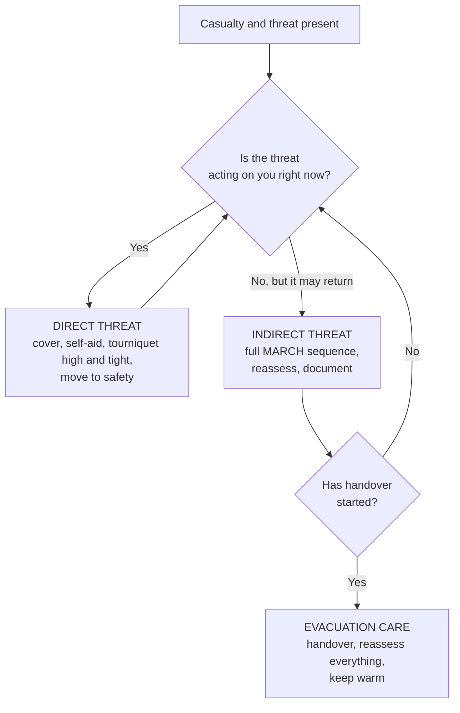

# 01.2 · The phases of care: direct threat, indirect threat, evacuation

By the end of this lesson you will be able to say which phase of care you are in at any moment of an attack, do only what that phase allows, and run the complete field-care sequence in the right order, from the first tourniquet to the handover. This is the backbone that every later lesson hangs on.

> [!CAUTION]
> Performing these procedures on people without the required state certification is illegal.
> This lesson is for educational purposes only. Practise only on models and animal tissue.

## Why it matters

Your EMT training starts with "scene safety": you don't go in until the scene is safe. In an attack the scene may never be safe, and waiting outside can mean the casualty bleeds to death. Tactical casualty care solves this by splitting care into **phases defined by the threat**, each with its own short list of allowed actions.

Two closely related systems teach this:

- **TCCC** (Tactical Combat Casualty Care), the military standard, current version 01 May 2026, with phases *Care Under Fire*, *Tactical Field Care* and *Tactical Evacuation Care*.
- **TECC** (Tactical Emergency Casualty Care), the civilian adaptation by C-TECC, current version 2025-1-2, with phases *Direct Threat Care* (hot zone), *Indirect Threat Care* (warm zone) and *Evacuation Care* (cold zone). TECC covers all ages and all hazards (active violence, fire, hazardous materials, structural collapse).

C-TECC states that the phases "correlate directly with the contemporaneous threat level and are not solely geographic." The same room can be indirect threat one minute and direct threat the next when a new alert sounds. This course uses the TECC names, with the TCCC names in brackets.

## What to do

### 1. Direct threat care (Care Under Fire)

You are under direct threat when the danger can hurt you and the casualty right now: shooting, an incoming rocket or drone alert, fire, a building about to collapse. The TCCC guidelines list a short plan, which in civilian terms is:

1. **Stop the threat from getting you.** Get to cover (protected space, behind a solid wall, away from windows). A wounded rescuer helps no one.
2. **Direct the casualty to help themselves** if they can: move to cover, apply their own tourniquet.
3. **Move the casualty to safety** if they can't. Fast and dirty: drag by clothing, a blanket or a strap. Spinal precautions are not a priority under direct threat; TCCC states that cervical spine stabilisation is not necessary for casualties with only penetrating trauma.
4. **Get them out of burning vehicles or buildings** and stop the burning.
5. **Stop life-threatening limb bleeding** only if it is safe enough. Apply a tourniquet **over clothing, clearly above the bleeding**; if you can't see where the bleeding is, place it **"high and tight"** (as close to the body as possible) on the injured limb, then move. C-TECC lists direct pressure and hasty tourniquet application as the only bleeding control skills for this phase.
6. **Defer airway management** to the next phase. TECC allows placing an unresponsive casualty with signs of life in the recovery position.

No triage, no full assessment, no dressings, no vital signs. C-TECC says formal triage is deferred in this phase and "minimal trauma interventions are warranted."

### 2. Indirect threat care (Tactical Field Care)

You are in indirect threat when you and the casualty are in relative safety (in the safe room, behind cover, in a cleared but not secured area) but the threat could come back. Now you do the full sequence. The TCCC 2026 guidelines list it in this order:

1. **Security and awareness.** Keep the door, the alert app or the radio in mind. Make any weapons safe if a casualty is armed and confused (leave this to someone who knows how).
2. **Triage** if there is more than one casualty. Outside a fixed casualty collection point, TECC limits triage here to three groups: walking or minimally injured; dead or dying; everyone else.
3. **M — Massive hemorrhage.** Look for bleeding you missed. Re-check every tourniquet: expose the wound; if a tourniquet is needed, place a new one on the skin 2-3 inches (5-7.5 cm) above the wound, then loosen the one over the clothes. If it isn't needed, remove it and record the time. Pack and press wounds that can't take a tourniquet. Check for shock (altered mental status without head injury, weak or absent radial pulse).
4. **A — Airway.** Let a conscious casualty sit up and lean forward if that helps. Put an unconscious casualty in the recovery position. Suction if available. (Advanced airway: module 3.)
5. **R — Respiration.** Look for tension pneumothorax signs, seal open chest wounds with a vented chest seal, and watch for tension developing after sealing. (Needle decompression: module 3.)
6. **C — Circulation.** Pelvic binder when indicated, re-check tourniquets, tourniquet conversion within 2 hours when the criteria allow, IV/IO access, TXA and blood when available and within scope. (Module 2 and 4.) A casualty not in shock may drink if conscious and able to swallow.
7. **H — Hypothermia prevention** (and head injury). Insulate from the ground, remove wet clothes, cover, add heat to the torso without direct skin contact.
8. **Eye injuries**: rigid shield, no pressure.
9. **Monitoring**: pulse oximeter if you have one; vital signs on a schedule.
10. **Pain relief and antibiotics** (module 4).
11. **Inspect and dress wounds**, then **check for wounds you missed** (back, armpits, groin, scalp).
12. **Burns**, then **splint fractures and re-check pulses**.
13. **CPR:** TCCC and TECC both state that CPR for victims of blast or penetrating trauma who have no pulse, no breathing and no other signs of life will not be successful and should not be attempted in this phase. Torso or polytrauma casualties in arrest should have bilateral needle decompression before care is stopped (module 3). In other causes (drowning, electrocution), TECC says CPR may be of benefit.
14. **Communicate**: reassure the casualty; tell whoever coordinates (MDA on 101, the local emergency squad, the army) what you have and what you need.
15. **Document** on a casualty card (lesson 01.7).
16. **Prepare for evacuation**: secure the card to the casualty, secure loose ends of bandages and the heat-loss wrap, brief walking casualties.

The first five letters form the **MARCH** mnemonic, which many trainers extend with **PAWS** (pain, antibiotics, wounds, splinting) for steps 10-12. TECC also accepts **X-ABCDE** (exsanguination, airway, breathing, circulation, disability, exposure). Lesson 01.3 explains why bleeding comes first in both.

### 3. Evacuation care (Tactical Evacuation Care)

Evacuation care starts when the casualty is handed to a vehicle, crew or facility, or when you move them yourself towards care. Two things change:

1. **Handover.** TCCC sets the minimum information as **stable or unstable, injuries identified, and treatments given**. Lesson 01.7 turns this into a full MIST handover.
2. **Re-assessment of everything.** The receiving crew should re-check every injury and every intervention. If you are the one transporting, you do it: every tourniquet, every dressing, the airway, breathing and warmth after every move.

TECC adds: there are **no threat-free areas** in a dynamic event. A new alert during evacuation puts you back in direct threat.

### Watch

A TCCC instructor (Odin Medical) demonstrating care under fire followed by tactical field care on a training lane:

https://www.youtube.com/watch?v=XqmtZ0g8D8s

A short explainer of the three phases of care from Outpost 95 Fieldcraft Academy:

https://www.youtube.com/watch?v=tGJfsZkPCv8

A full civilian TECC walkthrough (VLP Network) from the hot zone to handover; long, watch the first 15 minutes for the phase logic:

https://www.youtube.com/watch?v=pZ4WhPkhrhI

A US Army trainee's graded TCCC assessment lane, useful for seeing the order of steps under time pressure:

https://www.youtube.com/watch?v=0cSI1-AWhZ4

## Improvise it

### Moving a casualty out of direct threat without equipment

- **What works:** grabbing the shoulder straps or collar of a jacket or shirt and dragging backwards; rolling the casualty onto a blanket, duvet, rug or tarp and pulling it from the head end; a belt or long scarf looped under the armpits as a drag strap.
- **What fails:** thin bedsheets on rough ground tear; carrying in your arms tires you within metres and raises both of you above cover.
- **The risk:** dragging over glass or debris adds wounds; the head can bang on steps. Keep your body low and pull along the casualty's long axis.
- **How to tell it's failing:** the fabric is tearing, you are standing up straight to pull, or you stop every few metres. Switch method or get a second person.

### Tourniquet in direct threat when you have no commercial one

C-TECC lists "field expedient tourniquets" as an acceptable direct-threat skill. In direct threat, the faster option is usually **firm direct pressure by the casualty or a bystander while you move**, then a proper tourniquet in cover. If you must improvise:

- **What works:** a wide band (at least 4 cm: folded triangular bandage, tie, folded scarf), tied loosely around the limb high and tight, with a strong rod (wooden spoon, thick marker, metal spatula, screwdriver) tied into the knot as a windlass, twisted until bleeding stops, then the rod tied down.
- **What fails:** narrow cords, phone cables and thin belts cut tissue and don't compress evenly; any band without a windlass. In a manikin study, tee-shirt tourniquets without a windlass failed to stop bleeding in 79 of 80 tests; with a windlass they still failed in 32% (Altamirano et al., 2015).
- **The risk:** a partly tight band blocks venous return but not arterial inflow, and the limb bleeds faster.
- **How to tell it's failing:** bleeding continues or restarts, the limb below swells and darkens, the rod unwinds. Tighten, add a second band above, or replace with a commercial tourniquet as soon as you reach cover.

### Marking zones and casualties in a house

Use masking or duct tape and a marker: a strip of tape on the door of the room where you are treating (your casualty collection point), a strip on each casualty's chest with their triage group and tourniquet time. No commercial triage tags are needed.

## When it goes wrong

- **Full assessment under fire.** You kneel in the open checking breathing while the threat continues. Recovery: if the threat is active, only tourniquet and move. Everything else waits.
- **Forgetting to re-check the "hasty" tourniquet.** A tourniquet slapped over jeans often isn't tight enough or isn't needed. Recovery: in indirect threat, every tourniquet gets exposed and re-checked (step 3).
- **Assuming the room is safe forever.** A new alert or an attacker returning puts you back in direct threat. Recovery: keep your casualty packaged (dressings secured, card attached) so you can move again quickly.
- **Doing CPR on a blast or gunshot victim in arrest** while other casualties wait. Recovery: in this phase, don't start CPR for blast or penetrating trauma without signs of life; treat the living.
- **Skipping documentation because "I'll remember".** Recovery: write the tourniquet time on the tourniquet and the casualty as soon as you are in cover.

## Scope and law

Under the Duty to Rescue Law, 1998, you are not required to put yourself or others at risk to help; the duty exists only when you can help without that risk, and calling MDA, the police or the fire service counts as helping. Moving casualties, tourniquets, wound packing and the recovery position are within EMT-level care. Needle decompression, surgical airway, IV/IO drugs, TXA and prescription drugs, mentioned here only as steps in the sequence, are paramedic or physician powers; this course teaches them so you can prepare and assist, and act yourself only as a last resort when it is this or death and no one more qualified can be reached.

## Practice

### Drill: phase sorting and a hot-to-cold walkthrough

**You need:** a partner, a training tourniquet (keep your real one for real use), a blanket or duvet, masking tape, a marker, a phone timer, 45 minutes.

**Part A — phase sorting (10 minutes).** Write the phase (direct threat, indirect threat or evacuation care) for each moment, and one allowed action:

1. A drone alert sounds while you are kneeling over a casualty in the street.
2. You are inside the safe room with the door shut; the alert has ended but another may come any minute.
3. MDA crew arrives at your front door and starts taking your casualty out.
4. During the ride to hospital, a new rocket alert sounds and the ambulance stops by a wall.

**Part B — walkthrough (25 minutes, repeat twice, swap roles).**

1. Your partner lies 5 metres from a doorway with a "bleeding" right thigh (tape on the trousers). Start the timer.
2. **Direct threat:** shout instructions for self-aid, then place the training tourniquet over the trousers high and tight. Tighten only until it is snug: never fully tighten a tourniquet on a healthy partner.
3. Drag your partner on the blanket through the doorway.
4. **Indirect threat:** say each MARCH step out loud as you do it; expose the "wound", place a second tourniquet 5-7.5 cm above it on the skin (snug only), loosen the first, write the time on tape on the tourniquet and on your partner's forehead.
5. **Evacuation care:** give a 15-second handover: "stable or unstable, injuries, treatments."

**Part C — review (10 minutes).** Swap and compare times. What did you skip?

**How you know it worked:** Part A answers are 1 = direct, 2 = indirect, 3 = evacuation, 4 = direct; in Part B you did nothing but tourniquet and drag before the doorway, said all five MARCH letters in order, wrote the time in two places, and gave a handover with all three items in under 20 seconds.

## Sources

- Committee on TCCC. *Tactical Combat Casualty Care Guidelines*, 01 May 2026 (Care Under Fire/Threat; Tactical Field Care sections 1-20; Tactical Evacuation Care).
- Committee for Tactical Emergency Casualty Care. *TECC Guidelines for BLS/ALS Clinicians*, Final 2025-1-2 (preamble; Direct Threat, Indirect Threat and Evacuation Care sections).
- Altamirano MP et al. Role of the windlass in improvised tourniquet use on a manikin hemorrhage model. *J Spec Oper Med* 2015;15(2):42-46.
- חוק לא תעמוד על דם רעך, התשנ״ח-1998, s. 1.
