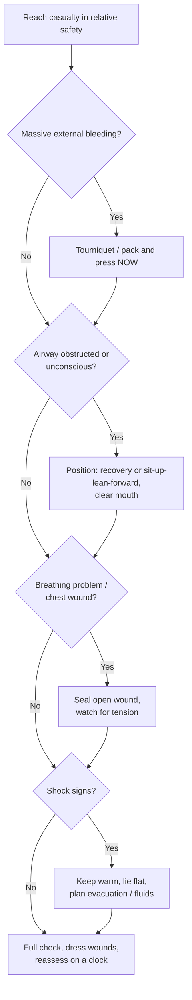

# 01.3 · Circulation first: why bleeding comes before airway

By the end of this lesson you will be able to explain why trauma care moved from "airway first" to "bleeding first", what the IDF Medical Corps changed during the war and what the data showed, and you will be able to run a fast circulation-first sweep on a casualty, knowing the few cases where the airway still comes first.

> [!CAUTION]
> Performing these procedures on people without the required state certification is illegal.
> This lesson is for educational purposes only. Practise only on models and animal tissue.

## Why it matters

The classic "ABC" (airway, breathing, circulation) came from a world where the commonest emergency was a collapsed person who had stopped breathing. Trauma is different. People with penetrating and blast injuries mostly die from **blood loss**, and they die fast.

- In a review of 4,596 US battlefield deaths (2001-2011), 90.9% of the deaths judged potentially survivable before reaching a hospital were caused by bleeding. The lethal bleeding was truncal in 67.3%, junctional (groin, armpit, neck) in 19.2% and in the limbs in 13.5% (Eastridge et al., 2012). Limb bleeding is the share you can stop with your hands and a tourniquet; truncal bleeding needs a surgeon, which is why speed of evacuation matters so much.
- In a US multicentre study of 440 trauma patients in shock who needed intubation, 245 got blood first and 195 were intubated first. Mortality was 47% and 50%, not significantly different; the authors concluded that starting circulation first was not associated with more deaths and called for prospective studies (Ferrada et al., 2018).

Both civilian and military systems now put **catastrophic bleeding first**: MARCH starts with "massive hemorrhage", and X-ABCDE (used by TECC as an alternative) starts with "exsanguination". You will also see it written as <C>ABC.

### What the IDF changed in 2024

On **30 April 2024** the IDF Medical Corps issued new clinical practice guidelines that **limit the indications for definitive airway management and chest decompression**, putting the priority on blood product resuscitation. A registry study of 3,984 IDF casualties of the Gaza ground operation (27 October 2023 to 30 November 2024) compared four periods (Bendor, 2025):

| Period | Intubation or cricothyroidotomy | Needle or chest-tube decompression |
|---|---|---|
| 1: 27 Oct 2023 - 31 Jan 2024 | 3.8% | 2.8% |
| 2: 1 Feb - 30 Apr 2024 | 2.8% | 3.1% |
| 3: 1 May - 31 Aug 2024 | 1.2% | 0.9% |
| 4: 1 Sep - 30 Nov 2024 | 0.8% | 0.0% |

Injury characteristics and mortality stayed stable across the periods, and blood product use stayed at 7.8%. In other words, medics did far fewer airway and chest procedures and casualties did no worse. The study is a conference abstract and not a randomised trial, so it shows that the change was safe to implement in wartime, not that each individual procedure is useless.

**What this means for you:** your first minute goes to finding and stopping bleeding. Airway positioning comes right after. Invasive airway and chest procedures are rarer than you think, and their indications are narrow (module 3).

## What to do

### The 60-second circulation-first sweep

Do this on every trauma casualty as soon as you reach indirect threat (lesson 01.2). Gloves on if you have them, but don't delay for them.

1. **Look and ask** (5 seconds): "Where are you hurt?" Watch for pooling blood, soaked clothing, spurting.
2. **Blood sweep** (15-20 seconds): run your flat hands, firmly, in a fixed order: head and neck, armpits, arms, chest, back (slide under), abdomen, pelvis and groin, thighs, legs. Check your gloves after each area for blood.
3. **Stop massive bleeding** as you find it: tourniquet for limbs, packing and pressure for junctional and other compressible wounds. If you are alone with several bleeding sites, treat the worst first and keep sweeping.
4. **Airway** (10 seconds): talking clearly = airway open. Unconscious = recovery position with head tilted back and chin away from the chest. Conscious with facial injuries = let them sit up and lean forward.
5. **Respiration** (10 seconds): rate, effort, both sides moving. Any hole in the chest gets a hand over it and then a vented chest seal.
6. **Circulation / shock** (10 seconds): radial pulse present and strong? Mental status? TCCC defines hemorrhagic shock in the field as **altered mental status without brain injury and/or a weak or absent radial pulse**. Pale, cold, sweaty skin supports it.
7. **Say the result** out loud and write it down: "Left thigh bleed, tourniquet 10:42. Airway open. Breathing 24. Radial weak. Shocked."

### When the airway really does come first

Circulation first is a rule for **trauma with bleeding**. Put the airway first when:

- the casualty is **choking** or has an obvious airway obstruction (blood, vomit, teeth, a crushed face) and **no** massive external bleeding;
- the problem is **not** trauma: drowning, smoke inhalation, a collapse without injury, an overdose, a child who stopped breathing;
- there are two rescuers: one stops the bleeding while the other opens the airway at the same moment. Circulation first is about **priority when you can only do one thing**, not about ignoring the airway.

### What has not changed

- Once massive bleeding is controlled, an obstructed airway kills in minutes. Position it immediately.
- Simple measures (positioning, clearing the mouth, a nasopharyngeal airway if trained) are still done early. What dropped are the **invasive** procedures, which now have narrow indications.

### Watch

A combat-medic instructor (UF PRO) walking through the MARCH sequence and why massive bleeding comes first:

https://www.youtube.com/watch?v=cUNSDvBIMA8

A civilian tactical medic (PrepMedic) running a MARCH-E assessment on a casualty:

https://www.youtube.com/watch?v=IhIbkVc707g

Two short blood-sweep demonstrations, from a TCCC training company (MEERCAT Solutions) and a TCCC instructor (Munro Medical Solutions):

https://www.youtube.com/watch?v=2xiwZ-XwOAs

https://www.youtube.com/watch?v=F1oTJZlIIc0

## Improvise it

Circulation first depends on having something to press with. If your kit is empty or elsewhere:

### Improvised packing material

- **What works:** clean cotton cloth torn into long strips (a T-shirt, a pillowcase, a tea towel), rolled gauze from a household first aid kit, clean socks unrolled into a strip. Push it into the wound with one or two fingers, filling from the bottom up, then press hard on top for at least 3 minutes (the same pressure time TCCC uses for hemostatic dressings).
- **What fails:** tampons and cotton balls are too small and soak up blood without filling the cavity; paper towels and tissues fall apart; synthetic fabrics don't absorb.
- **The risk:** dirty material adds infection, but bleeding to death is the bigger risk. Use the cleanest thing you have and note it on the card so it is replaced later.
- **How to tell it's failing:** blood seeps through the top or around the edges within minutes. Don't remove it: add more and press harder, or place a tourniquet if it's a limb.

### Improvised pressure dressing

- **What works:** a thick pad (folded towel, sanitary pad, nappy) over the packed wound, wrapped tightly with an elastic bandage, cling film (several layers), a torn sheet or a stretched T-shirt, with a hard object (a small closed jar lid, a folded wallet) over the wound under the wrap for focused pressure.
- **What fails:** loose wraps; tape alone; a wrap that is so tight the limb below goes cold and blue.
- **The risk:** a too-tight wrap acts as a bad tourniquet (it blocks the veins but not the arteries).
- **How to tell it's failing:** blood soaking through, or fingers or toes below becoming cold, numb or dark. Loosen and re-wrap.

### Improvised positioning

Pillows, a rolled duvet or a backpack hold a casualty in the recovery position; a chair back or a wall lets a conscious casualty with facial injuries sit up and lean forward.

### Watch

An improvised pressure dressing from household-type materials (Wildmedkits), and the CoTCCC's own standard pressure dressing demonstration for comparison:

https://www.youtube.com/watch?v=yXR5tJdq1Nk

https://www.youtube.com/watch?v=LdXZ2gwIqbA

## When it goes wrong

- **Airway first by habit.** You spend 30 seconds tilting the head while a femoral wound pours out. Recovery: train the sweep until bleeding is always your first move on a trauma casualty.
- **Missing bleeding on the back or in the armpit.** Blood pools under the casualty and soaks into clothes or carpets. Recovery: always slide your hands underneath; check your gloves after each area.
- **Stopping the sweep after the first wound.** Blast casualties usually have several. Recovery: finish the full sweep before you start detailed work on any one wound.
- **Using "circulation first" as a reason to ignore a blocked airway.** Recovery: as soon as bleeding is controlled, or immediately if you have a second rescuer, position and clear the airway.
- **Over-reading the IDF data.** The fall in procedures does not mean a real tension pneumothorax or blocked airway can be left alone. Module 3 teaches the narrow indications.

## Scope and law

Bleeding control, airway positioning and the primary assessment are within your EMT scope and are protected aid under Israeli law. Intubation, cricothyroidotomy and chest decompression, discussed here as data, are paramedic or physician powers; you will learn them in module 3 to assist and, only as a last resort when it is this or death and no one more qualified can be reached, to act yourself.

## Practice

### Drill 1: priority sort (10 minutes, paper)

For each casualty, write what you do first and second:

1. A man shouting for help with blood spurting from his upper arm.
2. A woman lying silent, snoring, with a small cut on her hand.
3. A teenager pulled from a swimming pool, not breathing, no injuries.
4. A soldier with a gurgling airway from a jaw wound and a steadily bleeding thigh. You are alone.
5. Same soldier, but there are two of you.

### Drill 2: the 60-second sweep (25 minutes, with a partner)

**You need:** a partner in old clothes, 5-6 pieces of red tape or red cloth, a timer, a notebook.

1. Your partner hides 2-4 pieces of "blood" (red tape) on themselves: armpit, lower back, groin, behind a knee, scalp.
2. Start the timer. Do the full sweep in the order above, saying each step out loud.
3. Stop the timer when you have said your result sentence.
4. Repeat 5 times with new hiding places; swap roles.

**How you know it worked:** in Drill 1, cases 1 and 4 start with bleeding, 2 and 3 start with airway, and case 5 has bleeding and airway done at the same time. In Drill 2 you found every piece of tape, including the back, in under 60 seconds on at least 3 of 5 runs, and your result sentence named bleeding, airway, breathing and shock status.

## Sources

- Bendor CD. Shifting priorities in combat casualty care: evaluating the implementation of circulation-first resuscitation in wartime. *Journal of Israeli Military Medicine* 2025;22(66-67), abstracts, WG 5.
- Eastridge BJ et al. Death on the battlefield (2001-2011). *J Trauma Acute Care Surg* 2012;73(6 Suppl 5):S431-7.
- Ferrada P et al. Circulation first - the time has come to question the sequencing of care in the ABCs of trauma; an AAST multicenter trial. *World J Emerg Surg* 2018;13:8.
- Committee on TCCC. *TCCC Guidelines*, 01 May 2026 (Tactical Field Care sections 3-6).
- Committee for Tactical Emergency Casualty Care. *TECC Guidelines for BLS/ALS Clinicians*, Final 2025-1-2 (MARCH and X-ABCDE footnote).
