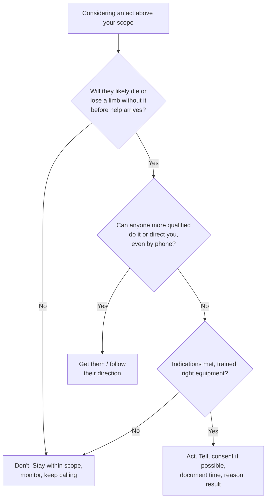

# 01.5 · The law and your scope in Israel

By the end of this lesson you will know exactly what Israeli law requires of you when someone is in danger, what it does and does not protect, and how to decide, and record, whether an action beyond your EMT training is a justified last resort. This is our reading of the law texts, not legal advice; no court ruling on these sections for lay or EMT rescuers has been checked for this course.

> [!CAUTION]
> Performing these procedures on people without the required state certification is illegal.
> This lesson is for educational purposes only. Practise only on models and animal tissue.

## Why it matters

This course teaches skills above your certificate: needle decompression, surgical airway, IO access, prescription drugs. You need to know where the legal lines are before you ever stand at one, because under stress you will not be able to think it through. You also need to know that the most common belief about this law in Israel, that "the Duty to Rescue Law protects anyone who helps", is not what the text says.

## What to do

### 1. Know what the Duty to Rescue Law actually says

The Duty to Rescue Law, 1998 (חוק לא תעמוד על דם רעך, התשנ״ח-1998) has six short sections. The ones that matter:

- **s. 1(a) — the duty.** A person must give help to a person **in front of their eyes** who, because of a **sudden event**, is in **serious and immediate danger** to life, bodily integrity or health, when they are **able to give the help without putting themselves or others at risk**.
- **s. 1(b) — calling counts.** Informing the authorities (the Israel Police, Magen David Adom, the fire service) or summoning another person who can give the help is treated as giving help.
- **s. 2 — expenses.** The law applies the Unjust Enrichment Law to rescuers, and a court may order whoever caused the danger (including the rescued person, if they caused it) to repay the rescuer's reasonable expenses.
- **s. 4 — penalty.** Breaking s. 1 is punishable by a fine.

What the law **does not** contain is a clause that protects rescuers from being sued or prosecuted for the way they helped. The protection you have comes from other laws, below.

### 2. Know which other rules apply

| Rule | What it says (our summary) | What it means for you |
|---|---|---|
| **Physicians Ordinance, s. 3(a)** | Only a licensed physician may practise medicine. "Practising medicine" (s. 1) includes examining, diagnosing, treating and prescribing. | Diagnosing and treating as a service is a doctor's job. |
| **Physicians Ordinance, s. 3(b)(3)** | The ban does not prevent any person from giving advice or treatment **occasionally and without payment or reward**, or working under the **direct personal supervision** of a licensed physician. | Helping a casualty you happen upon, for free, is outside the ban. Charging money, or doing it as a regular service, is not. |
| **Penal Law, s. 34יא (necessity)** | No criminal responsibility for an act that was **immediately necessary** to save the life, liberty, body or property of oneself or another from a **real danger of serious harm**, when there was **no other way**. | This is the main criminal-law defence for a last-resort procedure. |
| **Penal Law, s. 34טז** | Necessity does not apply when the act was **not reasonable** in the circumstances to prevent the harm. | An unreasonable act (wrong procedure, no indication, untrained) isn't protected. |
| **Penal Law, ss. 304 and 341** | Causing death by negligence (up to 3 years) and causing injury by negligence (up to 1 year). | Careless treatment that kills or injures can be a crime. |
| **Civil Wrongs Ordinance, s. 35** | Negligence is doing what a reasonable, prudent person would not do, or, in an occupation, not using the skill a reasonable, qualified person in that occupation would use. | A trained EMT may be judged against what a reasonable EMT would do, not a passer-by. |

### 3. Know your scope

- **Within EMT scope**: what your Israeli EMT course and protocols taught you: bleeding control including tourniquets and packing, chest seals, airway positioning and basic adjuncts you were trained on, BVM, primary assessment, triage, CPR/AED, splinting, and the medications your protocol allows. When you volunteer or work for MDA or another service, you act within that organisation's protocols and medical direction.
- **Paramedic or physician powers**: needle decompression, surgical cricothyroidotomy, IV/IO access and drugs, TXA, ketamine and other prescription drugs, tourniquet conversion after 2 hours. TCCC itself notes that responders at the two lowest skill tiers should not attempt tourniquet conversion beyond 2 hours unless directed by more advanced medical personnel.
- **Prescription drugs**: a prescription-only drug needs a doctor's prescription. Some drugs used in the field (for example opioids) are also controlled drugs, and holding them without a prescription can be a criminal offence. Module 4 explains how to build a legal home supply with your own doctor.

### 4. Use the four-part last-resort test

Before any act above your scope, all four must be true:

1. **Immediate threat**: without this act, the casualty will very likely die or lose a limb before help arrives.
2. **No one better**: no more qualified person can do it or direct you, in person or by phone (MDA on 101, a doctor you know, a paramedic neighbour). If someone can direct you remotely, follow their direction.
3. **Reasonable and trained**: the act is the standard one for this problem, the indications are met, you have trained on it (on models and animal tissue), and you have the right equipment.
4. **Consent and record**: you ask for consent if the casualty can give it (an unconscious person can't, and emergency treatment proceeds); you tell the casualty or witnesses what you're doing and why; you write it down.

If any of the four is false, don't do it. Do what is within your scope, keep the casualty alive, and keep trying to reach help.

### 5. Document a beyond-scope decision

Write, on the casualty card or a sheet of paper, as soon as you can:

- time, the casualty's condition (vital signs) and why the act was needed;
- who you tried to reach and when ("called 101 at 14:02, no answer; tried Dr. Cohen 14:04, no signal");
- what you did, with what equipment, and the result;
- witnesses' names.

### Watch

A US paramedic educator (The Paramedic Coach) on the medico-legal concepts every EMT meets: scope, consent, negligence. The law in the video is American; use it for the concepts, not the rules:

https://www.youtube.com/watch?v=U6ng0NAKrn0

A short explainer (Medic Mentor) on what "scope of practice" means and why it differs between levels; again US law, same caveat:

https://www.youtube.com/watch?v=cJasfZ2SsrU

## Improvise it

You won't have a lawyer or a medical director in the safe room. What you will have is a phone and other people.

- **Remote direction with household tools.** A phone call, text, voice message or video call to MDA (101), your own doctor or a paramedic you know. **Works:** when any network is up, even intermittently; voice messages often go through when calls fail. **Fails:** no signal, flat battery. **Risk:** following advice from someone who can't see the casualty; describe clearly using MIST (lesson 01.7). **How to tell it's failing:** you get no reply within minutes, so carry on within scope and try again.
- **Evidence without paperwork.** A phone voice memo started at the beginning ("14:02, man, about 40, chest wound…") gives you an automatic time stamp; photos of the tourniquet with the time written on it; a witness's name and number. **Fails:** if it distracts you from care; give the phone to a bystander to record.
- **Consent without forms.** Say what you will do in one sentence, ask "OK?", and note the answer and a witness. For an unconscious casualty, note "unconscious, unable to consent".
- **A "scope card".** On the back of your casualty card or in your kit lid, write the four-part test and the numbers to call. Under stress you will read, not remember.

## When it goes wrong

- **Believing the Duty to Rescue Law is a shield.** It creates a duty; it doesn't protect how you help. Recovery: rely on staying within scope, the necessity test and good documentation.
- **Doing a procedure because you learned it, not because it's indicated.** This fails the "reasonable" test in s. 34טז and the negligence standard. Recovery: check the indications every time (modules 2-5 give them).
- **Not calling for help first.** If a doctor or paramedic could have been reached by phone, "no one better" is false. Recovery: call or have someone call 101 at the start, and keep trying.
- **Charging money or running a regular "clinic".** Physicians Ordinance s. 3(b)(3) covers occasional, unpaid help. Recovery: never accept payment; in a long community crisis, organise under a physician's supervision where possible.
- **No record.** Months later you won't remember why you acted. Recovery: write it down, even on your arm, and transfer it to paper.

## Scope and law

This lesson is the scope-and-law lesson for the whole course, so in short: the Duty to Rescue Law, 1998 obliges you to help when you can without endangering yourself or others, and calling MDA counts. Your EMT certificate covers EMT-level care; needle decompression, cric, IO/IV drugs and prescription drugs are paramedic or physician powers. Acting beyond them is a last resort, when it is this or death and no one more qualified can be reached, and even then the act must be reasonable, trained and recorded. This is our reading of the texts, not legal advice.

## Practice

### Drill: last-resort decisions (30 minutes, paper)

**You need:** paper, this lesson open, 30 minutes.

For each case, apply the four-part test. Write for each part "yes" or "no" with one line of reasoning, then your decision: within scope, justified last resort, or not justified.

1. A man has a large bleeding wound on his calf. You place a tourniquet. MDA is 20 minutes away.
2. In a safe room, 30 minutes into a barrage, a woman with a fragment wound to the chest has a sealed wound, increasing breathlessness, absent breath sounds on one side and a falling level of consciousness. Phones are down. You have a 14G 3.25-inch decompression needle and have practised on lamb ribs.
3. Same as case 2, but a paramedic is on the phone and can talk you through it.
4. Same as case 2, but you have only a household sewing needle and have never practised.
5. A neighbour asks you to give his elderly mother an injection of antibiotics he got from a friend, because her doctor's clinic is closed for the holiday. She has a cough and mild fever.
6. Two days into a cut-off after an earthquake, a man's tourniquet has been on for 3 hours; he is not in shock and you can watch the wound. No one has answered your calls since yesterday.

**How you know it worked:** case 1 is within scope; case 2 meets all four parts (justified last resort, with documentation); case 3 means you act under remote direction and record who directed you; case 4 fails "reasonable and trained" (not justified; stay within scope, keep trying to call); case 5 fails "immediate threat" and "no one better" (not justified; find a doctor or pharmacist); case 6 needs your reasoning about the immediate threat to the limb and is covered in module 2. For every case you wrote all four parts, not just the decision.

## Sources

- חוק לא תעמוד על דם רעך, התשנ״ח-1998, ss. 1-4 (text checked on Hebrew Wikisource, 2026-11-14).
- פקודת הרופאים [נוסח חדש], תשל״ז-1976, ss. 1 ("עיסוק ברפואה"), 3(a), 3(b)(3).
- חוק העונשין, התשל״ז-1977, ss. 34יא, 34טו, 34טז, 304, 341.
- פקודת הנזיקין [נוסח חדש], ss. 35-36.
- Committee on TCCC. *TCCC Guidelines*, 01 May 2026 (note on tourniquet conversion by ASM/CLS-trained personnel).
