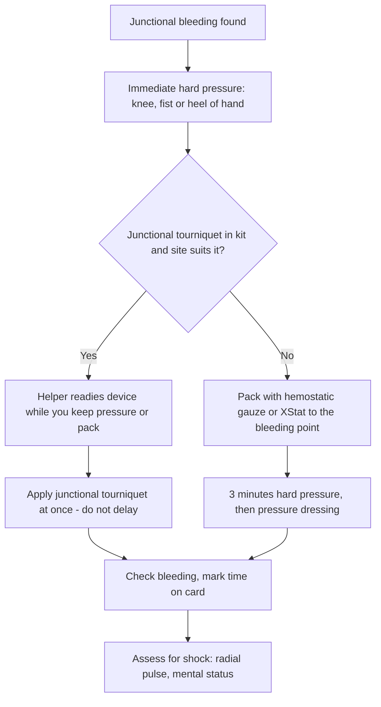

# 02.2 · Head, neck and junctional bleeding

By the end of this lesson you will be able to stop bleeding where a limb tourniquet cannot go: the groin, the armpit, the neck and the scalp. You will know the order of actions, how the three junctional tourniquets on the TCCC list are applied, how to use an iTClamp safely, and how to keep pressure on a groin wound for an hour with only household items.

> [!CAUTION]
> Performing these procedures on people without the required state certification is illegal.
> This lesson is for educational purposes only. Practise only on models and animal tissue.

## Why it matters

"Junctional" means the places where a limb joins the trunk: the groin, the buttock and perineum, and the armpit, plus the base of the neck. The big arteries there (femoral, axillary, subclavian, carotid) are wide, close to the surface and impossible to tourniquet. Blast and drone fragments hit exactly these areas, below body armour and above the reach of a limb tourniquet. In the wars of the last two decades junctional bleeding has been one of the leading causes of potentially survivable death.

The good news is that these vessels run over bone you can press against: the femoral artery over the pelvis, the subclavian artery over the first rib. Hard, continuous pressure in the right spot stops the flow; packing and devices let you keep that pressure without using your whole body for an hour.

## What to do

### The order of actions (all junctional wounds)

TCCC 2026: if the site suits a junctional tourniquet, apply it **immediately once it is ready**; pack and press while it is being readied or if you have none.

### Finding the pressure points

| Area | Vessel | Where to press | How |
|---|---|---|---|
| Groin | Femoral artery | In the crease of the groin, halfway between the bony point at the front of the hip and the pubic bone, just below the crease line | Knee or straight-arm heel of hand, body weight straight down onto the pelvic bone |
| Armpit / upper arm root | Subclavian artery | Above the middle of the collarbone, pressing down and back toward the first rib | Thumb or fingers pushed down hard behind the collarbone |
| Neck | Carotid and jugular | Directly on the wound | Fingers or packed gauze on the wound only; never press both sides of the neck |

### Packing junctional wounds

1. Groin and buttock: pack deep, toward the bone, with hemostatic gauze (02.1); XStat if the tract is narrow. Press with a knee or straight arms for 3 minutes, then a pressure dressing with a figure-of-eight around the hip.
2. Armpit: pack the wound, then hold the arm tight against the chest so the arm itself presses the pack. Bandage the arm to the chest over the pack.
3. Large tissue loss in the groin with a high amputation: pack the stump wound and apply a limb tourniquet as high as possible, plus a junctional tourniquet if available, plus a pelvic binder (02.6).

### Junctional tourniquets

All three below were on the CoTCCC recommended devices list. In a 2016 test by 14 IDF medics on a groin hemorrhage simulator, all were used safely; the SAM-JT and JETT were the fastest to work, and the CRoC was among the most effective.

**SAM Junctional Tourniquet (SAM-JT)** - a belt with one or two inflatable pads (target compression devices).

1. Slide the belt under the casualty at the level of the hips (over the bony prominences at the side of the hips) and buckle it.
2. Position the pad over the pressure point above the wound (groin), or both pads for both groins.
3. Pull the belt tight until the buckle clicks; then inflate the pad with the hand pump until bleeding stops.
4. The belt itself also works as a pelvic binder; FDA clearance covers groin, armpit (with an extra strap) and pelvic fracture immobilisation.

**Combat Ready Clamp (CRoC)** - a metal frame with a screw-driven pressure disc.

1. Assemble the frame; slide the base plate under the buttock (groin) or behind the shoulder (armpit).
2. Position the disc over the pressure point, then screw it down until bleeding stops.

**Junctional Emergency Treatment Tool (JETT)** - a belt with two screw-driven pressure pads, one per groin.

1. Belt around the hips; position pads over one or both groins.
2. Tighten the belt, then screw down the pad on the bleeding side until bleeding stops.

After any junctional tourniquet: record the time on the device and the card, check for bleeding every few minutes, and watch the device during moves; they shift.

### Head and scalp

1. Scalp wounds bleed heavily but sit on bone: press firmly with gauze against the skull, then wrap a pressure bandage around the head (forehead and back of head, or under the chin).
2. If the edges can be pulled together, the **iTClamp** is a primary option for head and neck bleeding: pack first if the wound is deep, then close the clamp so the needles grip both skin edges. No extra pressure is needed.
3. **Never apply the iTClamp within 1 cm of the eye socket.**
4. **Open skull fracture or penetrating head wound:** surface dressing only. Hemostatic gauze on the surface with gentle pressure if it bleeds. **Do not pack anything into the wound and do not close it.**

### Neck

1. Press directly on the wound with fingers, then pack with hemostatic gauze. A wound with an open vein near the base of the neck can suck in air; cover it with an occlusive dressing (a chest seal works).
2. Hold the pack with a pressure bandage that goes around the neck and **under the opposite armpit**, never twice around the neck alone. Raise the casualty's opposite arm while you wrap, then lower it; this keeps pressure on the wound without choking.
3. iTClamp on the neck: TCCC 2026 requires frequent airway checks and watching for an **expanding swelling (hematoma)** that can compress the airway. Hoarseness, a changing voice, stridor or a growing lump means the airway is at risk: sit them up if possible and get the most advanced help you can (airway is Module 3).
4. A penetrating-only neck wound does not need a cervical collar (TCCC 2026); a collar hides the wound and the swelling.

### Watch

The Committee on TCCC demonstrates each junctional tourniquet on the TCCC list:

https://www.youtube.com/watch?v=1iP0IbO9Gog

https://www.youtube.com/watch?v=BMvHzEd-pbk

https://www.youtube.com/watch?v=tMVl8g8DwNI

PrepMedic walks through the SAM-JT in detail, including the pelvic belt function:

https://www.youtube.com/watch?v=tcQGB9vcerM

Six Echo shows the basics of packing junctional wounds; Pressure On Wounds focuses on the armpit:

https://www.youtube.com/watch?v=yUH7jpdHZRU

https://www.youtube.com/watch?v=a1Bq_RTDnQM

Innovative Trauma Care (the maker) and PrepMedic show the iTClamp:

https://www.youtube.com/watch?v=83Mi2Rf-qRY

https://www.youtube.com/watch?v=ipUi-YAo6ZE

Six Echo and an EMS educator (Robby May) show neck bleeding control with the bandage under the opposite arm:

https://www.youtube.com/watch?v=QoOKS1_2jpQ

https://www.youtube.com/watch?v=UzfCOZrYAV8

## Improvise it

**Groin: a pressure device you can leave on.** Holding a knee in a groin for an hour is impossible while you treat others. Build a pressure delivery device:

1. Pack the wound (02.1), even with cotton strips.
2. Make a hard, fist-sized bolus: a tightly rolled small towel, a rolled Israeli bandage still in its wrapper, a 250 ml plastic bottle full of water wrapped in cloth, or a smooth stone wrapped in cloth.
3. Put the bolus on top of the pack, over the pressure point.
4. Strap it down hard with a belt, a cargo ratchet strap, a long torn sheet or the casualty's trouser belt, around the hips **and** in a figure-of-eight around the thigh so it cannot slide. Kneel on it while a helper tightens.
5. Check: bleeding stopped, bolus has not moved, strap still tight.

The Crisis Medicine improvised groin method (published in JSOM) and a TCCC pressure-delivery-device lesson for Combat Lifesavers:

https://www.youtube.com/watch?v=JPEsjtLV7cU

https://www.youtube.com/watch?v=n8_PswVDJ74

**What fails:** a soft bolus (a folded T-shirt collapses), a strap around the hips only (bolus slides off the pressure point when the casualty is moved), a narrow cord (cuts in and hurts without compressing the artery), a weight placed on the groin without strapping (falls off).

**Armpit:** pack, then bind the arm tight to the chest with a sheet or belt; a rolled towel in the armpit under the binding adds pressure.

**Scalp:** a rolled bandage or folded cloth pressed on the wound, then a tight wrap of a torn sheet around the head. Twisting hair strands from each side together to close a scalp wound (hair apposition) is taught in Module 9.

**Neck:** pack with clean cotton, cover with plastic (a clean cling-film square or a plastic bag cut open) taped on three sides to stop air being sucked in, then wrap around the neck and under the opposite armpit.

**The risks:** improvised pressure is uneven and slips; check it every 5 minutes and every time you move the casualty. Long, strong groin pressure also cuts blood flow to the leg like a tourniquet: write the time on the card.

## When it goes wrong

- **Pressing in the wrong place.** Groin pressure goes on the pelvic bone, not the soft belly above the crease. If the bleeding does not slow within seconds, move a few centimetres and press again.
- **Arms tired, pressure lost.** Use your knee and body weight, or swap with a helper hand over hand without lifting.
- **Junctional tourniquet shifts during a move.** Recheck bleeding after every move; re-inflate or retighten.
- **Neck bandage choking the casualty.** Any wrap that goes only around the neck is wrong. Redo it under the opposite arm.
- **Expanding neck swelling missed.** Recheck the neck and the voice every few minutes after an iTClamp or pack.
- **Packing a head wound with an open skull.** Never pack into brain; surface dressing and gentle pressure only.
- **iTClamp near the eye.** Keep it at least 1 cm from the bony edge of the eye socket; use pressure and packing there instead.

## Scope and law

Direct pressure and wound packing are EMT skills; the legal basis for lay aid (and why the Duty to Rescue Law gives no immunity) is in [lesson 01.5](../module-01/lesson-05.md). Junctional tourniquets, XStat and the iTClamp are medical devices outside the Israeli EMT curriculum: use them only when it is that or death and no one more qualified can be reached, and otherwise ready them and assist a paramedic or physician. Improvised manual pressure and pressure devices carry no special legal status; they are first aid.

## Practice

**Drill: junctional pressure on a partner (no wound, no device tightened on the body).**

What you need: a partner lying on a mat, a small towel, a 250 ml water bottle, a belt or ratchet strap, a roll of gauze, a marker, a timer.

Steps (40 minutes):

1. Find the femoral pulse on your partner in the groin. Mark the spot with a marker. Time yourself: under 10 seconds.
2. Find the spot above the middle of the collarbone where pressing down and back would compress the subclavian artery. Do **not** press hard on a real person; touch only.
3. Kneel next to your partner and place your knee over the groin mark with your weight held off; practise moving from kneeling to "knee in" in one movement.
4. Build the improvised groin device: rolled towel or bottle on the mark, strap around hips and in a figure-of-eight around the thigh. Tighten only to snug on a healthy partner. Have your partner roll onto their side and back: did the bolus stay on the mark?
5. Practise the neck wrap: gauze pad on the side of the neck, bandage around the neck and under the opposite raised arm, then lower the arm. Your partner should be able to swallow and speak normally.
6. Watch the junctional tourniquet videos above and, if you own a device, practise assembly on a backpack or a rolled sleeping mat, not on your partner.

How you know it worked: you find each point in under 10 seconds, the groin device stays on the mark through two rolls, and the neck wrap holds the pad firmly while your partner breathes, swallows and talks without discomfort.

## Sources

- Committee on Tactical Combat Casualty Care. *TCCC Guidelines*, 01 May 2026: Massive Hemorrhage 3b-3c (junctional tourniquets, iTClamp), Tactical Field Care 2h (cervical spine), 9e (penetrating TBI).
- Chen J, Benov A, Nadler R, et al. Testing of junctional tourniquets by medics of the Israeli Defense Force in control of simulated groin hemorrhage. *J Spec Oper Med* 2016;16(1):36-42.
- US FDA. 510(k) K131561, SAM Junctional Tourniquet; K152624, XSTAT 30.
- Manufacturers' instructions for use: SAM Junctional Tourniquet (SAM Medical), CRoC (Safeguard Medical), JETT (North American Rescue), iTClamp (Innovative Trauma Care).
