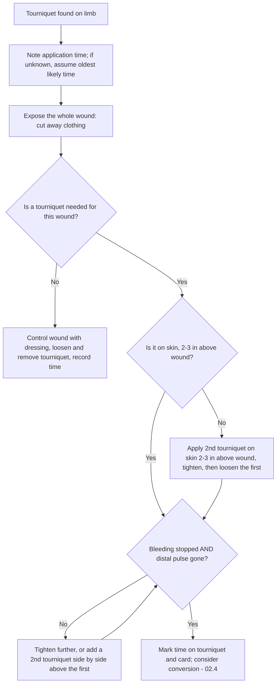

# 02.3 · Tourniquet reassessment

By the end of this lesson you will be able to take over a casualty with a tourniquet already on, decide whether it is needed, move it from over the trousers to the skin, make sure it is really stopping arterial flow, and add or remove tourniquets correctly. Your EMT course stopped at "apply and transport"; this is what happens next when transport is hours away.

> [!CAUTION]
> Performing these procedures on people without the required state certification is illegal.
> This lesson is for educational purposes only. Practise only on models and animal tissue.

## Why it matters

Tourniquets applied in the first minutes of an attack are often wrong in one of three ways:

- **Not needed.** In the chaos, frightened people tourniquet wounds that would have stopped with a pressure dressing. The Committee on TCCC changed its guidelines in 2026 partly because the war in Ukraine showed frequent tourniquets that were not medically indicated, left on for hours because evacuation took hours.
- **Not tight enough.** In an IDF randomised trial, 80% of tourniquet applications by non-medical soldiers failed on a simulator immediately after they finished training, and most were placed in the wrong spot. A loose tourniquet that blocks the veins but not the artery makes bleeding **worse** and swells the limb.
- **In the wrong place.** Under fire you put it "high and tight" over clothing. That is right for the first 60 seconds, but it puts the whole limb at risk of ischemia, and clothing lets it slip.

Every minute a tourniquet stays on costs muscle and nerve. When evacuation is delayed, reassessment is the step that saves limbs without risking lives. The CoTCCC working group behind the 2026 change (Proposed Change 25-2) set a reassessment window of **within 2 hours** of application even for non-medical personnel.

## What to do

### When to reassess

1. As soon as the threat allows (Indirect Threat / Tactical Field Care, see 01.2), and well within 2 hours of the application time.
2. Every time the casualty is moved, rolled or lifted.
3. Whenever the casualty's condition changes (new bleeding, worse shock, more pain or a cold, blue limb).
4. Regularly while you wait. As a course rule: every 15 minutes for the first hour, then every 30 minutes.

### Step by step (TCCC 2026, Tactical Field Care 6a2)

1. **Find the time.** Look on the tourniquet's time strip, the casualty's forehead or the card. If no one knows, ask who applied it and estimate the earliest likely time. Write down your estimate as "estimated".
2. **Expose the wound fully.** Cut away the trouser leg or sleeve. Look at the wound with the tourniquet still tight. Check the whole limb for other wounds below the first one.
3. **Is it needed?** A tourniquet is for life-threatening bleeding: spurting or steady flow, a pool of blood, clothing soaked through, or a traumatic amputation. A small wound with no major vessel nearby, or a wound below a wound that would clearly stop with packing, may not need it. If you are unsure, it stays on and you move on to conversion criteria in 02.4. If it clearly was not needed: put a pressure dressing on the wound, loosen the tourniquet slowly, watch for bleeding, and if none, remove it and write the time of removal.
4. **Reposition if needed (over clothing or high and tight).**
   1. Apply a second tourniquet **directly on the skin, 2-3 inches (5-7.5 cm) above the wound**. If that spot falls on the knee or elbow joint, move up above the joint.
   2. Tighten it until the bleeding stops and the distal pulse is gone.
   3. Then **loosen** the first tourniquet. Leave it loose in place as a backup.
   4. Watch the wound for a minute: no new bleeding means the new tourniquet is doing the job.
5. **Check it is arterial.** Bleeding must stop, and in a limb that is not amputated the **distal pulse must be absent**: radial pulse at the wrist for an arm; the pulse behind the inner ankle bone or on top of the foot for a leg. A pulse you can feel means arterial blood is still entering the limb.
6. **If bleeding persists or a pulse is still present:** tighten more (one or two more windlass turns). If one tourniquet cannot do it, which is common on a thick thigh, apply a **second tourniquet side by side**, just above the first, and tighten it.
7. **Mark everything.** Permanent marker on the tourniquet and on the card: time of application, re-application, conversion, removal. If you repositioned it, write both times.
8. **Keep the tourniquet visible.** Never cover it with clothing, a blanket or a dressing; the next person must see it.

### Pain is expected

A correctly tightened tourniquet hurts a lot. Pain is not a reason to loosen it. Pain relief is in Module 4.

### Watch

Six Echo explains how and when to reassess, replace and convert tourniquets:

https://www.youtube.com/watch?v=4nhqRorGjtI

A regional EMS agency (Hudson Mohawk REMO) shows a civilian EMS reassessment and conversion procedure:

https://www.youtube.com/watch?v=fUDaahYdVDk

The Committee on TCCC shows the buddy application of a CAT, the move you use for the second tourniquet on the skin:

https://www.youtube.com/watch?v=bcYGl0ApF20

## Improvise it

You may have one commercial tourniquet and two casualties, or need a second tourniquet side by side when you own only one.

**Strap-and-windlass tourniquet**

1. **Strap:** a triangular bandage folded into a cravat, or a strip torn from a cotton sheet or T-shirt, at least 4 cm (about 1.5 inches) wide when folded. Wider is better; narrow cords cut into the skin and crush nerves without stopping the artery.
2. **Placement:** the same as a commercial tourniquet: on skin, 2-3 inches above the wound, not over a joint.
3. **Tie** the strap around the limb with a half-knot (single overhand).
4. **Windlass:** a rigid stick 15-20 cm long - a strong wooden spoon handle, a metal tent peg, a thick screwdriver, a sturdy pen in an emergency. Lay it on the half-knot and tie a full square knot over it.
5. **Twist** the windlass until the bleeding stops and the distal pulse is gone.
6. **Secure** the windlass so it cannot unwind: tie both ends down with a second strip, or tuck it under a loop of tape around the limb.
7. **Mark** the time on the strap and the card.

**Blood pressure cuff.** A manual cuff on the upper arm or thigh, pumped well above the point where the bleeding stops (typically past 250 mmHg on the gauge), then the tube clamped or kinked and taped. It is wide and gentle on nerves, but cuffs and valves **leak**: recheck every few minutes and re-pump.

**What fails**

- **No windlass.** In a 2015 manikin study, T-shirt tourniquets tied without a windlass failed to stop bleeding in 79 of 80 tests. With a windlass they still failed in 32%. An improvised tourniquet is a last resort, not an equal.
- **Belts** buckled tight by hand: you cannot pull a belt hard enough; it becomes a venous tourniquet. A belt can serve as the strap only with a windlass twisted under it.
- **Rubber tubing, phone cables, zip ties, string:** too narrow, cut skin, damage nerves, and stretch.
- **Soft windlass** (plastic pen, thin twig): snaps under load and the tourniquet unwinds.

**How to tell an improvised tourniquet is failing:** bleeding starts again, the distal pulse returns, or the limb below turns dark, swollen and engorged (veins blocked, artery not). Twist more, or add a second one side by side. Swap it for a commercial tourniquet as soon as one arrives.

The ProTrainings and Steroplast "One Minute Demos" videos show the cravat-and-stick method; PrepMedic covers tourniquet, chest seal and splint improvisation together:

https://www.youtube.com/watch?v=DVBJ-9fNAxM

https://www.youtube.com/watch?v=F83HXDoGvuU

https://www.youtube.com/watch?v=ua1S-FCrtEI

## When it goes wrong

- **Venous tourniquet.** The limb swells, turns blue-purple and the wound bleeds more. Tighten until the distal pulse is gone, or add a second tourniquet.
- **Second tourniquet placed on top of the first instead of beside it.** It cannot grip. Side by side, touching, above the first.
- **Loosening the first tourniquet before the second is tight.** You lose control and lose blood. Always tighten the new one first.
- **Tourniquet over a joint.** The knee and elbow protect the artery; pressure there fails. Move above the joint.
- **Unknown application time.** Assume the earliest likely time and write "estimated". It changes your conversion window (02.4).
- **Reassessment skipped because "the hospital will do it".** Out here there is no hospital for hours. Reassessment is your job.
- **The removed tourniquet that was needed.** If bleeding restarts after removal, retighten (or reapply) at once and write the new time.

## Scope and law

Tourniquet application is an EMT skill and reassessment is part of using one safely; the legal basis for lay aid (and why the Duty to Rescue Law gives no immunity) is in [lesson 01.5](../module-01/lesson-05.md). Under the 2026 TCCC model, reassessment and repositioning within 2 hours are expected of every trained responder, not only medics. Removing a tourniquet you judged unnecessary is a clinical decision beyond the Israeli EMT curriculum: when a paramedic or physician can be reached, by phone if necessary, involve them first.

## Practice

> [!WARNING]
> Practise tourniquets on a healthy adult volunteer only. Do not use on anyone with a history of blood clots, varicose veins, vascular disease, diabetes with poor circulation, recent surgery on the limb, pregnancy, or blood-thinner use. Tighten to full occlusion for no more than about 1 minute, and stop at once if the volunteer asks. Never leave a tightened tourniquet unattended.

**Drill: reassess and reposition (partner, 45 minutes).**

What you need: two commercial tourniquets (or one commercial and one improvised: a cravat and a wooden spoon), trousers or a long sleeve on your partner, scissors you are allowed to cut with (or roll the sleeve), a red marker to draw a "wound", a permanent marker, a timer, a casualty card (01.7).

Steps:

1. Your partner draws a wound mid-thigh on the skin under the trousers. You apply tourniquet one "high and tight" over the trousers, only snug (not occluding). Write a time on it that is 50 minutes ago.
2. Start the timer. Expose the "wound" (roll or cut). State out loud: is it needed? What is the time? How long until 2 hours?
3. Apply tourniquet two on the skin 2-3 inches above the drawn wound. Tighten just until your partner's foot pulse disappears (hold a finger on it), no more than about 1 minute, then loosen tourniquet one.
4. Say "bleeding stopped, distal pulse absent", then release tourniquet two to snug immediately.
5. Fill in the card: original time (estimated), reposition time, site.
6. Repeat on the arm with the improvised tourniquet and the radial pulse.
7. Paper decisions, write one line each: (a) tourniquet over jeans on a forearm graze that oozes, applied 20 minutes ago; (b) tourniquet on skin above a thigh wound, distal pulse still present; (c) tourniquet over a sleeve on a below-elbow amputation, applied 90 minutes ago.

How you know it worked: from "start" to a correctly placed skin tourniquet with the pulse gone took under 2 minutes; the first tourniquet was loosened only after the second was tight; the card shows every time; your paper answers are (a) dress the wound, loosen, remove and record; (b) tighten more or add a second side by side; (c) reposition onto skin above the amputation now, and no conversion (amputation).

## Sources

- Committee on Tactical Combat Casualty Care. *TCCC Guidelines*, 01 May 2026: Care Under Fire 6, Tactical Field Care 3a and 6a2-6a4.
- Koch EJ, Andersen M, Barbee GA, et al. Standardizing tourniquet reassessment and conversion across TCCC tiers: TCCC Guidelines Proposed Change 25-2. *J Spec Oper Med* 2026;26(1).
- Tsur AM, Binyamin Y, Koren L, et al. High tourniquet failure rates among non-medical personnel do not improve with tourniquet training, including combat stress inoculation: a randomized controlled trial. *Prehosp Disaster Med* 2019;34(3):282-287.
- Altamirano MP, Kragh JF Jr, Aden JK 3rd, Dubick MA. Role of the windlass in improvised tourniquet use on a manikin hemorrhage model. *J Spec Oper Med* 2015;15(2):42-46.
