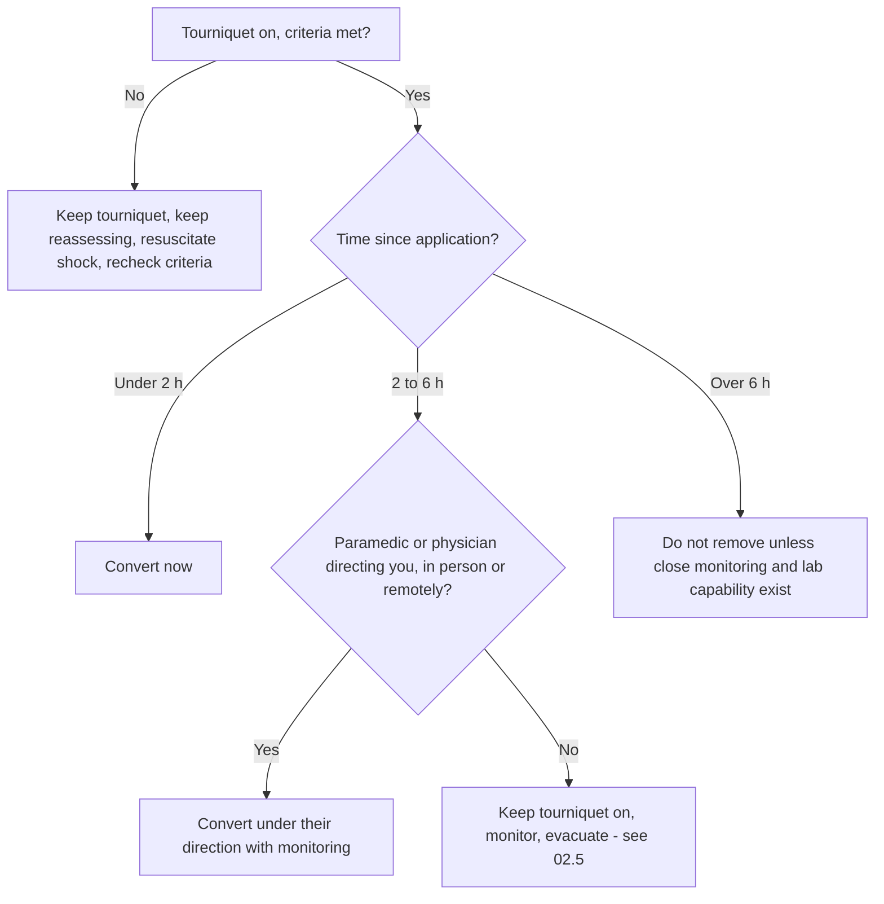

# 02.4 · Tourniquet conversion and removal

By the end of this lesson you will be able to decide whether a tourniquet can come off, convert it to a hemostatic and pressure dressing in the exact order the TCCC skill cards teach, catch rebleeding, and document it. In your EMT course this step belonged to the hospital; when the hospital is many hours away, the decision and the hands are yours.

> [!CAUTION]
> Performing these procedures on people without the required state certification is illegal.
> This lesson is for educational purposes only. Practise only on models and animal tissue.

## Why it matters

A tourniquet trades a limb's blood supply for the casualty's life. In the first two hours that trade is cheap. After that, muscle and nerve begin to die, and the longer the tourniquet stays, the more dangerous it becomes to release (lesson 02.5). Conversion means replacing the tourniquet with a packed hemostatic dressing and a pressure bandage, so the bleeding stays controlled **and** the limb gets blood again.

The 2026 TCCC Guidelines (checked 2026-11-14) say limb and junctional tourniquets **should be converted as soon as possible** when the criteria are met, and that **every effort** should be made to do it **in less than 2 hours**.

## What to do

### The criteria (all three must be true)

| Criterion | How you check it in the field |
|---|---|
| 1. The casualty is **not in shock** | Strong radial pulse and normal mental status (no confusion or drowsiness without a head injury) |
| 2. You can **monitor the wound closely** for bleeding | You stay with the casualty, the wound is exposed or the dressing is visible, you have light, and you are not about to move under threat |
| 3. The tourniquet is **not** controlling bleeding from an **amputation** | Amputations keep their tourniquet until surgery |

The skill card adds a practical fourth check: the wound must be one you can pack and bandage (not, for example, a limb shredded along its whole length).

### The time rules

- **Under 2 hours:** convert as soon as the criteria are met.
- **2 to 6 hours:** TCCC 2026 (from Proposed Change 25-2) says responders at the All Service Member and Combat Lifesaver levels - the levels closest to an EMT - should **not** convert beyond 2 hours unless directed by a combat medic, paramedic or other advanced medical provider. Without that oversight, keep the tourniquet on and monitor until a higher level of care. A phone or radio call to a physician counts as direction.
- **Over 6 hours:** do not remove a tourniquet that has been on longer than 6 hours unless close monitoring and laboratory capability are available. Releasing it can flood the body with potassium and muscle breakdown products (02.5).

### Prepare before you touch the tourniquet

1. Note the application time and check the criteria out loud.
2. Lay out: two or more hemostatic gauzes (or plain gauze), a pressure bandage (Israeli emergency bandage), a second tourniquet, a timer, a light, the casualty card, a marker.
3. Stage a **backup tourniquet** loosely above the existing one (on the skin, not tightened). If the original fails or slips you can tighten this one in seconds.
4. Explain to the casualty what you are doing; give pain relief first if you can (Module 4). Release hurts as blood returns.

### Conversion, step by step (TCCC skill card order)

1. **Expose** the wound, if not already exposed.
2. **Open** the hemostatic dressing or gauze. No gauze: clean, dry cloth.
3. **Pack** the wound cavity tightly, keeping firm pressure. More than one dressing may be needed.
4. Make sure the packing **extends 1-2 inches (2.5-5 cm) above the skin**; add more if not. A lodged foreign object stays in and is bandaged in place.
5. **Hold firm manual pressure for at least 3 minutes** after packing.
6. **Open** the pressure bandage.
7. **Place its pad** directly over the packed wound while keeping pressure.
8. **Wrap** the bandage tightly around the limb, pressure focused over the wound, edges of the pad covered. With an Israeli bandage, pass the wrap through the pressure bar and reverse it to force it down onto the pad.
9. **Secure** the end.
10. **Release the tourniquet slowly, over one minute**, watching the bandage for bleeding. Leave the loosened tourniquet in place on the limb as a backup.
11. **Document** on the casualty card: time of conversion, products used, and that the loosened tourniquet remains in place.

**If bleeding recurs** at step 10: **retighten the original tourniquet** until bleeding stops and the distal pulse is gone. Write the time of re-application. As a course rule, you may repack once with a fresh or different hemostatic dressing and try again if the casualty still meets the criteria and you are still inside the 2-hour window; if the second attempt fails, the tourniquet stays on.

### After conversion: watch

- Check the dressing for bleeding every few minutes for the first 30 minutes, then every 15 minutes, and after every move.
- The distal pulse, colour and warmth should return over minutes. Write the time you feel the pulse.
- Expect pain and some swelling. Increasing, severe pain, a tense swollen limb, or pain on moving the fingers or toes are signs of compartment syndrome (Module 8).
- Check urine colour when the casualty next passes urine: dark brown or red urine is a warning sign (02.5).
- Keep the loosened tourniquet in place and visible until handover; tell the receiving team.

### Watch

UF PRO's Combat Medic Essentials shows the full conversion on a casualty:

https://www.youtube.com/watch?v=oNKGOtdyoYw

TraumaPAK shows conversion based on TECC and TCCC with wound packing:

https://www.youtube.com/watch?v=vBscXuSDyq0

EM Note explains prehospital tourniquet conversion from an emergency-medicine angle:

https://www.youtube.com/watch?v=weK_nGYkLwk

Rob Orman, MD interviews emergency physician and Special Forces veteran Mike Shertz on placing and removing tourniquets:

https://www.youtube.com/watch?v=p50C7yrWCko

Some of these videos predate the 2026 guideline change. Where they differ, follow this lesson: release over one minute, leave the loosened tourniquet in place, and respect the 2-hour limit for non-medic responders.

## Improvise it

Everything in a conversion has a household version:

- **Packing:** clean cotton strips (boiled and dried in advance if you have time), as in 02.1. Pack to above the skin and press 3 full minutes.
- **Pressure bandage:** a sanitary pad as the pad; an elastic bandage, a torn bed sheet, or cling film wrapped six to eight times around the limb to hold it. Wrap from below the wound upward, firm but not so tight that the fingers or toes turn blue.
- **Pressure bar:** over the pad, put a hard, smooth object - a rolled bandage, a small smooth stone wrapped in cloth, or a capped marker - and wrap over it to focus pressure on the wound.
- **Backup tourniquet:** a cravat-and-windlass tourniquet (02.3) laid loosely above the original, windlass ready.
- **Timer and marker:** a phone alarm; any pen, eyeliner or lipstick to write times on the skin, the strap and a strip of tape on the chest.

**What fails:** a pressure bandage made of a single layer of T-shirt (stretches and loosens within minutes); cling film wrapped over a soft pad with no packing in a deep wound (no pressure in the depth); releasing the tourniquet in one go (you cannot tell slow oozing from failure, and you lose the moment to catch it).

**How to tell it is failing:** blood soaks through or runs from under the wrap, the pad feels squishy, the casualty becomes pale, sweaty, confused or the radial pulse weakens. Retighten the tourniquet first, then think.

## When it goes wrong

- **Converting a casualty in shock.** They cannot afford even a small rebleed. Resuscitate (Module 4) and recheck the criteria; if shock persists, the tourniquet stays.
- **Converting an amputation.** Never; amputation stumps keep their tourniquet.
- **Removing the tourniquet completely instead of loosening it.** If bleeding returns you have to reapply from scratch. Leave it loose in place.
- **Rebleeding missed under a blanket.** Keep the dressing visible and check it.
- **Converting at 3 hours without direction.** Under TCCC 2026 that is beyond the non-medic role; call for direction or keep it on.
- **Forgetting the card.** The next team will assume a tourniquet still on, or a tourniquet off, means something it does not. Every time goes on the card.
- **Packing too loosely.** The dressing must be tight and stand proud of the skin; a soft pack will not hold when the artery refills.

## Scope and law

Tourniquet conversion is taught in TCCC at the combat medic level and above, and it is not part of the Israeli EMT curriculum. Under the Duty to Rescue Law (1998) reasonable lay aid is protected, but conversion is a clinical decision: whenever a paramedic or physician can be reached, in person or by phone, convert under their direction. Act alone only when no evacuation is coming within the 2-hour window, no one more qualified can be reached, and the casualty meets every criterion.

## Practice

> [!WARNING]
> On a live partner, tighten tourniquets to full occlusion for no more than about 1 minute and only on a healthy adult volunteer without clotting, vascular or circulation problems, not pregnant and not on blood thinners. All "bleeding" in this drill is simulated.

**Drill: timed conversion (partner + meat model, 45 minutes).**

What you need: a partner, two tourniquets, a beef or lamb roast with a cut cavity (from 02.1), training gauze or cotton strips, an Israeli bandage or elastic bandage, a sanitary pad, a timer, a casualty card, a marker.

Steps:

1. Strap the roast to your partner's thigh with tape so the "wound" faces up. Apply tourniquet one on the skin above it, snug only. Write a time 70 minutes ago on it.
2. Start the timer. Say the three criteria out loud and how you checked each (your partner tells you their pulse is strong and they are alert).
3. Stage the backup tourniquet loosely above the first.
4. Pack the roast cavity, press 3 minutes, apply the pressure bandage with the pressure bar.
5. "Release" tourniquet one slowly while counting out loud to 60.
6. Your instructor or partner calls "rebleed" at random in one of three runs: retighten tourniquet one and record the time.
7. Complete the card: original time, conversion time, products, re-application time if any.
8. Paper decisions, one line each: (a) thigh wound, tourniquet 1 h 20 min, radial pulse weak, confused; (b) arm wound, tourniquet 3 h, you are alone, phone works; (c) below-knee amputation, tourniquet 50 min, stable; (d) thigh wound, tourniquet 7 h, no evacuation for 2 days.

How you know it worked: the whole conversion took under 4 minutes plus the 3-minute pressure hold, the release took a full minute, the original tourniquet stayed on the limb, the card shows every time, and your paper answers are (a) do not convert, treat shock first; (b) call a physician and convert only under direction; (c) never convert an amputation; (d) do not remove without monitoring and labs (see 02.5).

## Sources

- Committee on Tactical Combat Casualty Care. *TCCC Guidelines*, 01 May 2026: Tactical Field Care 6a3 (conversion criteria, 2-hour and 6-hour rules, ASM/CLS note) and 6a4 (documentation).
- TCCC skill instructions and skill cards, Tourniquet conversion: TCCC-CMC-09-01 (23 Jan 2021); TCCC-CMC-SC-37 (30 Apr 2025); TCCC-CPP-SC-37 (15 May 2025).
- Koch EJ, Andersen M, Barbee GA, et al. Standardizing tourniquet reassessment and conversion across TCCC tiers: TCCC Guidelines Proposed Change 25-2. *J Spec Oper Med* 2026;26(1).
