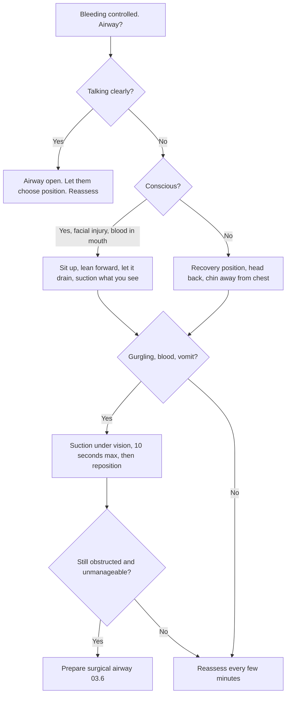

# 03.1 · Positioning and suction in the field

By the end of this lesson you will be able to keep a trauma casualty's airway open for hours with nothing more than the right position and a way to clear blood and vomit, including a suction you build yourself. Most airway problems on the battlefield are solved this way; the invasive procedures later in this module are for the few casualties these measures fail.

> [!CAUTION]
> Performing these procedures on people without the required state certification is illegal.
> This lesson is for educational purposes only. Practise only on models and animal tissue.

## Why it matters

Airway obstruction after injury usually comes from two things: the **tongue** falling back in an unconscious casualty, and **blood, vomit, teeth or swelling** from a facial injury. Both respond to simple measures. The TCCC course material puts it plainly: airway obstruction on the battlefield is often easily corrected with simple manoeuvres.

This is also why the IDF's April 2024 circulation-first guideline (lesson 01.3) could cut intubation and cricothyroidotomy from 3.8% to 0.8% of casualties without a rise in deaths: most airways can be held open by position, suction and attention. You already know the head-tilt/chin-lift, jaw thrust and OPA from your EMT course. What is new here is the trauma-specific positioning, the order TCCC uses, and suction when you have no machine.

## What to do

### The TCCC 2026 airway sequence (Tactical Field Care)

After massive bleeding is controlled (M of MARCH), TCCC 2026 says, in this order:

1. **Assess** for an unobstructed airway: talking clearly means the airway is open now.
2. If there is a traumatic airway obstruction or one is coming (expanding neck swelling, burns, a smashed face), **prepare** for possible direct airway intervention (lesson 03.6).
3. Let a **conscious** casualty take **any position that best protects the airway**, including **sitting up and/or leaning forward**. Do not force them to lie down.
4. Place an **unconscious** casualty in the **recovery position**, head tilted back, chin away from the chest.
5. **Use suction** if available and appropriate.
6. If these fail and the obstruction is unmanageable (facial fractures, direct airway injury, blood, deformation, burns), perform a **surgical cricothyroidotomy** (lesson 03.6).
7. **Reassess** often: SpO2, EtCO2 if you have it, and airway patency change over time.
8. Cervical spine stabilisation is **not** needed for casualties with **only penetrating** trauma.

In Care Under Fire, airway management is generally deferred until Tactical Field Care. In the 2026 Guidelines the nasopharyngeal airway no longer appears in the Airway section; it appears under Respiration, together with the bag-valve-mask, for uncorrectable hypoxia (lesson 03.2).

### The positions in detail

**Sit up and lean forward** (conscious casualty with facial or jaw injury, bleeding into the mouth):

1. Help them sit, back unsupported or against a wall, chest forward, head down and forward so blood and saliva run out of the mouth, not down the throat.
2. Give them something to spit into and a cloth to hold to the face.
3. Do not lay them flat to "treat shock". A conscious casualty with a smashed jaw who is laid on their back may lose the airway within minutes, because the broken jaw no longer holds the tongue forward.

**Recovery position** (unconscious, breathing):

1. Kneel beside them. Place the near arm at a right angle, bring the far arm across the chest with the back of the hand against the near cheek.
2. Bend the far knee, pull on it to roll them towards you onto their side.
3. Tilt the head back and keep the chin **away from the chest**; the mouth should point slightly down so fluid drains out.
4. Bend the top leg at hip and knee to stop them rolling onto their face.
5. With a one-sided chest injury, TCCC places the casualty **injured side down** (skill card for needle decompression), so the good lung is on top.
6. Check breathing and the airway every few minutes and every time you move them. During transport you may have to return them to their back; then someone must hold the airway.

**Supine** (on the back) only when you must: CPR, a procedure, or a litter that does not allow side-lying. Then hold the airway with a jaw thrust, and keep suction ready.

### Suction

TCCC rates suction as **good: improvised device; better: manual suction device; best: mechanical (battery) suction**. The rules are the same for all three:

1. **Turn the head or the whole casualty to the side** first; gravity is your first suction.
2. Open the mouth (cross-finger technique or jaw thrust). Wipe out large clots and broken teeth you can **see** with a gloved finger wrapped in gauze. **Never do a blind finger sweep.**
3. Insert the suction tip **only as far as you can see**. Going deeper triggers gagging and vomiting.
4. Apply suction **only while withdrawing** the catheter.
5. Suction for **no more than 10 seconds** at a time, then let the casualty breathe (or ventilate them) before the next pass.
6. Use a **rigid wide tip** (Yankauer type) for blood and vomit in the mouth. Thin soft catheters clog with clots.
7. After suctioning, reposition and reassess.

Manual pumps (squeeze-handle types such as V-Vac, or foot pumps) are cheap, need no battery, and belong in a home or community kit (lesson 01.6). Practise with one before you need it: the canister fills faster than you expect and must be emptied.

### Watch

North West Ambulance Service (UK NHS) shows the standard recovery position step by step:

https://www.youtube.com/watch?v=_LvM4VcVz-k

First Aid for Life shows the same position from a lay first-aid trainer's angle:

https://www.youtube.com/watch?v=KFo4u19TxPE

The Committee on TCCC's official Tactical Field Care airway lecture (positions, manoeuvres, when to escalate):

https://www.youtube.com/watch?v=ewMZXFvBYC4

Top Hat Tutorials demonstrates a hand-operated manual suction device:

https://www.youtube.com/watch?v=dEXKiVpfVIU

A fire-department training channel (BCFPD) shows a V-Vac manual pump as the backup when battery suction fails:

https://www.youtube.com/watch?v=Voc4bC2Ur14

Older TCCC lectures also show supraglottic airways (SGAs). The 2026 Guidelines no longer list them in Tactical Field Care, and this course does not teach them. If a video shows one, skip that part.

## Improvise it

### Improvised suction

| Option | How | What it does well | Where it fails |
|---|---|---|---|
| **60 ml catheter-tip syringe + tubing** | Push 15-20 cm of clear tubing (aquarium air-line, a cut nasogastric tube, or the tube from an IV giving set with the spike cut off) onto the syringe tip. Put the tube end in the mouth under vision, pull the plunger while withdrawing. Disconnect, empty, repeat. | Thin blood, saliva, liquid vomit | Clots and food plug thin tubing at once; each pass only holds 60 ml |
| **60 ml syringe, no tubing** | Use the syringe tip itself at the side of the mouth | Pooled liquid in the cheek | Cannot reach the back of the mouth safely |
| **Baby nasal aspirator / ear bulb** | Squeeze, place in the pool you see, release | Small amounts, nose of a child | Very weak; useless for vomit |
| **Turkey baster** | Same as bulb | Larger volume of thin liquid | Wide rigid tip can break teeth or cut the mouth; weak suction |
| **Gravity and wiping** | Recovery position, head down slightly, mouth open; wipe with gauze wrapped on a finger | Always available, any volume, works with clots | Slow; needs the casualty on their side |

**Do not** suck on a tube with your own mouth to clear someone else's airway. You will swallow blood and vomit (infection risk), you cannot see what you are doing, and you cannot stop the suction quickly.

**Wide tip from household items:** a large clean drinking straw (the wide "bubble tea" kind) pushed onto a 60 ml syringe works better for clots than thin tubing, but is soft and can collapse.

**How to tell it is failing:** gurgling continues after a pass, the syringe fills with air instead of fluid (tip blocked or out of the pool), or blood wells back faster than you remove it. Switch to gravity: roll the casualty further onto the side, head lower than chest, and let it drain. If blood keeps filling the airway from a facial wound, this casualty may need a surgical airway (03.6).

### Improvised positioning aids

A rolled blanket or backpack behind the back holds the recovery position on a moving vehicle floor; a chair turned backwards lets a conscious casualty with a jaw injury lean forward on the backrest; a towel roll under the shoulders helps hold the head tilted in a supine casualty.

### Cleaning reusable improvised suction

Between casualties: flush tubing and syringe with clean water, then soak 10 minutes in 0.5% chlorine (household bleach diluted to that strength; see lesson 03.4 for the dilution), rinse with boiled water, air-dry. Better: use a new syringe and tubing for every casualty and throw them away.

## When it goes wrong

- **Laying a conscious jaw-injury casualty flat.** They fight you because they cannot breathe lying down. Let them sit up and lean forward.
- **Blind finger sweep.** Pushes a tooth or clot deeper and gets your finger bitten. Only remove what you can see.
- **Suctioning too deep or too long.** Triggers vomiting, and an unconscious casualty desaturates. Stop at 10 seconds; see what you suction.
- **Recovery position with chin on chest.** Kinks the airway. Head back, chin away from the chest.
- **Forgetting the airway during transport.** A casualty rolled onto their back for loading needs someone holding the jaw and watching. Reassess after every move.
- **Spinal immobilisation for a penetrating wound.** TCCC says it is not needed for penetrating trauma only; a collar on a casualty with facial bleeding hides the airway and makes drainage harder.

## Scope and law

Airway positioning, manual manoeuvres, OPA, suction and BVM were all part of your EMT course and are within your scope. Improvised suction is still suction; use the cleanest equipment you have and document what you used. The legal framework for everything above your scope is in [01.5 · The law and your scope in Israel](../module-01/lesson-05.md).

## Practice

**Drill: airway position and suction (partner + kitchen, 40 minutes).**

What you need: a partner, a blanket, a 60 ml catheter-tip syringe (pharmacy), 30 cm of aquarium tubing or a cut nasogastric tube, a wide drinking straw, a bowl of thin "blood" (water, red food colouring, a spoon of cornflour) and a bowl of "vomit" (the same plus porridge oats), a timer.

1. **Positions (10 min).** Your partner plays: (a) conscious, smashed jaw, spitting blood; (b) unconscious, breathing, snoring; (c) unconscious, right-side chest wound. Put them in the right position within 15 seconds each, saying why. Swap roles.
2. **Build the suction (5 min).** Fit the tubing to the syringe. Fit the straw to a second syringe.
3. **Suction test (15 min).** From each bowl, time how much you remove in 60 seconds with: tubing-syringe, straw-syringe, and simply tipping the bowl (gravity). Write the volumes down.
4. **Clot test (5 min).** Drop a teaspoon of jam into the "blood" bowl and try again with the tubing.
5. **Clean-up (5 min).** Flush and disinfect as above.

How you know it worked: you chose sit-up-lean-forward for (a), recovery position for (b) and recovery position injured side down for (c); you can say why each is right. Your numbers show that thin tubing handles thin fluid but blocks with jam or oats, the wide straw handles more, and tipping the bowl beat both: this is why you roll the casualty before you suction.

## Sources

- Committee on Tactical Combat Casualty Care. *TCCC Guidelines*, 01 May 2026: Care Under Fire 7; Tactical Field Care 4 (Airway Management) and 5e (NPA and BVM).
- Joint TCCC course, Combat Medic/Corpsman Module 7: Airway Management in Tactical Field Care (suction good/better/best; suction rules; recovery position).
- TCCC Combat Lifesaver skill card, Needle Decompression of the Chest (TCCC-CLS-SC1-24, 25 Jan 2020): recovery position injured side down.
- Bendor CD. Shifting priorities in combat casualty care: circulation-first resuscitation in wartime. *J Isr Mil Med* 2025;22, abstracts (see lesson 01.3).
