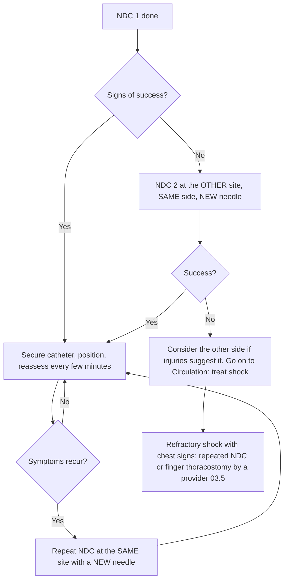

# 03.4 · Needle decompression

By the end of this lesson you will be able to find both decompression sites with your fingers, decompress a tension pneumothorax with a needle in the order TCCC teaches, tell whether it worked, and know exactly what to do when it does not. This is the procedure in this module you are most likely to need, and it takes under a minute once you have decided.

> [!CAUTION]
> Performing these procedures on people without the required state certification is illegal.
> This lesson is for educational purposes only. Practise only on models and animal tissue.

## Why it matters

Needle decompression (NDC) lets the trapped air out of a tension pneumothorax through a long, wide catheter pushed between two ribs. The heart can fill again, and a casualty who was dying of obstructive shock can wake up within a minute.

It is also an invasive procedure with real failure rates and real complications, which is why the IDF narrowed its indications in April 2024 (lesson 01.3). The answer is not to avoid it; it is to do it **only when the criteria in lesson 03.3 are met**, and to do it **properly**: right needle, right site, all the way in.

## What to do

### Equipment

- A **14-gauge or 10-gauge needle/catheter, 3.25 inches (8.25 cm) long**, made for decompression (for example the ARS or SPEAR kits sold for TCCC). The 10G passes more air and kinks less.
- Gloves, an antiseptic wipe if available, tape, a marker, a casualty card, a sharps container (or a bottle with a lid).
- A second needle for a second attempt. TCCC requires a **new needle/catheter unit** for every attempt.

Why 3.25 inches: chest walls are thick, especially at the front. In a 2016 meta-analysis, a standard 5 cm needle was predicted to **fail to reach the chest cavity** in 38% of people at the 2nd intercostal space midclavicular line, 31% at the midaxillary line, and 13% at the anterior axillary line (Laan et al.). A 2025 meta-analysis of 51 studies found an overall failure rate of about 33% and that **each extra centimetre of needle reduced failure by about 7.8%**, but also that **injury rates rise with length**, and that on the **left side** the front site (2nd intercostal space) carries less risk of hitting the heart (Ahmad et al.). The 3.25-inch needle at the TCCC sites is the balance between these.

Why 10G: in a swine study of tension pneumothorax with cardiac arrest (PEA), a 10G catheter rescued 87% of events versus 48% for a 14G. Another swine study found 26% of 14G catheters failed mechanically (kinked, blocked or dislodged) within 5 minutes. These are animal studies, but they are why many kits now carry 10G.

### Finding the sites

You will use **either** site, whichever is more accessible. Practise finding both with your eyes closed.

**Site 1: 5th intercostal space, anterior axillary line (side of the chest)**

1. Raise the casualty's arm on that side (or move it away from the body).
2. The **anterior axillary line** runs straight down from the **front fold of the armpit** (the edge of the chest muscle).
3. Find the **nipple level** in a man: the nipple usually sits over the 4th intercostal space or 4th rib. The **5th intercostal space** is one space below. In a woman, or anyone where the nipple is not a reliable landmark, count ribs from the sternal angle (below), or use the crease under the breast as a rough level and confirm by feeling the ribs.
4. On the anterior axillary line, at the 5th space, place your finger **on top of the 6th rib** (the lower rib of the space). That is the insertion point.
5. **Do not go below the 5th space**: lower down you risk the liver (right) and spleen (left), which rise high in the chest when the casualty breathes out.

**Site 2: 2nd intercostal space, midclavicular line (front of the chest)**

1. Find the **sternal angle** (angle of Louis): run a finger down from the notch at the top of the breastbone about 5 cm until you feel a horizontal ridge.
2. The **2nd rib** joins the breastbone at that ridge. Slide sideways onto the 2nd rib; the space **below** it is the 2nd intercostal space.
3. Follow that space outward to the **midclavicular line**: a vertical line through the middle of the collarbone.
4. Place your finger **on top of the 3rd rib** at that point.
5. **Never insert medial to the nipple line** (closer to the breastbone than a vertical line through the nipple): the heart and great vessels lie there.

### Needle decompression, step by step (TCCC order)

1. **Confirm the indication** (lesson 03.3): significant torso or blast trauma plus one or more of the six criteria, and the chest seal (if any) has been **burped or removed** without improvement.
2. **Attach a pulse oximeter** if you have one.
3. Position: **supine or recovery position**, unless the casualty is conscious and must sit up to keep the airway clear because of facial injuries.
4. Choose the **site on the injured side** (the side of the wound or of decreased breath sounds).
5. **Clean** the site with antiseptic if you have it. Do not delay for this.
6. **Remove the Luer-lock cap** from the back of the needle if there is one, so air can escape.
7. **Insert** the needle/catheter **just over the top of the lower rib**, at **90 degrees to the chest wall** (to the curve of the chest, **not** to the ground). The vessels and nerve run along the bottom edge of each rib; staying on top of the rib avoids them.
8. **Advance all the way to the hub.** You may feel a "pop" as you enter the chest cavity and hear a hiss. Do not stop at the pop: go to the hub.
9. **Hold it in place for 5-10 seconds** to let decompression happen.
10. **Remove the needle, leave the catheter** in place. Put the needle in the sharps container at once.
11. **Secure** the catheter hub with tape so it is not pulled out or bent. Do not cap it.
12. **Assess for success** (below). Place the casualty in a position of comfort, or the recovery position with the **injured side down**.
13. **Document** on the casualty card: time, side, site, needle size, result.

### Signs of success (any one)

- **Respiratory distress improves.**
- An **obvious hiss** of air escaping (hard to hear in noise).
- **SpO2 rises to 90% or more** (this can take several minutes and may not happen at altitude).
- A casualty with no vital signs regains **consciousness and/or a radial pulse**.

### When it does not work, or comes back

- **First NDC fails:** perform a **second NDC on the same side at the other site**, with a **new** needle. **Consider** whether the **opposite side** also needs decompression, based on the injuries and examination.
- **First NDC worked, then symptoms recur:** the catheter has kinked, clotted or slipped out. Perform **another NDC at the same site**, with a new needle.
- **Second NDC also fails:** stop decompressing and **go on to Circulation** (MARCH): the problem may be blood loss or a hemothorax. If shock does not respond to resuscitation and chest signs persist, TCCC lists repeated NDC or finger thoracostomy/chest tube by a qualified provider (lesson 03.5).
- **Continue to reassess.** A catheter that worked can stop working at any time.

### Traumatic cardiac arrest

TCCC 2026: a casualty with **torso trauma or polytrauma** (or primary blast injury) who has **no pulse, no breathing, no response to pain and no other signs of life** should have **bilateral needle decompression** before you stop treatment. CPR is not attempted in the field for blast or penetrating trauma arrest (lesson 01.2), but decompressing both sides takes a minute and rules out the one reversible cause you can fix.

### Children

TCCC gives no separate child needle size. An 8.25 cm needle is far longer than a small child's chest wall. A CT study (Leonhard et al., 2019) suggested about 2.5 cm (22G) for infants, 3.2 cm (20G) at age 5 and 4.5 cm (18G) at age 10, at the 4th intercostal space anterior axillary line. Use the 2nd intercostal space midclavicular line or the anterior axillary line site as in adults, insert only until air hisses, then advance the catheter off the needle. This is study data, not a guideline; get physician direction whenever you can.

### Watch

The Committee on TCCC's official needle decompression video (2018 edition; it predates the current guidelines but shows the same sites and technique):

https://www.youtube.com/watch?v=IIvvSCfOyJs

MEERCAT Solutions, a TCCC training provider, demonstrates the procedure step by step:

https://www.youtube.com/watch?v=b0S0N5livBM

PrepMedic, a civilian tactical paramedic educator, walks through chest needle decompression and landmarks:

https://www.youtube.com/watch?v=1AlFaLuuPVs

Rescue Academy shows needle decompression as taught in paramedic school, at the anterior axillary line:

https://www.youtube.com/watch?v=JF5SnjGJOmM

Some civilian videos teach advancing only until the "pop" and then sliding the catheter forward, or use 5 cm needles. For adults, follow TCCC: a 3.25-inch needle, all the way to the hub.

## Improvise it

### If you don't have a decompression needle

| Option | What works | What fails / the risk |
|---|---|---|
| **Standard 14G IV cannula** (usually about 4.5-5 cm long) | Wide enough to let air out | Often too short to reach the chest cavity, especially at the front: use the **anterior axillary line**, where the chest wall is thinnest. Kinks easily; tape it |
| **16G IV cannula** | Still lets air out | Slower, kinks more, same length problem |
| **Large-animal veterinary catheter** (farms, kibbutz vet stores; some are 14G and much longer than 8 cm) | Reaches the cavity | **Too long:** do not advance beyond the depth of a 3.25-inch needle; mark that depth on it with tape first |
| **Long thin needle** (spinal or injection needle, 18G or thinner) | May confirm air (hiss) | Too narrow to relieve tension reliably |
| **Bare metal needle, no plastic catheter** | Lets air out while in | Do **not** leave a metal needle in: as the lung re-expands, the sharp tip can tear it. Remove after the hiss; repeat if needed |
| **No needle at all** | | A knife is not a needle. Opening the chest with a blade is a finger thoracostomy (lesson 03.5), a far bigger procedure |

**How to tell an improvised needle has failed:** no hiss, no improvement, or improvement that fades within minutes (kink, clot, or it slipped out of the chest). Re-decompress with a new needle, at the other site if the first failed.

### Improvised flutter valve: why and why not

A **flutter valve** lets air out of the chest and stops it coming back in. **TCCC does not put a valve on a decompression catheter**: the catheter is left open. A 14G or 10G hole lets in far less air than the casualty's own airway, so an open catheter does not create a meaningful sucking chest wound.

The classic improvised valve is the **glove-finger valve**: cut a finger from a clean glove, snip 1 cm off its tip, slide the open base over the catheter hub and tape it. Air pushes out through the slit; on breathing in, the rubber collapses and seals.

- **Where it helps:** on an improvised **drain** (a tube left in the chest by a physician), where the hole is large.
- **Where it fails:** blood and fluid glue the rubber shut, turning it into a closed cap, and the tension builds again without anyone noticing. The extra weight and handling pull the catheter out.
- **The rule:** do not add a valve to a decompression catheter. If someone more qualified places a tube, a commercial Heimlich valve or a glove-finger valve may be used on it, checked every few minutes for flutter.

### Skin prep and sterilising with household means

Speed beats sterility for a tension pneumothorax. If you have 10 seconds, clean the skin; if you do not, decompress.

- **Best:** chlorhexidine-alcohol or povidone-iodine wipe.
- **Household:** isopropyl alcohol 70% (rubbing alcohol). Spirits must be **60% alcohol or stronger** to disinfect skin; most vodka and arak are about 40% and are only better than nothing. Soap and clean water to remove dirt is better than any antiseptic on dirty skin.
- **Needles and catheters are single-use.** Never reuse a decompression needle on another person.
- **Reusable instruments** (scissors, a clamp, a knife for lesson 03.5): scrub with soap and water, then **boil for 20 minutes** (kills bacteria and viruses but not all spores, so it is high-level disinfection, not sterilisation). A **pressure cooker** at full pressure is closer to sterilisation and is what disaster surgery reviews describe when there is no autoclave.
- **Chlorine soak:** 0.5% chlorine for 10-20 minutes inactivates most organisms on cleaned instruments. Household bleach is usually 3-6% sodium hypochlorite (read the label). Parts of water for each part of bleach = (bleach % divided by 0.5) minus 1. So 5% bleach: 1 part bleach + 9 parts water. 3.5% bleach: 1 part + 6 parts water. Make it fresh daily, rinse instruments with boiled water afterwards, and never put bleach on skin or in a wound.

## When it goes wrong

| Problem | Cause | Recovery |
|---|---|---|
| No hiss, no improvement | Needle too short, not to the hub, wrong site, or there is no tension (hemothorax, shock) | Second NDC at the other site, same side, new needle; then go on to Circulation |
| Worked, then distress returns | Catheter kinked, clotted or pulled out | Repeat at the same site with a new needle; tape the hub; consider 10G |
| Bleeding from the site | Hit the intercostal vessels under the rib above | Press firmly; it usually stops. Next time, go over the top of the lower rib |
| Inserted medial to the nipple line | Heart or great vessel injury risk | Leave the catheter, do not move it, monitor, evacuate urgently, tell the receiving team |
| Too low (below the 5th space) | Liver or spleen injury risk, especially as the casualty breathes out | Leave it, use a correct site for the next attempt, tell the receiving team |
| No tension was present | You created a simple pneumothorax | Usually tolerated; monitor for tension as before |
| Needle angled to the ground on a casualty on their side | Slides along the ribs and misses | Perpendicular to the chest wall, always |

## Scope and law

Needle decompression is a paramedic and physician procedure in Israel and is not part of the EMT course. In TCCC it is taught down to the Combat Lifesaver tier, which shows it can be taught to non-medics, but that does not change Israeli scope. Prepare the equipment for a paramedic or physician and assist them; act yourself only as the last resort described in [01.5 · The law and your scope in Israel](../module-01/lesson-05.md): the casualty meets the criteria, is dying, no one more qualified can reach them or direct you, and you have trained on the procedure.

## Practice

> [!WARNING]
> Never insert any needle into a person for practice. Landmark drills on a partner use a washable marker and your fingers only. Handle needles over a table, keep a sharps bottle open beside you, and never recap by hand.

**Drill 1: landmarks on a partner (15 minutes).** A washable marker, a partner (a man and a woman if possible).

1. Find the sternal angle, the 2nd rib, the 2nd intercostal space and the midclavicular line; mark an X on top of the 3rd rib. Mark the nipple line and check your X is outside it.
2. Find the front armpit fold, the anterior axillary line and the 5th intercostal space; mark an X on top of the 6th rib.
3. Repeat on the other side, then with your eyes closed. Your partner checks you.

**Drill 2: first decompressions on ribs (45 minutes).** A rack of lamb or beef ribs with meat and fat on (kosher butcher), two or three 14G 3.25-inch decompression needles (or 14G IV cannulas for practice), a balloon or a nitrile glove, tape, a chopping board, a sharps bottle.

1. Inflate the balloon or glove a little and tape it **under** the rib rack, so it sits where the chest cavity would be.
2. With the meat side up, find an intercostal space and the top of the lower rib.
3. Insert at 90 degrees to the surface, just over the rib, all the way to the hub. Feel the pop through the meat; hear the balloon go.
4. Count 5-10 seconds, remove the needle into the sharps bottle, leave the catheter, tape the hub.
5. Repeat at new spaces with a fresh balloon, timing each run from "decision" to "catheter taped".
6. Cut open one track afterwards to see whether you went over the top of the rib.

richardestep's do-it-yourself chest decompression simulator, built from a rack of ribs and cling film, shows the same idea:

https://www.youtube.com/watch?v=37BvAsD0pIo

How you know it worked: on your partner, your two X marks are on top of the 3rd and 6th ribs and both are outside the nipple line, found in under 20 seconds each with eyes closed. On the ribs, every needle reached the hub just over the top of the lower rib (check by cutting), the balloon popped on most runs, and your time from decision to taped catheter is under 60 seconds. The TCCC standard is under 3 minutes for the whole procedure.

## Sources

- Committee on Tactical Combat Casualty Care. *TCCC Guidelines*, 01 May 2026: Tactical Field Care 5a (NDC), 6f (refractory shock), 17 (CPR and bilateral NDC); TACEVAC 16.
- TCCC Combat Paramedic/Provider skill instructions, Module 8 (TCCC-CPP-08-01, 19 Aug 2022): NDC instruction, standard under 3 minutes.
- TCCC Combat Lifesaver skill card, NDC (TCCC-CLS-SC1-24, 25 Jan 2020).
- Laan DV, Vu TD, Thiels CA, et al. Chest wall thickness and decompression failure: a systematic review and meta-analysis comparing anatomic locations in needle thoracostomy. *Injury* 2016;47(4):797-804.
- Ahmad et al. Systematic review and meta-analysis of needle decompression failure and injury. *World J Emerg Surg* 2025.
- Bigger is better: comparison of alternative devices for tension hemopneumothorax and PEA in a Yorkshire swine model. *J Trauma Acute Care Surg* 2017 (10G vs 14G).
- Leonhard G, et al. Determining optimal needle size for decompression of tension pneumothorax in children: a CT-based study. *Scand J Trauma Resusc Emerg Med* 2019.
- Infection prevention for limited-resource settings: boiling 20 minutes as high-level disinfection; 0.5% chlorine decontamination (Ethiopian MOH / Jhpiego training module; PATH reprocessing guidelines).
