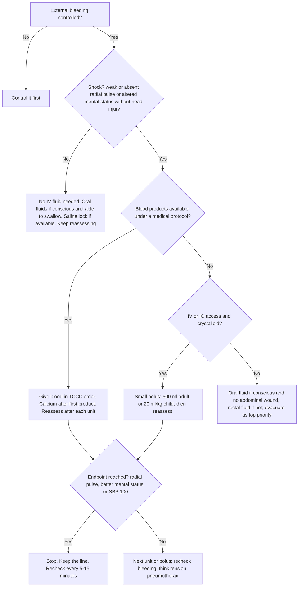

# 04.1 · Shock resuscitation in the field

By the end of this lesson you will be able to recognise hemorrhagic shock with your hands and a watch, decide whether a casualty needs fluid at all, pick the right fluid when you have a choice, and stop at the right point instead of chasing a normal blood pressure. You will also know how to keep a casualty going by mouth or rectum when there is no IV, no IO and no ambulance.

> [!CAUTION]
> Performing these procedures on people without the required state certification is illegal.
> This lesson is for educational purposes only. Practise only on models and animal tissue.

## Why it matters

Bleeding is the leading preventable cause of death after wounding (lesson 01.3). Your EMT course taught you the signs of shock and to "start a line". In the field, two other facts matter more:

- **Fluid is not blood.** Saline and Hartmann's carry no oxygen and no clotting factors. Large volumes dilute what clotting the casualty has left, cool them and make them acidotic: the "lethal triad" that keeps wounds bleeding.
- **A higher pressure can blow the clot off.** Pushing blood pressure back to normal before the bleeding is surgically controlled can restart internal bleeding. That is why field resuscitation aims for "just enough": a radial pulse and a casualty who can talk to you, not a textbook pressure.

The 2026 TCCC Guidelines (checked 2026-11-14) list **only blood products** as resuscitation fluids for hemorrhagic shock. Crystalloid is no longer on the list. In Israel's war, whole blood reached 4.6-6.1% of IDF casualties (lesson 01.4); a civilian at home will usually have none, so this lesson teaches both what the protocol wants and what you can do without it.

## What to do

### 1. Recognise shock without a monitor

TCCC defines hemorrhagic shock in the field by two signs:

- **Altered mental status in the absence of brain injury** (confused, slow, anxious, drowsy), and/or
- **Weak or absent radial pulse.**

Add what you can measure:

| Sign | What it suggests |
|---|---|
| Heart rate over 100, radial pulse thready | Compensating for blood loss |
| Radial pulse gone, carotid present | Severe shock |
| Pale, cold, sweaty skin; capillary refill over 2 s | Shut-down skin circulation (unreliable in the cold) |
| Fast breathing | Early compensation |
| Thirst, restlessness | Common and easy to miss |
| Little or dark urine (hours later) | Kidneys under-perfused (lesson 07.3) |

**Shock index** = heart rate / systolic blood pressure. If you have a manual cuff:

- Normal is about 0.5-0.7.
- **Above 0.9** in a casualty whose pressure still "looks fine" predicted a 1.6-fold higher need for massive transfusion in a trauma-centre study (Vandromme 2011).
- **1.0 or more** (heart rate at or above the systolic) means significant blood loss until proven otherwise.

Example: pulse 120, systolic 110 → 1.09. Treat as shock even though 110 "looks normal".

**Traps:** beta-blocker users and the elderly may not become fast; athletes and young people hold their pressure until they crash; pregnancy raises the resting heart rate. Children compensate with tachycardia and keep their blood pressure until very late. The C-TECC pediatric minimum systolic is **60 mmHg under 1 month, 70 + (2 × age in years) for 1 month to 10 years, and 90 mmHg from 10 years**; reaching it means late shock, not safety.

### 2. Stop the bleeding before you think about fluid

Fluid into a casualty who is still bleeding goes out of the hole. Before any resuscitation, recheck every tourniquet, packing and pressure dressing (lessons 02.3-02.4), look for bleeding you have not found (back, buttocks, armpits, groin, scalp), and consider the hidden spaces: chest, abdomen, pelvis (binder, lesson 02.6) and thigh fractures (splint).

### 3. Decide: fluid or no fluid

### 4. The fluids, in TCCC 2026 order

| Preference | Fluid | Who usually has it |
|---|---|---|
| 1 | Cold-stored low-titer O whole blood (LTOWB) | IDF mobile ICUs, some EMS (lesson 04.4) |
| 2 | Pre-screened low-titer O fresh whole blood (walking blood bank) | Military units with a donor program |
| 3 | Plasma, red cells and platelets 1:1:1 | Hospitals |
| 4 | Plasma and red cells 1:1 | Hospitals, some helicopters |
| 5 | Plasma (including freeze-dried) or red cells alone | Military medics, some paramedic units |

**Crystalloid (0.9% saline, Hartmann's/Ringer's lactate, Plasma-Lyte)** is not on the 2026 list. When it is all you have and the casualty is in shock, the older civilian TECC guidance (2017) is the practical rule: a **500 ml bolus**, reassess, and **repeat once after 30 minutes** if still in shock. For children, C-TECC v2.8 says **20 ml/kg** of saline or Ringer's lactate if blood is not available, repeated up to **60 ml/kg** total while signs of shock persist, slowing as soon as a strong pulse returns. Warm the fluid if you possibly can (step 7).

### 5. Endpoints: when to stop

TCCC 2026: reassess after each unit and **stop when one or more** of these is reached:

| Endpoint | How you check |
|---|---|
| Palpable radial pulse | Two fingers on the wrist, count 15 s |
| Improved mental status | AVPU, orientation, can answer questions |
| Systolic 100 mmHg | Manual cuff, if you have one |

**Exception: traumatic brain injury.** The injured brain needs pressure. If a casualty with suspected TBI and altered mental status has a weak or absent radial pulse, resuscitate to a **normal** (not just palpable) radial pulse, and to **systolic above 100 mmHg** if you can measure it (TCCC 2026, Module 5.2). If both hemorrhagic shock and TBI are present, treating the hemorrhagic shock comes first.

### 6. Reassess and catch recurrence

- After stopping, recheck pulse and mental status every 5-15 minutes and after every move.
- **Shock comes back** → recheck every bleeding control first, then repeat resuscitation.
- **Shock does not respond** to fluid → think **tension pneumothorax** (chest injury, worsening breathing, SpO2 under 90%, one-sided breath sounds) and decompress if indicated (lessons 03.3-03.4). Also think of bleeding into the pelvis, abdomen or thigh.

### 7. Prevent hypothermia at the same time

TCCC says hypothermia prevention starts **while** fluids run: off the ground, wet clothes off, wrapped, head covered, heat on the chest and armpits (Module 5.7). A cold casualty does not clot.

### 8. Document

On the casualty card (lesson 01.7): time and value of each pulse, mental status and pressure check; each fluid, volume and time; TXA and calcium (lesson 04.3).

### Watch

UF PRO's combat medic series shows how to check a wounded buddy for shock inside the MARCH sequence:

https://www.youtube.com/watch?v=cad1yvcN4NY

Munro Medical Solutions demonstrates assessing radial and carotid pulses the TCCC way:

https://www.youtube.com/watch?v=TxRsJMQFVBQ

National University Hospital Singapore explains permissive hypotension in trauma (a hospital view of the same principle):

https://www.youtube.com/watch?v=GAgVkB6ryb0

The Center for Medical Education covers whole blood, shock index and modern trauma resuscitation:

https://www.youtube.com/watch?v=dV3qfr83TSg

Some videos quote a target systolic of 80-90 mmHg from older guidelines. TCCC 2026 uses radial pulse, mental status or systolic 100 mmHg, and a normal radial pulse or systolic above 100 for TBI; follow this lesson.

## Improvise it

### Oral fluids instead of IV

TCCC and C-TECC both allow fluids by mouth for a conscious casualty who can swallow. In a long hold with no IV or IO this is your main route.

- **What:** oral rehydration solution. Pharmacy sachets are best; the home recipe is 1 litre of clean water, 6 level teaspoons of sugar and half a level teaspoon of salt (made properly in lesson 11.2). Water alone is the next best.
- **How:** small sips, about 100-200 ml every 15 minutes, more if tolerated. A teaspoon every minute for a nauseated casualty or a child.
- **Not when:** unconscious or drowsy (aspiration), cannot protect the airway, evisceration (TCCC: nothing by mouth) and, as a course rule, any penetrating abdominal wound (the bowel may be holed and the casualty needs surgery), repeated vomiting (treat nausea first, lesson 04.8), or about to go into surgery within the hour.
- **How you know it is failing:** vomiting, abdominal swelling, worsening pulse and mental status despite drinking. The gut of a casualty in deep shock absorbs slowly; oral fluid does not replace blood.

### Rectal fluids (proctoclysis)

The large bowel absorbs water and salt. In a published wilderness case, doctors resuscitated a man in hemorrhagic shock from a stomach bleed with **3 litres of oral rehydration solution given rectally over about 3 hours** through a 14 Fr urinary catheter with a glove as a reservoir, using boiled water at body temperature; he survived evacuation (Grocott 2005). In palliative care, tap water or saline at **100-400 ml per hour** has been given safely (Bruera 1998, cited in the same paper). These are case-level data, not a guideline.

1. Explain and get consent if possible. Gloves.
2. Fluid: oral rehydration solution or saline, made with boiled (or at least drinking-quality) water, warmed to body temperature.
3. Tube: a soft catheter (Foley, nasogastric tube, or a well-rinsed soft tube) lubricated with oil or soap, inserted gently about 10 cm. If it is a Foley, inflate the balloon and pull back to gentle tension so fluid stays in.
4. Reservoir: an enema bag, an IV bag, a 60 ml syringe, or a funnel or glove taped to the tube, held about 30-50 cm above the casualty.
5. Run it slowly, about 100-400 ml per hour; stop if cramps or leakage.
6. Titrate to pulse, mental status and urine, as for IV.

**What fails:** diarrhoea or a casualty who cannot hold the fluid; wounds of the abdomen, pelvis, rectum or perineum (do not use: a holed bowel would leak the fluid into the abdomen); very rapid bleeding (absorption is far too slow). Hard tubes can perforate the bowel.

### Other household versions

- **Warming IV fluid:** put the bag under the casualty's armpit, between your own body and jacket, or in warm (not hot) water. Never in a microwave (uneven hot spots).
- **Pressure bag:** a blood-pressure cuff wrapped around the IV bag and pumped up, or a person kneeling slowly on the bag. Watch for air in the line.
- **Blood pressure without a monitor:** palpated systolic with a manual cuff (inflate until the radial pulse goes, deflate slowly, the reading when it returns is the systolic). No cuff: a palpable radial pulse is a very rough "systolic around 80 or more"; treat it as a trend, not a number.

## When it goes wrong

- **Chasing a normal pressure.** Running litres of saline until the pressure is 120 restarts bleeding and dilutes clotting. Stop at the endpoint.
- **Giving fluid before controlling bleeding.** Recheck tourniquets and packing first; every time shock returns, look again.
- **Under-resuscitating a head injury.** The TBI casualty needs a normal pulse and systolic above 100, not "just palpable".
- **Missing the hidden bleed.** Pelvis, femur, chest and abdomen can hold most of the blood volume. Binder, splint, think.
- **Cold fluid into a cold casualty.** Warm it and wrap them.
- **Trusting one number.** A fast heart rate can be pain or fear; a normal one can be a beta-blocker. Look at the trend and the whole person.
- **Reassuring yourself with a child's normal pressure.** By the time it falls, the child is close to arrest.
- **Forcing oral fluid into a drowsy casualty.** Aspiration kills faster than dehydration.

## Scope and law

Assessing shock, positioning, warming and giving oral fluids are within EMT care. IV and IO fluid resuscitation and anything with blood products are paramedic or physician acts (and blood only within an approved medical protocol); rectal fluids are not taught to EMTs in Israel at all. The Duty to Rescue Law (1998) requires you to help but gives you no immunity for how you help; the legal basis and the last-resort test are in [lesson 01.5](../module-01/lesson-05.md). Go beyond your scope only when it is this or death and no one more qualified can be reached or can direct you by phone.

## Practice

**Drill: shock decisions by hand (45 minutes, partner and paper).**

What you need: a partner, a watch with seconds, a manual blood-pressure cuff (or none), paper, the ten cases below.

1. **Pulses (10 minutes).** Find your partner's radial, carotid and (on the leg) dorsalis pedis pulse with eyes closed. Count each for 15 seconds and multiply by 4. Press the radial lightly until it disappears, so you feel what "weak" means.
2. **Palpated pressure (10 minutes).** With a cuff, take your partner's systolic by palpation three times; compare with a stethoscope reading if you have one.
3. **Shock index (5 minutes).** Calculate it for each case below.
4. **Decisions (20 minutes).** For each case write: shock yes or no, fluid yes or no, which fluid, endpoint.

| # | Casualty | Pulse | Systolic | Mental status | What you have |
|---|---|---|---|---|---|
| 1 | Adult, thigh wound, tourniquet tight | 96, strong radial | 128 | Alert | Saline, IV kit |
| 2 | Adult, abdominal shrapnel | 128, weak radial | 92 | Confused, no head injury | Saline, IV kit |
| 3 | Adult, blast, head wound, drowsy | 118, weak radial | 88 | Responds to voice | Saline, IV kit |
| 4 | 6-year-old (about 20 kg), leg wound, controlled | 150, weak | 76 | Quiet, slow to answer | Saline, IV kit |
| 5 | 70-year-old on a beta-blocker, pelvic fracture | 78 | 86 | Confused | Binder, saline |
| 6 | Adult, arm wound, tourniquet, 10 hours to evacuation | 88 | 124 | Alert, thirsty | No IV kit, water, sugar, salt |
| 7 | Adult, chest wound, breathing worse after 1 litre | 136, absent radial | not measurable | Responds to pain | Saline running |
| 8 | Adult, thigh wound now controlled, vomits every sip, no IV possible | 120, weak | 90 | Alert, thirsty | ORS, soft catheter |
| 9 | Adult, thigh wound, shock resolved, now pulse weak again | 124, weak | 94 | Anxious | Saline |
| 10 | Adult, back wound, radial strong after 500 ml | 102, strong | 104 | Alert | Saline |

How you know it worked: you found every pulse in under 10 seconds; your palpated systolic was within about 10 mmHg of the stethoscope reading; your answers match these.

Answers

1. No shock (SI 0.75). No IV fluid; oral fluids allowed; keep reassessing.
2. Shock (SI 1.39). 500 ml crystalloid bolus, reassess; no oral fluid (abdominal wound); evacuation priority.
3. Shock plus TBI. Resuscitate to a normal radial pulse and systolic above 100.
4. Shock in a child (minimum systolic for age 6 is 82). 20 ml/kg = 400 ml, reassess, repeat to 60 ml/kg maximum.
5. Shock despite pulse 78 (beta-blocker; SI 0.91, confused). Binder on, small bolus, reassess.
6. No shock. Oral rehydration solution by sips.
7. Refractory shock with chest injury: think tension pneumothorax and decompress (03.4); recheck bleeding.
8. Shock, no IV, oral route failing: treat the nausea (04.8) and give warmed ORS rectally at about 100-400 ml per hour; evacuation is the real treatment.
9. Recurrent shock: recheck the tourniquet and packing first, then repeat resuscitation.
10. Endpoint reached (strong radial, alert). Stop the fluid, keep the line, recheck every 5-15 minutes.

## Sources

- Committee on Tactical Combat Casualty Care. *TCCC Guidelines*, 01 May 2026: Tactical Field Care 6b (shock assessment), 6c (IV/IO), 6e (fluid resuscitation, endpoints, TBI), 6f (refractory shock), 7 (hypothermia).
- Committee for Tactical Emergency Casualty Care. *C-TECC Pediatric Guidelines* v2.8, 05 Jun 2024: circulation (20 ml/kg bolus to 60 ml/kg, minimum systolic by age, oral intake).
- Committee for Tactical Emergency Casualty Care. *TECC Guidelines for BLS/ALS Medical Providers*, 2017: IV fluid bolus, repeat once after 30 minutes.
- Vandromme MJ, Griffin RL, Kerby JD, et al. Identifying risk for massive transfusion in the relatively normotensive patient: utility of the prehospital shock index. *J Trauma* 2011;70(2):384-8.
- Grocott MPW, McCorkell S, Cox ML. Resuscitation from hemorrhagic shock using rectally administered fluids in a wilderness environment. *Wilderness Environ Med* 2005;16:209-11.
- Bruera E, Pruvost M, Schoeller T, et al. Proctoclysis for hydration of terminally ill cancer patients. *J Pain Symptom Manage* 1998;15:216-9.
