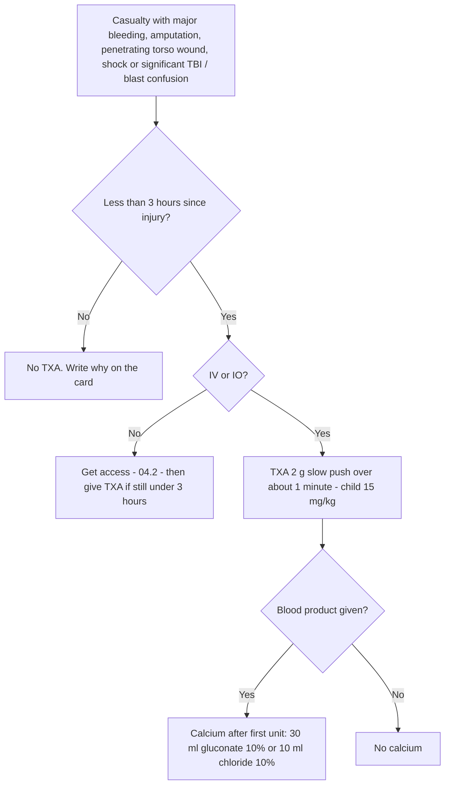

# 04.3 · TXA and calcium

By the end of this lesson you will be able to decide in seconds whether a casualty needs tranexamic acid (TXA), give the full 2 g dose correctly inside the 3-hour window, give the child dose, and give calcium after blood the way TCCC 2026 says, knowing what each drug can and cannot do.

> [!CAUTION]
> Performing these procedures on people without the required state certification is illegal.
> This lesson is for educational purposes only. Practise only on models and animal tissue.

## Why it matters

**TXA** stops the body from dissolving clots that are still forming. In the CRASH-2 trial (20,211 bleeding trauma patients) it reduced death from bleeding. The follow-up analysis showed the timing is everything: given within the first hour it helped most, within 3 hours it still helped, and **given after 3 hours it increased the risk of death from bleeding**. CRASH-3 later showed benefit in mild and moderate head injury when given early. That is why TCCC gives it early, and never after 3 hours.

**Calcium** is needed for every step of clotting and for the heart to squeeze. Stored blood is kept liquid with citrate, which binds calcium; trauma itself also lowers it. In IDF casualties treated with prehospital blood products in the war (October 2023 to January 2025), **54% of the 222 with an ionised calcium result were hypocalcaemic** (IDF MHSRS abstract). TCCC therefore gives calcium after the first unit of blood.

## What to do

### TXA: who gets it (TCCC 2026)

Give TXA if **either**:

1. The casualty will **likely need a blood transfusion**, for example: hemorrhagic shock, one or more major amputations, penetrating torso trauma, or evidence of severe bleeding; **or**
2. The casualty has **signs or symptoms of significant TBI**, or **altered mental status after blast or blunt trauma**.

**And** it is **less than 3 hours since injury.** Write the time of injury the moment you arrive; if you do not know it, ask witnesses and estimate conservatively.

### TXA: dose and how to give it

| | Adult | Child (C-TECC v2.8) |
|---|---|---|
| Dose | **2 g** | **15 mg/kg** loading dose (max 1 g, usual hospital limit), then 2 mg/kg/hour for 8 hours if an infusion is possible |
| Route | Slow IV or IO push | IV or IO |
| When | As soon as possible, **never later than 3 hours** after injury | Under 3 hours, ideally within 30 minutes |
| Repeat | None in the field | None in the field |
| Notes | One dose; TCCC replaced the old 1 g + 1 g infusion with a single 2 g push | C-TECC: only in a pediatric trauma system with prior coordination; get physician direction |

TXA comes as 100 mg/ml (500 mg in 5 ml, for example the Israeli Hexakapron or Cyklokapron ampoules; check your label). Preparation:

1. Check the drug, the concentration, the expiry and that the liquid is clear.
2. Draw up 2 g = **20 ml** (four 5 ml ampoules) into one 20 ml syringe, or two 10 ml syringes. Use a filter needle or straw for glass ampoules if you have one (04.7).
3. Label the syringe "TXA 2 g".
4. Confirm the IV or IO runs freely.
5. Push **slowly, over about 1 minute** (TCCC "slow push"; the CoTCCC proposal used about 1 minute). A fast push can drop blood pressure.
6. Flush 10 ml saline.
7. Write "TXA 2 g IV/IO, time" on the card and on the casualty's skin or tape.

Effect: onset 30 seconds to 5 minutes, lasts about 24 hours (TCCC reference card).

**Contraindications** (TCCC reference card): hypersensitivity to TXA, subarachnoid hemorrhage, active intravascular clotting. Considered relatively safe in pregnancy if indicated. **Side effects:** blurred or altered colour vision, nausea, vomiting, diarrhoea, low blood pressure with a fast push, rarely seizures at high doses. **Interactions:** factor IX complex or anti-inhibitor coagulant concentrates (more clots); hormonal contraceptives and a history of clots (higher thrombosis risk in principle; in a bleeding casualty the bleeding kills first).

**Oral TXA tablets** (500 mg, prescribed for heavy periods) are absorbed slowly and play no role in hemorrhagic shock. **Prescription status:** TXA injection and tablets are prescription-only in Israel.

### Calcium: who gets it

TCCC 2026: **if blood products are transfused**, give **one gram of calcium** IV/IO **after the first transfused product**. Not for crystalloid resuscitation, and not "just in case" without blood.

### Calcium: dose and how to give it

| | Calcium gluconate 10% | Calcium chloride 10% |
|---|---|---|
| Adult (TCCC) | **30 ml** | **10 ml** |
| Child (Ranger Medic Handbook; pediatric emergency cards) | **60 mg/kg = 0.6 ml/kg**, max 30 ml | **20 mg/kg = 0.2 ml/kg**, max 10 ml |
| Route | IV or IO, peripheral IV is acceptable | **IO or a large, free-running vein only** |
| Rate | Slowly over a few minutes | Slowly over a few minutes |
| Elemental calcium in the adult dose | about 6.6 mmol | about 6.8 mmol |

The two adult doses are equivalent: calcium chloride carries three times more calcium per millilitre, which is why the volumes differ. Calcium chloride burns tissue badly if it leaks out of a vein.

Steps:

1. Give the first unit of blood.
2. Draw up the calcium; label it.
3. **Use a separate line, or flush the line well with saline before and after.** Calcium mixed with citrated blood in the tubing can clot the line.
4. Push slowly. Watch the site; stop at the first sign of swelling.
5. Write the time on the card.

**Contraindications and cautions** (TCCC reference card): hypercalcaemia, ventricular fibrillation, kidney stones, low phosphate; caution with digoxin (calcium increases digoxin toxicity), kidney or heart disease. **Side effects:** tingling, warmth, fainting or low pressure with a fast push, slow pulse, tissue necrosis with chloride extravasation. **Interactions:** reduces absorption of fluoroquinolones and tetracyclines; calcium-channel blockers blunt its effect; never mix with ceftriaxone in the same line (lesson 04.6), and never with sodium bicarbonate (precipitates).

**Prescription status:** injectable calcium gluconate and chloride are hospital and paramedic drugs; you will meet them in an MDA or IDF kit, not in a pharmacy.

### Decision summary

### Watch

The National Registry of EMTs (USA) explains TXA during prehospital transport:

https://www.youtube.com/watch?v=HpbnF3lNEWM

The London School of Hygiene and Tropical Medicine (the CRASH trial team) explains how TXA stops bleeding:

https://www.youtube.com/watch?v=emAHFC-Aidg

JEMS explains calcium as the hidden "C" in trauma shock for EMS providers:

https://www.youtube.com/watch?v=ECYxLAIGB7c

Clinical Why explains why the lethal triad became a "diamond" with low calcium:

https://www.youtube.com/watch?v=DVi8SNi_HhI

The NREMT video describes a 1 g dose over 10 minutes followed by an infusion, which is still used in many civilian systems. TCCC 2026 uses a single 2 g slow push; follow this lesson unless your medical director says otherwise.

## Improvise it

There is **no household substitute** for TXA or intravenous calcium, and you should know that clearly so you do not waste time:

- **Oral TXA tablets** are slow and incompletely absorbed; they do nothing useful for a casualty bleeding to death now.
- **Calcium tablets, antacids or milk** do not correct citrate-induced low calcium during transfusion.
- **Topical TXA:** soaking gauze in TXA solution is used by doctors for nosebleeds and dental bleeding (Module 12); it does not replace packing and pressure in a limb wound.

What you can improvise is everything around the drugs:

- **No 20 ml syringe:** two 10 ml syringes, pushed one after the other over a total of about 1 minute; or draw 2 g into a 50 ml syringe.
- **No ampoule filter needle:** draw from glass ampoules with the needle bevel held off the bottom and against the side, and expel the first drop of air; or break and pour into a clean cup and draw up immediately (higher contamination risk).
- **No watch on the casualty:** write the injury time with a marker on the forehead or the tourniquet: "INJ 14:05". The 3-hour limit depends on it.
- **No IV or IO:** TXA by IM injection is being studied but is **not** in TCCC 2026; do not count on it. Get access (04.2) or move the casualty.

## When it goes wrong

- **Giving TXA after 3 hours.** CRASH-2 showed harm after 3 hours. If you cannot establish the time of injury and it may be over 3 hours, do not give it.
- **Fast push.** Low blood pressure in a casualty who already has little. Push over about a minute.
- **Forgetting the second drug.** Blood without calcium; calcium without blood. Tie them together: "first unit in, calcium next".
- **Calcium chloride into a small hand vein.** It can burn the skin off. Use an IO or a large vein, or use gluconate.
- **Calcium in the same line as blood or ceftriaxone.** Clotted or blocked line; flush or use a separate line.
- **Confusing the volumes.** 30 ml of gluconate equals 10 ml of chloride; 30 ml of chloride is three times the dose.
- **Child dose from adult habit.** A 20 kg child needs 300 mg of TXA (3 ml), not 2 g.

## Scope and law

TXA and injectable calcium are prescription drugs given IV or IO, which in Israel is paramedic or physician practice; neither is in the EMT protocol. The Duty to Rescue Law (1998) requires help but gives no immunity for how you help; the legal basis is in [lesson 01.5](../module-01/lesson-05.md). Your realistic role is to recognise who needs TXA, record the injury time, get access ready and prepare the drug for the paramedic or physician; give it yourself only as a last resort, under remote physician direction whenever a phone works.

## Practice

**Drill: TXA and calcium preparation against the clock (40 minutes).**

What you need: four 5 ml plastic water-for-injection ampoules or small vials of water (from a pharmacy) labelled "TXA 500 mg/5 ml", a 20 ml and two 10 ml syringes, drawing-up needles, a 10 ml and a 30 ml syringe for calcium practice, labels, a marker, a timer, the casualty cards below.

1. **Draw up TXA (10 minutes, three runs).** From four "ampoules" into one 20 ml syringe, label it, expel air. Target: under 2 minutes per run.
2. **Timed push (5 minutes).** Into a cup, push 20 ml over a measured 60 seconds. Most people push too fast the first time.
3. **Calcium (5 minutes).** Draw up 30 ml "gluconate" and 10 ml "chloride". Say out loud which goes in a small hand vein (gluconate only).
4. **Decisions (20 minutes).** For each casualty write: TXA yes or no, dose, calcium yes or no, dose.

| # | Casualty | Time since injury |
|---|---|---|
| 1 | Adult, bilateral below-knee amputations, tourniquets on | 25 min |
| 2 | Adult, gunshot to the chest, radial pulse weak | 2 h 50 min |
| 3 | Adult, arm wound, tourniquet, alert, strong pulse | 40 min |
| 4 | Adult, blast, confused, no visible bleeding | 1 h |
| 5 | Adult, thigh wound in shock, found by you, time unknown, "since this morning" | unknown |
| 6 | 20 kg child, abdominal shrapnel, shock | 30 min |
| 7 | Adult in shock receiving the first unit of whole blood from a paramedic | 1 h |
| 8 | Adult in shock, 1 litre of saline given, no blood available | 1 h 30 min |

How you know it worked: each draw-up took under 2 minutes with a labelled, air-free syringe; your push took 55-75 seconds; your answers match.

Answers

1. TXA 2 g (major amputations). No calcium unless blood is given.
2. TXA 2 g now (penetrating torso, under 3 hours). Hurry: 10 minutes left.
3. No TXA (no shock, bleeding controlled, no sign of needing transfusion).
4. TXA 2 g (altered mental status after blast).
5. No TXA: likely over 3 hours, and TXA after 3 hours increased deaths from bleeding.
6. TXA 15 mg/kg = 300 mg = 3 ml, with physician direction; infusion of 2 mg/kg/h only if possible.
7. TXA 2 g if not given yet; calcium 1 g (30 ml gluconate 10% or 10 ml chloride 10%) after this first unit.
8. TXA 2 g; no calcium (no blood products).

## Sources

- Committee on Tactical Combat Casualty Care. *TCCC Guidelines*, 01 May 2026: Tactical Field Care 6d (TXA) and 6e (calcium after the first transfused product).
- TCCC combat medic pharmacology reference *Shock management / fluid resuscitation*, TCCC-CMC-SC-26, 11 Jun 2021 (TXA and calcium contraindications, side effects, interactions, onset).
- Committee for Tactical Emergency Casualty Care. *C-TECC Pediatric Guidelines* v2.8, 05 Jun 2024 (TXA 15 mg/kg then 2 mg/kg/h for 8 hours).
- CRASH-2 collaborators. *Lancet* 2010;376:23-32 and *Lancet* 2011;377:1096-1101 (timing).
- CRASH-3 trial collaborators. *Lancet* 2019;394:1713-23.
- IDF Medical Corps trauma group. *Does early whole blood cause hypocalcemia?* MHSRS abstract, 2025.
- 2025 Ranger Medic Handbook, pediatric calcium dosing (calcium gluconate 60 mg/kg, calcium chloride 20 mg/kg).
