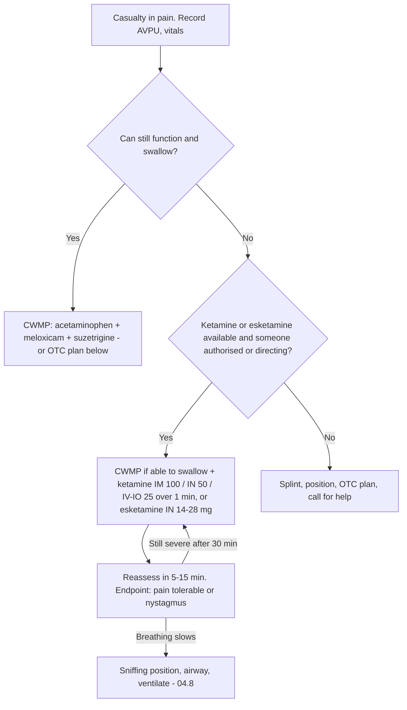

# 04.5 · Field pain management

By the end of this lesson you will be able to relieve a casualty's pain with the 2026 TCCC options, from the tablet pack to ketamine and esketamine, at full adult and child doses, and to build a safe plan from the painkillers already in an Israeli home when nothing else exists, without stopping anyone's breathing.

> [!CAUTION]
> Performing these procedures on people without the required state certification is illegal.
> This lesson is for educational purposes only. Practise only on models and animal tissue.

## Why it matters

Severe pain raises heart rate and blood pressure, makes a casualty panic, fight the people helping, and refuse movement and procedures. Over hours it disturbs sleep and breathing. But the wrong drug at the wrong dose can stop breathing in a casualty who is already in shock.

TCCC 2026 states the goal plainly: **tolerable pain that preserves airway, breathing and mental status**, not complete pain relief or sedation. The 2026 update removed fentanyl lozenges from the text and added **suzetrigine** (a new non-opioid tablet) and **intranasal esketamine**.

## What to do

### The TCCC 2026 tiers

| Casualty | What TCCC gives |
|---|---|
| **Can still function** (walk, help, guard, keep a clear head) | **Combat Wound Medication Pack (CWMP)**, self-administered or given by any trained responder: acetaminophen + meloxicam + suzetrigine |
| **Cannot function** (severe pain, cannot move or cooperate) | CWMP if not already taken, **and** by medical personnel: **ketamine** IM, IN or IV/IO, **or esketamine** IN |
| **Needs dissociation** for a procedure or safety | Ketamine at anaesthetic doses, by combat paramedics/providers prepared to secure the airway (awareness only; not this course's role) |

Before any potent analgesic: **record AVPU** on the card, **remove weapons and disconnect communications** from the casualty (TCCC), and have airway equipment at hand.

### Tier 1: the wound medication pack

| Drug | Route | Adult dose | Child dose | Repeat | Max per day | Status in Israel |
|---|---|---|---|---|---|---|
| **Acetaminophen** (paracetamol) | PO | **1000-1300 mg** (e.g. two 650 mg extended-release caplets) | **15 mg/kg** | Adult every 8 h (TCCC); child every 4-6 h | Adult 4 g; child 75 mg/kg, not over 4 g | OTC |
| **Meloxicam** | PO | **15 mg** | Not in the field pack; use ibuprofen | Once daily | 15 mg | Prescription |
| **Suzetrigine** | PO | **100 mg** (2 × 50 mg) first dose on an empty stomach, then **50 mg** every 12 h starting 12 h later | Not established for children | Every 12 h | 100 mg day 1 then 100 mg/day | Prescription; not found in the Israeli drug registry when checked (2026-11-14) |

**Acetaminophen.** Pain and fever relief without bleeding risk; safe in pregnancy. **Contraindications:** severe liver disease. **Cautions:** chronic heavy drinking, malnutrition or adults under 50 kg (use 15 mg/kg per dose and a lower daily maximum; 3 g a day is a common limit). **Interactions:** duplicates hidden in cold-and-flu and combination products; warfarin effect increases with regular use. Do not crush extended-release caplets.

**Meloxicam.** An NSAID chosen by TCCC because at this dose it has little effect on platelets. **Contraindications:** allergy or asthma triggered by aspirin or any NSAID, active stomach ulcer or bleeding, severe kidney disease, pregnancy from 20 weeks. **Cautions:** shock or dehydration (risk to the kidneys; give fluids first), elderly, crush injury (Module 8). **Interactions:** never with another NSAID (ibuprofen, naproxen, diclofenac, aspirin for pain); anticoagulants, SSRIs and steroids raise bleeding risk; ACE inhibitors, ARBs and diuretics raise kidney risk; lithium and methotrexate levels rise.

**Suzetrigine** (Journavx, US approval January 2025). Blocks the Nav1.8 sodium channel in pain nerves: not an opioid, not sedating. **Contraindication:** use with **strong CYP3A inhibitors** (for example clarithromycin, ketoconazole, itraconazole, ritonavir). **Cautions:** lower dose with moderate CYP3A inhibitors (for example fluconazole, erythromycin, diltiazem, verapamil); avoid grapefruit; avoid in severe liver impairment and lower the dose in moderate; avoid if eGFR under 15. Swallow whole. **Hormonal contraception:** with progestins other than levonorgestrel or norethindrone, use a backup method during treatment and for 28 days after. Not studied beyond 14 days. Common side effects: itching, muscle spasms, rash.

### Tier 2: ketamine and esketamine

| Drug | Route | Adult dose (TCCC 2026) | Child dose | Repeat | Notes |
|---|---|---|---|---|---|
| **Ketamine** | **IM** | **100 mg** | **0.2-0.5 mg/kg**, slowly (C-TECC; over 3 months old) | Every 30 min as needed | Thigh or deltoid; onset about 5 min |
| **Ketamine** | **IN** | **50 mg**, using the **100 mg/ml** concentration (0.5 ml) | **1 mg/kg**, max 50 mg (Ranger Medic Handbook; pediatric ED practice) | Every 30 min as needed | Split between nostrils with an atomiser; onset about 10 min |
| **Ketamine** | **IV/IO** | **25 mg** (or 0.2-0.3 mg/kg) **slowly over 1 minute** | **0.1-0.2 mg/kg**, slow push (C-TECC) | Every 30 min as needed | Onset about 1 min |
| **Ketamine** | PO | Not in TCCC | 0.2-0.5 mg/kg every 8 h (C-TECC) | Every 8 h | Bitter; mix with juice |
| **Esketamine** | **IN** | **14 or 28 mg** once (one spray = 14 mg; one device = 2 sprays = 28 mg) | Not approved for children | Once | Prescription, restricted |

**Endpoints:** reduced pain, or **nystagmus** (rhythmic flicking of the eyes), which signals you are at the start of dissociation; stop adding there.

**Ketamine facts you need:**

- It keeps airway reflexes and breathing better than opioids at these doses, and raises blood pressure slightly: good for shock.
- TCCC: **TBI or an eye injury does not prevent ketamine**; use caution because sedation hides neurological decline.
- It is generally safe after an opioid has already been given.
- Concentrations: 10, 50 and 100 mg/ml. **Read the vial every time** (04.7).
- Side effects: strange perceptions, agitation or fear on emergence, nystagmus, salivation, nausea and vomiting, rise in heart rate and blood pressure, rarely laryngospasm or slowed breathing.
- **Contraindications:** infants under 3 months (C-TECC); known allergy. Use caution in known psychosis, severe uncontrolled hypertension or heart disease.
- **Interactions:** **benzodiazepines are not recommended with ketamine or esketamine** (TCCC 2026); alcohol, opioids and sedating antihistamines add to sedation. **If a casualty is partly dissociated and agitated, more ketamine is safer than a benzodiazepine** (TCCC).
- **Status:** prescription-only and tightly controlled; held by MDA, the IDF and hospitals. A home supply is realistic only inside an organised medical team or a physician-supervised community kit.

**Esketamine** (Spravato) is the more potent half of ketamine, licensed only for depression and dispensed under restricted programmes. TCCC 2026 adopted it for pain as a single intranasal dose. **Contraindications (label):** aneurysmal vascular disease (aorta, brain, peripheral arteries) or arteriovenous malformation, history of brain haemorrhage, allergy to ketamine or esketamine. It raises blood pressure for up to about 2 hours. You will not get it for a home kit.

### Opioids

Fentanyl lozenges and morphine are no longer in the TCCC 2026 text. You may meet opioids anyway: a paramedic's morphine, or someone's prescribed oxycodone, tramadol or codeine combinations at home. They cause **respiratory depression**, especially with shock, head injury, alcohol or any sedative, and **never with a benzodiazepine** (TCCC). If opioids are given by anyone, have **naloxone** ready and know how to use it (lesson 04.8). Codeine and tramadol are not for children under 12.

### Non-drug pain relief (always, first)

Splint fractures (Module 5), position of comfort, cool packs over a closed injury for 20 minutes, cover burns (Module 5.4), reassurance and a calm single voice, distraction, warmth. For infants, C-TECC recommends a pacifier or gloved finger dipped in sugar solution (never honey under one year).

### Decision flow

### Watch

The Prolonged Field Care Collective explains the 2026 TCCC analgesia update (suzetrigine, esketamine, tiers):

https://www.youtube.com/watch?v=Zzz_H_VS4FY

Munro Medical Solutions shows the Combat Wound Medication Pack for Combat Lifesavers:

https://www.youtube.com/watch?v=u3O30OKO6nY

Qualora (paramedic skills) shows intranasal medication with an atomiser step by step:

https://www.youtube.com/watch?v=kp_20KnTlb0

EMS1 explains prehospital ketamine indications and administration:

https://www.youtube.com/watch?v=VeusabfkvVY

Older videos may still show fentanyl lozenges and moxifloxacin in the medication pack; TCCC 2026 dropped them.

## Improvise it

### An over-the-counter pain plan from an Israeli medicine cabinet

When you have no prescription drugs, **acetaminophen plus an NSAID** together is the strongest legal oral combination: in a Cochrane review, ibuprofen plus paracetamol relieved acute pain better than either alone.

| Drug | Adult | Child | Max | Notes |
|---|---|---|---|---|
| **Acetaminophen** (e.g. Acamol) | 1000 mg every 6 h | 15 mg/kg every 4-6 h | Adult 4 g/day; child 75 mg/kg/day (not over 4 g) | Check every other product for hidden paracetamol |
| **Ibuprofen** (e.g. Advil, Nurofen) | 400 mg every 6-8 h | 10 mg/kg every 6-8 h, from 6 months, max 400 mg per dose | OTC adult 1200 mg/day (a doctor may allow up to 2400 mg); child 40 mg/kg/day | NSAID: same contraindications as meloxicam |
| **Naproxen** 220 mg (OTC strength) | 220-440 mg first, then 220 mg every 8-12 h | Not OTC under 12 years | 660 mg/day OTC | NSAID; longer acting |
| **Dipyrone / metamizole** (e.g. Optalgin) | 500-1000 mg up to 4 times a day | 8-16 mg/kg per dose up to 4 times a day, from 3 months | Adult 4 g/day | Not an NSAID-type stomach risk, but can cause **agranulocytosis** (sudden loss of white cells): fever, sore throat or mouth ulcers mean stop and get help. Avoid in G6PD deficiency (common in some Israeli communities), porphyria, late pregnancy; can drop blood pressure |

**Rules:**

- Combine **one** acetaminophen product with **one** NSAID. Never two NSAIDs together (ibuprofen + naproxen, or either + meloxicam or diclofenac).
- Dipyrone can replace the NSAID when an NSAID is contraindicated (stomach ulcer, kidney problems, anticoagulants), not be stacked on top of everything.
- Give NSAIDs only after fluids in a dehydrated or shocked casualty, and with food if possible.
- Write every dose and time on the card; the commonest home error is an unintended second dose from a family member.

### Other household measures

- **Cold:** a bag of frozen vegetables in a cloth, 20 minutes on, 20 minutes off, over closed injuries; never on frostbite, never directly on skin.
- **Splints and slings** from magazines, pillows, sticks and belts (Module 5.6): immobilisation is the most powerful painkiller you have.
- **Liquid doses for children:** see 04.7 for crushing tablets and measuring with a syringe instead of a kitchen spoon.

**What fails:** alcohol "for the pain" (worse bleeding, vomiting, sedation, hypothermia); unknown pills from a drawer; someone else's opioids in a drowsy, shocked or head-injured casualty; doubling the dose when the first one "isn't working" (wait for the onset: 30-60 minutes for tablets).

## When it goes wrong

- **Over-sedation and slow breathing.** Reposition the airway to the "sniffing position"; if that fails, ventilate (TCCC; lesson 04.8, 03.2).
- **Emergence reaction** (fear, hallucinations, agitation) after ketamine. Calm voice, reduce stimulation; if partly dissociated, more ketamine rather than a benzodiazepine (TCCC).
- **Vomiting** after ketamine or opioids. Recovery position, suction, ondansetron (04.8).
- **Wrong concentration.** 100 mg/ml drawn up as if it were 10 mg/ml is a tenfold overdose. Read the vial and say the dose and volume out loud.
- **NSAIDs into a shocked casualty.** Kidney injury; give fluids first or use acetaminophen alone.
- **Hidden duplicates.** A casualty took a cold-and-flu tablet and you add 1 g of acetaminophen. Ask "what did you take today?"
- **Suzetrigine with clarithromycin or ketoconazole**, or with grapefruit juice: contraindicated or dangerous; check what else they take.
- **No record.** The next responder gives the same drug again. Write drug, dose, route and time every time.

## Scope and law

Acetaminophen, ibuprofen, OTC naproxen and dipyrone are sold over the counter in Israel and giving them at label doses is reasonable lay aid. Meloxicam, suzetrigine, ondansetron and every injectable drug need a prescription; ketamine, esketamine and opioids are also controlled, and IM, IN, IV and IO drug administration is paramedic or physician practice. Build a home supply only through your own doctor, who decides what you may hold and for whom, and get remote physician direction before giving any prescription drug to someone else whenever a phone works. The Duty to Rescue Law gives no immunity for how you help; the legal basis and last-resort test are in [lesson 01.5](../module-01/lesson-05.md).

## Practice

**Drill: your pain card and three casualties (45 minutes).**

What you need: paper or the drug card template in lesson 04.8, a calculator, an empty medicine bottle or labelled water vials for "ketamine 50 mg/ml" and "ketamine 100 mg/ml", a 1 ml and a 3 ml syringe, an intranasal atomiser (MAD) if you have one, a partner.

1. **Inventory (10 minutes).** List every painkiller in your home: name, active ingredient, strength, expiry. Mark OTC or prescription, and any combination product with hidden acetaminophen.
2. **Pain card (15 minutes).** Write your adult and child (10 kg, 20 kg, 30 kg) doses for acetaminophen, ibuprofen and dipyrone, with maximums per day. Add the TCCC CWMP and ketamine doses.
3. **Casualties (15 minutes).** Write the plan, doses and route:
   - (a) 75 kg man, broken forearm, walking and alert, takes no other drugs.
   - (b) 70 kg woman, thigh wound with tourniquet, screaming, pulse 110, alert, a paramedic with ketamine is on the phone and in your kit.
   - (c) 18 kg child, burned hand, crying, no other drugs.
4. **Intranasal technique (5 minutes).** Draw up 0.5 ml of water into a 1 ml syringe, attach the atomiser, and "give" 0.25 ml into each side of an orange or a paper towel tube. Note the dead space left in the atomiser.

How you know it worked: every dose on your card has a maximum next to it; your answers are: (a) acetaminophen 1000 mg + ibuprofen 400 mg (or the CWMP), splint; (b) ketamine 50 mg IN (0.5 ml of 100 mg/ml) or 100 mg IM, with AVPU recorded first and her weapon or phone away, reassess at 5-15 minutes, repeat at 30 minutes if needed; (c) acetaminophen 270 mg (15 mg/kg) + ibuprofen 180 mg (10 mg/kg), cool running water and cover the burn.

## Sources

- Committee on Tactical Combat Casualty Care. *TCCC Guidelines*, 01 May 2026: Tactical Field Care 11 (analgesia tiers, doses, notes 1-11) and 13c (sedation).
- Vertex Pharmaceuticals. *JOURNAVX (suzetrigine) prescribing information*, revised 1/2026.
- Janssen. *SPRAVATO (esketamine) prescribing information*, revised 3/2026 (device, contraindications).
- Committee for Tactical Emergency Casualty Care. *C-TECC Pediatric Guidelines* v2.8, 2024 (acetaminophen 15 mg/kg, ketamine by route, sugar for infants).
- 2025 Ranger Medic Handbook, ketamine 1 mg/kg IM/IN for children.
- Derry CJ, Derry S, Moore RA. Single dose oral ibuprofen plus paracetamol (acetaminophen) for acute postoperative pain. *Cochrane Database Syst Rev* 2013.
- European Medicines Agency. Metamizole-containing medicinal products (dosing referral 2018; agranulocytosis review 2024).
- Israel Ministry of Health drug registry (prescription status), checked 2026-11-14.
