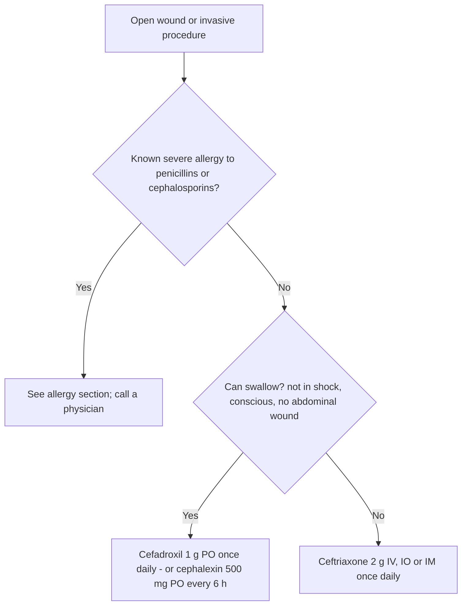

# 04.6 · Field antibiotics for open wounds

By the end of this lesson you will be able to give the 2026 TCCC antibiotics (cefadroxil, cephalexin and ceftriaxone) at full adult and child doses, prepare ceftriaxone for an intramuscular or intravenous injection, handle the "I'm allergic to penicillin" casualty safely, and judge which antibiotics from a home cabinet are worth using.

> [!CAUTION]
> Performing these procedures on people without the required state certification is illegal.
> This lesson is for educational purposes only. Practise only on models and animal tissue.

## Why it matters

Every penetrating wound is contaminated: skin bacteria (Staphylococcus aureus, Streptococcus pyogenes), soil and clothing (Clostridium). Given early, antibiotics lower the chance that contamination becomes infection, and in a long hold a wound infection can turn into sepsis or gas gangrene (Module 8). The TCCC panel that rewrote the antibiotic section in 2025 reaffirmed **early** administration and noted that future conflicts may not offer a "golden hour" to hospital, which is the Israeli reality in a cut-off area.

TCCC 2026: **antibiotics are recommended for all open combat wounds and invasive procedures** (for example IO, needle decompression, cricothyroidotomy). Moxifloxacin and ertapenem were replaced: oral **cefadroxil** (preferred) or **cephalexin**, and **ceftriaxone** when the casualty cannot swallow.

## What to do

### Choose the drug

### Doses

| Drug | Route | Adult (TCCC 2026) | Child | Repeat | Max | Status in Israel |
|---|---|---|---|---|---|---|
| **Cefadroxil** (preferred oral) | PO | **1 g** | **30 mg/kg** (US label daily dose; once daily or split in two) | Once daily | Child: adult dose (1 g) per dose | Prescription; few brands registered (check the registry) |
| **Cephalexin** (alternative oral) | PO | **500 mg** | **12.5-25 mg/kg** | **Every 6 h** | Adult 4 g/day; child 100 mg/kg/day, not over adult dose | Prescription; widely available |
| **Ceftriaxone** (cannot swallow) | IV, IO or IM | **2 g** | **50-75 mg/kg** | Once daily | 2 g/day (higher only for meningitis, by a physician) | Prescription |
| **Penetrating eye injury** | | Ceftriaxone 2 g IV/IM **or** cefadroxil 1 g PO as soon as possible (TCCC) | As above | | | |

Cefadroxil's once-daily dosing is why TCCC prefers it; cephalexin covers the same bacteria but needs four doses a day.

**Who cannot swallow:** shock, reduced consciousness, vomiting, facial or jaw injury, penetrating abdominal wound (nothing by mouth).

### Contraindications, cautions and interactions

| Drug | Contraindications | Cautions | Interactions |
|---|---|---|---|
| Cefadroxil, cephalexin | Previous severe reaction to a cephalosporin; anaphylaxis to amoxicillin or ampicillin (similar side chain) | Kidney failure (longer interval) | Few; probenecid raises levels |
| Ceftriaxone | Previous severe reaction to a cephalosporin; **newborns** with jaundice, or newborns who need calcium-containing IV fluids | Gallbladder sludge with long courses; kidney and liver failure together | **Never mix or run with calcium solutions in the same line** (crystals; in newborns, never within 48 hours); lidocaine diluent must never be given IV |

Common side effects: diarrhoea, nausea, rash. Watch for anaphylaxis for 30 minutes after a first injected dose, with adrenaline ready (your EMT protocol).

### Preparing ceftriaxone

**Intramuscular (no IV or IO, or to save the line):**

1. Two 1 g vials for an adult 2 g dose (**no more than 1 g per injection site**: two sites).
2. To each 1 g vial add **3.5 ml of 1% lidocaine** (reduces the pain; check lidocaine allergy). Without lidocaine, use water for injection: it works but hurts.
3. Shake until clear (about 4 ml, roughly 250 mg/ml).
4. Deep IM into a large muscle: outer thigh (vastus lateralis) or the upper outer gluteal or ventrogluteal site, with a needle long enough (04.7). Aspiration is not needed.
5. Label the casualty card: "ceftriaxone 2 g IM, two sites, time".

**Intravenous or IO:**

1. 1 g vial + **10 ml water for injection** (about 100 mg/ml); 2 g = two vials = 20 ml.
2. Slow IV/IO push over about 5 minutes (European label), or add to 50-100 ml saline and run over 30 minutes.
3. Flush before and after; never through a line carrying calcium or blood with calcium.

**Child example:** 16 kg × 50 mg/kg = 800 mg = 8 ml of the 100 mg/ml IV solution.

### The allergy question

Ask, and write the answer down:

1. "Are you allergic to any medicine?" If yes: "Which one, what happened, and how long ago?"
2. **Anaphylaxis** (throat swelling, wheeze, collapse, needed adrenaline) is very different from a rash or stomach upset.
3. Most people who say they are "allergic to penicillin" are not: in one study of Marine recruits, only 5 of 402 self-reported penicillin-allergic recruits reacted to an amoxicillin challenge (cited in TCCC Change 25-1).

| History | What to do |
|---|---|
| Rash or stomach upset with penicillin or amoxicillin, years ago | Cefadroxil, cephalexin or ceftriaxone as normal; watch 30 minutes after the first dose |
| **Anaphylaxis to penicillin or amoxicillin** | Avoid cefadroxil and cephalexin (side chains similar to amoxicillin and penicillin); **ceftriaxone** has a dissimilar side chain and the 2022 allergy practice parameter allows a dissimilar cephalosporin without testing. Adrenaline ready, observe |
| **Anaphylaxis to any cephalosporin** | No cephalosporin. Physician decision on a non-beta-lactam (see below) |
| Unknown, casualty unconscious | Give per protocol (ceftriaxone); check for a medical bracelet or phone medical ID; observe |

**Non-beta-lactam options (physician decision):** clindamycin by mouth (adult 300-450 mg every 6-8 hours; child 10 mg/kg every 8 hours) covers staph and strep; moxifloxacin 400 mg once daily (adults only) was the previous TCCC oral choice. Both are prescription drugs.

### Watch

Med Skills Practice shows how to prepare and give an IM ceftriaxone injection:

https://www.youtube.com/watch?v=cdHHI9TabIo

Katie Glass (nurse) shows ceftriaxone reconstitution for IM use with lidocaine:

https://www.youtube.com/watch?v=L01FN9GIh0E

Maurice Zwart's trauma lecture covers antibiotic prophylaxis for open fractures, contaminated wounds and chest drains:

https://www.youtube.com/watch?v=nu8W-D-9cJ0

Hospital protocols for open fractures (for example cefazolin by infusion) differ from TCCC field choices; in the field use the TCCC drugs above.

## Improvise it

### Antibiotics from a home cabinet

Many Israeli households have leftovers. How useful are they for a contaminated wound?

| What you find | Verdict | Adult dose | Child dose |
|---|---|---|---|
| **Cephalexin** (e.g. Ceforal) | Good: TCCC alternative | 500 mg every 6 h | 12.5-25 mg/kg every 6 h |
| **Amoxicillin-clavulanate** (e.g. Augmentin) | Acceptable: second tier in the TCCC panel's scoring; adds gut and anaerobic cover, slightly weaker on staph | 875/125 mg every 12 h | 25 mg/kg/day of amoxicillin in two doses (up to 45 mg/kg/day for severe infection) |
| Amoxicillin alone | Weak: many wound staph destroy it | | |
| Azithromycin, ciprofloxacin | Poor for skin and wound bacteria; keep for what they were prescribed for | | |
| Doxycycline | Not a first choice for fresh wounds; not under 8 years | | |
| Someone else's partial course | Use only if the drug is right; count tablets: a partial course may cover only a day or two | | |

Expired antibiotics: in controlled US military storage most tested drugs stayed potent long after expiry (lesson 12.4), but home storage in a hot bathroom is not controlled; use the newest you have.

### No antibiotics at all

The single most effective measure is **mechanical cleaning**: irrigate the wound with plenty of drinking-quality water (litres, not cups), remove visible dirt, do not close contaminated wounds, and change dressings daily (Modules 8.6 and 9.1). Antibiotics support cleaning; they never replace it.

### Injecting without the proper diluent

- **No lidocaine:** water for injection works for IM ceftriaxone, but the injection is painful.
- **No water for injection:** for IV use, 0.9% saline is an accepted diluent for ceftriaxone. Never use tap or bottled water for any injection.

**How to tell an antibiotic plan is failing:** fever, spreading redness or red streaks, increasing pain and swelling after the first day, pus, a foul smell, crackling under the skin (gas), or a casualty who becomes confused or fast-breathing. That is wound infection or sepsis (lesson 08.5): it needs the wound opened and cleaned and a physician, not a different tablet.

## When it goes wrong

- **Late first dose.** Give antibiotics in the first hours, not "when we get to the shelter".
- **Oral drug in a casualty who cannot swallow.** Shock, unconscious or abdominal wound: ceftriaxone.
- **2 g IM in one site.** Painful and absorbed poorly; split 1 g per site.
- **Lidocaine-mixed ceftriaxone into a vein.** Never; lidocaine diluent is for IM only.
- **Ceftriaxone in the same line as calcium.** Precipitation; separate lines or flush well, and never in newborns.
- **Missing anaphylaxis.** Observe for 30 minutes after the first injected dose; adrenaline as per EMT protocol.
- **Believing antibiotics clean a wound.** Irrigate and debride; leave contaminated wounds open.
- **Forgetting the next dose.** Write "next dose due" with the time on the card and on tape on the casualty.

## Scope and law

All antibiotics are prescription drugs in Israel, and injecting them is paramedic or physician practice; there is no EMT protocol for wound antibiotics. A legal home supply comes only through your own doctor, who decides what you may hold; the TCCC choices (cephalexin, cefadroxil where available, ceftriaxone) are reasonable to discuss with them. The Duty to Rescue Law gives no immunity for how you help ([lesson 01.5](../module-01/lesson-05.md)): give an antibiotic to someone else only when a physician directs you, or when no one can be reached during a long hold and an open wound would otherwise go untreated.

## Practice

**Drill: allergy interview, reconstitution and dosing (40 minutes, partner).**

What you need: a partner, two empty vials or small bottles with rubber stoppers, a 5 ml and a 10 ml syringe, drawing-up needles, water, a marker, the casualty card, a calculator.

1. **Allergy interview (10 minutes).** Your partner plays four casualties from cards you have not seen: (a) "penicillin made me sick as a child"; (b) "amoxicillin, my throat closed, I needed an EpiPen"; (c) "cephalexin gave me hives and wheezing"; (d) unconscious, phone lock-screen medical ID says "allergy: none". Choose the antibiotic and say why.
2. **Reconstitution (10 minutes).** "Ceftriaxone 1 g IM": add 3.5 ml of water to the vial (as lidocaine), swirl, draw it all back, label. Then "IV": add 10 ml, label "ceftriaxone 100 mg/ml".
3. **Dosing (10 minutes).** Calculate: (a) 24 kg child, cefadroxil 30 mg/kg once daily, suspension 250 mg/5 ml; (b) 12 kg child, cephalexin 25 mg/kg every 6 h, suspension 250 mg/5 ml; (c) 40 kg teenager, ceftriaxone 75 mg/kg; (d) adult, ceftriaxone 2 g IM.
4. **Card (10 minutes).** Write each choice and the next-dose time on a casualty card.

How you know it worked: allergy answers (a) any of the three as normal; (b) ceftriaxone with adrenaline ready and observation, physician informed; (c) no cephalosporin, call a physician (clindamycin is the usual alternative); (d) ceftriaxone 2 g, observe. Dosing: (a) 720 mg = 14.4 ml once daily; (b) 300 mg = 6 ml every 6 h; (c) 3000 mg exceeds the maximum, give 2 g; (d) two 1 g vials, each with 3.5 ml lidocaine 1%, two sites.

## Sources

- Committee on Tactical Combat Casualty Care. *TCCC Guidelines*, 01 May 2026: Tactical Field Care 9 (penetrating eye trauma) and 12 (antibiotics).
- Wisniewski, Murray, et al. Antibiotics in Tactical Combat Casualty Care 2025: TCCC Change 25-1. *J Spec Oper Med* 2025;25(4):85-93 (pathogens, matrix scoring, cefadroxil vs cephalexin vs amoxicillin-clavulanate, side chains, Marine recruit allergy study).
- Khan DA, Banerji A, Blumenthal KG, et al. Drug allergy: a 2022 practice parameter update. *J Allergy Clin Immunol* 2022;150:1333-93 (dissimilar cephalosporins after penicillin anaphylaxis).
- US labels (DailyMed): ceftriaxone (pediatric dosing, neonatal and calcium contraindications), cefadroxil, cephalexin. European ceftriaxone summary of product characteristics (IV injection over 5 minutes, 1 g per IM site, lidocaine diluent).
- Israel Ministry of Health drug registry, checked 2026-11-14.
