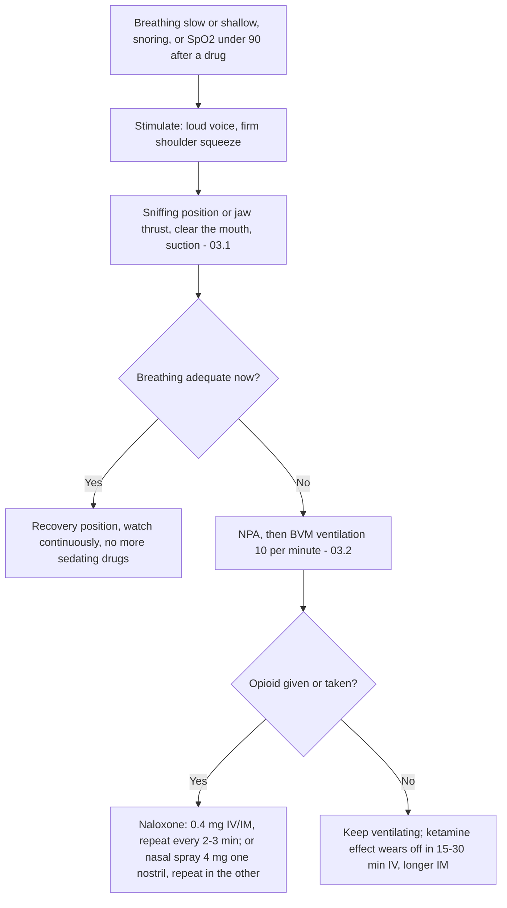

# 04.8 · Nausea, sedation risks and dangerous combinations

By the end of this lesson you will be able to stop a casualty vomiting, keep a sedated casualty breathing, recognise the drug combinations that kill in the field, and you will finish the module with your own drug card, twenty dosing drills done by hand, and injection technique practised on a model.

> [!CAUTION]
> Performing these procedures on people without the required state certification is illegal.
> This lesson is for educational purposes only. Practise only on models and animal tissue.

## Why it matters

The combination that kills casualties after drugs are given is simple: **reduced consciousness plus vomiting, or reduced consciousness plus slowed breathing**, in someone nobody is watching. Ketamine and opioids cause nausea; shock, head injury, blast and fear cause it too. Every drug in this module is safe on its own at the right dose; the danger comes from stacking them, from doses repeated by different people, and from the drugs the casualty took before you arrived.

## What to do

### 1. Nausea and vomiting

**Position first:** a vomiting casualty who is drowsy goes on their side (recovery position, or stable side position on a stretcher, head slightly down if no head injury), with suction ready (lesson 03.1). Nothing by mouth if they keep vomiting or have an abdominal wound.

**Ondansetron** (TCCC 2026: 4 mg ODT, IV, IO or IM every 8 hours as needed):

| Route | Adult | Child | Repeat | Max |
|---|---|---|---|---|
| ODT (on the tongue) | **4 mg** (8 mg in large adults) | By weight: **8-15 kg 2 mg, 15-30 kg 4 mg, over 30 kg 8 mg** (Freedman 2006); C-TECC: 4 mg for 4-12 years, 8 mg over 12 years | Every 8 h | Adult 16 mg as a single IV dose (QT risk); usually 8 mg per dose |
| IV / IO | **4 mg** over at least 30 seconds | **0.1 mg/kg** (1 month-12 years, max 4 mg); 4 mg over 12 years (C-TECC; children over 8 kg) | Every 8 h | |
| IM | **4 mg** | 0.1 mg/kg, max 4 mg | Every 8 h | |

- **Contraindications:** congenital long-QT syndrome; use with apomorphine; allergy.
- **Cautions and interactions:** other QT-prolonging drugs (some antiarrhythmics, antipsychotics, macrolides, quinolones, methadone); **serotonin syndrome** with SSRIs, SNRIs, tramadol, fentanyl or triptans (agitation, tremor, fever, twitching); low potassium or magnesium (dehydration, crush).
- **Side effects:** headache, constipation, warmth.
- **Status in Israel:** prescription.

**Household alternatives:**

| Drug | Adult | Child | Cautions |
|---|---|---|---|
| **Dimenhydrinate** (e.g. Dramamine, OTC travel-sickness tablets) | 50-100 mg every 4-6 h, max 400 mg/day | 2-6 years 12.5-25 mg every 6-8 h (max 75 mg/day); 6-12 years 25-50 mg every 6-8 h (max 150 mg/day) | **Sedating** antihistamine: adds to ketamine, opioids and alcohol; dry mouth, confusion in the elderly |
| **Ginger** (tea, crystallised, capsules) | 250 mg to 1 g of ginger a day in divided doses | Small amounts of tea | Weak but harmless |
| **Acupressure at P6** | Press 2-3 finger widths above the inner wrist crease, between the two tendons | Same | Some evidence for post-operative nausea; costs nothing |

Metoclopramide is prescription-only; it can cause acute dystonia and is not used in young children.

### 2. Who is at high risk from sedating drugs

- **Shock:** small doses have big effects; respiratory drive is fragile.
- **Head injury:** sedation hides deterioration (TCCC: caution, document AVPU first).
- **Children and the elderly.**
- **Intoxicated** casualties (alcohol, cannabis, other drugs).
- **Large neck, known sleep apnoea, facial injuries or burns** to the airway.
- **Anyone who has already had sedating drugs**, including their own medication (sleeping pills, benzodiazepines, opioids, antihistamines, antipsychotics).

### 3. Monitor after every potent dose

| When | What |
|---|---|
| Before | AVPU, breathing rate, SpO2 if you have an oximeter, pulse; write on card |
| Every 5 min for the first 15 min, then every 15 min | Same, plus airway sounds (snoring, gurgling) and colour |
| Stop and act if | Breathing under 10 per minute, SpO2 under 90%, snoring or gurgling, responds only to pain or not at all, vomiting while drowsy |

Never leave a casualty alone after ketamine, an opioid or a sedating antihistamine. Assign one person to watch.

### 4. Respond: the sedation ladder

TCCC 2026 says the same in one line: if respirations are reduced after opioids or ketamine, reposition the airway into a sniffing position; if that fails, provide ventilatory support.

**Specific problems:**

- **Emergence reaction** after ketamine (fear, hallucinations, screaming): calm single voice, reduce light and noise, reassure; if partly dissociated, **more ketamine is safer than a benzodiazepine** (TCCC). Combat paramedics may give midazolam 0.5-2 mg for emergence after procedural sedation, prepared to manage the airway; that is not your role.
- **Laryngospasm** (rare; sudden high-pitched noise or silence with effort to breathe after ketamine): jaw thrust hard, suction, BVM with a tight seal and steady pressure; it usually breaks within a minute.
- **Hypersalivation:** turn on the side, suction.
- **Vomiting while drowsy:** turn immediately, suction, then ondansetron.
- **Naloxone is short-acting** (30-90 minutes); opioid effects can return. Watch for at least 2 hours.

### 5. Combinations never to give in the field

| Combination | Why | What instead |
|---|---|---|
| **Benzodiazepine + ketamine, esketamine or an opioid** | Respiratory arrest; TCCC 2026: not recommended / should not be used | More ketamine for agitation; no benzodiazepines in the field |
| **Opioid + alcohol, sleeping pills or sedating antihistamines** | Additive respiratory depression | Acetaminophen, NSAID, ketamine |
| **Two NSAIDs** (ibuprofen + naproxen, meloxicam + diclofenac, NSAID + aspirin for pain) | Stomach bleeding, kidney injury, no extra pain relief | One NSAID + acetaminophen |
| **NSAID + anticoagulant** (warfarin, apixaban, rivaroxaban, dabigatran) or + SSRIs | Bleeding | Acetaminophen or dipyrone |
| **NSAID in shock or dehydration** | Acute kidney injury | Fluids first, or acetaminophen |
| **Two acetaminophen sources** (pack + cold-and-flu tablet + syrup) | Liver failure | Count every source against the daily maximum |
| **Suzetrigine + strong CYP3A inhibitors** (clarithromycin, ketoconazole, itraconazole, ritonavir) or grapefruit | Contraindicated; toxic levels | Other analgesics |
| **Ondansetron + apomorphine**; caution with other QT drugs | Contraindicated / arrhythmia | Dimenhydrinate, ginger |
| **Ondansetron + tramadol, SSRIs, SNRIs, fentanyl** | Serotonin syndrome (rare); reduced tramadol effect | Watch for agitation, tremor, fever |
| **Ceftriaxone + calcium in the same line** | Precipitates (fatal in newborns) | Separate lines or flush well |
| **Calcium + citrated blood in the same tubing** | Clots the line | Flush or separate line |
| **Calcium + digoxin** | Digoxin toxicity | Give slowly, only if blood was transfused |
| **TXA after 3 hours** | Increased bleeding deaths | Withhold and record |
| **Dipyrone in G6PD deficiency** | Haemolysis | Acetaminophen |

### 6. Take a medication history that catches them

Use AMPLE/SAMPLE and ask specifically:

1. "What medicines do you take every day?" (blood thinners, antidepressants, sleeping pills, heart drugs, insulin, steroids)
2. "What did you take today, including for pain, colds or sleep?"
3. "Any alcohol or other drugs today?"
4. "Any allergies, and what happened?"
5. Check for pill boxes, a phone medical ID, a medical bracelet.

Write the answers on the card before you give anything.

### Watch

The CDC shows how to give naloxone nasal spray:

https://www.youtube.com/watch?v=odlFtGNjmMQ

Johns Hopkins Bloomberg School of Public Health shows naloxone with rescue breathing:

https://www.youtube.com/watch?v=8eUUf5ssH_4

Kevin Mackey (5 Minutes or Less of EMS) covers ketamine indications, contraindications and EMS use:

https://www.youtube.com/watch?v=75AGJCBRXyI

Carl J. Bonnett, MD explains ketamine emergence reactions:

https://www.youtube.com/watch?v=Ta5EydgXGS4

## Improvise it

- **Suction:** a turkey baster or a 60 ml syringe with a length of soft tubing; a finger sweep with a cloth only for visible solids; gravity (turn the casualty) is the most reliable (lesson 03.1).
- **Head-up or side position on a stretcher or door:** wedge a rolled blanket behind the back so the casualty cannot roll onto their face.
- **Monitoring without an oximeter:** count breaths for a full 30 seconds, watch lip and nail-bed colour, listen for snoring; a phone timer every 5 minutes reminds you.
- **Nausea:** ginger tea, P6 pressure, small cold sips, fresh air, a closed-eye rest; avoid strong food smells.
- **Bag-valve-mask failure:** mouth-to-mask with a pocket mask or a cut plastic bottle is a poor last resort (lesson 03.2).

**What fails:** "sleeping it off" without a watcher; propping a drowsy casualty sitting up with the head falling forward (blocks the airway); dimenhydrinate given "to calm" a casualty already on ketamine (deeper sedation, more confusion).

## When it goes wrong

- **Nobody is watching.** Assign a named watcher after every sedating drug.
- **Repeat doses by different people.** One drug record on the card, one person in charge of drugs.
- **Giving a benzodiazepine for agitation after ketamine.** TCCC: more ketamine instead.
- **Naloxone wears off** while the opioid persists. Keep watching for 2 hours; repeat if needed.
- **Missing a home drug.** The casualty on apixaban gets ibuprofen; the casualty on an SSRI gets tramadol and ondansetron. Ask first.
- **Ondansetron hides worsening.** Repeated vomiting after a head injury is a warning sign (Module 5.2); treat it, but do not ignore it.

## Scope and law

Positioning, airway manoeuvres, suction and BVM are within EMT care, and naloxone nasal spray is designed for lay rescuers where it is available. Ondansetron, benzodiazepines, opioids, ketamine and injectable drugs are prescription drugs whose administration is paramedic or physician practice in Israel; OTC dimenhydrinate at label doses is reasonable lay aid. The Duty to Rescue Law gives no immunity for how you help ([lesson 01.5](../module-01/lesson-05.md)); your firmest duty here is to watch and protect the airway of any casualty who has received sedating drugs.

## Practice

**Module 4 scenario: your drug card, 20 dosing drills and injection technique (120 minutes).**

> [!WARNING]
> Never inject a person for practice. All injections in this drill go into meat, fruit or a trainer, with water only. Keep needles in a sharps container (an empty plastic bottle with a screw cap) and never recap by hand.

What you need: a raw turkey drumstick or chicken thighs with skin (or an injection trainer pad), an orange, 1, 3, 5 and 10 ml syringes, 23G 25 mm needles, an intranasal atomiser if available, vials or bottles of water labelled with the concentrations below, tape, a marker, a calculator, paper or a printout of the card template, a timer.

### Part 1. Your personal drug card (40 minutes)

Make a pocket card (A6 or two sides of an index card, laminated or in a zip bag) with one row per drug you could realistically have or meet. Use lessons 04.3-04.8.

| Drug and strength you hold | Indication | Adult dose and route | Child dose per kg | Repeat | Max | Contraindications / never with | Rx or OTC |
|---|---|---|---|---|---|---|---|
| Acetaminophen 500 mg tab, 120 mg/5 ml syrup | | | | | | | |
| Ibuprofen 200/400 mg, 100 mg/5 ml | | | | | | | |
| Dipyrone 500 mg | | | | | | | |
| (Meloxicam 15 mg) | | | | | | | |
| (Suzetrigine 50 mg) | | | | | | | |
| (Ketamine 50 and 100 mg/ml) | | | | | | | |
| (TXA 100 mg/ml) | | | | | | | |
| (Calcium gluconate 10%, chloride 10%) | | | | | | | |
| (Cephalexin / cefadroxil / ceftriaxone) | | | | | | | |
| (Ondansetron 4 mg ODT, 2 mg/ml) | | | | | | | |
| Dimenhydrinate 50 mg | | | | | | | |
| Lidocaine 2% (IO) | | | | | | | |

On the back: the formula (dose = mg/kg × kg; volume = dose ÷ concentration), the APLS weight formulas, "1% = 10 mg/ml, 1:1000 = 1 mg/ml", the never-combine list, and the sedation ladder. Drugs in brackets are ones you may meet in a team kit; mark them prescription.

### Part 2. Twenty dosing drills (40 minutes)

Work on paper, without looking at the answers. Use the concentrations given.

1. Ketamine 100 mg IM for an adult, from a 50 mg/ml vial. How many ml?
2. Ketamine 50 mg IN for an adult, from 100 mg/ml. How many ml, and per nostril?
3. Ketamine 0.2 mg/kg IV for a 90 kg adult. Dose? Volume from 50 mg/ml diluted to 5 mg/ml?
4. TXA 2 g from 500 mg/5 ml ampoules. How many ampoules and ml?
5. TXA 15 mg/kg for a 20 kg child, from 100 mg/ml. Dose and ml?
6. TXA 15 mg/kg for a 75 kg 14-year-old. Dose and ml? (Remember the maximum.)
7. Calcium chloride 10% for an adult after the first unit of blood. How many ml?
8. Calcium chloride 10%, 20 mg/kg, for a 25 kg child. Dose and ml?
9. Calcium gluconate 10%, 60 mg/kg, for an 18 kg child. Dose and ml?
10. Acetaminophen 15 mg/kg for a 22 kg child, syrup 120 mg/5 ml. Dose and ml? Maximum doses per day?
11. Ibuprofen 10 mg/kg for a 14 kg child, suspension 100 mg/5 ml. Dose and ml? Maximum per day?
12. Ibuprofen 10 mg/kg for a 45 kg 12-year-old. Dose?
13. Ceftriaxone 50 mg/kg IV for a 16 kg child, vial reconstituted to 100 mg/ml. Dose and ml?
14. Ceftriaxone 2 g IM for an adult, 1 g vials each made up with 3.5 ml lidocaine 1% (about 4 ml). How do you give it?
15. Cephalexin 25 mg/kg for a 12 kg child, suspension 250 mg/5 ml. Dose and ml, how often?
16. Cefadroxil 30 mg/kg for a 24 kg child, suspension 250 mg/5 ml. Dose and ml, how often?
17. Ondansetron 0.1 mg/kg IV for a 15 kg child, 2 mg/ml. Dose and ml?
18. Ondansetron ODT for a 10 kg toddler, tablets 4 mg. How much?
19. Lidocaine 2% for IO: adult initial dose, and for a 20 kg child (0.5 mg/kg). ml?
20. A 4-year-old, weight unknown, needs acetaminophen 15 mg/kg from syrup 120 mg/5 ml. Estimate weight, dose and ml.

Answers

1. 100 ÷ 50 = **2 ml**.
2. 50 ÷ 100 = **0.5 ml**, about **0.25 ml per nostril** (plus about 0.1 ml atomiser dead space in the syringe).
3. 0.2 × 90 = **18 mg**; 1 ml of 50 mg/ml + 9 ml saline = 5 mg/ml; 18 ÷ 5 = **3.6 ml** over 1 minute.
4. 2000 ÷ 500 = **4 ampoules = 20 ml**.
5. 15 × 20 = **300 mg = 3 ml**.
6. 15 × 75 = 1125 mg, above the 1 g limit used for children: give **1 g = 10 ml** (many protocols simply give a 14-year-old of adult size the adult dose; follow physician direction).
7. **10 ml** (1 g).
8. 20 × 25 = **500 mg = 5 ml**.
9. 60 × 18 = **1080 mg = 10.8 ml**.
10. 15 × 22 = **330 mg**; 120 mg/5 ml = 24 mg/ml; 330 ÷ 24 = **13.75 ml (about 13.8 ml)**; maximum 75 mg/kg/day = 1650 mg = **5 doses** a day.
11. 10 × 14 = **140 mg**; 20 mg/ml → **7 ml**; maximum 40 mg/kg/day = 560 mg = **4 doses** a day.
12. 10 × 45 = 450 mg, above the 400 mg per-dose cap: **400 mg**.
13. 50 × 16 = **800 mg = 8 ml**, slow IV over about 5 minutes.
14. **Two separate IM injections of about 4 ml (1 g each)** into two large muscles (both thighs, or thigh and ventrogluteal). Never IV.
15. 25 × 12 = **300 mg**; 50 mg/ml → **6 ml every 6 hours**.
16. 30 × 24 = **720 mg**; 50 mg/ml → **14.4 ml once daily**.
17. 0.1 × 15 = **1.5 mg = 0.75 ml**, over at least 30 seconds.
18. 8-15 kg band: **2 mg = half a 4 mg tablet**.
19. Adult **40 mg = 2 ml** over 2 minutes; child 0.5 × 20 = **10 mg = 0.5 ml**.
20. (2 × 4) + 8 = **16 kg**; 15 × 16 = **240 mg**; 240 ÷ 24 = **10 ml**.

### Part 3. IM and IN technique on a model (30 minutes)

1. **IM, 10 injections.** On the turkey drumstick or chicken thighs: landmark as if it were a thigh (middle third, outer front), stretch the skin, 90° in one motion to the hub, inject 1 ml of water coloured with food colouring over 5 seconds, withdraw, press. Into the sharps bottle without recapping.
2. **Check placement.** Cut through each injection site. Count how many are in muscle, how many in fat or skin.
3. **Deltoid landmarks on a partner (no needle).** Find the acromion, mark the injection site 2-3 finger widths below in the centre of the muscle; partner checks.
4. **IN, 5 runs.** Draw 0.5 ml water plus dead space, atomise 0.25 ml per side into a paper towel tube or onto a tissue. Practise the one-handed brisk push.
5. **Under pressure.** A partner reads you three drills from Part 2 at random; you draw up the dose, label the syringe and say the dose and volume out loud, timed.

### Part 4. Debrief (10 minutes)

Answer in writing: which drill did you get wrong and why (weight, concentration, maximum or units)? Which drug on your card do you not actually have, and do you need it? Which of your family's daily medicines appear on the never-combine list?

How you know it worked: your card fits in a pocket, every row has a maximum and a contraindication, and drugs you do not hold legally are marked; you got at least 18 of the 20 drills right without looking (redo the module's lessons for any you missed); at least 8 of 10 IM injections were in muscle; each timed draw-up under pressure took under 90 seconds with a labelled syringe and a correct read-back.

## Sources

- Committee on Tactical Combat Casualty Care. *TCCC Guidelines*, 01 May 2026: Tactical Field Care 11c (monitoring, sniffing position and ventilation, ondansetron 4 mg every 8 h, no benzodiazepines with ketamine, esketamine or opioids, more ketamine for partial dissociation) and 13c (midazolam for emergence at combat paramedic level).
- Committee for Tactical Emergency Casualty Care. *C-TECC Pediatric Guidelines* v2.8, 2024 (ondansetron doses by age and weight).
- Freedman SB, Adler M, Seshadri R, Powell EC. Oral ondansetron for gastroenteritis in a pediatric emergency department. *N Engl J Med* 2006;354:1698-1705 (weight bands).
- US FDA drug safety communication on ondansetron and QT prolongation (2012): maximum single IV dose 16 mg.
- Vertex. *JOURNAVX prescribing information*, 1/2026 (CYP3A contraindication, grapefruit).
- TCCC pharmacology reference TCCC-CMC-SC-26 (2021) (calcium interactions).
- Lee A, Chan SKC, Fan LTY. Stimulation of the wrist acupuncture point PC6 for preventing postoperative nausea and vomiting. *Cochrane Database Syst Rev* 2015.
