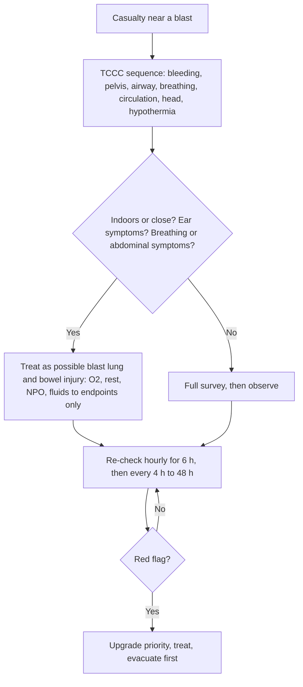

# 05.1 · Blast injury

By the end of this lesson you will be able to look at a casualty from a rocket, drone or bomb and think in four layers of injury instead of one, find the injuries that hide (the lungs, the bowel, the ears, the brain), apply the TCCC rules that are specific to blast, and keep re-checking the "lightly injured" for the 48 hours in which blast injuries can still declare themselves.

> [!CAUTION]
> Performing these procedures on people without the required state certification is illegal.
> This lesson is for educational purposes only. Practise only on models and animal tissue.

## Why it matters

Explosions caused about four in five of the injuries in the IDF trauma registry during the war (lesson 01.4), and rockets, drones and bombs are what reach Israeli homes and streets. An explosion does not cause one injury. It causes several at once, through different mechanisms, and the most visible one (a bleeding leg, a burned face) is often not the one that kills.

An EMT course teaches you to treat what you see. Blast care adds two habits: **look for what you cannot see**, and **look again later**. A casualty who walks away from a blast can develop breathing failure or an abdominal catastrophe hours afterwards, at a time when, in a cut-off place, you are the only person watching.

## What to do

### The four (and five) layers of blast injury

| Type | Cause | Typical injuries | What it hides |
|---|---|---|---|
| **Primary** | The pressure wave itself hitting the body | **Blast lung**, **ruptured eardrum** and middle ear damage, **bowel** bruising and perforation, eye rupture, concussion, air embolism | Often no visible wound at all |
| **Secondary** | Fragments and debris thrown by the blast (casing, shrapnel, glass, stones, added nails or ball bearings) | Penetrating wounds anywhere: limbs, torso, neck, eyes | Small entry holes over deep injuries; fragments in the chest or abdomen through a tiny skin wound |
| **Tertiary** | The person thrown against walls or the ground, or crushed by collapse | Fractures, traumatic amputation, head and spine injury, pelvic fracture, crush | Pelvic and spinal injuries in a casualty who is distracted by other pain |
| **Quaternary** | Everything else the explosion causes | Burns, smoke and toxic gas inhalation, crush, dust asthma, worsening of heart or lung disease | Inhalation injury that swells the airway over hours (lesson 05.4) |

Some sources add a **quinary** layer: effects of materials added to a device (chemical, biological, radiological) or unusual inflammatory reactions. If casualties have symptoms that do not fit their wounds (for example pinpoint pupils, drooling), think CBRN and protect yourself first (Module 6).

**Enclosed spaces multiply primary blast.** In an Israeli study of four bombings, 49% of victims died in the two bus bombings against 7.8% in the two open-air bombings, and primary blast injury was found in 77.5% of admitted bus victims against 34.2% in the open (Leibovici et al., 1996). A blast in a room, stairwell, shelter entrance or vehicle should raise your suspicion of blast lung and bowel injury in everyone inside, even those without wounds.

### The sequence does not change

Treat every blast casualty with the TCCC sequence you already know (lesson 01.2, MARCH with circulation first, lesson 01.3). Blast adds specific points along the way:

1. **Massive bleeding:** traumatic amputations and multiple fragment wounds. Tourniquets high and tight for amputations. Look under the clothes of the whole body: fragment wounds are small and many.
2. **Pelvis:** TCCC lists **severe blunt force or blast injury** with pelvic pain, any major lower-limb amputation or near-amputation, signs of pelvic fracture, unconsciousness or shock as indications for a **pelvic binder** (lesson 02.6). After a close blast with a leg amputation, bind the pelvis.
3. **Airway and breathing:** facial burns and soot in a closed space suggest inhalation injury (lesson 05.4). Breathing difficulty can be blast lung, tension pneumothorax, or both (below).
4. **Circulation:** TCCC gives **TXA** to a casualty who will likely need a transfusion **or who has altered mental status associated with blast injury or blunt trauma** (lesson 04.3). After a blast, a confused casualty qualifies for TXA even without visible bleeding.
5. **Head:** blast is the commonest cause of brain injury in war. Use the TBI rules in lesson 05.2.
6. **Eyes and ears:** check vision in each eye (lesson 05.3). Assume everyone near the blast has damaged hearing: speak loudly, face them, use gestures and writing.
7. **Traumatic cardiac arrest after blast:** TCCC says resuscitation of blast or penetrating trauma victims with no pulse, no breathing and no other signs of life **will not be successful and should not be attempted** in the field. Casualties with torso trauma or polytrauma in arrest should have **bilateral needle decompression** before care is stopped (lesson 03.4).

### Blast lung

Blast lung is bruising and bleeding inside the lungs caused by the pressure wave. The CDC calls it the most common fatal primary blast injury among people who survive the first moments.

**Suspect it in anyone close to an explosion, especially indoors, who has:**

- shortness of breath, fast breathing, cough;
- **coughing up blood** (hemoptysis), or frothy blood-tinged sputum;
- chest pain;
- falling SpO2 on the oximeter;
- the triad the CDC describes for severe cases: **apnea, slow heart rate and low blood pressure** right after the blast.

**Timing:** signs are usually present when you first examine the casualty, but **they have been reported up to 48 hours after the explosion** (CDC). This is why "lightly injured" people who were close to the blast must be re-checked, not just sent away.

**What you do:**

1. Sit the conscious casualty up if that is easier for them, or put them in the recovery position (lesson 03.1).
2. **Oxygen** if you have it, aiming for SpO2 ≥ 90% (≥ 92% with head injury) (lesson 03.7).
3. **Watch for tension pneumothorax**: blast lung and fragment wounds can both cause it. Use the six TCCC criteria (lesson 03.3) and decompress if they are met.
4. **Fluids only to the TCCC endpoints** (radial pulse, mental status, or SBP 100), no more (lesson 04.1). Extra fluid floods injured lungs. This follows from the TCCC endpoints; it is not a separate blast rule.
5. **Rest.** Physical exertion worsens breathing; carry them, do not make them walk.
6. Evacuate as a priority when you can. Tell the receiving team "blast lung suspected": the CDC primer warns that positive-pressure ventilation and air transport carry extra risk (tension pneumothorax, air embolism) in blast lung.

### The ears: a clue, not a test

A ruptured eardrum is the commonest primary blast injury. Signs: hearing loss, ringing (tinnitus), ear pain, blood from the ear canal, dizziness.

What the eardrum tells you, from Israeli data:

- In 647 survivors of 11 bombings in Israel (1994-1996), 142 had an **isolated** ruptured eardrum. **None** of them later developed lung or bowel blast injury (Leibovici et al., 1999). An isolated ruptured eardrum, in a casualty who feels well and breathes well, does not by itself predict hidden lung injury.
- But the opposite is not true: **an intact eardrum does not rule out blast lung**. You cannot look in the ears instead of watching the breathing.
- In a field setting without an otoscope, blood from the ear and sudden deafness are enough to say "this person was close to a strong pressure wave": re-check their breathing and abdomen as you would for anyone close to the blast.

**Ear care:** do **not** irrigate the ear or put anything in it, and keep water out of the ear canal until it heals (JTS Aural Blast CPG 2025). Most perforations (80-94%) heal on their own, mostly within eight weeks. Hearing loss lasting more than 72 hours needs an audiologist or ENT when the system is back; a prescriber may give steroids, so note the time of the blast and the hearing complaint on the casualty card.

### The abdomen: the late killer

The gas-filled bowel is vulnerable to the pressure wave. The CDC lists bowel perforation, bleeding into the bowel wall and mesentery, solid organ tears and testicular rupture. **Bowel injury can be silent at first and declare itself later**, when a bruised segment of bowel dies and perforates.

Suspect abdominal blast injury, and re-examine every few hours, in anyone close to the blast who has:

- abdominal pain, nausea, vomiting, vomiting blood;
- rectal pain or an urge to pass stool, testicular pain;
- **unexplained shock** (fast pulse, pale, weak radial pulse) without enough visible bleeding;
- a tense, tender or increasingly swollen abdomen, guarding, or pain on moving.

What you can do in the field is limited: treat shock to the TCCC endpoints, give nothing by mouth if you suspect bowel injury (small sips for comfort only, and oral medication only if needed), antibiotics as for penetrating wounds if prescribed (lesson 04.6), and push hard for surgical evacuation. Lesson 05.5 covers the abdomen in detail.

### Observation and re-survey for the "walking wounded"

When no one can take casualties away, those with "minor" blast injuries stay with you. Course rule, built from the CDC timing above:

1. **Full head-to-toe survey within the first hour**, clothes off in a warm place. Fragment wounds are often missed on the back, buttocks, armpits, scalp and groin.
2. **Write down** for each person: distance from the blast, indoors or outdoors, ear symptoms, breathing rate, SpO2, pulse, abdominal pain.
3. **Re-check breathing, pulse, SpO2 and abdomen every hour for 6 hours**, then every 4 hours until 48 hours have passed (lesson 07.2 covers the flowsheet).
4. **Red flags that change the plan:** new breathlessness or cough with blood, SpO2 falling, new abdominal pain or vomiting, confusion, a new headache that worsens, fainting.

### Watch

The NEJM Group's short animated clips show the mechanisms of the four blast injury types, and then what the pressure wave does to the lungs:

https://www.youtube.com/watch?v=-Pyqzj5jGaI

https://www.youtube.com/watch?v=pR1rHXWBdVo

A trauma surgeon lecture for a US regional trauma advisory committee (MTAC, 2023) on civilian blast injury patterns and hospital lessons:

https://www.youtube.com/watch?v=Cj5HYlzhxJo

EM Note's explainer on blast lung (an emergency-medicine educator; hospital-oriented, but the recognition part applies in the field):

https://www.youtube.com/watch?v=geTaNF-25_c

## Improvise it

### Monitoring without a monitor

| What you need to watch | Improvised method | What fails / the risk |
|---|---|---|
| Breathing rate | Count for 30 seconds and double, using a phone stopwatch | People breathe faster when watched; count while you pretend to check the pulse |
| Oxygen | Home finger pulse oximeter (many Israeli homes have one since COVID) | Cold fingers, shock and nail polish give false readings (lesson 03.7); trust the trend and the patient, not one number |
| Blood in sputum | Ask them to cough into a white tissue or paper | Blood from a facial or mouth wound looks the same; look in the mouth first |
| Abdomen getting bigger | Measure the waist at the navel with a string or a tape measure, mark the string, re-measure later | Swelling of the abdominal wall or wet clothes can mislead; use it as a trend |
| Shock | Radial pulse quality, mental state, skin colour, capillary refill, pulse rate trend on paper | A frightened person has a fast pulse too; reassess after calming them |

### Protecting hearing and talking to deafened casualties

- After an explosion, many casualties and helpers cannot hear. Use a **phone screen or paper** to write short instructions in large letters. Face the person, point and gesture.
- Plug a perforated ear only with a **loose, dry cotton wool ball** to keep dirt and water out. Do not push anything into the canal, and do not use drops or water.

### Rest and positioning for breathing

- Prop the conscious casualty up with pillows, a backpack or rolled blankets against a wall. A chair turned backwards, with them leaning forward onto a pillow on its back, helps many breathless people.
- Carry them on an improvised litter (Module 6) rather than letting them walk if they are short of breath.

**How to tell the improvised monitoring is failing:** your numbers are not written down with times, so you cannot see a trend; or the casualty is "fine" but has not been looked at for more than the interval you set. Put one person in charge of the observation list and an alarm on a phone for each round.

## When it goes wrong

| Problem | Why it happens | Recovery |
|---|---|---|
| A casualty sent away as "uninjured" collapses hours later | Blast lung or bowel injury declares itself late (up to 48 h) | Never release blast-exposed people from a closed space without breathing and abdominal checks; give them written red flags and a way to call |
| A fragment wound in the back or armpit found on day 2, infected | No full body survey, clothes not removed | Full survey in the first hour, front and back, with a second person checking |
| Pulmonary oedema after "a few litres to be safe" | Fluid given past the TCCC endpoints into bruised lungs | Stop fluids once radial pulse and mental status return; oxygen; sit up |
| CPR on a blast casualty in arrest while others bleed | Habit from EMT cardiac training | TCCC: no CPR for blast arrest in the field; bilateral NDC, then turn to the living |
| Treating the eardrum as the test for blast lung | Misreading old teaching | The breathing and SpO2 trend decides, not the ear |
| Missing the pelvis | Distracted by a dramatic leg amputation | Bind the pelvis for any major leg amputation after blast (02.6) |

## Scope and law

Recognising blast injuries, positioning, oxygen, bleeding control, the pelvic binder and observation are within reasonable lay and EMT aid. TXA, IV fluids, antibiotics and needle decompression are paramedic or physician powers in Israel. The Duty to Rescue Law (1998) obliges you to help but gives no immunity; the legal basis for acting beyond your scope is set out in [01.5 · The law and your scope in Israel](../module-01/lesson-05.md). Act beyond your training only when it is that or death and no one more qualified can be reached or direct you.

## Practice

**Drill: blast casualty cards and a 48-hour watch (40 minutes).** Paper, pens, a phone timer, a partner to play casualties and read out updates. No tissue needed.

1. Your partner writes six cards, one casualty each, after a drone hits the entrance of a building: for example (a) leg amputation, confused; (b) ringing ears, bleeding ear, walking; (c) fragment wound under the left armpit, short of breath; (d) no wounds, was inside the stairwell, coughing; (e) burned hands, soot around the nose, hoarse; (f) abdominal pain, no visible wound, pulse 118.
2. For each card, in 2 minutes: name every blast layer involved, the hidden injury you fear most, and your first three actions. Say whether TXA, a pelvic binder, oxygen or NDC is indicated by TCCC.
3. Set up an observation sheet (time, RR, SpO2, pulse, abdomen, red flags) for the "walking" casualties.
4. Your partner then reads timed updates: "hour 3: casualty (d) coughs pink froth, SpO2 88%"; "hour 9: casualty (b) still fine"; "hour 20: casualty (f) vomits, abdomen swollen". Decide and write what you do each time.

How you know it worked: every card lists at least two blast layers; you gave TXA (or flagged it for a provider) to the confused amputee and bound his pelvis; you treated (c) and (d) as possible blast lung with tension pneumothorax in mind; you did not discharge (b) without a breathing check; your sheet has times and numbers you could hand to a doctor; and each update led to a specific decision within 1 minute.

## Sources

- Committee on Tactical Combat Casualty Care. *TCCC Guidelines*, 01 May 2026: TFC 3 (pelvic binder), 5 (breathing), 6d (TXA including altered mental status after blast), 17 (CPR and bilateral NDC).
- Centers for Disease Control and Prevention. *Explosions and Blast Injuries: A Primer for Clinicians* (blast lung triad and timing up to 48 h; abdominal injury; air embolism).
- Leibovici D, Gofrit ON, Shapira SC. Eardrum perforation in explosion survivors: is it a marker of pulmonary blast injury? *Ann Emerg Med* 1999;34(2):168-172.
- Leibovici D, Gofrit ON, Stein M, et al. Blast injuries: bus versus open-air bombings. A comparative study of injuries in survivors of open-air versus confined-space explosions. *J Trauma* 1996;41(6):1030-1035.
- Joint Trauma System. *Aural Blast Injury/Acoustic Trauma and Hearing Loss* CPG, 14 Aug 2025 (no irrigation, dry ear, 80-94% spontaneous healing, 72-hour hearing rule).
