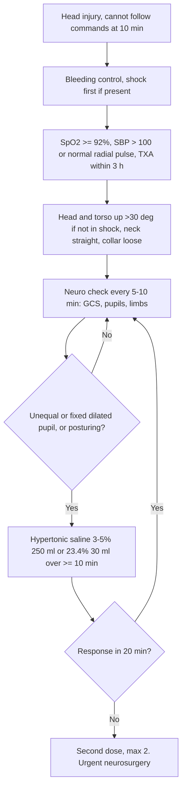

# 05.2 · Head injury (TBI)

By the end of this lesson you will be able to decide whether a casualty has a moderate or severe traumatic brain injury by the 2026 TCCC definition, protect the injured brain from the two things that kill it after the injury (low oxygen and low blood pressure), position the casualty correctly, recognise herniation and know the hypertonic saline doses, dress a penetrating head wound, and keep a written neuro-check trend for hours.

> [!CAUTION]
> Performing these procedures on people without the required state certification is illegal.
> This lesson is for educational purposes only. Practise only on models and animal tissue.

## Why it matters

You cannot fix the brain injury itself in the field. What you can prevent is the **second injury**: the damage done in the following hours by low oxygen, low blood pressure, swelling, seizures and fever. C-TECC notes that hypotension can double the mortality associated with TBI in children, and the JTS reminds providers that cerebral blood flow suffers more from a fall in blood pressure than from a rise in intracranial pressure. Blast is the main cause of TBI in war (lesson 05.1).

TCCC rewrote its TBI section in the 2026 guidelines: a clear definition of moderate/severe TBI, plasma for TBI without bleeding, a ventilation rate, positioning, and a herniation protocol with hypertonic saline. The EMT course taught you AVPU and "watch the head injury". This lesson gives you the targets and the treatment.

## What to do

### 1. Decide: is this moderate or severe TBI?

TCCC 2026 definition: the casualty is **unable to follow simple instructions (thumbs up, two fingers or blink) beyond 10 minutes after the injury**, **and** a head injury is suspected without another cause.

- If you are not sure whether the abnormal neuro exam comes from TBI or from shock, **treat hemorrhagic shock** first (TCCC).
- Mild TBI/concussion (dazed, headache, confused briefly, now following commands) is assessed later, in prolonged care. It still gets observed (below).
- **Evacuate moderate/severe TBI as soon as possible to neurosurgery**: TCCC notes outcomes are better with surgery within **5 hours** of injury. Tell whoever coordinates evacuation that this is a time-critical head injury.

### 2. Score it: GCS, pupils, limbs

| Glasgow Coma Scale | Score |
|---|---|
| **Eyes:** spontaneously 4, to voice 3, to pain 2, none 1 | 1-4 |
| **Verbal:** oriented 5, confused 4, inappropriate words 3, sounds 2, none 1 | 1-5 |
| **Motor:** obeys 6, localises pain 5, withdraws 4, abnormal flexion 3, extension 2, none 1 | 1-6 |

Severity by GCS (JTS PFC TBI CPG): **mild 13-15, moderate 9-12, severe 3-8.** Record the three parts separately (for example E2 V3 M5 = 10), because the motor score carries most of the prognosis and is the one you can still score in a casualty with a face injury.

- **Pupils:** size in mm (hold a ruler or a pen with marks beside the eye), equal or not, reaction to light. Use a phone torch.
- **Limbs:** can the casualty move all four? Is one side weaker?
- **Red flags** of moderate-severe injury (JTS PFC): witnessed loss of consciousness, two or more blast exposures within 72 hours, unusual or combative behaviour, unequal pupils, seizures, repeated vomiting, double or lost vision, worsening headache, weakness on one side, disorientation, abnormal speech.

### 3. Protect the brain: the TCCC 2026 targets

| Target | How | Notes |
|---|---|---|
| **Oxygen: SpO2 ≥ 92%** | Supplemental oxygen whenever available; NPA and 1000 ml BVM if SpO2 stays below 92% with impaired breathing (lesson 03.2) | Pulse oximetry on every moderate/severe TBI |
| **Blood pressure: SBP > 100 mmHg**, or a **normal radial pulse** if you cannot measure | If hemorrhagic shock is also present, **shock resuscitation takes precedence** (lesson 04.1). If there is no hemorrhage, TCCC gives **1-2 units of plasma** | Plasma is not for mild TBI/concussion. This is higher than the "permissive" endpoint for bleeding alone |
| **Ventilation: EtCO2 35-45 mmHg** if you are ventilating and have capnography | Without EtCO2: **low tidal volume at 10 breaths per minute** (one breath every 6 seconds) | Over-breathing for a casualty narrows brain vessels and starves the brain |
| **TXA 2 g** within 3 hours | For signs of significant TBI or altered mental status after blast or blunt trauma (lesson 04.3) | |

### 4. Lower the pressure in the skull

1. **Head and torso up more than 30 degrees**, **if the casualty is not in shock** and it is tactically feasible (TCCC). Raise the whole upper body, not just the head on a pillow: bending the neck blocks venous drainage.
2. **Head facing forward, no rotation**; **loosen any cervical collar** (TCCC). A tight collar squeezes the neck veins.
3. **Treat agitation and pain** (TCCC): pain and anxiety raise intracranial pressure. TBI and eye injury **do not preclude ketamine**, but use caution with all sedating painkillers in TBI (TCCC 2026; doses in lesson 04.5).
4. **Avoid fever**: the JTS PFC CPG targets a core temperature of 35.6-37.5 °C (96-99.5 °F); acetaminophen 650 mg every 4 hours if needed (adult), and cool the skin with damp cloths and a fan. Avoid hypothermia too (lesson 05.7).
5. **Reassess the neuro status every 5-10 minutes** (TCCC) in the first phase, then at least every hour (JTS PFC).

### 5. Recognise and treat herniation

Herniation means the swelling brain is being pushed through the openings in the skull. Without surgery it is fatal; treatment buys time.

**Signs (TCCC 2026):** **asymmetric or fixed and dilated pupil(s)**, or **posturing** (abnormal flexion or extension of the arms). Also a falling GCS, and **Cushing's triad**: rising blood pressure or widening pulse pressure, **slowing heart rate**, irregular breathing. The JTS PFC CPG calls Cushing's triad a late sign of herniation to be treated immediately.

**Treatment (TCCC 2026, provider level):**

| Drug | Route | Adult dose | Child dose | Repeat | Max | Notes |
|---|---|---|---|---|---|---|
| **3% or 5% hypertonic saline** | IV/IO | **250 ml** over **at least 10 minutes**, then a saline flush | **3%: 2-5 ml/kg** over 10-20 min (Brain Trauma Foundation pediatric guideline) | **Once after 20 minutes** if no response | **2 doses** | Watch the IV/IO site; stop if it leaks into the tissue (extravasation burns tissue) |
| **23.4% hypertonic saline** | IV/IO | **30 ml** over **at least 10 minutes**, then a saline flush | 0.5 ml/kg, max 30 ml, is a hospital dose for refractory pressure, usually via a central line; not a field drug for children | Once after 20 minutes | 2 doses | Very concentrated: a slow push only, never fast |

- **Not prophylactic.** TCCC: do not give hypertonic saline to prevent herniation, only to treat its signs.
- **Not a resuscitation fluid.** It does not replace blood or plasma for shock.
- The JTS PFC CPG (for hours to days) allows 3% 250 ml over 20 minutes **every 3 hours as needed** under medical direction, and mannitol 1 g/kg only when there is no bleeding and SBP is above 110. Mannitol is a diuretic and can drop blood pressure; hypertonic saline is preferred.
- **Brief hyperventilation:** the JTS PFC CPG allows faster ventilation for **no more than 20 minutes** to an EtCO2 of 35 when herniation is suspected, with expert advice. The TCCC 2026 text does not include it. Older guidelines and many videos teach hyperventilation at 20 breaths per minute without capnography: do not use it as routine, because it can cause brain ischaemia.

### 6. Penetrating head wounds and open skull fractures

TCCC 2026 says these casualties are **not automatically expectant**. Many survive with timely surgery.

1. Apply a **surface dressing** that keeps contamination out.
2. If the wound or its edges bleed, put **hemostatic gauze on the surface** and hold **gentle pressure**.
3. **Do not pack anything into the wound cavity.** **Do not close it** with sutures or staples.
4. Gentle, **low-pressure irrigation** of gross contamination with saline or drinkable water is acceptable.
5. **Antibiotics** per TCCC (cefadroxil 1 g PO or ceftriaxone 2 g IV/IO/IM; lesson 04.6).
6. **Leave impaled objects** in place and stabilise them with bulky dressings.
7. Brain tissue in the wound: cover it with a moist, clean, non-stick dressing; do not push it back.

### 7. Seizures

Seizures after TBI raise brain pressure and oxygen demand. JTS PFC CPG:

| Drug | Route | Adult dose | Child dose | Repeat | Notes |
|---|---|---|---|---|---|
| **Midazolam** | IV/IO/IM | **5 mg** | 0.1-0.2 mg/kg IM/IV (common pediatric practice; confirm with a physician) | Every 5 minutes until the seizure stops | Have the BVM ready: breathing can stop. Never combine casually with ketamine or opioids (lesson 04.8) |
| **Levetiracetam** | IV/IO | **1500 mg** over 15 min, then **1000 mg every 12 h** | Physician decision | | Prevention after the first seizure; prescription, hospital drug |

Without drugs: protect the head, turn the casualty on their side when the jerking stops, clear the area, **never put anything in the mouth**, time the seizure, and give oxygen.

### 8. Children

- Use the **pediatric GCS** (verbal scale adapted for age). C-TECC: **pediatric GCS ≤ 12** suggests non-mild TBI, **≤ 8** suggests the need for airway support, **≤ 6** suggests the need for surgery.
- Same principles: prevent hypoxia, treat shock aggressively, head up about 30 degrees, avoid hypothermia, aim for normal ventilation (EtCO2 35-40 per C-TECC).
- Doses above; weight estimation and minimum blood pressures in lesson 05.8.

### Watch

Brainbook (a UK neurosurgery education charity) explains how to score each part of the GCS properly:

https://www.youtube.com/watch?v=h2SIN7Mn0YA

The San Diego Miramar EMT Program shows how to check pupils for size, equality and reaction:

https://www.youtube.com/watch?v=4DikkHsAglw

A US Army Expert Field Medical Badge (EFMB) task demonstration of treating an open head injury, showing a loose, non-compressing dressing:

https://www.youtube.com/watch?v=df6dxpOj4Uo

Master Your Medics (a UK paramedic education channel) walks through managing severe head trauma, including positioning and preventing secondary injury; where it differs from TCCC 2026 targets, use the TCCC numbers above:

https://www.youtube.com/watch?v=uHv9yZt1JpE

## Improvise it

| Need | Improvised version | What works / what fails |
|---|---|---|
| **Head and torso up 30°** | A backpack and rolled blankets under the shoulders and back; a door or ironing board propped at one end as a ramp; a reclining car seat | Raise the whole trunk, keep the neck straight. A single pillow under the head bends the neck and makes things worse |
| **Neck straight, no rotation** | Rolled towels or two filled 1.5 L bottles in socks on each side of the head, taped to the surface | Tape across the forehead only, never across the chin or throat |
| **Pupil check** | Phone torch; a ruler or the 1-2-3 mm lines on a printed card beside the eye | Strong daylight makes both pupils small; shade the eyes with your hand first |
| **GCS card** | Write the scale on the back of the casualty card and on tape on your forearm | Without a written scale, people guess and the trend is useless |
| **Fever control** | Damp cloths on the skin, a fan, light clothing; acetaminophen from the home cabinet | Do not use ice water baths: shivering raises brain pressure |
| **Surface dressing for a skull wound** | Clean cling film or the inside of a clean plastic bag over a moist clean cloth, held loosely with a scarf or bandage | Never press on a depressed skull fracture; tie the bandage beside, not over, the soft area |
| **Seizure safety** | Cushion the head with a jacket, move furniture, time it with a phone | Nothing in the mouth, ever (broken teeth and fingers, no airway benefit) |

### What cannot be improvised

- **Hypertonic saline cannot be made at home for IV use.** Homemade salt solutions are not sterile, not accurate and can destroy blood cells and veins. If you do not have a manufactured solution, the realistic tools are oxygen, positioning, blood pressure, airway and evacuation.
- **Plasma** comes only from a blood program (lesson 04.4).

**How to tell your improvised care is failing:** the GCS falls or a pupil changes between checks, the casualty vomits repeatedly, breathing becomes irregular, or the pulse slows while the blood pressure rises. These are signs of rising pressure: re-check oxygen, blood pressure and positioning at once, and escalate evacuation.

## When it goes wrong

| Problem | Why it happens | Recovery |
|---|---|---|
| GCS falls while you "let him rest" | Hypoxia from a blocked airway in a casualty lying flat | Check airway and SpO2 first every time the GCS drops; NPA, recovery position, oxygen |
| Blood pressure falls after you sat him up | Hidden bleeding: head-up position is only for casualties not in shock | Lay flat, treat shock, look for the bleeding; raise again only when stable |
| Casualty treated as "drunk" or "difficult" | Combativeness and confusion are TBI red flags | Assume TBI after any head trauma or blast; observe, do not argue |
| Over-breathing with the BVM in the excitement | Rescuers squeeze fast | Count aloud: one breath every 6 seconds; small, gentle volumes |
| Packing gauze into a skull wound | Habit from limb wounds | TCCC: hemostatic gauze on the surface with gentle pressure only |
| Hypertonic saline given "to be safe" | Misreading the protocol | Only for signs of herniation; maximum 2 doses |
| Hypertonic saline extravasates | IV/IO slipped | Stop, remove the line, elevate, new access elsewhere |

## Scope and law

Assessment, positioning, airway basics, oxygen, dressing the wound and observation are within EMT-level aid. TXA, plasma, hypertonic saline, benzodiazepines, antiepileptics and IV/IO access are paramedic or physician powers in Israel and these drugs are prescription-only. The Duty to Rescue Law (1998) gives no immunity; see [01.5 · The law and your scope in Israel](../module-01/lesson-05.md) for the legal basis. Prepare and assist a qualified provider; act beyond your scope only when it is that or death and no one more qualified can be reached or direct you.

## Practice

**Drill: the neuro-check hour (45 minutes).** A partner, a phone torch, a ruler, a watch, a printed GCS card, a casualty card or notebook, pillows and a backpack.

1. **GCS calibration (10 minutes).** Your partner acts out six presentations (for example: eyes open to voice, confused speech, localises pain). Score each as E-V-M. Swap. You should agree within 1 point on every one.
2. **Pupils (5 minutes).** Shade your partner's eyes, then check size, equality and reaction with the torch. Record in mm.
3. **Positioning (10 minutes).** With pillows, a backpack and a board, raise your partner's head and torso to about 30 degrees with the neck straight. Check the angle with a phone level app. Then show how you flatten them in 10 seconds if shock appears.
4. **Timed scenario (20 minutes).** Your partner reads a scenario card: 25-year-old, blast in a stairwell, follows no commands at 15 minutes, GCS E2 V2 M5, pupils 3 mm equal. Every 5 minutes they give an update (for example: SpO2 89%; radial pulse weak; left pupil 6 mm and sluggish; arms extend to pain). At each update say your action aloud and write the time, GCS, pupils and action in a table.

How you know it worked: your GCS scores match your partner's within 1 point; the 30-degree position has a straight neck; in the scenario you corrected oxygen before anything else, treated shock before positioning, recognised the dilated pupil and extension as herniation, stated "hypertonic saline 3% 250 ml (or 23.4% 30 ml) over at least 10 minutes, repeat once at 20 minutes if no response" and asked for urgent neurosurgical evacuation; and your table shows a clear trend another person could read.

## Sources

- Committee on Tactical Combat Casualty Care. *TCCC Guidelines*, 01 May 2026: TFC 5c-e (oximetry, oxygen, NPA/BVM with SpO2 below 92% in TBI), 6d (TXA), 6e7 (TBI with weak pulse), 8 (Traumatic Brain Injury: definition, targets, ICP, herniation, penetrating TBI, reassessment), 11 (ketamine not precluded).
- Joint Trauma System. *Traumatic Brain Injury Management in Prolonged Field Care* CPG, 06 Dec 2017, rapid update Apr 2024: GCS severity, red flags, Cushing's triad, temperature target, HTS every 3 h, mannitol, brief hyperventilation, midazolam, levetiracetam.
- Committee for Tactical Emergency Casualty Care. *C-TECC Pediatric Guidelines* v2.8, 05 Jun 2024: pediatric GCS thresholds, normocarbia, head elevation, hypotension risk.
- Kochanek PM, et al. *Guidelines for the Management of Pediatric Severe Traumatic Brain Injury*, 3rd ed., Brain Trauma Foundation, 2019: 3% saline 2-5 ml/kg over 10-20 min; 23.4% 0.5 ml/kg, max 30 ml, for refractory ICP.
