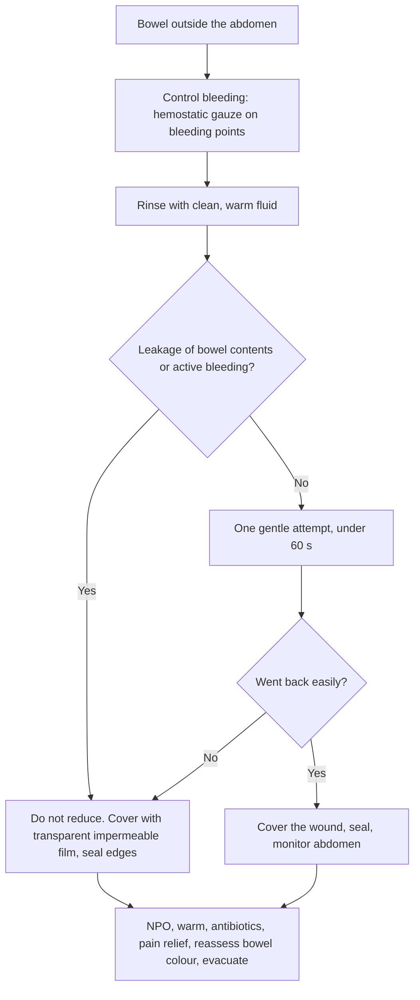

# 05.5 · Abdomen and evisceration

By the end of this lesson you will be able to find every wound that may have entered the abdomen, recognise bleeding inside the belly with your hands and eyes only, keep a casualty with a penetrating torso wound alive for as long as possible without a surgeon, and dress eviscerated bowel the way TCCC 2026 now teaches, including when you may put it back and how to cover it with kitchen cling film.

> [!CAUTION]
> Performing these procedures on people without the required state certification is illegal.
> This lesson is for educational purposes only. Practise only on models and animal tissue.

## Why it matters

A torso wound bleeds where no tourniquet, packing or pressure can reach. In the IDF registry, about a quarter of injuries in the war involved the torso (lesson 01.4). These casualties need a surgeon, and nothing you do replaces one. What you can do is buy time: avoid making the bleeding worse, keep the casualty warm, give TXA, give the right amount of fluid, and make sure they are first in line when evacuation comes.

Evisceration (bowel outside the abdominal wall) looks terrible and is rarely the immediate killer. The TCCC 2026 guidelines updated how to handle it, including a single brief attempt to put the bowel back and an explicit list of covers, among them **clear food wrap**.

## What to do

### 1. Find the wounds

Any penetrating wound **between the nipples and the groin, front, side or back**, may have entered the abdomen. Fragments travel unpredictably: a wound in the buttock can cut the bowel, and a wound in the lower chest can enter the liver or spleen.

1. **Expose the whole torso, front and back**, buttocks, groin and perineum, in a warm place. Log-roll to see the back.
2. Count the holes. An odd number means a fragment is still inside; it does not tell you where it went.
3. **Look and feel:** swelling, bruising, tenderness, **guarding** (the muscles tense when you press), **rigidity** (board-hard belly), pain that spreads to the shoulder (blood under the diaphragm).
4. **Look for blood** in vomit, urine or from the rectum.
5. **After a blast**, the bowel can be injured with no wound at all (lesson 05.1).

### 2. Penetrating torso trauma without a surgeon

You cannot stop internal bleeding. Do everything that keeps the casualty alive until a surgeon can:

| Action | Why | Lesson |
|---|---|---|
| **Control everything you can control**: junctional groin bleeding, limb bleeding, a pelvic binder for pelvic injury | Every millilitre saved outside matters when you cannot stop the bleeding inside | 02.2, 02.6 |
| **TXA 2 g** as soon as possible, within 3 hours | TCCC lists **penetrating torso trauma** among injuries likely to need transfusion | 04.3 |
| **Fluids only to the TCCC endpoints**: palpable radial pulse, improved mental status, or SBP 100; then stop | More fluid raises pressure, dilutes clotting factors and restarts bleeding | 04.1 |
| **Whole blood or plasma** first if available | The preferred resuscitation fluids | 04.4 |
| **Prevent hypothermia** from the start | Cold blood does not clot | 05.7 |
| **Evacuate first** | Surgery is the only cure; tell the coordinator "penetrating abdomen, in shock" | 01.7 |
| **Antibiotics** for open wounds | Bowel contents cause peritonitis | 04.6 |
| **Pain relief** | Ketamine is the TCCC 2026 drug for severe pain; aim for tolerable pain that preserves airway, breathing and mentation | 04.5 |

**Position:** on the back with the knees bent over a rolled blanket relaxes the abdominal muscles and eases pain, or the position of comfort the casualty chooses. If they are vomiting or unconscious, the recovery position.

**Impaled objects:** leave them. Stabilise with rolled cloth on each side and tape. Remove only if the object blocks the airway or CPR (rarely relevant in trauma arrest).

**Food and drink:** keep a casualty with an abdominal wound **nil by mouth** while evacuation is possible within hours. Oral rehydration is **not** used with abdominal injuries (JTS Burn CPG 2025 lists abdominal injury as a reason to avoid enteral resuscitation). Wet the lips and mouth for comfort. If evacuation is days away, the decision about drinking belongs to a physician on the phone (Module 7).

### 3. Evisceration, step by step (TCCC 2026)

1. **Control bleeding.** For uncontrolled bleeding, apply **Combat Gauze or another CoTCCC-recommended hemostatic dressing** (lesson 02.1) to the bleeding point.
2. **Rinse** the exposed bowel with **clean fluid, warm if possible**, to remove gross contamination (dirt, clothing fibres).
3. **Decide about reduction** (putting it back):
   - **Do not attempt** if there is **evidence of ruptured bowel** (gastric or intestinal fluid, or stool, leaking) or **active bleeding**.
   - If there is **no leakage** and **bleeding is visibly controlled**, you may make **a single brief attempt (under 60 seconds)** to replace the bowel into the abdomen: gentle pressure with moist gloved hands, while the casualty bends the knees and breathes out.
   - **Do not force** it. If it does not go back easily, stop.
4. **If you cannot reduce it:** **cover the eviscerated organs with a water-impermeable, non-adhesive material, transparent preferred** so you can see ongoing bleeding. TCCC examples: **a bowel bag, an IV bag, clear food wrap**. Secure the impermeable cover to the skin with **adhesive dressing (for example Ioban, or a chest seal)**. A moist sterile dressing under the cover is the other TCCC option.
5. **Keep the casualty nil by mouth** (TCCC).
6. **Keep the bowel warm**: a dry towel or blanket over the plastic, then the hypothermia wrap over everything.
7. **Reassess the bowel colour every 15-30 minutes** through the transparent cover: pink and moist is good; dusky, purple or black means the blood supply is cut off (often by a tight wound edge), which needs a surgeon urgently.
8. **Document** the time of evisceration, whether reduction was attempted, and the bowel colour on the casualty card.

Many older videos and first-aid books say "never put the bowel back". TCCC 2026 allows one brief attempt in the specific conditions above; follow the current text.

### 4. Hours to days: watching the abdomen

If evacuation is delayed, the dangers change from bleeding to **infection (peritonitis) and sepsis**.

**Signs of peritonitis:** rising fever (or a falling temperature), a pulse that keeps climbing, a belly that becomes harder, more swollen and more painful, pain on any movement or cough, vomiting, no passing of wind, shallow breathing, confusion. Sepsis recognition and care continue in Module 8.

**What to record every 1-4 hours:** pulse, breathing rate, temperature, mental status, waist measurement (string marked at the navel), pain score, urine, vomit, bowel colour if eviscerated. A physician on the phone needs these numbers.

**Antibiotics:** TCCC gives **cefadroxil 1 g by mouth or ceftriaxone 2 g IV/IO/IM** for open combat wounds (lesson 04.6); a casualty who is nil by mouth gets ceftriaxone. These do not cover the anaerobic bacteria of the large bowel well; C-TECC's pediatric guidelines add **metronidazole** (15 mg/kg IV loading dose in children) when the gut is involved. Adding metronidazole for adults is a physician's decision.

### Watch

The Committee to Protect Journalists' battlefield first-aid series shows how a non-medic covers an abdominal evisceration:

https://www.youtube.com/watch?v=MDWL2bXxsyE

Howard County Department of Fire and Rescue Services and the Maryland Fire and Rescue Institute (posted by Robby May) demonstrate an evisceration dressing with a moist layer and an occlusive cover, as taught to EMTs and paramedics:

https://www.youtube.com/watch?v=hmoBviCt3kg

North American Rescue, a manufacturer, shows its abdominal emergency trauma dressing on an evisceration model:

https://www.youtube.com/watch?v=P-petAdOAqU

A US Army training task video (2nd Infantry Brigade, 3rd Infantry Division) on first aid for an open abdominal wound. It reflects the older soldier task and does not include the TCCC 2026 single reduction attempt:

https://www.youtube.com/watch?v=Q5ISMDrk5hU

## Improvise it

### Evisceration cover

| Material | How | What fails / the risk |
|---|---|---|
| **Clear food wrap (cling film)**, named by TCCC | Discard the first two turns of the roll (the cleanest film is inside). Lay a large sheet over the bowel, 5-10 cm beyond the wound on all sides. Seal the edges with tape, a chest seal or duct tape on dry skin | If wrapped round and round the whole torso it restricts breathing and can strangle swelling bowel: lay sheets, do not bind tightly |
| **Cut-open IV bag** (named by TCCC) | Cut along three sides, open like a book, inner surface towards the bowel | Small: fine for a small evisceration |
| **Clean freezer or oven bag** | Cut open; inner surface towards the bowel | Opaque bags hide bleeding; prefer clear |
| **Moist layer** (optional, under the film) | Clean cotton cloth or gauze soaked in boiled and cooled water or saline, wrung out | Dries out and sticks if left uncovered; always cover with the film |
| **Warmth** | Dry towel over the film, then blankets or a hypothermia wrap | Wet cloth without a plastic cover cools the bowel |

**Never** use paper towels, toilet paper or cotton wool on bowel: they shred and stick. **Never** apply pressure on the bowel itself.

### Rinsing fluid

TCCC says "clean (and warm if possible) fluid". Drinkable tap or bottled water is acceptable. Boiled water must be **cooled to body temperature** (test on your inner wrist). Saline from a kit is better, if you have it.

### Securing on a wet, bloody abdomen

Tape does not stick to wet skin. Wipe and dry a ring of skin around the wound with a towel first. A chest seal's adhesive works well as a frame. On a hairy abdomen, a few strips of duct tape over the film edges hold better than medical tape. A wide elastic bandage or a pillowcase tied loosely over everything keeps it in place during transport.

**How to tell the improvised dressing is failing:** the film has lifted and the bowel is drying (dull, sticky surface), you can no longer see the bowel colour, or the casualty is getting cold. Re-moisten, re-cover and re-warm.

### Improvised positioning

A rolled blanket or a backpack under the knees; a pillow under the head. For transport, strap the knees over the roll so it does not slip.

## When it goes wrong

| Problem | Why it happens | Recovery |
|---|---|---|
| Back wound found on day 2 | Casualty never log-rolled | Expose and inspect front and back in the first survey |
| Casualty bleeds again after "a good bag of fluid" | Fluid past the endpoints raised pressure and diluted clotting | Stop at radial pulse and mental status; warm; TXA if within 3 h |
| Bowel turns dark purple | Strangled in a tight wound, or film wrapped too tight | Loosen the cover; never force reduction; urgent surgery |
| Stool leak and you pushed the bowel back | Did not check for leakage first | Contamination now inside: antibiotics, tell the receiving surgeon exactly what happened |
| Bowel dries and sticks | Dry gauze directly on bowel, no impermeable cover | Moisten with clean fluid, cover with film |
| Casualty given food "because evacuation is late" | Hunger and pity | Nil by mouth unless a physician decides otherwise; mouth care for comfort |
| Hypothermia | Exposed abdomen, wet dressings | Cover, warm, hypothermia wrap (05.7) |

## Scope and law

Finding wounds, positioning, evisceration covering, warming and monitoring are within EMT-level aid; the single brief reduction attempt is a TCCC skill that belongs to the trained responder, and is done only within the conditions above. TXA, IV/IO fluids, blood, ketamine and antibiotics are paramedic or physician powers and prescription drugs in Israel. The Duty to Rescue Law (1998) gives no immunity; see [01.5 · The law and your scope in Israel](../module-01/lesson-05.md) for the legal basis. Act beyond your scope only when it is that or death and no one more qualified can be reached or direct you.

## Practice

**Drill: evisceration on a model (40 minutes).** A pillow or cushion in an old T-shirt as the "abdomen", a long string of kosher beef or chicken sausages (uncut links) as the bowel, a kitchen knife to cut a 10 cm slit in the T-shirt, a roll of cling film, a clean freezer bag, a 1 L bottle of lukewarm water, duct tape or a chest seal, a towel, a timer, a marker and a casualty card.

1. Pull 30-40 cm of sausage links out through the slit. Smear a little ketchup on one link to represent bleeding and a little mustard on another to represent stool leakage in one run, and none in a second run.
2. **Run 1 (with "leakage"):** rinse, decide, cover with cling film without reduction, seal the edges, cover with a towel, write the card. Time it.
3. **Run 2 (no leakage, no bleeding):** rinse, make one gentle reduction attempt with a timer running (stop at 60 seconds whatever happens), then cover the wound and seal.
4. Lift the film edge and check that the "bowel" stayed moist; look through the film and describe its colour as you would on a card.
5. Take a photo and compare with the TCCC text above.

How you know it worked: in run 1 you did not attempt reduction; in run 2 your attempt stopped at or before 60 seconds; the film covers 5-10 cm beyond the slit on all sides, is transparent over the bowel and sealed on dry fabric, and is not wrapped round the whole cushion; the card has the time, the reduction decision and the bowel colour; total time per run is under 5 minutes.

## Sources

- Committee on Tactical Combat Casualty Care. *TCCC Guidelines*, 01 May 2026: TFC 6d (TXA for penetrating torso trauma), 6e (fluid endpoints), 12 (antibiotics), 13b (abdominal evisceration: bleeding control, rinse, reduction rules with a single brief attempt under 60 seconds, transparent impermeable cover including clear food wrap, adhesive securing, do not force, NPO).
- Centers for Disease Control and Prevention. *Explosions and Blast Injuries: A Primer for Clinicians* (abdominal blast injury signs).
- Joint Trauma System. *Burn Care* CPG, 10 Jun 2025 (abdominal injury as a reason to avoid enteral resuscitation).
- Committee for Tactical Emergency Casualty Care. *C-TECC Pediatric Guidelines* v2.8, 2024 (cefazolin plus metronidazole 15 mg/kg loading dose when the gut is involved).
