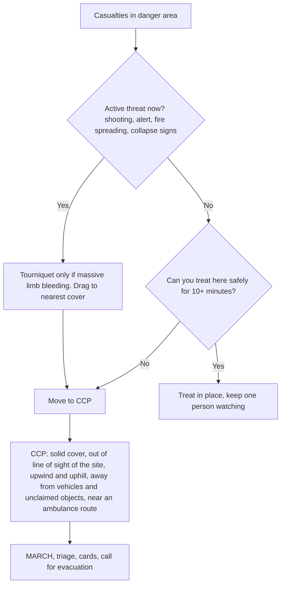

# 06.1 · Scene threats and where to treat

By the end of this lesson you will be able to look at an attack scene through a responder's eyes: spot the threats that injure people who come to help, decide whether to treat a casualty where they lie or move them first, and choose a casualty collection point that is out of the way of the next strike, the fire and the falling building. It is the lesson that keeps you alive long enough to use everything else in this course.

> [!CAUTION]
> Performing these procedures on people without the required state certification is illegal.
> This lesson is for educational purposes only. Practise only on models and animal tissue.

## Why it matters

After a bombing, a rocket or drone impact, or a shooting, the people who rush in are at risk from what happens next. A narrative review of responder risk at terrorist incidents (Thompson et al., 2014) lists secondary explosive devices, further attacks, structural collapse, fire and hazardous materials as the main dangers to responders. In the 2015 San Bernardino attack, an explosive device was left in the room where casualties were being treated; about 30 rescuers worked around it before it was found. In Israel, the war since 7 October has added repeated rocket and drone alerts over the same site, and follow-up strikes on rescuers.

There are two opposite failures:

- **Rushing in** and becoming a second casualty, which takes away a rescuer and adds a patient.
- **Waiting too long.** A 2023 review of the "stage and wait" practice argues that holding all medical care back until a scene is declared safe was set without good evidence and costs lives from bleeding that a tourniquet would have stopped. TCCC and TECC solve this with **zones**: do very little in the danger zone, move the casualty out, and do the full treatment where it is safer.

You are not a bomb technician or a police officer, and this course gives no information about weapons. It teaches only what a rescuer needs to recognise a threat, keep away from it, and treat in the right place.

## What to do

### The zones (TECC/TCCC language)

| Zone | What it is | What you do there |
|---|---|---|
| **Hot (direct threat)** | Active shooting, a suspected second device, falling debris, fire, a gas cloud, an alert in progress | Get yourself to cover. Tell casualties who can move to come to you. Only a tourniquet for massive limb bleeding, then **move the casualty out**. Nothing else. |
| **Warm (indirect threat)** | Threat not active but not cleared: police still searching, a drone could return, a building could collapse further | Full MARCH assessment and treatment (lessons 01.2, 02.x, 03.x, 04.x), at a casualty collection point with cover |
| **Cold (evacuation)** | Away from the scene, behind security | Hand over, re-triage, prolonged care |

The same three zones are used for chemical incidents (lessons 06.3 and 06.4): a hot zone where the agent is, a warm zone where decontamination happens, a cold zone that is clean.

### Step by step: arriving at an attack scene

1. **Stop before you arrive.** Pull over or stop walking 50-100 metres short, behind something solid, and **look and listen for 10-20 seconds**. Is shooting still going on? Is there a fire, smoke, a gas smell, a leaning wall? Are there sirens or a Home Front Command alert on your phone?
2. **Report.** Call 101 (MDA) and 100 (police) if no one has yet, with location, number of casualties and the threats you see. Report anything suspicious to police; do not investigate it yourself.
3. **Decide the zone** you are in. If in doubt, treat it as hot.
4. **Approach from a different direction** than the obvious one if you can, and not through the crowd.
5. **Hot zone:** shout to walking wounded to come to you behind cover. For a casualty who cannot move, apply a tourniquet high and tight over clothing on a limb that is spurting or pooling blood, then **drag them out** (lesson 06.2). Do not open airways, do not pack wounds, do not take a full history.
6. **Pick the casualty collection point (CCP)** before you start treating (below), and move casualties there.
7. **At the CCP:** MARCH, triage, cards (lesson 01.7). Keep the number of people at the site small; send helpers away to fetch kit, direct ambulances, and hold back the crowd.
8. **Keep reassessing the scene, not only the casualties.** Appoint one person (not the treater) to watch: new smoke, cracks, an unattended bag, a vehicle that doesn't belong, a drone sound, an alert.

### Recognising threats (recognition and avoidance only)

**A second device or a second attacker.** Attacks are sometimes planned so that a second explosion or attack hits the crowd and the rescuers. You will not be able to tell a dangerous object from a harmless one, and you must not try.

- Treat as suspicious: a bag, box or package that no one claims, especially near the place where people gather, at exits and at the obvious place for a casualty collection point; a vehicle parked oddly, or one that arrived after the event; a person who is calm, filming, or trying to direct the crowd somewhere specific; anything with wires, a phone or a container attached that does not belong.
- What to do: **do not touch, move, cover or open it.** Move yourself and casualties away, out of its line of sight, behind something solid. Tell police exactly where it is. Choose a CCP that is not near it.
- Do not use the obvious spot: car parks, the main exit, the nearest open square are where crowds go, which is why they are risky. A less obvious sheltered place is usually better.

**A second rocket, missile or drone.** Since 2023, Israeli communities near the borders have seen several strikes on the same area within minutes.

- If the Home Front Command app or a siren gives an alert, **you and every casualty who can be moved go into the nearest protected space**. A casualty who cannot be moved in time: lie beside them, both as low as possible, behind any solid cover, protecting your head. A tourniquet goes on before you move; everything else waits.
- Listen for the buzzing of a drone, and look up. Do not gather in an open area, on a roof or around the impact site.
- Lights, phones and crowds at night make the CCP obvious. Use red or dim light and keep the CCP small.

**Fire.** Burning vehicles, gas cylinders, fuel and batteries can flare or burst. Upholstery and plastics give off carbon monoxide and cyanide (lesson 06.5).

- Treat upwind and uphill of smoke. If smoke comes towards you, move the CCP.
- Do not go into smoke without breathing protection. A wet cloth does not protect you from the gases that kill in fires (lesson 06.5).
- Keep away from burning vehicles; tyres, fuel tanks, gas struts and electric vehicle batteries can burst or reignite.

**Structural collapse.** Blast and fire weaken buildings. Signs that more may fall: new cracks or cracks getting wider, bulging or leaning walls, sagging floors or ceilings, creaking, dust or plaster falling, doors and windows that jam suddenly, water or gas leaking.

- Do not enter a damaged building unless trained and equipped (Home Front Command search and rescue units do this). If you must reach a casualty near one, go in fast, take them out, and treat outside **at least the height of the building away** from its walls (course rule of thumb: debris falls outwards, and a wall can fall its own height).
- Shut off gas only if the valve is outside and easy to reach; never light a match or use a lighter near a damaged building.

**Hazardous materials.** Several people collapsing, coughing or with streaming eyes without obvious injuries, an unusual smell, a cloud or liquid, dead birds or animals: think chemical (lessons 06.3-06.5). Move upwind and uphill, away from the area, and tell the dispatcher.

**People and traffic.** Crowds, angry relatives, people filming, traffic and ambulances reversing hurt rescuers too. Give a bystander the job of keeping people back and a lane open for ambulances.

### Choosing the casualty collection point

A good CCP has:

- **Cover** that stops fragments: a concrete wall, a building corner, an earth bank, a protected space (mamad, shelter) if casualties can be carried in.
- **Distance and no line of sight** to the impact point and to anything suspicious.
- **Upwind and uphill** of smoke, gas and fuel.
- **An exit** for ambulances or cars, and a route casualties can be carried along (lesson 06.2).
- **Space** to lay casualties in a row with room to kneel between them, and a separate area for the dead.

During repeated alerts in a community, the CCP is often **inside a protected space** or next to it, as happened in the improvised casualty stations in safe rooms, houses and a synagogue on 7 October (lesson 01.4). That lets you keep treating through alerts.

### Treating during repeated alerts

- Plan the move before the alert: which casualty goes into the protected space first, who carries, and what each person takes (kit bag, light, oxygen).
- **Before you move:** tourniquets tight, packed wounds held by a pressure bandage, an unconscious casualty on their side on a blanket for dragging.
- After the all-clear, **reassess everyone**: dressings move and tourniquets loosen during carries.
- The Home Front Command order is to stay in the protected space until official notice; for a casualty who needs evacuation, coordinate with MDA through 101 rather than driving through an active alert.

### Watch

CareerCert's lesson on situational awareness, scene management, triage and the incident command system from an EMS point of view:

https://www.youtube.com/watch?v=ctNDyvMWSdg

Dr. Rich Gasaway, a former fire chief who studies responder decision-making, on how situational awareness fails on scenes and how to keep it:

https://www.youtube.com/watch?v=ZEdg1Dnai60

## Improvise it

You will rarely have barriers, signs or radios. What works with household things:

| Need | Improvised | What fails / the risk |
|---|---|---|
| **Cover** | Concrete walls, building corners, a stairwell, an engine block, earth banks, a row of full sandbags or soil-filled bins | Car doors, wooden fences, plasterboard, glass and trees thinner than a body stop little. Cars and bins can be the threat |
| **Marking a cordon** | Tape, a rope, a line of chairs, a bystander with arms out | People ignore tape. Assign a person, not a line |
| **A watcher** | Any calm adult, told exactly what to look for and to shout one word ("Move!") | A watcher who starts helping with treatment stops watching. Replace them |
| **Lighting at night** | Phone torch with a red or orange plastic bag over it, a head torch on red | Bright white light shows the CCP from far away and blinds you for a minute when switched off |
| **Communications** | WhatsApp group of the community response team, a runner, a written message | Group chats fill with noise; give one person the phone |
| **Wind direction** | Smoke, a flag, dust, a strip of tissue, wet finger | Wind near buildings swirls; recheck every few minutes |
| **Moving the CCP fast** | Casualties on blankets or sheets (lesson 06.2), kit in one bag | Kit spread on the ground is left behind |

The risk with any improvisation here is false confidence: a wall that looks solid and is not, a "safe" car park that is where the crowd gathers. When unsure, add distance.

## When it goes wrong

| Problem | What happens | Recovery |
|---|---|---|
| Treating everyone where they fell | Rescuers clustered at the impact point, exposed to the next strike or collapse | Tourniquet only, then move. Full treatment at the CCP |
| CCP in the obvious open place | Crowds, cars and the next attack all come there | Move it to cover out of line of sight, even 50 m away |
| Too many helpers at the site | More people exposed, chaos, no one watching | Send people away with jobs: fetch kit, guide ambulances, keep the crowd back |
| Touching or moving a suspicious object | Can kill everyone nearby | Never. Leave it, move away, tell police |
| Ignoring the alert because you are mid-procedure | Rescuer and casualty killed by the next impact | Finish the tourniquet, then everyone into the protected space |
| Entering a damaged building | Trapped under a second collapse | Wait for search and rescue unless the casualty is reachable in seconds |
| Not reassessing after a move | Tourniquets and packing shift during carries | Re-check every intervention after every move |
| Smoke drifting over the CCP | Rescuers and casualties breathing carbon monoxide and cyanide | Move upwind; watch for headache, confusion |

## Scope and law

Scene assessment, choosing where to treat and moving casualties out of danger are within any rescuer's reasonable lay aid, and the Duty to Rescue Law asks you to help **without putting yourself in danger**. It gives no immunity (see [01.5 · The law and your scope in Israel](../module-01/lesson-05.md)). Police, the Home Front Command and fire and rescue services control the scene: follow their orders, and leave suspicious objects and damaged buildings to them.

## Practice

> [!WARNING]
> Do this drill in a quiet place you are allowed to be in, never near real security sites, and do not leave real bags or objects around in public: they cause real alarms.

**Drill: CCP selection walk (45 minutes).** A partner, a phone, a notebook, a map of your neighbourhood or kibbutz.

1. Your partner names an imaginary impact point in your area (a bus stop, a playground, a street corner) and an imaginary time and weather.
2. Walk to 100 m short of it. In 30 seconds, write down every hazard you would expect: fire sources, glass, buildings that could collapse, the place a crowd would gather, cars.
3. Choose a CCP. Write why: cover, out of line of sight, upwind, exit route, space.
4. Your partner then changes something: "an alert has started", "the wind turned", "a bag nobody claims is by the CCP". Re-decide in under 30 seconds.
5. Find the nearest protected space you could carry a casualty into, and the route. Pace it and time a walk to it.
6. Repeat for three different places, including one at night.

How you know it worked: each CCP you chose is behind solid cover, not visible from the impact point, upwind, and not in the place the crowd would naturally go; you re-decided correctly for each change within 30 seconds; and you know the nearest protected space and the time to reach it for every place you practised.

## Sources

- Thompson J, Rehn M, Lossius HM, Lockey D. Risks to emergency medical responders at terrorist incidents: a narrative review of the medical literature. *Crit Care* 2014;18:521.
- Rethinking the current "stage-and-wait" paradigm (PMC10027492), 2023.
- A tactical medicine after-action report of the San Bernardino terrorist incident. *West J Emerg Med* 2018 (device found in the treatment room).
- Committee on TCCC. *TCCC Guidelines*, 01 May 2026: Care Under Fire / Threat principles.
- Joint Trauma System. CBRN Injury Part I: Initial Response to CBRN Events, CPG ID 69, 08 Apr 2026 (hot, warm and cold zones).
- Home Front Command protected-space order as reported in Ynetnews, June 2025 (order of protected spaces, stay until official notice). The Home Front Command website (oref.org.il) blocked automated access on 2026-11-14, so check the current instructions in the Home Front Command app or website yourself.
- Collapse-distance and CCP-selection rules in this lesson are course rules of thumb, not a published standard.
