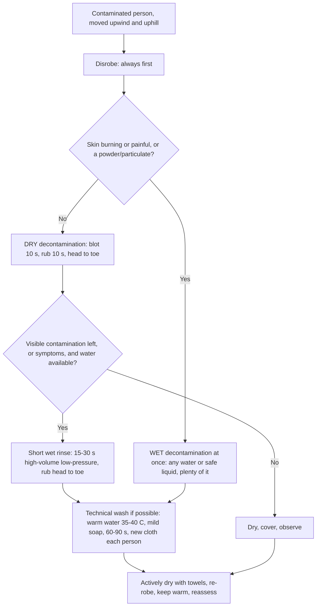

# 06.4 · Decontamination: disrobe, dry, wet

By the end of this lesson you will be able to decide who needs decontamination and how, take a contaminated person through the PRISM steps (get away, undress, blot dry, and wash only when needed), do it for a casualty on a stretcher, a child and a crowd, and improvise every step with what is in a house. Decontamination is a treatment: the sooner the chemical is off the skin, the less of it gets into the body.

> [!CAUTION]
> Performing these procedures on people without the required state certification is illegal.
> This lesson is for educational purposes only. Practise only on models and animal tissue.

## Why it matters

Chemical on skin and clothing keeps poisoning the casualty and anyone who touches them. US federal guidance for mass chemical incidents, PRISM (Primary Response Incident Scene Management, second edition, ASPR/BARDA), was written from a six-year research programme with volunteers and simulants. Its findings changed practice:

- **Removing clothing removes most of the contamination.** The 2026 JTS CBRN guideline puts it at **90-95%**.
- **Blotting and rubbing the skin with dry absorbent material** after undressing removes up to **99%** (CHEMM). It can start at once, needs no water, and works in the cold.
- **Showering for too long can drive chemicals into the skin** ("wash-in"). Short, high-volume, low-pressure showers are better.
- The **Triple Protocol** (dry, then a short high-volume rinse, then a technical shower) removed the most, up to 99.9%.

The lesson for you: you do not need a fire engine or a decontamination tent. **Get them away, get the clothes off, and blot them down** within minutes. Wet decontamination is added when it is needed and possible.

## What to do

### Does this person need decontamination?

Decontaminate if **any** is true (CHEMM, PRISM):

- Visible liquid or powder on them.
- Signs or symptoms of chemical exposure (lessons 06.3, 06.5).
- They were close to the release when it happened or shortly after.
- Responders (police, fire, Home Front Command) have said or detected that a chemical is involved.
- They ask for it (undressing and blotting costs little and calms people).

**Vapour only, no symptoms on arrival, a while after exposure**: removing outer clothing is enough (clothing traps vapour); skin exposed only to vapour does not contaminate others (ATSDR).

### Dry or wet first?

- **Dry is the default.** PRISM: dry decontamination is the preferred emergency method and the preferred method in cold weather.
- **Wet first** when the chemical is **caustic or corrosive** (the skin burns or hurts, as with acids, alkalis, chlorine solutions) or a **powder/particulate**, which rubbing grinds into the skin.

### Step by step: one walking casualty

1. **You:** gloves (two pairs), mask or respirator if you have one, long sleeves, apron or a bin bag. Stay upwind of the casualty.
2. **Move them** upwind and uphill away from the source, to fresh air.
3. **Antidotes and life-saving care first** if needed: tourniquet, autoinjectors (lesson 06.3). They go in through clothing.
4. **Disrobe.** Tell them to undress themselves if they can, **from the top down**, keeping clothing away from the face: cut T-shirts and jumpers off rather than pulling them over the head. Remove everything down to underwear at least (all of it if contaminated), jewellery, watch, glasses if contaminated. Keep their phone, keys and ID in a separate labelled bag.
5. **Bag the clothing:** into a plastic bag, tie it, put it into a second bag, label with name and time. Leave it upwind of nobody, away from people.
6. **Dry decontamination (10:10):** with any dry absorbent material, **blot for 10 seconds and then rub for 10 seconds**, starting with the **hair and top of the head**, then face, neck, hands, and down the body, using a fresh piece for each area. Plan for **at least 4 pieces per person** (pads, towels, paper towels, nappies).
7. **Used materials** into a bag, tied: they are now contaminated waste.
8. **Wet decontamination if needed and available:** a short rinse of 15-30 seconds under plenty of low-pressure water (not longer, to avoid wash-in), rubbing from head down, concentrating on hair, face, neck and hands. Then, if there is a proper shower, warm water (35-40 °C), mild soap, 60-90 seconds, a new washcloth.
9. **Dry actively** with towels, top to bottom. **Re-robe** in anything clean: blankets, sheets, clean clothes, bin bags with head and arm holes.
10. **Keep warm**, reassess (CRESS, ABC), write on the card what was done and when, and keep watching for delayed signs (up to 18 hours after liquid nerve agent).

### Eyes, wounds and hair

- **Eyes:** irrigate with plenty of clean water or saline, from the nose side outwards, eyelids held open. ATSDR advises about 5-10 minutes for nerve agent liquid; for caustic chemicals (acids, alkalis) irrigate much longer (lesson 05.3). Remove contact lenses.
- **Wounds:** expose and decontaminate them first (they absorb fastest): irrigate with water or saline. 0.5% hypochlorite may be used in **open limb wounds**, but **never** in the chest or abdominal cavity, open brain or spinal cord wounds, or the eyes (JTS 2026).
- **Hair:** blot and rub first. Long hair holds chemical: consider **cutting it off** rather than spending a long time washing; never shave (nicks the skin).

### 0.5% hypochlorite

From household bleach: **1 part 5% bleach + 9 parts water** (JTS 2026). For other strengths: parts of water for each part of bleach = (bleach % divided by 0.5) minus 1 (so 3.5% bleach: 1 part + 6 parts water). Make it fresh. Wipe on the skin, leave about a minute, rinse with water. Never use stronger solutions on skin; never mix bleach with acids or ammonia-containing cleaners (toxic gas). It does **not** work on radioactive particles and is not needed for most chemicals: soap and water is the standard, and dry decontamination comes first.

### RSDL (Reactive Skin Decontamination Lotion)

A military and some EMS kit item that deactivates nerve agents and mustard on **intact skin**: rub the sponge in circles for at least **2 minutes**, wipe off, reapply; not for eyes, wounds or hair (JTS 2026). If you have it, use it on exposed skin immediately; it does not replace undressing.

### A stretcher (non-ambulatory) casualty

1. Two or more rescuers, protected. Casualty on a sheet, blanket or improvised litter (lesson 06.2).
2. **Cut** the clothing off: up both sleeves and both trouser legs, through the front; peel it away to the sides, folding the outer surface inward, then log-roll to pull it out from underneath.
3. Log-roll onto a **clean** sheet or litter.
4. Dry decontaminate front, then log-roll and do the back.
5. Wet rinse only if indicated: tilt so water runs off, short and high volume; then dry.
6. Wrap warmly. Keep airway and tourniquets under control throughout. Hypothermia is a major risk (JTS 2026).

### For many people

PRISM sorts people into three groups: **C1** walking and able to follow instructions (they decontaminate themselves while you instruct them), **C2** communication-challenged (children, elderly, disabled, language barrier: need help), **C3** non-ambulatory (need full assisted decontamination).

1. Pick a decontamination area **upwind, uphill, on hard ground, near water if possible**, with a dirty side and a clean side.
2. Shout simple instructions: "Walk this way. Take off your clothes. Put them in the bag. Wipe your head, then your body, with these towels."
3. **Children, pregnant women and the elderly first**; keep families together; separate men and women where possible, with same-gender helpers; provide privacy (sheets on poles, a wall).
4. **Small children:** carry, never let them walk through the contaminated area; decontaminate in a laundry basket or baby bath; parent with them.
5. **Glasses, hearing aids, prosthetics** stay with the person if possible (wipe them).
6. **A garden hose with a spray nozzle** set to a wide mist is the home version of the fire service "ladder pipe" corridor: each person 15-30 seconds, rubbing head to toe.
7. Everyone **dries and re-robes** before leaving the clean side. Count people, record names and times.
8. Focus on the cooperative first; do not wrestle someone who refuses.

### Decontaminating yourself and helpers

Last out: remove the outer layer, gloves last, turning everything inside out, into bags. Blot, wash hands, face and neck with soap and water. Anyone who develops symptoms is a casualty.

### Watch

FAST-ACT, a manufacturer of dry decontamination products, demonstrates a dry decontamination protocol for chemically contaminated patients arriving at hospital (the method is the same with household absorbents):

https://www.youtube.com/watch?v=4UCUE3NCbBY

Action Training Systems, a fire and EMS training company, on organising mass decontamination for many casualties:

https://www.youtube.com/watch?v=UL2Z-OjycZ4

Cheshire Fire and Rescue Service (UK) running a mass decontamination exercise with volunteers, showing undressing, the shower corridor and re-robing:

https://www.youtube.com/watch?v=6-jvnWzYoz0

The County of San Diego showing hazardous materials decontamination at a hospital disaster drill, including a stretcher casualty:

https://www.youtube.com/watch?v=t53fMk8Oi7c

Many older videos show long showers (several minutes) as the first step. PRISM now puts disrobe and dry decontamination first and limits the high-volume rinse to 15-30 seconds.

## Improvise it

| Need | Improvised | What works | What fails / the risk |
|---|---|---|---|
| **Absorbent for dry decon** | Paper towels, kitchen roll, cotton wool, bath towels, nappies, sanitary pads, wound dressings, flour, talc | All listed by CHEMM or ATSDR; flour and talc are named by ATSDR for nerve agent when water is short. Sprinkle flour, wait a minute, wipe off with paper towels | Flour on caustic chemicals or wounds is wrong (wet first); powders get into eyes: keep away from the face. Running out: plan 4+ pieces per person |
| **Water source** | Garden hose with a spray nozzle on wide mist, buckets, bottled water, a shower, any safe drink (soft drinks, juice, lukewarm tea) | CHEMM: use whatever water or safe liquid is immediately available | A jet hose under high pressure drives chemical into the skin and splashes; set to mist. Long soaking causes wash-in |
| **Soap** | Dish soap, liquid hand soap, shampoo, diluted | Mild detergent is what technical decontamination uses | Abrasive scrubbing, brushes or solvents damage skin and increase absorption |
| **0.5% hypochlorite** | Household bleach diluted as above | Effective on skin and limb wounds | Wrong dilution burns; not in eyes, body cavities, brain wounds; never mixed with other cleaners |
| **Clothing bags** | Rubbish bags, double-tied; supermarket bags for valuables | Contains vapour and liquid | Leaking bags off-gas near people: put them downwind, away from the casualty area |
| **Cutting clothes** | Trauma shears, kitchen scissors, a seatbelt cutter | | Pulling a jumper over the head drags chemical across the face |
| **Privacy screen** | Sheets hung on a line, a car parked as a wall, umbrellas | People undress faster when screened | |
| **Re-robe** | Blankets, sheets, clean clothes from neighbours, bin bags with holes cut for head and arms, emergency blankets | | Wet people in thin covers become hypothermic fast; dry first |
| **Eye wash** | Bottled water, a gentle shower, a jug, saline from a drip bag | | Contact lenses left in trap the chemical |
| **Gloves for helpers** | Two pairs of dishwashing gloves, plastic bags taped at the wrist | | Tears; latex and thin nitrile are a poor barrier to some agents; change often |

**How to tell it is failing:** symptoms get worse after decontamination (look for missed areas: hair, armpits, groin, under nails, wounds; or contaminated clothing left near the casualty); helpers develop symptoms (your protection or the set-up is wrong: move the decontamination area upwind and swap helpers); casualties are shivering (dry and cover faster, shorten the wet stage, use dry methods in the cold).

## When it goes wrong

| Problem | Cause | Recovery |
|---|---|---|
| Shirt pulled over the head | Habit | Cut clothing off; blot the face and hair at once |
| Long hot shower before undressing | Old practice | Undress first; short rinse only |
| Powder rubbed into skin | Dry rubbing of particulate | Brush off gently, then wash with plenty of water |
| Caustic burn getting worse while blotting | Wrong method for corrosives | Wet decontamination at once with plenty of water |
| Hypothermia in the casualty | Wet, undressed, cold day, agent effect | Dry thoroughly, wrap, warm space; dry methods in cold weather |
| Treating before removing clothing in a closed room | Vapour from clothing poisons the treater | Undress casualties outside or by an open window; bag clothes |
| A child panics and runs | Fear, strangers in masks | Keep the parent with the child; decontaminate in a basket; talk, show pictures |
| Contaminated waste left at the clean side | No flow plan | Dirty side and clean side marked from the start |

## Scope and law

Getting people away from a chemical, helping them undress and wiping or washing them is lay aid within anyone's scope and part of first aid; antidotes and RSDL are prescription and professional items (lesson 06.3). In Israel, police, the fire and rescue service and the Home Front Command control hazardous materials scenes; follow their instructions and hand over to them. The Home Front Command website (oref.org.il) refused automated access when this lesson was checked (2026-11-14); check its current chemical incident instructions yourself. The law gives no immunity for harm you cause (see [01.5 · The law and your scope in Israel](../module-01/lesson-05.md)), so stick to the gentle methods here.

## Practice

> [!WARNING]
> Use only harmless simulants (flour, cocoa powder, a few drops of food colouring in vegetable oil or a UV fluorescent lotion). Never practise with real chemicals or bleach on skin. Keep the volunteer warm and their dignity protected (swimwear under old clothes).

**Drill: dry and wet decontamination with a simulant (60 minutes).** A partner in swimwear under old clothes, vegetable oil with food colouring or UV lotion and a UV torch, flour, kitchen roll, bath towels, rubbish bags, kitchen scissors, a garden hose with a mist nozzle (outdoors, warm day) or a shower, a blanket, a stopwatch.

1. **Contaminate:** dab the "chemical" on the hair, face, neck, both hands, one forearm and the lower legs. Photograph (or UV-check) as a baseline.
2. **Disrobe (5 min):** cut off the top layer from the front and sleeves without dragging it over the head; double-bag it. Time it.
3. **Dry decon (10 min):** 10:10 blot-and-rub with kitchen roll from head down, new piece for each area; use flour on the oily forearm, wait a minute, wipe off. Check under UV or by eye what is left.
4. **Wet rinse (5 min):** 15-30 seconds under the mist, rubbing head to toe; dry with a towel; wrap in the blanket.
5. **Stretcher version (15 min):** repeat on a partner lying on a blanket: cut clothes, log-roll, dry decon front and back, move onto a clean blanket.
6. **Child version (10 min):** with a large doll in a laundry basket: undress, dry decon, rinse, dry, wrap.
7. **Your own doffing (5 min):** remove gloves and apron inside out into a bag without touching the outside.

How you know it worked: no simulant on the face or hair after disrobing; under 10% of the simulant visible after dry decontamination and almost none after the rinse; the whole one-person sequence in under 10 minutes; your partner was never cold or exposed more than needed; and your own hands were clean after doffing.

## Sources

- ASPR/BARDA. *PRISM: Primary Response Incident Scene Management*, Volumes 1-3, Second Edition, via CHEMM (page updated 02 Sep 2026). The Volume 3 PDF on the University of Hertfordshire site refused automated access; figures come from CHEMM's PRISM summary.
- CHEMM. Decontamination Guidances (updated 02 Sep 2026): need for decontamination, dry vs wet, 10:10 blotting, at least 4 absorbent items per person, 15-30 s ladder pipe, 60-90 s technical decontamination at 95-104 °F with mild detergent, special populations, up to 99% (dry) and 99.9% (Triple Protocol).
- Joint Trauma System. *CBRN Injury Part I: Initial Response*, CPG ID 69, 08 Apr 2026: clothing removal 90-95%, 0.5% hypochlorite 1:9 and its limits, RSDL, hair, hypothermia.
- CDC/ATSDR. *Medical Management Guidelines for Nerve Agents*, last reviewed 2017: soap and water, 0.5% hypochlorite, flour, talc or Fuller's earth when water is limited; eye irrigation 5-10 min; vapour-only exposure.
- Chilcott RP et al. Evaluation of US federal guidelines (PRISM) for mass decontamination of casualties during the initial operational response to a chemical incident. *Ann Emerg Med* 2019.
