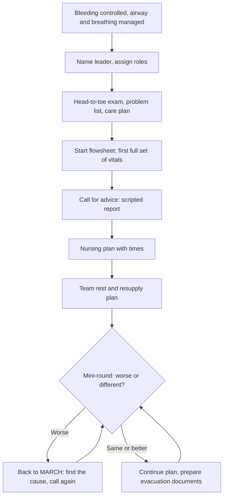

# 07.1 · The 10 prolonged-care capabilities

By the end of this lesson you will know what military medicine means by prolonged care, the 10 capabilities it says a team needs to keep a casualty alive for hours to days, and the "minimum, better, best" way of thinking that lets you deliver each one with whatever you have. You will turn this into a 13-step checklist you run every time evacuation is delayed, and audit your own kit against it.

> [!CAUTION]
> Performing these procedures on people without the required state certification is illegal.
> This lesson is for educational purposes only. Practise only on models and animal tissue.

## Why it matters

Everything in Modules 1-6 assumes the casualty reaches a hospital within an hour or two. On 7 October whole communities waited many hours for evacuation, and in a war, a siege, a collapsed road or a cut-off village that wait can stretch into days (lesson 01.4). A casualty who survives the first hour now faces a second set of killers: shock that comes back, dehydration, kidney failure, infection, pressure sores, pneumonia, blood clots, pain that stops them breathing deeply, and carers who are exhausted and make mistakes.

US military medicine calls this **prolonged casualty care (PCC)**: casualty care for extended periods when evacuation or the mission outruns the available capability. **Prolonged field care (PFC)** is the advanced-provider continuation of it. The Joint Trauma System (JTS) PCC guidelines put the aim bluntly: the main goal in PCC is to get out of PCC. Everything in this module serves two ends: keep the casualty from getting worse, and get them out as soon as you can.

## What to do

### The 10 core capabilities

The Prolonged Field Care Working Group defined 10 capabilities in a 2014 position paper. Each has a minimum, a better and a best level. The table gives the military levels and, in the last column, what a trained civilian can realistically do at home (course reasoning, not part of the paper).

| # | Capability | Military minimum → best | What you can do (this course) |
|---|---|---|---|
| 1 | **Monitor** and build a vital-sign trend | BP cuff, stethoscope, pulse oximeter, urine measurement, a way to record → automated monitor | Hand vitals, cuff, oximeter, thermometer, flowsheet, measured urine (07.2, 07.3) |
| 2 | **Resuscitate** beyond crystalloid | Fresh whole blood kits → stored blood and typed donors | Bleeding control, oral and rectal fluids, warming; assist a paramedic with IV fluid (04.1, 04.4) |
| 3 | **Ventilate / oxygenate** | BVM with PEEP valve → ventilator and oxygen | Positioning, NPA, BVM, oxygen if you have it (03.2, 03.7) |
| 4 | **Airway** with a cuffed tube | Cric → rapid sequence intubation | Positioning, suction, NPA; cric only as the last resort (03.6) |
| 5 | **Sedation and pain control** | Titrated IV opioid → long-term multi-drug sedation | Scheduled oral analgesia, assist with ketamine; monitoring (04.5, 07.6) |
| 6 | **Physical exam / diagnostics** | Thorough exam → ultrasound and point-of-care labs | Repeated head-to-toe exam; urine dipstick and glucometer if you have them |
| 7 | **Nursing / hygiene / comfort** | Clean, warm, dry, padded, urine managed, basic wound care → debridement, stomach decompression | All of it: this is where you save the most lives (07.4, 07.5) |
| 8 | **Surgical interventions** | Chest tube, cric → fasciotomy, amputation | Not your role; prepare and assist a physician |
| 9 | **Telemedicine** | Reliable comms and a structured report → video | Phone, text, photos, a script (07.7) |
| 10 | **Prepare for transport** | Understand flight stressors → critical care transport experience | Packaging, documents, handover (07.8) |

Notice that capabilities 1, 7, 9 and 10 need almost no equipment and almost no legal scope. They are also the ones most often skipped. The 2025 JTS nursing guideline calls nursing, wound care and splint management possibly the most important yet overlooked capabilities, because they prevent complications without costly equipment.

### Minimum, better, best

Every JTS prolonged-care guideline is written in three levels:

- **Minimum**: the least you must deliver with what you have.
- **Better**: adjuncts that improve outcomes when available or practical.
- **Best**: optimal care for the provider's level of expertise.

Use it as a habit, not a table. For any task, ask "what is the minimum I must not drop, and what is the best I can sustain for 72 hours?" For example, urine measurement: minimum is any empty bottle; better is a graduated container such as an empty IV bag; best is a urinary catheter (JTS 2025). A best you cannot keep up at 03:00 on day 2 is worse than a better you can.

### The 13 PCC principles: your checklist

The JTS PCC guidelines list these steps for any casualty when evacuation is delayed. Run them in order, then loop through 4, 6 and 9 for as long as the hold lasts.

1. **Lifesaving care first** (TCCC / Modules 1-6) and continue resuscitation.
2. **Name a team leader** and give out roles. The leader keeps the big picture; helpers do the attention-heavy tasks (holding pressure, counting drops, recording).
3. **Full head-to-toe exam and history**, then write a **problem list and care plan**. Look for the injuries missed in the first minutes: back, armpits, groin, scalp, behind the ears.
4. **Record and trend vital signs** from the first set onward (07.2).
5. **Teleconsultation** as soon as you can: prepare a scripted report (07.7).
6. **Nursing care plan**, early, so you do not cause sores, pneumonia or clots (07.4).
7. **Wake, rest and food plan for the team.** Carers take short breaks for sleep, food and decompression. A 72-hour hold cannot be run by one person.
8. **Plan resupply and power**: water, drugs, batteries, phone charging, light.
9. **Mini-rounds** at intervals: step back and ask four questions. Sick or not sick? Stable or unstable? Better or worse? **How is this different from last time?**
10. **Labs** if available (a glucometer, urine dipstick).
11. **Procedures** only when the benefit to the whole outcome outweighs the risk, not just to fix the number in front of you.
12. **Prepare for transport** from the start: drugs, fluids, supplies for the move (07.8).
13. **Prepare documents for handover** and send evacuation requests up every channel you have.

### Time frames

The JTS describes four settings, useful for planning what you carry: carried at the point of need (under an hour), a vehicle (1-4 hours), a house or support site (beyond 4 hours, no fixed limit), and the evacuation platform. Most civilian prolonged care in Israel will happen in the third: a safe room, a house, a synagogue, a school or a kibbutz clinic.

### Watch

Dr Sean Keenan, one of the founders of the Prolonged Field Care Working Group, explains prolonged field care and its capabilities in a conference lecture:

https://www.youtube.com/watch?v=FBCd_bqFVH4

The WarDocs military medicine podcast discusses prolonged casualty care and delayed evacuation from the planning side:

https://www.youtube.com/watch?v=2D6rC26x7rc

## Improvise it

You will rarely have the military "minimum" for every capability. The table shows household substitutes for the four capabilities you own (course suggestions; each one is taught in its lesson).

| Capability | Household substitute | What fails / the risk | How to tell it is failing |
|---|---|---|---|
| Monitor | A watch with seconds, a notebook, a phone camera for photos of the flowsheet; a kitchen scale for nappies | Lost or wet paper; nobody records at night | Gaps of more than one planned interval on the sheet |
| Nursing | Duvets, pillows, camping mats, rolled towels, wipes, cut plastic bottles, a baking tray as a bedpan | Padding slides out; damp bedding causes skin breakdown | Red marks that do not fade when pressed |
| Telemedicine | Mobile phone, WhatsApp text and photos, a landline, a neighbour's radio | Battery dies; network jammed during attacks | No answer for two planned call times: switch to the next method |
| Transport prep | Tape, marker, plastic bags for documents, a door or ladder as a litter | Documents lost in transit; lines pulled during carries | Receiving team asks questions your paper should have answered |

The biggest improvised resource is **people**. Neighbours who cannot treat can still record vital signs, empty urine bottles, turn a casualty with you, boil water and sit with the casualty while you sleep. The JTS guidelines stress cross-training non-medical team members for exactly this. Teach them one job each, write it on the care plan, and check it.

## When it goes wrong

| Mistake | What happens | Recovery |
|---|---|---|
| Everyone treats, no one leads | Duplicate doses, missed vitals, no plan | Stop for one minute, name a leader, write roles on paper |
| No care plan after the first hour | The casualty drifts; problems are found late | Write the problem list now; each problem gets an action and a time |
| Carer does not sleep | Errors in dosing and recording by night 2 | Rest plan with a named stand-in who records and wakes you on agreed triggers |
| "Best" equipment that cannot be sustained | Drip runs dry at night; batteries die | Plan for the level you can keep for 72 hours |
| Waiting for perfect information before calling | Delay in advice and evacuation | Call early, call often (07.7) |
| Forgetting evacuation preparation until the vehicle arrives | Rushed handover, lost lines and dressings | Prepare from hour 1 (07.8) |

## Scope and law

Organising care, monitoring, nursing, hygiene, documentation and calling for medical advice are within lay first aid and EMT care in Israel. Several capabilities on the list (IV fluids, blood, prescription drugs, cric, surgical procedures) are paramedic or physician powers. The Duty to Rescue Law (1998) obliges you to help but gives no immunity for how you help; see [01.5 · The law and your scope in Israel](../module-01/lesson-05.md) for the legal basis. Go beyond your scope only as the last resort: it is this or death, and no one more qualified can reach you or direct you by phone.

## Practice

**Drill: 72-hour capability audit (40 minutes).** You need your home or community kit (lesson 01.6), paper and a pen.

1. Copy the 10-capability table. For each capability write what you have today at minimum, better and best level, and how many hours it would last for one adult casualty (for example: one pulse oximeter, 2 spare AAA batteries, about 60 hours of spot checks).
2. Mark every capability where you have nothing at minimum level. These are your first purchases or improvisations.
3. Write the 13 PCC principles on one card. Next to steps 2 and 7, write the names of two people near you who could take roles and stand in while you sleep.
4. Write down your resupply and power plan (step 8): water litres per day, phone charging method, light.

How you know it worked: every capability has at least a minimum entry (even "none, improvise with X"), you can say from memory the four mini-round questions, and you have named real people for roles and rest.

## Sources

- Prolonged Field Care Working Group. *Prolonged Field Care Capabilities*, position paper, June 2014, published on ProlongedFieldCare.org (9 Feb 2015, updated 27 Feb 2024).
- Joint Trauma System. *Prolonged Casualty Care Guidelines* (CPG ID 91), 21 Dec 2021, rapid update June 2023: PCC background, 13 PCC principles, minimum/better/best and roles of care.
- Joint Trauma System. *Nursing Interventions, Wound Care, and Splint Management in Prolonged Casualty Care* (CPG ID 70), 08 Jul 2025: introduction and intake/output equipment levels.
- Joint Trauma System. CPG index, checked 2026-11-14.
