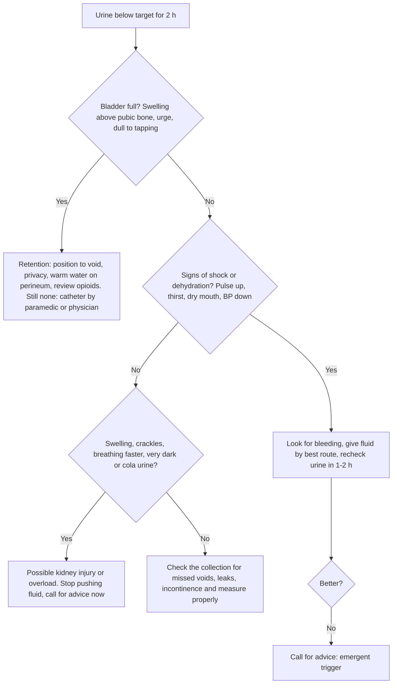

# 07.3 · Fluids in and out

By the end of this lesson you will be able to measure everything that goes into and comes out of a casualty with household containers, judge from the urine whether they are getting enough, work out daily maintenance fluid for an adult or a child, and run an IV drip at the right rate with nothing but a watch. Shock resuscitation itself is in lesson 04.1; this lesson is about the hours and days after it.

> [!CAUTION]
> Performing these procedures on people without the required state certification is illegal.
> This lesson is for educational purposes only. Practise only on models and animal tissue.

## Why it matters

After the first hour, fluid problems kill slowly. A casualty who drinks too little, loses blood into a thigh, sweats in a hot safe room or vomits all night slides into dehydration and kidney failure. A casualty who receives litres of IV fluid without anyone watching the urine or the breathing can drown in fluid overload, especially a child, an old person, or someone with heart or kidney disease. The only way to steer between the two without a laboratory is to **measure what goes in, measure what comes out, and watch the urine**.

The JTS 2025 nursing guideline makes urine the main sign: adequacy of hydration should be judged by the amount of urine the casualty makes. It also warns that urine colour may not be an accurate sign in injured casualties.

## What to do

### 1. Record intake and output

**Intake (in):** everything by mouth, IV, IO, rectal or tube.
**Output (out):** urine, vomit, diarrhoea, wound and drain fluid. Burns, fever, heat and rapid breathing add losses you cannot measure.

How often (JTS 2025):

- **Non-critical casualty:** write each drink and each void as it happens; total every 24 hours.
- **Critical casualty:** total every **1-2 hours** and adjust fluids each time; total again at 24 hours.

Use a separate block on the flowsheet with columns for time, what went in (type and ml), what came out (type and ml), and running totals. Close the books at the same time every day (for example 06:00) and write the **24-hour balance**: total in minus total out.

### 2. Urine output targets

| Patient | Minimum urine output | Example |
|---|---|---|
| **Adult** | **0.5 ml/kg/h** (JTS 2025) | 80 kg: at least **40 ml/h**, about **240 ml every 6 hours** |
| **Child** | **1 ml/kg/h** (ATLS teaching) | 20 kg: at least **20 ml/h** |
| **Infant under 1 year** | **2 ml/kg/h** (ATLS teaching) | 8 kg: at least **16 ml/h**; count wet nappies and weigh them |
| Burns | Adult 30-50 ml/h (lesson 05.4) | Titrate the burn formula to it |
| Crush or dark urine | Much higher targets (module 8) | Do not use the targets above |

When you cannot collect every drop (an incontinent casualty, an external collection device), your numbers will be falsely low. The JTS notes that external devices do not empty the bladder and can under-read output.

### 3. When urine output falls

Work through this every time output drops below target for 2 hours or more:

Retention is common in prolonged care: opioids, ketamine, lying flat, pain, embarrassment and a pelvic injury all stop people passing urine. A conscious adult who has not passed urine for 8 hours and has a tender swelling above the pubic bone needs a catheter (course rule): call for a paramedic or physician and keep the casualty comfortable meanwhile.

### 4. Maintenance fluid: how much per day

Maintenance is what a casualty needs to replace normal daily losses, on top of anything needed for resuscitation, burns, vomiting or diarrhoea.

| Patient | Rule | Example |
|---|---|---|
| Adult, oral (JTS 2025) | Minimum **2.6 L/day men, 2.1 L/day women**, about **100-125 ml/h** at rest; more for wounds, burns, diarrhoea, heat. Thirst means drink more | 80 kg man: about 2.6-3 L/day |
| Adult, IV (JTS 2025) | **100-150 ml/h** depending on the urine target; replace the urine volume | Start 100 ml/h, adjust to urine |
| Adult, IV (NICE CG174, hospital) | **25-30 ml/kg/day** water, rarely more than 3 L/day | 70 kg: 1.75-2.1 L/day |
| Child (NICE NG29, Holliday-Segar) | **100 ml/kg/day** for the first 10 kg, **50 ml/kg/day** for the next 10 kg, **20 ml/kg/day** for every kg above 20. Hourly: 4, 2, 1 ml/kg/h | 25 kg: 1000 + 500 + 100 = **1600 ml/day**, about **65 ml/h** |
| Child, ceiling (NICE NG29) | Boys rarely need more than 2.5 L/day, girls 2 L/day | |

Adult numbers differ between military field guidance (higher, active young soldiers in heat) and hospital guidance (lower, bed rest). In practice, start in the range, then **let urine output and the trend tell you**.

### 5. Choose the route

1. **By mouth** whenever the casualty is awake, can swallow, is not vomiting, and has no evisceration or penetrating abdominal wound (lesson 04.1). Water as tolerated; better, oral rehydration solution (home recipe: 1 L clean water, 6 level teaspoons of sugar, half a level teaspoon of salt; made properly in lesson 11.2). Offer small amounts every 15-30 minutes rather than a litre at once; give a marked bottle and record it.
2. **Rectal (proctoclysis)** when the mouth cannot be used and there is no IV. In 78 palliative-care patients, tap water given rectally at about **250 ml per hour (±63)** was used for an average of **15 days** with little discomfort (Bruera 1998). Technique, contraindications and the resuscitation case are in lesson 04.1. For maintenance on a long hold, run it in portions, for example 250-500 ml over 1-2 hours several times a day, and stop for cramps, leakage or a swollen abdomen (course suggestion based on the study rate).
3. **IV or IO** when a paramedic or physician has placed one, by gravity drip (below) or a pump. The IO must come out within 24 hours (lesson 07.5).
4. **Subcutaneous (hypodermoclysis)** and nasogastric routes are taught in Module 11.

### 6. Run an IV drip by gravity

The **drop factor** is printed on the giving set package: the number of drops that make 1 ml. Macrodrip adult sets are usually **10, 15 or 20 drops/ml**; microdrip (paediatric) sets are **60 drops/ml**.

$$\text{drops per minute} = \frac{\text{volume (ml)} \times \text{drop factor (drops/ml)}}{\text{time (minutes)}}$$

Short cut: **drops/min = ml per hour × drop factor ÷ 60**.

| Rate wanted | 10 drops/ml set | 15 drops/ml set | 20 drops/ml set | 60 drops/ml set |
|---|---|---|---|---|
| 40 ml/h | 7/min (1 drop every 9 s) | 10/min (every 6 s) | 13/min (every 4.5 s) | 40/min |
| 65 ml/h | 11/min | 16/min | 22/min | 65/min |
| 100 ml/h | 17/min | 25/min | 33/min (1 every 2 s) | 100/min |
| 125 ml/h | 21/min | 31/min | 42/min | 125/min |
| 150 ml/h | 25/min | 38/min | 50/min | 150/min |

For slow rates, count **seconds between drops** instead of drops per minute: seconds between drops = 60 ÷ drops per minute. The JTS ketamine-drip tables are written this way ("1 drop every 9 seconds").

Steps:

1. Check the drop factor on the package and write it on the flowsheet.
2. Calculate drops per minute; write it on a strip of tape on the bag.
3. **Time-tape the bag**: a vertical strip of tape on the bag with a mark for each hour's level (for 100 ml/h, a mark every 100 ml) and the clock time beside it.
4. Hang the bag at least about a metre above the casualty's heart.
5. Open the roller clamp slowly while watching the drip chamber; count for a full **15 seconds** and multiply by 4 (or a full minute for slow rates).
6. **Recheck every hour** and after every move: gravity drips speed up or slow down when the casualty bends the arm, rolls over, or the bag is lowered. Compare the fluid level with the time-tape.
7. Record every bag: start time, fluid, volume, rate, finish time.

A **dial-a-flow** regulator is better than a roller clamp (JTS "better"); the JTS notes it is not accurate below 10 ml/h, where you must count drops.

### 7. Fluid overload: watch for it

Stop or slow fluids and call for advice if you see: breathing faster, new breathlessness lying flat, falling SpO2, crackles at the lung bases, swelling of the eyelids, ankles or lower back, rising weight in a child, or urine that does not increase despite fluid. Children, the elderly, and anyone with heart or kidney disease are at highest risk.

### Watch

RegisteredNurseRN (a nurse educator) explains drop factors and drops-per-minute calculations with worked examples:

https://www.youtube.com/watch?v=kza8QKqjnPM

Daniel Ozimek works through gravity (manual) flow-rate calculations explaining why the formula works:

https://www.youtube.com/watch?v=klX585VtYl4

Future Building Nursing Prep Center shows the same calculation from a different teaching angle, with the drip chamber:

https://www.youtube.com/watch?v=1nowyD3KVwA

Measuring and recording urine output, as taught to nursing assistants (Qualora):

https://www.youtube.com/watch?v=fHK85tqUbXU

Bell Healthcare Training School shows bedpan use, measuring the urine in a graduated container and recording it:

https://www.youtube.com/watch?v=8qGc-8fVlAw

## Improvise it

### Measuring with household containers

The JTS minimum for collecting urine is any available container, such as an empty water bottle; better is a graduated container such as an empty IV bag. To estimate without tools it suggests common items: a standard US soda can holds about 350 ml (Israeli cans are usually 330 ml; check the label).

| Method | How | What fails | How to tell |
|---|---|---|---|
| **Calibrated bottle** | Pour measured water (kitchen measuring jug, or a 60 ml syringe) into a 1.5 L bottle in 100 ml steps, marking each line with a marker | Marker rubs off; neck too narrow for a urinal | Re-check one line monthly; cut the top off for a wider mouth |
| **Kitchen scale** | **1 ml of urine weighs about 1 g.** Weigh a nappy, pad or towel dry, then wet; the difference is the volume | Faeces and wound fluid add weight; evaporation if left | Weigh within the hour; note mixed contents |
| **Known cups and bottles** | Note the volume printed on drinks containers and use them for intake | Partly drunk bottles | Mark the level with a pen at each check |
| **IV bag as a jug** | An empty, rinsed IV bag has a printed scale | Hard to pour into | Cut the top corner; tape the edge |

### Drip rate with no watch

Count "one-thousand-one, one-thousand-two" as seconds while watching the chamber, but check your counting against a phone clock first: most people count too fast under stress. A pendulum is a last resort: a key on a string about 25 cm long completes one full swing, there and back, in about one second (course note).

### No roller clamp, or a broken one

A clothes peg or a binder clip on the soft tubing can partly pinch it. It is crude: the rate drifts as the plastic relaxes. Count every 15-30 minutes and never leave a pinched line unchecked overnight. **Never improvise a giving set or reuse one between people**: air embolism and infection risks are not worth it.

### Oral fluids for someone who cannot hold a cup

A sports bottle with a valve cap, a straw cut short, a 10-20 ml syringe without a needle squirted slowly into the cheek pouch, or a teaspoon. Sit the casualty up at least 30 degrees. Stop if they cough or the voice turns wet: aspiration kills faster than dehydration.

## When it goes wrong

| Problem | Cause | Recovery |
|---|---|---|
| "Low urine" that is really missed voids | Incontinence, external device, helpers not recording | Weigh pads; label the urine bottle; brief every helper |
| Drip ran 1 L in 2 hours instead of 10 | Roller clamp slipped or the casualty moved | Clamp, check breathing and chest, recalculate, time-tape the bag, recheck hourly |
| Drip stopped | Kinked line, clot, infiltrated cannula, bag too low | Trace the line from bag to skin; check the site (lesson 07.5) |
| Breathless after fluids | Overload | Sit up, stop the fluid, call |
| Large volumes of plain water by mouth or rectum in a child | Low blood sodium (seizures, confusion) | Use oral rehydration solution, not water, for large volumes in children (course rule) |
| Drop factor assumed | A 15-drop set run at a 20-drop count gives 33% more fluid | Read the package every time; write it on the sheet |

## Scope and law

Measuring intake and output, encouraging oral fluids and oral rehydration solution are within lay first aid and EMT care. IV and IO fluids, adjusting their rates, catheterisation and rectal fluids are paramedic or physician acts in Israel; an EMT may observe and report a drip but not set its prescription. The Duty to Rescue Law (1998) gives no immunity for how you help; see [01.5 · The law and your scope in Israel](../module-01/lesson-05.md). Run or adjust fluids only under medical direction, or as the last resort when it is this or death and no one more qualified can reach or direct you.

## Practice

**Drill 1: calibrate your containers (15 minutes).** A 1.5 L bottle, a measuring jug or 60 ml syringe, a marker, a kitchen scale, a dry nappy or pad.

1. Mark the bottle in 100 ml steps. Cut the top off a second bottle as a wide urinal and mark it too.
2. Pour 150 ml of water onto the nappy; weigh dry and wet. The difference should be about 150 g.

**Drill 2: drip counting (25 minutes).** An expired IV bag and giving set (from a pharmacy or first-aid course; not for use on people), or a 1 L bottle hung upside down with the giving set spike pushed through the cap, a bucket, tape, a phone stopwatch.

1. Read the drop factor. Calculate drops per minute for 100 ml/h and for 40 ml/h.
2. Time-tape the bag for 100 ml/h.
3. Set the drip by counting 15 s × 4. Check after 30 and 60 minutes against the tape and against the volume in the bucket.
4. Lower the bag by 50 cm and recount. Note the change.

**Drill 3: your own 24-hour balance (all day, 20 minutes of work).** Record every drink and every void for 24 hours with your calibrated bottle. Total in, total out, balance, and your hourly urine in ml/kg/h.

How you know it worked: the nappy weight matched the poured volume within 10%; after one hour your drip delivered within 15 ml of 100 ml; you saw the rate change when the bag was lowered; and your own urine was above 0.5 ml/kg/h with a balance you can explain.

## Sources

- Joint Trauma System. *Nursing Interventions, Wound Care, and Splint Management in Prolonged Casualty Care* (CPG ID 70), 08 Jul 2025: intake and output (frequency, equipment, soda-can estimate), hydration by mouth and IV/IO, urine output 0.5 ml/kg/h, maintenance 100-150 ml/h, Foley/external catheter caveat.
- Joint Trauma System. *Analgesia and Sedation Management during Prolonged Field Care* (CPG ID 61), 11 May 2017: drip-count tables (drops per seconds), dial-a-flow accuracy below 10 ml/h, macrodrip counting as the minimum.
- NICE NG29, *Intravenous fluid therapy in children and young people in hospital* (Holliday-Segar maintenance, daily ceilings).
- NICE CG174, *Intravenous fluid therapy in adults in hospital* (25-30 ml/kg/day maintenance).
- American College of Surgeons. *ATLS* shock chapter, urine output targets for adults, children and infants (via course manual summaries; not checked against the current edition).
- Bruera E, et al. Proctoclysis for hydration of terminally ill cancer patients. *J Pain Symptom Manage* 1998;15(4):216-9.
- Open RN *Nursing Skills* (Chippewa Valley Technical College / WTCS Pressbooks), 5.14 IV infusion by gravity.
