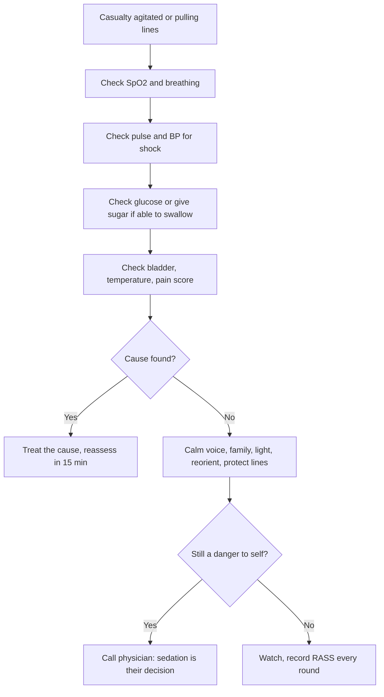

# 07.6 · Pain and sedation over days

By the end of this lesson you will be able to build a pain plan that keeps a casualty comfortable for three days without stopping their breathing: scheduled background analgesia, extra doses for breakthrough pain, cover for painful procedures, and the monitoring that catches trouble early. You will also learn why a restless casualty usually needs something other than a sedative. The single-dose field drugs are in lesson 04.5; their risks and the combinations to avoid are in lesson 04.8.

> [!CAUTION]
> Performing these procedures on people without the required state certification is illegal.
> This lesson is for educational purposes only. Practise only on models and animal tissue.

## Why it matters

TCCC analgesia is built for minutes to hours: one strong dose, then evacuation. Over days, that approach swings the casualty between agony and over-sedation. The JTS prolonged-care guideline (written for 4-72 hours) says it plainly: prolonged care needs a different approach from TCCC. Go slow, use lower doses, titrate to effect and redose more often. Untreated pain is not just suffering: a casualty in pain breathes shallowly (pneumonia), will not move or turn (sores, clots), cannot sleep, and pulls at dressings and lines. Over-treatment kills more directly: stopped breathing, low blood pressure, vomiting into an unprotected airway.

## What to do

### 1. The priorities (JTS PFC analgesia guideline)

1. **Keep the casualty alive.** Do not give analgesia or sedation if there are other priorities (bleeding control).
2. **Keep perfusion.** Do not give drugs that lower blood pressure or depress breathing to a casualty in shock or respiratory distress, or at real risk of either.
3. **Relieve pain.** Treat pain first.
4. **Maintain safety.** Sedation only when agitation endangers the casualty (pulling lines, falling, fighting) and is not controlled by treating pain.
5. **Stop awareness** only for painful procedures, and only by those trained to do it.

### 2. Three kinds of pain, three plans

| Pain | What it is | Plan |
|---|---|---|
| **Background** | Always there because of the wound | **Scheduled** doses around the clock, so that the casualty is comfortable at rest but breathing, circulation and mental state are normal |
| **Breakthrough** | Comes with movement, turning, coughing | Extra doses **as needed**; if breakthrough is frequent or occurs at rest, **increase the background** |
| **Procedural** | Dressing changes, splint adjustments, moving to a vehicle | **Given before** the procedure, timed to peak during it (lesson 07.5) |

### 3. Assess at every round

- **Pain score** 0-10 at rest and on movement (faces scale for children over about 3).
- **Sedation** once any sedating drug is given, using the Richmond Agitation-Sedation Scale (RASS), which the JTS uses to trend sedation:

| RASS | Description |
|---|---|
| +4 | Combative, violent, immediate danger |
| +3 | Very agitated, pulls at tubes or lines, aggressive |
| +2 | Agitated, frequent purposeless movement |
| +1 | Restless, anxious, movements not aggressive |
| 0 | **Alert and calm** |
| -1 | Drowsy: not fully alert, but stays awake to voice (eyes open and contact more than 10 s) |
| -2 | Light sedation: briefly wakes to voice (eye contact less than 10 s) |
| -3 | Moderate sedation: movement or eye opening to voice, no eye contact |
| -4 | Deep sedation: no response to voice, moves to physical stimulation |
| -5 | Unrousable |

How to score: watch for a moment (0 to +4). If not alert, say their name and ask them to open their eyes and look at you (-1 to -3). If no response, shake the shoulder (-4 or -5). **Course target for a casualty without a protected airway: RASS 0 to -1.** Anything at -2 or below means stop sedating drugs and watch the airway.

- **Breathing**: rate and depth every round. MSF minimum respiratory rates for anyone on morphine: **1-12 months at least 25/min; 1-2 years at least 20/min; 2-5 years at least 15/min; over 5 years and adults at least 10/min.** Below that, act (section 7).
- **Minimum monitoring** for anyone on potent analgesia or sedation over time (JTS): blood pressure cuff, stethoscope, pulse oximeter, and a vital-sign trend on the flowsheet.

### 4. Background analgesia: the scheduled base

| Drug | Route | Adult dose | Child dose | Interval | Max per day | Notes |
|---|---|---|---|---|---|---|
| **Acetaminophen** (paracetamol) | PO (IV if available) | **1000 mg** (JTS PFC: 500-1000 mg; TCCC: 1000-1300 mg every 8 h) | **15 mg/kg** (MSF, from 1 month) | Every **6 h** | Adult **4 g**; child 60 mg/kg (MSF) | Count hidden acetaminophen in combination tablets |
| **Meloxicam** | PO | **15 mg** | Not in field use; use ibuprofen | Once daily | 15 mg | TCCC pack; prescription |
| **Ibuprofen** (if no meloxicam) | PO | **400 mg** | **5-10 mg/kg** from 3 months (MSF) | Every 6-8 h | Adult 1200 mg OTC; child 30 mg/kg (MSF) | Do not give with meloxicam |
| **Suzetrigine** (if available) | PO | **50 mg** every 12 h after the 100 mg first dose (TCCC 2026, lesson 04.5) | Not established | Every 12 h | 100 mg/day after day 1 | Prescription; not found in the Israeli registry (2026-11-14) |

**When to hold the NSAID (meloxicam, ibuprofen):** shock not yet corrected, low urine output, crush injury or dark urine, ongoing bleeding, or known kidney disease or stomach ulcer (course reasoning: NSAIDs reduce kidney blood flow and impair clotting; TCCC still includes meloxicam in its pack for casualties who can function).

**Non-drug background care**, every round: splint and elevate injured limbs, reposition (07.4), loosen tight dressings, cold packs for the first 48 hours on closed injuries (20 minutes on, wrapped in cloth), reassurance, darkness and quiet for sleep.

### 5. Breakthrough analgesia

These are prescription drugs. In a civilian setting they are given by a paramedic or physician, or by you only under their remote direction or as the last resort (Scope and law). The JTS prolonged-care doses are **smaller and more frequent** than the TCCC single doses.

| Drug | Route | Adult dose (JTS PFC) | Child dose | Repeat | Notes |
|---|---|---|---|---|---|
| **Ketamine** (analgesic dose) | **IV/IO slow push** | **20 mg** (range **0.1-0.2 mg/kg**) | **0.1-0.2 mg/kg** slow push (C-TECC, lesson 04.5) | Every **10-30 min** as needed | Safe in head and eye injury; increases salivation; nausea on waking. Stop for nystagmus or RR under 10 |
| **Ketamine** | **IM** | **80 mg** (0.4-0.8 mg/kg); TCCC 2026 single dose 100 mg | 0.2-0.5 mg/kg (C-TECC, 04.5) | Every 15-30 min until effect | IN 50 mg in TCCC (04.5) |
| **Morphine** | IV | **5 mg** (range 2.5-10 mg); give 2.5 mg steps every 5 min to effect | **0.1 mg/kg** total, given as **0.05 mg/kg every 10 min** (MSF, over 6 months) | Every 1-6 h (adult); every 4 h (child) | Accumulates in kidney failure; itching, low BP |
| **Morphine** | PO (immediate release) | **10 mg** (MSF) | **0.15 mg/kg** (MSF, over 6 months) | Every 4 h | Halve in elderly, kidney or liver failure (MSF) |
| **Morphine** | SC/IM | 0.1-0.2 mg/kg (MSF); JTS: 5-10 mg IM only if no IV | 0.1-0.2 mg/kg (MSF, over 6 months) | Every 4 h | IM absorption unreliable in shock |
| **Hydromorphone** | IV/IO | **0.5 mg** (range 0.25-2 mg) | Physician direction only | Every 1-6 h | The JTS's preferred PFC opioid: long acting, less accumulation |
| **Oxycodone + acetaminophen** (e.g. Percocet 5/325) | PO | **1-2 tablets** | Physician direction only | Every 4-6 h | Each tablet adds 325 mg acetaminophen (check your local label): reduce scheduled acetaminophen so the total stays under 4 g |

Rules for breakthrough doses (JTS PFC):

- **Start low, go slow.** Give the lowest dose every 2-5 minutes until the target is reached; the total is that casualty's "effective dose", which you then repeat when needed.
- The less blood volume, the less drug and time are needed. In a casualty who was in shock, **reduce doses** and expect a drop in blood pressure.
- **Ketamine, opioids and benzodiazepines multiply each other's effects**. TCCC 2026 forbids benzodiazepines with ketamine or opioids at TCCC level (lesson 04.8). The JTS PFC guideline uses small midazolam doses with ketamine or opioids only by advanced providers with telemedicine support. Course rule: **you do not combine them** unless a physician directs it.
- If breakthrough doses are needed more than about every 2 hours, the background plan is too weak: call for advice.

### 6. Procedural pain

- Oral drugs **60 minutes** before; IV drugs **15-30 minutes** before (JTS 2025).
- The JTS nursing guideline gives providers a procedural ketamine dose of **0.5-1 mg/kg IV/IO** (lower if other drugs were given) **2-3 minutes** before wound care, and local anaesthetic 10-15 minutes before.
- Full procedural sedation (ketamine 1-2 mg/kg IV) is a paramedic or physician skill with airway equipment ready: awareness only for this course.
- Without drugs: explain, distract, take breaks, and do the minimum needed.

### 7. Side effects over days

| Problem | Cause | What to do (dose) |
|---|---|---|
| **Breathing under the minimum, RASS -3 or lower, pinpoint pupils** | Opioid toxicity | Stop opioids; airway, ventilate; **naloxone** (lesson 04.8): adult 0.4 mg IV/IM (or diluted 0.4 mg in 10 ml, 1 ml at a time, JTS) or nasal spray; child **5 micrograms/kg** IV repeated every minute until breathing normalises (MSF). Watch at least 2 hours: naloxone wears off first |
| **Nausea, vomiting** | Opioids, ketamine | **Ondansetron** adult **4 mg** ODT/IV/IM every 4-8 h, max 8 mg in 8 h (JTS PFC; TCCC 4 mg every 8 h); child **0.15 mg/kg**, max 4 mg per dose, up to 3 times a day (MSF) |
| **Constipation** | Opioids | Laxative after 48 h of opioids (lesson 07.4) |
| **Cannot pass urine** | Opioids, ketamine | Lesson 07.3 |
| **Itching** | Morphine | **Diphenhydramine** adult 25-50 mg IV/PO every 4-6 h, max 400 mg/day (JTS PFC); adds sedation: watch RASS |
| **Drooling, wet airway** | Ketamine | Suction, position on side; JTS lists glycopyrrolate for providers |
| **Fear, hallucinations on waking** | Ketamine emergence | Calm voice, low light (lesson 04.8) |
| **Stomach bleeding, low urine** | NSAIDs | Stop the NSAID |
| **Liver damage** | Acetaminophen over 4 g/day | Count every source |

**Accumulation:** a dose that was safe on day 1 can sedate on day 2 if the kidneys are failing (morphine builds up). Falling urine output plus rising sedation means cut the opioid and call.

### 8. Agitation: find the cause before sedating

The JTS lists the most common causes of agitation as **untreated pain, low oxygen, low blood pressure and low blood sugar**. Course additions: a **full bladder**, cold, fear, and withdrawal from alcohol, nicotine or regular medications.

A ketamine drip for sedation (loading dose 1 mg/kg IV over 60 seconds, then 750 mg in 250 ml normal saline = 3 mg/ml, about 1 mg/kg/h in a non-intubated casualty, counted by drops when no pump exists) is in the JTS PFC guideline for advanced providers with telemedicine support. For example, 1 mg/kg/h for an 80 kg casualty is about 27 ml/h, about 1 drop every 9 seconds with a 15 drops/ml set. Know it exists so you can count and record a drip a provider sets up; do not start one yourself.

### 9. End-of-life (expectant) care

When a casualty will die before help can arrive, relief of suffering becomes the goal. The JTS guideline says that opioids and sedatives are then therapeutic and indicated even if they worsen vital signs, after a telemedicine consult. Position them comfortably, pad pressure points, give water, company and anything that comforts. This is a physician-directed decision (module 13 covers the dead and the grieving).

### Watch

WBM Emergency & Critical Care explains the Richmond Agitation-Sedation Scale and how to score it:

https://www.youtube.com/watch?v=7z6gpaGPeok

Yellow Pages Nursing explains RASS in five minutes from a nursing angle, with sedation targets:

https://www.youtube.com/watch?v=Airun30OqrU

The naloxone videos in lesson 04.8 show reversal of opioid over-sedation.

## Improvise it

### Without prescription drugs

You may only have what is in a home medicine cabinet. Scheduled acetaminophen plus an NSAID (when safe) controls much more pain than either alone, and dipyrone (Optalgin) is an option where available (doses and risks in lesson 04.5).

| Method | What works | What fails / the risk | How to tell it is failing |
|---|---|---|---|
| **Scheduled OTC** analgesia with phone alarms and a written chart | Steady background control | Missed night doses; double dosing by two helpers | Gaps or duplicates on the drug chart; pain spikes at dawn |
| **Splint, elevate, reposition** | Large reductions in fracture pain | Too tight after swelling | Numb, cold fingers or toes |
| **Cold** (frozen peas, ice in a bag, wet towel), first 48 h | Swelling and pain in closed injuries | Frostbite on bare skin; cooling a hypothermic casualty | White, numb skin: remove; do not use on a cold casualty |
| **Warmth** (warm water bottle wrapped) for muscle spasm after 48 h | Back and muscle pain | Burns on numb or sedated skin | Red skin under the bottle |
| **Breathing, distraction, music, a familiar voice** | Lowers pain and fear during procedures | Not enough alone for severe pain | Rising pulse and breathing during the procedure |
| **Sleep**: darkness, earplugs, eye mask, clustering checks | Pain is worse without sleep | Clustering checks so much that monitoring lapses | Gaps on the flowsheet |

**Weighing a child for doses:** stand on a bathroom scale holding the child, subtract your own weight (lesson 04.7).

### Dangerous "home remedies"

- **Alcohol** as a painkiller: depresses breathing, worsens bleeding, hypothermia and vomiting, and interacts with every sedating drug. Do not give it.
- **Someone else's prescription** sleeping pills, benzodiazepines or opioids: unknown dose, and benzodiazepines plus opioids or ketamine stop breathing. Do not give them without a physician.
- **Sedating antihistamines** (diphenhydramine and similar) to make an old or head-injured casualty sleep: they cause confusion and urinary retention in the elderly (course reasoning) and hide a falling level of consciousness.
- **Codeine and tramadol** in children under 12: dangerous; not for children (lesson 04.5).

## When it goes wrong

| Mistake | Effect | Recovery |
|---|---|---|
| "As needed" only, no scheduled background | Pain returns, large rescue doses, swings | Scheduled background around the clock; rescues on top |
| Big doses spaced far apart | Peaks of over-sedation, troughs of agony | Smaller, more frequent doses; start low, go slow |
| Sedating an agitated casualty who is hypoxic or in shock | Arrest | Check oxygen, BP, glucose and bladder first |
| Adding a benzodiazepine to ketamine or an opioid | Apnoea | Do not combine without a physician; if done, monitor continuously, naloxone and BVM ready |
| Acetaminophen in two products | Liver damage | One drug chart with totals; read every label |
| Same morphine dose on day 3 with falling urine | Accumulation, over-sedation | Reduce; call; watch RASS and breathing |
| Forgetting nausea and constipation | Vomiting, abdominal pain, refusal to eat | Antiemetic when needed; laxative after 48 h |

## Scope and law

Over-the-counter acetaminophen, ibuprofen and dipyrone at label doses, non-drug pain relief and sedation scoring are within lay aid and EMT practice in Israel. Ketamine, opioids, benzodiazepines, ondansetron and injectable drugs are prescription medicines; giving them is a paramedic or physician act, and several are controlled drugs. The Duty to Rescue Law (1998) gives no immunity for how you help; see [01.5 · The law and your scope in Israel](../module-01/lesson-05.md). Give prescription drugs only on a prescription or physician direction (including by phone, lesson 07.7), or as the last resort when it is this or death and no one more qualified can reach or direct you.

## Practice

**Drill 1: write two 72-hour pain plans (30 minutes).** Paper, the dose tables above and in lesson 04.5, a calculator.

- **Casualty A:** man, 80 kg, open lower-leg fracture splinted, not in shock, urine 60 ml/h, can swallow. You have acetaminophen 500 mg tablets, ibuprofen 200 mg, and a physician on the phone who has authorised morphine 10 mg/ml ampoules for a paramedic neighbour who can give IV doses.
- **Casualty B:** girl, 20 kg, burn to one forearm, conscious, drinking. You have acetaminophen syrup 120 mg/5 ml and ibuprofen syrup 100 mg/5 ml.

For each: a scheduled background chart for 24 hours with clock times, doses in mg and ml, and daily totals checked against maximums; the breakthrough option; the procedural plan for a dressing change at 10:00; the monitoring (what, how often, which triggers).

Reference answer

**A:** Acetaminophen 1000 mg (2 tablets) at 06:00, 12:00, 18:00, 24:00 = 4 g/day. Ibuprofen 400 mg (2 tablets) at 06:00, 14:00, 22:00 = 1200 mg/day, since he is not in shock and urine is adequate; stop if urine falls or bleeding recurs. Breakthrough: morphine IV by the paramedic, 2.5 mg (0.25 ml) every 5 minutes to effect, up to about 5-10 mg, then every 1-6 h as needed. Dressing at 10:00: give the scheduled oral doses early at 09:00 if due, or an IV morphine dose at 09:45. Monitoring: pain, RASS and breathing every round; breathing at least 10/min; RASS 0 to -1; laxative from day 3; ondansetron if nauseated (if prescribed).

**B:** Acetaminophen 15 mg/kg = 300 mg = 12.5 ml every 6 h (max 60 mg/kg = 1200 mg/day). Ibuprofen 10 mg/kg = 200 mg = 10 ml every 8 h (max 30 mg/kg = 600 mg/day), alternating so that a dose is due every 3-4 h. Dressing: give the next dose 60 minutes before 10:00; distraction, a parent present. No opioid available: if pain is uncontrolled, call for advice. Monitoring: faces pain scale every round, breathing rate against her age band, fluid intake and urine (burn, lesson 05.4). The MSF breathing minimums apply once any opioid is given.

**Drill 2: RASS role-play (15 minutes).** A partner acts six sedation levels in random order (calm, restless, drowsy and keeps eye contact, briefly wakes, opens eyes to shaking only, no response). Score each using the steps above without seeing the card.

How you know it worked: your daily totals never exceed the maximums, every dose has a time and a volume in ml, your plan names the triggers that mean stop and call, and you scored at least five of six RASS levels correctly.

## Sources

- Joint Trauma System. *Analgesia and Sedation Management during Prolonged Field Care* (CPG ID 61), 11 May 2017 (oxygen update 01 Sep 2023): priorities, principles, pain categories, minimum monitoring, Appendix A doses, Appendix B ketamine drip and drip counts, Appendix C and D, RASS, expectant care.
- Joint Trauma System. *Prolonged Casualty Care Guidelines* (CPG ID 91), 21 Dec 2021: pain management for PCC.
- Joint Trauma System. *Nursing Interventions in Prolonged Casualty Care* (CPG ID 70), 08 Jul 2025: analgesia before wound care, procedural ketamine, reversal agents.
- Committee on Tactical Combat Casualty Care. *TCCC Guidelines*, 01 May 2026: TFC 11 (analgesia tiers, ketamine, esketamine, suzetrigine, ondansetron, no benzodiazepines with ketamine or opioids).
- Médecins Sans Frontières. *Clinical Guidelines*, Pain: acetaminophen, ibuprofen, morphine (PO, SC/IM, IV) adult and child, laxatives, naloxone, minimum respiratory rates on morphine, ondansetron in children.
- C-TECC Pediatric Guidelines v2.8 (2024): child ketamine doses (via lesson 04.5).
