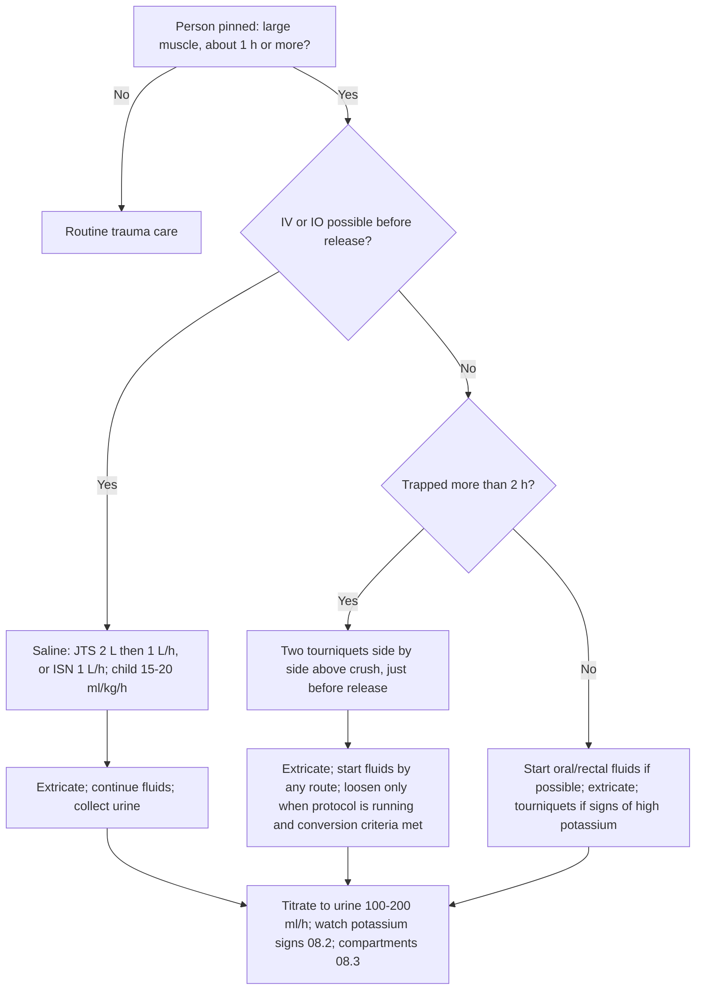

# 08.1 · Crush syndrome: fluids before extrication, tourniquets before release

By the end of this lesson you will be able to look at a person pinned under rubble, decide whether they are at risk of crush syndrome, start the fluids that protect their heart and kidneys before they are pulled out, use tourniquets to buy time when you cannot, and keep the protocol going for days with whatever fluid you have, including drinks you mix in a kitchen.

> [!CAUTION]
> Performing these procedures on people without the required state certification is illegal.
> This lesson is for educational purposes only. Practise only on models and animal tissue.

## Why it matters

When a heavy weight lies on a large muscle (a thigh, a calf, buttocks) for an hour or more, the muscle under it starts to die. While the weight is on, the dead muscle is sealed off. When the weight comes off, blood flows back through it and washes **potassium, acid, myoglobin** (the red muscle pigment) and other cell contents into the circulation. Fluid also pours out of the blood into the swollen limb. The result is **crush syndrome**: shock, a heart that can stop from high potassium within minutes of release (the so-called "rescue death"), and kidneys blocked by myoglobin within hours to days.

The JTS crush CPG says crush syndrome can follow **as little as 1 hour of entrapment**, and that the risk grows with the amount of muscle crushed (one or both legs) and the time pinned. The same mechanism follows release of a **tourniquet left on more than 2 hours** (lesson 02.5), compartment syndrome (08.3) and severe blunt limb trauma, and the treatment is the same.

What the data says:

- **Israeli experience.** Israeli physicians (Ron, Better and colleagues, 1984) treated seven people pulled from a collapsed building after 1 to 28 hours with fluids and an alkaline diuresis started **immediately on extrication**. None developed kidney failure, at a time when similar injuries usually did. Better's work is the origin of today's "fluids first" teaching.
- **Turkey, Bingöl 2003.** Of 16 crush victims, the 4 who needed dialysis had waited an average of **9.3 hours** from rescue to the first fluids, against **3.7 hours** for those who did not (Gunal et al. 2004).
- **Turkey, Kahramanmaraş 2023.** In 1,024 crush-syndrome patients from 46 hospitals (median 12 hours under rubble), **67.9% developed acute kidney injury**, 70% of those needed dialysis, 40.8% had compartment syndrome, and 9.8% died in hospital (Ozturk et al. 2024).

In Israel the realistic scenarios are a building hit by a missile, an earthquake (the Dead Sea rift is active), or a collapse during a ground attack, all with hours before heavy rescue reaches a trapped person. You may be the one at the void with a cannula and a bag of saline.

## What to do

### 1. Who is at risk

Assume crush injury in anyone pinned by a heavy weight unless it is definitely excluded (ISN field version). The risk is high when **all three** are present:

- a **large muscle mass** is compressed: thigh, calf, buttock, or more than one limb (a trapped forearm or hand alone rarely causes the full syndrome);
- the compression lasted **about 1 hour or more**;
- the limb's circulation was **cut off** by the weight.

Note the time of entrapment as early as you can: ask the casualty or witnesses, and write it on the casualty card (lesson 01.7).

### 2. Before extrication: start fluids

The JTS crush CPG states plainly that **hypotensive (permissive) resuscitation does not apply** to an extremity crush that needs extrication. You give large volumes on purpose, to dilute the potassium and flush the kidneys before the weight comes off. The exception is a crush casualty who is also **bleeding from the torso** (non-compressible haemorrhage): there, big volumes may increase bleeding, and the balance should be set by a physician on the phone if at all possible.

1. **Make contact and assess** through the void: airway, dust (give a dust mask or wet cloth), obvious bleeding, which limbs are trapped, how long.
2. **Gain IV or IO access** in any reachable limb that is not trapped (lesson 04.2 for IO). One large-bore cannula is enough to start.
3. **Give isotonic saline (0.9% NaCl).** Avoid potassium-containing fluids such as Hartmann's or Ringer's lactate before release (ISN). Rates:

| Source | Adult | Child | Notes |
|---|---|---|---|
| **JTS crush CPG (2016)** | **2 L bolus**, then **1 L/h** | Not stated | Start before extrication; adjust to urine output 100-200 ml/h after release |
| **ISN field version (2012)** | **1,000 ml/h** | **15-20 ml/kg/h** | Less in older or lighter people, small trapped mass, cold weather, little urine, very long entrapment. If extrication takes **more than 2 hours, reduce to 500 ml/h** |

4. **Keep the casualty warm** and covered (cold fluids and rubble dust cool them fast, lesson 05.7).
5. **Give pain relief** that does not harm the kidneys: ketamine or opioids (lesson 04.5). **No NSAIDs** (no meloxicam, ibuprofen, diclofenac) in crush injury (ISN field version).
6. **Re-check every 15 minutes** during entrapment and extrication (JTS): mental state, pulse rate and strength, regularity of the pulse, breathing.

### 3. Tourniquets before release

The JTS crush CPG: **if entrapment has lasted more than 2 hours and the crush protocol (fluids and monitoring) cannot be started immediately**, consider tourniquets to delay the flood of potassium until you can treat it.

- **Best:** apply **two tourniquets side by side, as close to the body as possible above the crushed area, immediately before extrication.**
- **Minimum:** apply them **immediately after extrication**, before the limb has had time to reperfuse.
- **Do not loosen** them until the crush protocol has started (fluids running, urine collection ready, potassium treatment at hand, lesson 08.2), and then only if the casualty meets the tourniquet conversion criteria (lesson 02.4): not in shock, wound can be watched, not an amputation.

> [!IMPORTANT]
> A tourniquet here is not for bleeding. It is a temporary seal that keeps the dead muscle's contents out of the circulation. Every hour it stays on adds ischaemic damage (lesson 02.5), so it buys time for fluids, a physician's direction or evacuation; it is not a plan in itself.

A limb that is **cool, without sensation, tensely swollen and pulseless** after release is probably dead. The JTS CPG: it may cause shock, kidney failure and death; if it does not improve, **place two tourniquets side by side above the injury and leave them on**. Amputation is expected at a hospital.

### 4. After extrication: the crush protocol

1. **Move the casualty away** from the collapse site as quickly as possible (ISN), then do a full primary survey.
2. **Continue saline.** ISN target: **3-6 L of isotonic saline within the first 6 hours** of contact. JTS: **1 L/h**, adjusted to urine output.
3. **Collect and measure all urine** (lesson 07.3 for fluid charts). **Target 100-200 ml/h** (JTS). Record volume and colour every hour on the flowsheet (lesson 07.2).
4. **Watch the colour.** Red, brown or black ("cola") urine means myoglobin: the kidneys are at risk. Darker over time is worse. A urine dipstick that is **positive for blood** in dark urine supports myoglobin (lesson 08.4).
5. **Vital signs every 15 minutes for the first 1-2 hours**, then every 30 minutes, then hourly if stable or the urine is clearing (JTS).
6. **If urine stays below 100 ml/h for more than 2 hours at 1 L/h**, the kidneys may already be damaged (JTS). Get a physician on the phone. Slow the fluids if there are any signs of overload (below); consider whether hidden bleeding or fluid moving into swollen limbs explains it.
7. **No urine at all after 3-6 L:** treat as established kidney failure. Stop pushing fluid (ISN warns of severe "rebound" volume overload in oliguric victims), give only what replaces measured losses plus a little, and make evacuation to dialysis the top priority.
8. **Look for compartment syndrome** in every crushed limb, hourly (lesson 08.3).
9. **Antibiotics** for open wounds (lesson 04.6), and wound care (lesson 08.6).

### Fluid overload: when to slow down

Large volumes into a casualty whose kidneys are failing drown the lungs. Check every hour: **breathlessness lying flat, crackles at the lung bases, rising breathing rate, falling SpO2, swollen face and eyelids, distended neck veins, new swelling of the uninjured limbs.** Any of these: halve the rate, sit the casualty up, and call for direction.

### Watch

The Prolonged Field Care Collective's podcast on crush syndrome from a prolonged-care perspective (2016, recorded the year the JTS CPG was written):

https://www.youtube.com/watch?v=i-a91Fck3rU

The same group's "Basics" episode on crush syndrome and tourniquet conversion:

https://www.youtube.com/watch?v=FcUDXI5I9oA

The Virtual Nephrologist explains crush injury and rhabdomyolysis in earthquakes from the kidney doctor's side:

https://www.youtube.com/watch?v=j7LtRvv-RsM

CriticalCareNow walks through the pathophysiology and management of crush injuries:

https://www.youtube.com/watch?v=pSvM6PM_WMk

Some EMS videos recommend routine sodium bicarbonate or mannitol in the field. The JTS CPG notes there is no clear evidence that bicarbonate prevents kidney damage, and the ISN says mannitol must not be given to a casualty without urine. Neither is part of this course's field protocol.

## Improvise it

### No IV fluid or no IV access: drink, rectum, under the skin

The JTS CPG ranks the routes: **best IV or IO crystalloid; better oral electrolyte drink; minimum rectal electrolyte solution.** Plain water in large volumes can cause **life-threatening low sodium**, so every oral or rectal fluid must contain salt.

| Fluid (per litre of clean water) | What works | What fails / the risk |
|---|---|---|
| **WHO oral rehydration salts (ORS) sachet** | JTS lists it as the preferred oral fluid | Contains potassium (20 mmol/L). Course reasoning: fine early, while urine flows well; switch to a potassium-free mix once urine turns dark or scanty |
| **JTS crush home mix: 8 level teaspoons sugar + ½ teaspoon salt + ½ teaspoon baking soda** | Salt for volume, baking soda (sodium bicarbonate) to counter acid, sugar for absorption and calories; no potassium | Measure level teaspoons; too much salt causes vomiting and high sodium |
| **Sports drink, 1 quart (about 950 ml) + ¼ teaspoon salt + ¼ teaspoon baking soda** (JTS) | Easy to drink, tastes acceptable | Contains a little potassium; not a replacement for ORS in children |
| **Plain water, tea, juice** | Only as part of a mix | Plain water alone: low sodium; juice: high potassium |

**How to give it:** "coached drinking on a schedule" (JTS). Course rule: a cup (about 250 ml) every 15 minutes is about 1 L per hour; write each cup on the flowsheet. A conscious, trapped casualty can drink through a tube or a bottle with a straw passed through the void. Stop if they vomit repeatedly, become drowsy or cannot protect their airway.

**Rectal fluid:** the JTS crush CPG allows **up to 500 ml/h** of electrolyte solution rectally, plus oral fluids. Use the same home mix (lukewarm) through a soft tube (a cut-off urinary catheter, a nasogastric tube, or soft aquarium tubing with smooth edges), lubricated, inserted about 10 cm, fed by gravity from a bag or a bottle with the bottom cut off, held about 30-50 cm above the casualty. Fluid that runs straight back out is not absorbed: slow down.

**Under the skin (hypodermoclysis):** the ISN field version suggests isotonic saline **at 1 ml per minute** (60 ml/h) under the skin if no vein can be found. It is slow, but it is something during a long entrapment. Use a thin cannula or butterfly needle in the abdomen or thigh, saline only (never sugar solutions or home mixes under the skin).

### Measuring urine without a catheter

- **Any bottle with volume marks**: a 1.5 L water bottle, a baby bottle, a measuring jug. Mark 100 ml steps with a pen by pouring in measured water first.
- **Men:** a wide-mouthed bottle or a condom-catheter-style arrangement taped to tubing (lesson 07.4). **Women:** a bedpan from a cut-down plastic container or a wide food tub; or weigh nappies/incontinence pads (1 g of extra weight is about 1 ml of urine).
- **Colour:** keep a white cup and look against white paper in daylight. Write a word on the flowsheet each hour: clear, yellow, amber, red, brown, cola, black.

### Improvised tourniquet before release

A commercial tourniquet is far better (lesson 02.4). If you have none: a triangular bandage or a 5 cm wide strip of cloth with a stick windlass, two side by side. Narrow cords cut nerves and skin and fail to compress a thigh. Check that the limb below is pulseless; if the pulse returns, it is acting as a venous tourniquet and makes things worse.

## When it goes wrong

| Problem | Why | Recovery |
|---|---|---|
| Sudden collapse or arrest on release | Potassium and acid surge | Treat high potassium at once (08.2); CPR if indicated; tourniquets if limb still accessible |
| Limited fluid treated with "permissive" small volumes | Confusing crush with bleeding | Crush without torso bleeding needs volume; correct as soon as recognised |
| No urine despite fluids | Established kidney injury, or bladder not draining | Check bladder (lower belly dome, pain), sit or stand a man to void; then restrict fluids and evacuate for dialysis |
| Crackles, breathless, swollen face | Overload | Halve rate, sit up, oxygen if available, call a physician |
| Vomiting oral fluids | Too fast, too salty, or head injury | Smaller sips, cooler, ondansetron (04.8); switch to rectal |
| Potassium-containing IV fluid given before release | Habit from trauma care | Switch to 0.9% saline |
| Muscles keep swelling, pain rising | Compartment syndrome | Lesson 08.3 |
| Thirst, confusion and seizures after many litres of plain water | Low sodium | Stop plain water; salty fluids only; physician advice |

## Scope and law

IV and IO cannulation and IV drugs are paramedic and physician procedures in Israel; giving oral or rectal fluids and applying tourniquets are within reasonable lay first aid. At a collapse, prepare equipment and assist the rescue medical team, and act beyond your scope only as the last resort described in [01.5 · The law and your scope in Israel](../module-01/lesson-05.md): the casualty will otherwise die, and no one more qualified can reach them or direct you. The ISN field version also says medical helpers should not take part in the extrication itself; leave the structural work to trained rescuers.

## Practice

**Drill 1: mix and measure (20 minutes).** You need: 1 L bottle, measuring spoons, sugar, salt, baking soda, a 1.5 L bottle, a marker, a measuring jug, food colouring.

1. Mix the JTS crush home drink: 1 L water, 8 level teaspoons sugar, ½ teaspoon salt, ½ teaspoon baking soda. Taste it: it should be no saltier than tears.
2. Calibrate the 1.5 L bottle: pour in 100 ml at a time from the jug and draw a line at each step.
3. Make five "urine" samples with water and food colouring from pale yellow to dark brown; label them as you would on a flowsheet.

**Drill 2: collapsed-building paper scenario (25 minutes).** A 35 kg child and a 75 kg adult are trapped by the legs under a fallen wall since 07:00; you reach them at 09:30; heavy rescue expects extrication at 11:00. You have one bag of 1 L saline, one IV cannula, two tourniquets and a kitchen.

1. Decide for each: IV, oral or rectal; rate; tourniquets yes or no; when.
2. Write the fluid plan for the first 6 hours with totals.
3. Write the three signs that would make you slow the fluid and the three that would make you treat for high potassium.

How you know it worked: the drink is mixed in under 3 minutes with level measures; your urine bottle is marked within 50 ml of the jug; your scenario plan gives the adult saline at about 1 L/h (or 500 ml/h once beyond 2 hours of extrication per ISN) with oral fluids filling the gap when the bag runs out, the child 525-700 ml/h (15-20 ml/kg/h) by mouth or IV, two tourniquets each placed immediately before release because entrapment exceeds 2 hours and fluids are limited, no NSAIDs, and a urine target of 100-200 ml/h for the adult.

## Sources

- Joint Trauma System. *Crush Syndrome - Prolonged Field Care* CPG (ID 58), 28 Dec 2016: 1-hour risk, no permissive hypotension, 2 L then 1 L/h, urine 100-200 ml/h, oral and rectal routes and recipes, urine colour and dipstick, tourniquets before extrication, dead limb, monitoring frequencies.
- Sever MS, Vanholder R, et al. *Recommendations for the management of crush victims in mass disasters*, Nephrol Dial Transplant 2012;27 Suppl 1, and the Short Field Version (ERA/ISN): 1,000 ml/h adult, 15-20 ml/kg/h child, 500 ml/h after 2 hours of extrication, 3-6 L in 6 hours, hypodermoclysis 1 ml/min, no potassium fluids, no NSAIDs, rebound overload, no mannitol in anuria.
- Gunal AI, et al. *J Am Soc Nephrol* 2004;15:1862-7 (Bingöl earthquake).
- Ron D, Taitelman U, Michaelson M, Bar-Joseph G, Bursztein S, Better OS. *Arch Intern Med* 1984;144:277-80.
- Ozturk I, et al. *J Nephrol* 2024;37:2589-99 (Kahramanmaraş 2023).
- Schwartz DS, Weisner Z, Badar J. *Prehosp Emerg Care* 2015;19:544-7 (tourniquet before release, case report).
