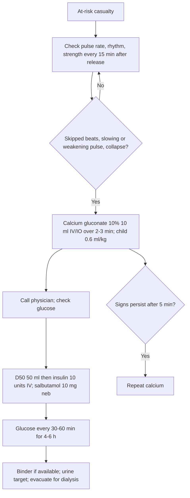

# 08.2 · Dangerous potassium without a monitor

By the end of this lesson you will be able to say which of your casualties is likely to develop a dangerously high potassium level, pick up the warning signs with your hands and a watch, and give the emergency drugs that protect the heart and push potassium back into the cells, at adult and child doses, without an ECG or a lab.

> [!CAUTION]
> Performing these procedures on people without the required state certification is illegal.
> This lesson is for educational purposes only. Practise only on models and animal tissue.

## Why it matters

Potassium lives inside cells. When muscle dies (crush, long tourniquets, compartment syndrome, burns) it spills out; when the kidneys fail it cannot get out of the body. Above about 6.0-6.5 mmol/L the heart's electrical system slows and can stop without warning. In hospital it is diagnosed with a blood test and an ECG. In a long hold you have neither, and the JTS crush CPG accepts that: its **minimum** standard is "close monitoring of vital signs and circulatory examination", and treatment when the pulse tells you something is wrong.

Older war data show why this matters: up to **one third** of combat casualties with kidney failure and little urine developed severe high potassium **within four days** of injury (JTS hyperkalaemia CPG). In a cut-off community the same danger applies to a neighbour on dialysis whose unit has closed.

This course does not teach ECG reading (plan §3: no monitors). Everything below works with hands, a watch, a pulse oximeter and a glucometer.

## What to do

### 1. Know who is at risk

| Group | Why | When the danger peaks |
|---|---|---|
| **Crush injury after release** (08.1) | Dead muscle releases potassium | Minutes after release, and again as kidneys fail over 1-4 days |
| **Tourniquet on more than 2 hours, then released** (02.5) | Same reperfusion | Minutes to hours after release |
| **Rhabdomyolysis** from exertion, heat, seizures, lying on the floor for hours (08.4) | Muscle breakdown | Hours to days |
| **Acute kidney injury**: urine below 0.5 ml/kg/h for 6 hours or more | Cannot excrete potassium | Days 1-4 |
| **Dialysis patients** cut off from dialysis | No kidney function | Usually within days of a missed session; earlier with potassium-rich food |
| **Large burns, sepsis, severe dehydration (worse with NSAIDs), urinary blockage, many units of stored blood** | Listed by the JTS hyperkalaemia CPG | Variable |
| **Drugs**: ACE inhibitors and ARBs (e.g. enalapril, losartan), spironolactone, trimethoprim, NSAIDs, potassium supplements, "low-sodium" salt substitutes | Raise potassium | When combined with dehydration or kidney injury |

### 2. Watch for the warning signs

The JTS crush CPG tells you what to watch for when you have no monitor, every **15 minutes for the first 1-2 hours** after release, then every 30 minutes, then hourly:

- **Skipped beats**: an irregular pulse with pauses. Count a full 60 seconds at the radial pulse, and listen with your ear or a stethoscope over the left chest.
- **Slowing pulse**: a pulse falling towards or below 60 in a casualty who was fast. Slow heart rate is the **primary** sign in the JTS list.
- **Weakening peripheral pulse** and falling blood pressure.
- Course additions from general teaching: new **muscle weakness** or heaviness of the limbs, tingling around the mouth or in the hands, nausea, a casualty who suddenly "goes flat".

> [!WARNING]
> High potassium can kill with no warning sign at all. The JTS CPG notes that even a normal ECG does not rule it out. Your hands are less sensitive than an ECG. In a high-risk casualty, prepare the drugs before release, not after the collapse.

**A pulse oximeter helps**: most show a pulse waveform and a pulse rate that you can watch continuously. A sudden fall in rate, an irregular bar or waveform, or loss of signal in a casualty at risk is your alarm. Check the patient, not the device.

### 3. Decide to treat

The JTS crush CPG: treat urgently when **skipped beats become more frequent, the pulse slows, or the peripheral pulse weakens** in a casualty at risk. The JTS hyperkalaemia CPG adds that without potassium measurement, the full drug set is considered for a casualty who is **peri-arrest with high clinical suspicion**. Course rule combining both: **at-risk casualty + any of the warning signs = give calcium now and call a physician**; add the shifting drugs if you have them and can monitor glucose.

### 4. Field treatment

Order matters: **calcium first** (protects the heart within minutes but does not lower potassium), then **shift** potassium into cells (insulin with dextrose, salbutamol), then **remove** it (binders, urine, dialysis). Every drug except the binders is temporary.

| Drug | Route | Adult dose | Child dose | Onset / lasts | Repeat | Notes |
|---|---|---|---|---|---|---|
| **Calcium gluconate 10%** (1 g in 10 ml) | IV/IO **slowly over 2-3 min** | **10 ml** | **0.6 ml/kg** (60 mg/kg, as in 04.3; RCH uses 0.68 ml/kg), not above the adult dose per push | Immediate / 30-60 min | After **5 min** if signs persist (JTS), then as needed | Preferred through a small vein. Stop if the pulse slows sharply during the push |
| **Calcium chloride 10%** (alternative) | IV/IO slowly over 2-3 min | **10 ml** | **0.2 ml/kg**, max 10 ml (RCH) | Immediate / 30-60 min | As above | Three times as much calcium per ml; burns tissue if it leaks; large vein or IO |
| **Dextrose 50%** then **regular insulin** | IV/IO | **50 ml D50** first (unless glucose is above 250 mg/dl), then **10 units** regular insulin IV push (JTS) | **5 ml/kg of 10% dextrose**, then **0.1 unit/kg** insulin, max 10 units (RCH) | 10-20 min / 4-6 h | Every 4-6 h with glucose checks | Glucose check before, then every 30-60 min for at least 4-6 h (longer if kidneys fail) |
| **Salbutamol (albuterol)** nebulised | Inhaled | **10 mg** over 10 min (JTS: four 2.5 mg nebules) | **2.5 mg** if 25 kg or less, **5 mg** above 25 kg, 1-2 hourly (RCH) | 20-30 min / 1-2 h | As above | Adds to insulin. Causes fast heart rate and tremor |
| **Sodium zirconium cyclosilicate** (Lokelma) | PO in water | **10 g three times a day** for 48 h, then 10 g daily (JTS "best" binder) | Not established; physician only | About 1 h | | Removes potassium from the body |
| **Patiromer** (Veltassa) | PO | 8.4-16.8 g once daily | Physician only | Hours | | Keep refrigerated |
| **Sodium polystyrene sulfonate** (Kayexalate, Resonium) | PO or rectal | **15-30 g** in 50-100 ml liquid (JTS) | **0.5-1 g/kg** every 6 h, max 30 g (RCH) | 1 h rectal, 4-6 h oral | Every 6 h | Avoid after bowel injury or surgery (rare colon necrosis) |
| **Furosemide** | IV | **40 mg** (JTS) | Physician only | About 2 h | | Only if the casualty passes urine and is **not** dry or in shock |

Notes from the sources:

- **Sodium bicarbonate is no longer recommended** for high potassium in the 2022 JTS CPG (its potassium-lowering effect is slow and unsustained). RCH reserves it for children with metabolic acidosis. Never give bicarbonate and calcium through the same line at the same time: they form a chalky precipitate.
- **Fluids:** large-volume 0.9% saline makes the blood more acidic, which pushes potassium out of cells; the JTS hyperkalaemia CPG prefers balanced crystalloids (Ringer's lactate, Plasma-Lyte) once potassium is the problem, because their small potassium content is lower than the casualty's blood level. Before crush release, ISN still says potassium-free saline (08.1). Course reasoning: saline before and around release, balanced fluid later if a physician directs.
- **Last resort:** if potassium signs appear and you cannot treat them, the JTS crush CPG says **use tourniquets to isolate the crushed limb(s)** again.
- **Pre-emptive binders:** for transport, ISN suggests giving a binder (Kayexalate, zirconium cyclosilicate or patiromer) in advance to crush casualties.
- **The opposite problem:** once urine flows well, potassium can **fall**. In the Bingöl earthquake series, 9 of 16 crush victims needed potassium replacement. Weakness and cramps in the polyuric phase need a physician's advice, not more calcium.

### Watch

These videos show ECG strips; you do not need to read them. Watch for the drug sequence and the reasons.

Lecturio Medical's step-by-step treatment of high potassium (calcium, shift, remove):

https://www.youtube.com/watch?v=bCFiJOB2on0

Alila Medical Media animation of causes, effects on the heart and treatment:

https://www.youtube.com/watch?v=-32U9eU1hdM

Maryland EMS 2026 protocol update on hyperkalaemia and crush syndrome, from an EMS system that lets paramedics treat both:

https://www.youtube.com/watch?v=lOsKkBCgk54

Some videos still list sodium bicarbonate as a first-line potassium drug; the 2022 JTS CPG removed it.

## Improvise it

### Glucose monitoring with a home glucometer

Insulin without glucose checks can kill faster than the potassium. Any diabetic household has a glucometer and strips. Use a fingertip on an uninjured hand; check before insulin and every 30-60 minutes for 4-6 hours, longer if the kidneys are failing (insulin lingers). Below **70 mg/dl**: give dextrose (IV 50 ml D50, or sugar by mouth if the casualty is awake and can swallow: 15-20 g, about 4 teaspoons of sugar in water, or 150 ml of a sugary soft drink). **If you have no way to check glucose, do not give insulin** unless a physician on the phone decides the risk is worth it; give calcium and salbutamol instead.

### Salbutamol without a nebuliser

A household asthma inhaler (salbutamol 100 micrograms per puff, e.g. Ventolin) through a spacer, or through a plastic bottle with the bottom cut off as an improvised spacer. Small studies in dialysis patients found inhaler doses lowered potassium, but the dose needed is many puffs and the effect is less certain than a nebuliser; treat it as an add-on, never instead of calcium. Course rule: 10-20 puffs, one at a time with 4-6 breaths each, watch for a racing pulse and tremor.

### Calcium when you have no IV

Calcium is only useful into a vein or bone. Oral calcium tablets do nothing for the heart in time. IO is acceptable (lesson 04.2).

### Isolate the source

- **Tourniquets** back on above a crushed limb (JTS last resort, 08.1).
- **Keep urine flowing** with the crush fluid plan (08.1): every litre of urine removes potassium.

### Feed and drink without potassium

For a casualty at risk and for a dialysis patient cut off from treatment, potassium intake is something you control in the kitchen:

| Avoid (high potassium) | Prefer (lower potassium) |
|---|---|
| Bananas, oranges and orange juice, dried fruit, dates, tomatoes and tomato paste, potatoes and sweet potatoes, avocado, legumes, nuts, chocolate, coffee in quantity, coconut water, sports drinks with added potassium | White rice, white bread, pasta, apples, pears, cucumbers, cabbage, eggs, plain biscuits, oil, sugar, honey |
| **"Low-sodium" or "lite" salt substitutes** (potassium chloride) | Ordinary table salt |

Peeling, cutting small and boiling potatoes and vegetables in a large pot of water, then discarding the water, removes a share of their potassium (standard renal dietetic advice; not a reason to eat large amounts). A dialysis patient should also limit fluid to what their unit told them, since they cannot pass it.

### Moving potassium out without dialysis

Only a physician can do improvised peritoneal dialysis (the JTS CPG describes it for a deployed surgical team). Your job is to recognise early, treat for time and **evacuate to dialysis as the top priority**.

## When it goes wrong

| Problem | Cause | Recovery |
|---|---|---|
| Confusion, sweating, seizure an hour after insulin | Hypoglycaemia | Dextrose IV or sugar by mouth; recheck glucose every 15 min |
| Signs return after 30-60 minutes | Calcium wears off; shifting drugs are temporary | Repeat calcium; repeat insulin and dextrose at 4-6 h; push evacuation |
| Burn and blistering at the cannula site | Calcium chloride leaked out of the vein | Stop, remove cannula, elevate; use gluconate or IO next time |
| White cloudy line | Calcium and bicarbonate (or ceftriaxone in a newborn) mixed | Never mix; flush between drugs (04.7) |
| Pulse racing after salbutamol | Expected effect | Watch; do not repeat early |
| Weakness and cramps on day 2-3 with plenty of urine | Low potassium in the polyuric phase | Physician advice; ORS with potassium becomes appropriate |
| Dialysis patient given banana smoothies "for strength" | Kind, dangerous | Teach the family the table above |

## Scope and law

Calcium, insulin and dextrose given intravenously, prescription binders and nebulised salbutamol in this setting are physician and paramedic treatments in Israel and are not part of the EMT scope. Prepare them for a paramedic or physician, give them yourself only under remote physician direction or as the last resort described in [01.5 · The law and your scope in Israel](../module-01/lesson-05.md). Lowering potassium in the diet, glucose checks with a household glucometer and helping a patient use their own inhaler are within reasonable lay aid.

## Practice

**Drill 1: pulse drill (15 minutes).** A partner, a watch with a second hand, a pulse oximeter.

1. Take your partner's radial pulse for a full 60 seconds, eyes closed, three times. Write rate and "regular or not".
2. Your partner taps an irregular rhythm with skipped beats on the table while you count with eyes closed; identify each pause.
3. Watch the pulse oximeter's rate and waveform for 2 minutes; note how fast it reacts when your partner raises their hand above the head.

**Drill 2: drug cards (25 minutes).** Paper, a calculator, a household glucometer if available.

1. Write a pocket card in treatment order (calcium, dextrose and insulin, salbutamol, binder) with adult doses and the child formula.
2. Calculate for a 22 kg child: calcium gluconate 10% volume, 10% dextrose volume, insulin units, salbutamol dose.
3. If you own a glucometer, take your own reading and write a 6-hour glucose check schedule for a casualty given insulin at 14:00.

How you know it worked: three pulse counts within 4 beats of each other; every skipped beat in the tapping drill found; for the 22 kg child: calcium gluconate 10 ml (0.6 × 22 = 13.2 ml, which is above the 10 ml adult dose, so give 10 ml and repeat after 5 minutes if signs persist), 10% dextrose 110 ml, insulin 2.2 units, salbutamol 2.5 mg; glucose checks at 14:00 (before), then 14:30, 15:00, 16:00, 17:00, 18:00, 19:00, 20:00.

## Sources

- Joint Trauma System. *Hyperkalemia and Dialysis in the Deployed Setting* CPG (ID 52), 25 Apr 2022: causes, threshold 6.0 mmol/L, calcium indications, Appendix A doses and order (calcium, D50 then insulin 10 units, albuterol 10 mg neb, zirconium cyclosilicate, patiromer, Kayexalate, furosemide), bicarbonate removed, balanced crystalloids, one third of oliguric casualties hyperkalaemic within 4 days.
- Joint Trauma System. *Crush Syndrome - Prolonged Field Care* CPG (ID 58), 28 Dec 2016: minimum monitoring by vital signs, warning signs (skipped beats, bradycardia, weakening pulse), monitoring intervals, tourniquets to isolate the limb.
- Royal Children's Hospital Melbourne. *Hyperkalaemia* clinical practice guideline: child doses of calcium gluconate and chloride, dextrose and insulin, salbutamol, resonium, bicarbonate only with acidosis.
- Sever MS, Vanholder R, et al. ISN crush recommendations, Short Field Version: expect hyperkalaemia at all times; pre-emptive binders for transport.
- Gunal AI, et al. *J Am Soc Nephrol* 2004: hypokalaemia in 9 of 16 crush victims during the polyuric phase.
