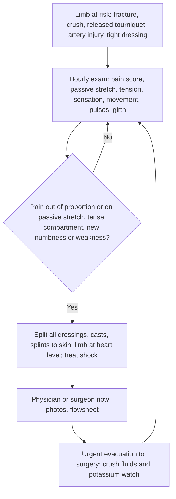

# 08.3 · Compartment syndrome: recognition and what to do without a surgeon

By the end of this lesson you will be able to pick out the limbs at risk of compartment syndrome, examine them by hand every hour and record what you find, do everything that can be done without a scalpel to relieve pressure, and get the right people involved before the muscle dies.

> [!CAUTION]
> Performing these procedures on people without the required state certification is illegal.
> This lesson is for educational purposes only. Practise only on models and animal tissue.

## Why it matters

The muscles of the leg and forearm sit in closed sleeves of tough fascia. After injury the muscle swells; the sleeve does not stretch. Pressure inside the compartment rises until it squeezes shut the small veins and capillaries, the muscle starves of blood, swells more, and dies within a few hours. Dead muscle then releases potassium and myoglobin: the same chain as crush syndrome (08.1, 08.2). The May 2026 JTS CPG says plainly that **a delay in diagnosis can be lethal through rhabdomyolysis and kidney failure**, and that only surgery (fasciotomy) stops the process once pressure reaches the critical level.

How common it is:

- **3-27%** of civilian tibia (shin bone) fractures develop compartment syndrome; about **36%** of all cases come from tibia fractures (JTS 2026).
- **20-25%** occur **without any fracture** (JTS 2026): crush, vessel injury, shock, prolonged lying on a limb, burns.
- Up to **15%** of military orthopaedic trauma casualties need at least one fasciotomy (JTS 2026).
- After the 2023 Turkish earthquakes, **40.8%** of crush-syndrome patients had compartment syndrome (Ozturk et al. 2024).

In a long hold you have time against you: swelling peaks at **24-48 hours** after injury, and after reperfusion (a tourniquet released, a crush lifted, shock corrected) it may keep rising for **2-5 days** (JTS 2026). The limb that looked fine at hour 2 can be lost at hour 20.

## What to do

### 1. Know the limbs at risk

From the JTS 2026 risk table, the ones you will meet in the field:

| Category | Examples |
|---|---|
| **Fractures** | Open tibia fracture, high-energy fracture of the top of the tibia, bullet or fragment fracture of tibia or fibula (especially upper third), badly displaced or comminuted open fractures. **In children: elbow fracture just above the joint (supracondylar)** |
| **Crush and compression** | Pinned under rubble, a person unconscious (drugs, alcohol, head injury, carbon monoxide) lying on a limb for hours |
| **Blood flow** | Artery injury, tourniquet on for a long time then released, shock then resuscitation |
| **Your own treatment** | **Tight dressings, circumferential bandages, tight splints or casts**; a pressure dressing left on a swollen limb; large volumes of crystalloid (above about 5 L); limb raised well above heart level; ankle held bent up (dorsiflexed) |
| **Other** | Burns (circumferential), frostbite, electrical injury, snake bite, bleeding disorders and anticoagulants |

The most common site is the **lower leg**, then the **forearm**; also thigh, buttock, foot, upper arm and hand.

### 2. Examine every hour

The JTS 2026 CPG: there is **no reliable test** in the field; the diagnosis is clinical, and **serial examinations should be repeated hourly when the risk is high**, with every finding documented. Pressure measurement is not recommended for routine use even in theatre.

Examine both limbs, compare, and write on the flowsheet each hour (lesson 07.2):

1. **Pain.** Pain out of proportion to the injury, rising despite good pain relief, is the earliest and most important sign. Ask the casualty to score it 0-10 every hour; a rising score with the same drugs is your alarm.
2. **Pain on passive stretch.** Gently move the toes or fingers in the direction that stretches the muscles of the compartment: for the front of the shin, point the toes and foot downward; for the calf, pull the toes and foot up; for the forearm flexors, straighten the fingers backward. Severe pain is a warning sign.
3. **Feel the compartments.** Tense, "woody", shiny skin, harder than the other side. JTS 2026 warns that this finding is subjective and cannot rule compartment syndrome out.
4. **Sensation.** Light touch and pinprick between the first and second toes (front compartment nerve), on the sole, and on the fingertips. New numbness or tingling.
5. **Movement.** Can they lift the toes and foot, curl the toes, make a fist, spread the fingers? New weakness.
6. **Circulation.** Skin colour and temperature, capillary refill, distal pulses. **A pulse does not rule it out**: irreversible damage occurs with palpable pulses. Pulselessness is late and ominous.
7. **Measure.** Mark a line with a pen at the widest point of each calf or forearm and measure the circumference with a tape or string each hour. A steadily growing limb is a trend you can show a physician.

> [!IMPORTANT]
> The classic "5 Ps" (pain, pallor, paralysis, paraesthesia, pulselessness) are listed in every textbook, but by the time all five are present the muscle is usually dead. Act on **pain out of proportion plus pain on passive stretch** in a limb at risk. In an unconscious or heavily sedated casualty you cannot use pain, so a tense, growing compartment in a high-risk limb is enough to call for help.

### 3. What you can do without a surgeon

These steps do not cure compartment syndrome; they remove the causes you control and protect the rest of the body while you get a surgeon or physician involved.

1. **Loosen or split anything circumferential**: bandages, pressure dressings, tape, a cast or a rigid splint. Split a cast and its padding along its full length **down to skin** and spread it. Re-apply splints loosely with padding (lesson 05.6).
2. **Keep the limb at heart level.** Not raised: raising lowers the blood pressure inside the compartment and worsens the starvation (JTS lists "limbs positioned well above heart" as a risk). Not hanging down either.
3. **Support blood pressure.** Treat shock (lesson 04.1); low blood pressure lowers perfusion into a tight compartment.
4. **Give oxygen** if you have it and saturation is low (lesson 03.7).
5. **Cool only by evaporation or ambient air.** The JTS crush CPG's minimum for a swelling crushed limb is evaporative or environmental cooling; **never pack it in ice or snow**.
6. **Pain relief** (lesson 04.5), but keep examining: good pain relief should make the pain settle. Pain that breaks through good analgesia is a sign, not a reason for more drug. **Avoid NSAIDs** in a limb at risk of muscle breakdown (08.1).
7. **Start the crush fluid plan** if muscle damage is likely: dark urine, crushed limb, compartment syndrome present for hours (08.1, 08.4). Watch potassium (08.2).
8. **Call a physician or surgeon** at the first suspicion, with your hourly flowsheet and photos. Make evacuation to a surgical facility **urgent**: JTS 2026 says compartment syndrome needs **immediate** operative treatment because irreversible necrosis occurs **within a few hours**, and recommends fasciotomy at the first surgical facility for any limb at risk when a long evacuation is expected.

### Fasciotomy: what you need to know

Fasciotomy means cutting the skin and fascia of **every** compartment along its **full length** and leaving the wound open. In the lower leg JTS 2026 requires a **two-incision, four-compartment** release; incomplete fasciotomy is a known, preventable cause of limb loss and death. The CPG calls it **an operative procedure performed in an operating room**, with large blood loss and an open wound needing days of care. Even in hospital the wounds are prone to infection: after the 2003 Bingöl earthquake, 9 of 16 fasciotomies in crush victims became infected (Gunal et al. 2004).

The JTS crush PFC CPG allows fasciotomy in prolonged field care **only** when qualified medical personnel, or a teleconsultation ideally with live video, are available, **and** wound care is available afterwards, **and** regional anaesthesia or IV sedation can be given. This course does not teach the incisions: an EMT-level provider attempting it is far more likely to cut a nerve or artery, or to make an incomplete release, than to save the limb. Your role is recognition, the non-surgical steps, documentation, preparing the casualty and equipment for the physician who does it, and post-operative wound care (lesson 08.6).

**Late presentation (more than 12 hours)** of an established compartment syndrome carries a high risk of infection and death after fasciotomy; the JTS 2026 CPG still leans towards fasciotomy, with full resuscitation and kidney support. Foot compartment syndrome is generally **not** released (JTS 2026). Both are a surgeon's decision.

### Watch

Dr Paull ("Beyond the Scalpel") explains how surgeons diagnose compartment syndrome:

https://www.youtube.com/watch?v=tvmHKXz-Wwg

Armando Hasudungan's illustrated lecture on acute compartment syndrome (anatomy of the compartments and why pressure kills muscle):

https://www.youtube.com/watch?v=txAugSNF4Jk

A firefighter-paramedic (TheFirefighterMedic) on recognising compartment syndrome and what to do about it in the field:

https://www.youtube.com/watch?v=o4_bgjotFFU

Alila Medical Media's short animation of the mechanism:

https://www.youtube.com/watch?v=oO9GqanB0s8

Some videos still teach elevating the limb above the heart and applying ice; for suspected compartment syndrome keep it at heart level and cool only by air.

## Improvise it

| Need | Household version | What works | What fails / how to tell |
|---|---|---|---|
| **Splitting a cast or rigid splint** | Strong kitchen or tailor's scissors for padding and bandage; a fine hacksaw or a utility knife scored repeatedly for plaster, with a spoon or ruler slid between cast and skin as a guard | Full-length split down to skin, then spread with two flat screwdrivers or spoons | Partial split or only cutting the outer layer: padding and dried blood still constrict. Check you can slide a finger under along the whole length |
| **Measuring girth** | Tailor's tape, or string marked with a pen then laid against a ruler | Same spot each time (mark the skin) | Measuring at different points gives false trends |
| **Limb at heart level** | Pillows, folded blankets, a rolled sleeping mat | Keep the limb level with the chest when lying | Propping on a high stack "to reduce swelling" |
| **Evaporative cooling** | A fan, or a damp (not wet) cloth over the skin with air moving across | Gentle cooling of a swollen crushed limb | Ice packs and frozen food packs damage tissue (JTS) |
| **Hourly record** | A sheet of paper ruled into hour columns: pain score, stretch pain Y/N, tension 0-3, sensation, movement, pulse, girth | The trend is what the physician needs | Notes like "looks ok" with no numbers |
| **Photos for the physician** | A phone: same angle, a ruler or coin for scale, the time on a piece of paper in the photo | Shows swelling, colour and blisters | Photos without scale or time |

## When it goes wrong

| Mistake | Consequence | Recovery |
|---|---|---|
| Pain blamed on the fracture and treated with more drugs | Muscle dies unrecognised | Re-examine: passive stretch and tension; call for help |
| Unconscious or ketamine-sedated casualty not examined | No pain signal | Use tension, girth and the risk list; call earlier |
| Pressure dressing left on a swollen leg overnight | Created a compartment syndrome | Loosen all dressings on rounds; re-dress loosely (lesson 07.5) |
| Limb raised on three pillows | Lower perfusion pressure | Lower to heart level |
| "Pulses are fine, so no compartment syndrome" | False reassurance | Pulses disappear late |
| Ice packs on a crushed calf | Further tissue damage | Air cooling only |
| Dark urine ignored in a tense limb | Kidney injury progressing | Crush fluid plan (08.1); potassium watch (08.2) |
| An untrained helper tries to "cut it open" | Nerve and artery injury, incomplete release, infection | Prevent it; this is a surgeon's procedure |

## Scope and law

Examining a limb, loosening dressings and splints, positioning and documenting are within EMT and lay first aid. Fasciotomy is a surgical procedure for a physician with surgical training, and analgesia beyond over-the-counter drugs is a paramedic or physician power; act beyond your scope only in the circumstances set out in [01.5 · The law and your scope in Israel](../module-01/lesson-05.md), and in this case the last-resort step is getting a surgeon or physician to the casualty or the casualty to a surgeon, not the knife.

## Practice

**Drill 1: compartment exam on a partner (20 minutes).** A partner, a pen, a tape measure or string, a safety pin or toothpick (blunt end for sensation), a watch.

1. Find and outline with the pen the four compartments of the lower leg (front, side, back superficial, back deep) and the front and back of the forearm, using an anatomy picture.
2. Perform the full exam in order: pain score, passive stretch for each compartment, tension, sensation (first web space, sole, fingertips), movement, capillary refill, pulses, girth at a marked line.
3. Fill in one hour's column on a ruled flowsheet.
4. Repeat on the other limb, then time yourself doing both legs.

**Drill 2: splitting a splint (20 minutes).** A roll of plaster or fibreglass bandage (pharmacy) over a padded tube (a rolled newspaper or a cardboard tube with a towel around it), scissors, a utility knife, two spoons.

1. Make a short "cast" around the padded tube and let it set.
2. Split it along the full length with a spoon guarding the "skin", cut the padding too, and spread it.
3. Slide a finger under the whole length.

How you know it worked: you can perform the full exam on both lower legs in under 4 minutes, your girth readings on the same spot vary by no more than 0.5 cm between three tries, your flowsheet column has numbers rather than words, and the split cast opens along its full length with padding cut and no cut in the "skin" towel.

## Sources

- Joint Trauma System. *Acute Extremity Compartment Syndrome and the Role of Fasciotomy in Extremity War Wounds* CPG (ID 17), 21 May 2026: incidence, risk table, swelling timeline, clinical diagnosis and hourly exams, pressure measurement not routine, immediate surgery, complete two-incision fasciotomy, late presentation, foot compartment syndrome, dressings after fasciotomy.
- Joint Trauma System. *Crush Syndrome - Prolonged Field Care* CPG (ID 58), 28 Dec 2016: fasciotomy only with qualified personnel or teleconsultation, wound care and anaesthesia; minimum evaporative cooling, no ice or snow.
- Ozturk I, et al. *J Nephrol* 2024 (Kahramanmaraş: compartment syndrome in 40.8%).
- Gunal AI, et al. *J Am Soc Nephrol* 2004 (Bingöl: 16 fasciotomies in 11 of 16 patients, 9 complicated by infection).
