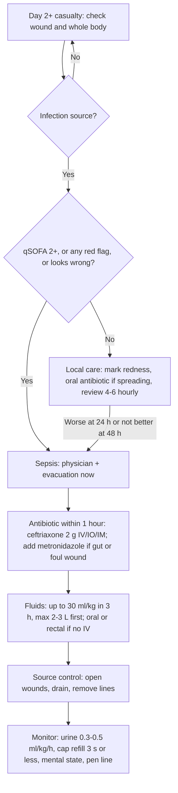

# 08.5 · Wound infection and sepsis without labs

By the end of this lesson you will be able to examine a wound and a casualty on day 2, 3 or 5 and say whether the wound is infected, whether the infection has become sepsis, and what to do in the next hour, using only your eyes, hands, a thermometer, a watch, a pen and a urine bottle.

> [!CAUTION]
> Performing these procedures on people without the required state certification is illegal.
> This lesson is for educational purposes only. Practise only on models and animal tissue.

## Why it matters

In a long hold, infection overtakes bleeding as the main threat. The JTS sepsis CPG states that severe infection is often a greater risk than trauma in prolonged field care, that war wounds are grossly contaminated, and that unattended wounds can cause sepsis **within days, or within hours** for very large dirty wounds. Trauma-related sepsis typically appears **several days** after injury: exactly when you are alone with the casualty. Infection also starts from your own interventions: IV and IO lines, urinary catheters, packed wounds.

**Sepsis** (Sepsis-3, 2016) is life-threatening organ dysfunction caused by the body's response to infection. Untreated, it progresses to septic shock. Early antibiotics, fluids and removing the source save lives; recognising it late, after the blood pressure falls, costs lives (JTS: hypotension is a **late** sign; do not wait for it).

## What to do

### 1. Examine the wound at every dressing change

Normal healing in the first 2-3 days: mild redness at the edges (a few millimetres), mild swelling, some clear or blood-stained ooze, pain that is **getting less** each day.

**Local infection** (JTS wound CPG: increasing pain, redness, warmth, purulent drainage, swelling):

- Pain **increasing** after day 1-2 instead of settling.
- Redness spreading out from the edges, warm to the touch.
- Swelling, firmness, pus (thick yellow, green or grey), a bad smell.
- Red streaks running up the limb towards the armpit or groin (lymphangitis), tender lumps in the armpit or groin.
- A closed wound that becomes tense, red and painful.

**Mark it.** The JTS sepsis CPG: outline the redness with a pen, **write the date and time** on the skin, and watch for spread beyond the line. If redness **worsens after 24 hours** or **fails to improve within 48 hours** of antibiotics, the antibiotic or the wound care is failing: talk to a physician about changing antibiotics or surgical debridement.

### 2. Recognise the infections that kill fast

| Infection | Warning signs | What to do |
|---|---|---|
| **Necrotising soft-tissue infection** (necrotising fasciitis, gas gangrene) | Pain far beyond what the wound looks like, or pain beyond the red area; rapid spread (visible in an hour or two); skin dusky, purple, bronze or grey; blisters with dark fluid; crackling under the skin (gas, felt like bubble wrap); thin "dishwater" discharge with a sweet or foul smell; the casualty looks very ill | Surgical emergency: only wide surgical excision saves life. Antibiotics now (below), fluids, physician by phone, **evacuate immediately**. Mark the edge every hour |
| **Tetanus** | Jaw stiffness ("lockjaw"), difficulty swallowing, stiff neck and belly, painful spasms set off by noise or touch, days to weeks after a dirty wound | Physician emergency (antitoxin, sedation, airway). Prevention is the wound care in 08.6 and vaccination |
| **Invasive fungal infection** after blast with soil contamination | Wound that keeps producing new dead tissue despite debridement, grey-black areas | Physician; JTS switches to Dakin's solution (08.6) |

### 3. Screen the whole casualty for sepsis

Look for the source first: the wound, but also chest (cough, fast breathing), urine (burning, cloudy, catheter), lines and IO sites, the skin over pressure areas, the back and perineum (JTS: genital and perianal areas are commonly missed).

**qSOFA** (Sepsis-3): one point each for

- breathing rate **22 or more** per minute,
- **altered mental state** (new confusion, drowsiness, agitation),
- systolic blood pressure **100 or lower**.

Two or more points: high risk of death, treat as sepsis. The JTS sepsis CPG uses the same three signs.

**SIRS signs** (JTS sepsis CPG; no longer part of the definition, but useful early warnings): heart rate above 90, breathing above 20, temperature above 38 °C or below 36 °C (white cell count is the fourth, which you cannot measure).

> [!IMPORTANT]
> The Surviving Sepsis Campaign 2021 recommends **against using qSOFA alone** as a screening tool, because it misses many early cases; SIRS, NEWS2 or similar scores are more sensitive. Use qSOFA as a danger sign, never as reassurance. A casualty who "looks wrong" with a known source needs treatment even with a qSOFA of 1.

**UK Sepsis Trust red flags, adults 16+ (community tool, 2025)**: any one of these means red-flag sepsis:

- new or altered mental state;
- breathing rate **25 or more** per minute;
- new need for oxygen to keep SpO2 above 92% (88% in COPD);
- systolic BP **90 or less**, or a drop of more than 40 from their normal;
- heart rate **above 130**;
- **no urine for 18 hours** (below 0.5 ml/kg/h if you are measuring);
- non-blanching rash, mottled, ashen or blue skin.

**UK Sepsis Trust red flags, children under 5 (community tool, 2024)**: acutely altered behaviour, does not wake or stay awake, looks very unwell, SpO2 below 90% on air, heart rate below 60, non-blanching rash or mottled/ashen/blue skin, temperature below 36 °C, **under 3 months with 38 °C or above**, or severe fast breathing or heart rate:

| Age | Breathing at or above | Heart rate at or above |
|---|---|---|
| Under 1 year | 60 | 160 |
| 1-2 years | 50 | 150 |
| 3-4 years | 40 | 140 |

Amber flags in children (worth acting on in a long hold) include capillary refill of 3 seconds or more, cold hands and feet or leg pain, reduced urine and a parent who is worried.

**Remember who hides it** (JTS): the elderly (muted signs), the very young (late signs), pregnant women (up to 50% have no fever), anyone on steroids or with diabetes.

### 4. Act in the first hour: the field sepsis bundle

The Surviving Sepsis Campaign 2021 recommends antibiotics **immediately, ideally within 1 hour** when septic shock or sepsis is probable. The JTS sepsis CPG: evacuation is the **highest** treatment priority.

1. **Call for evacuation and a physician** (telemedicine report, lesson 07.7): vital signs and their trend, urine output, mental state, skin, the wound with photos, what you have given.
2. **Antibiotics now.** Course plan built from TCCC 2026 and the JTS sepsis CPG:

| Situation | Drug | Adult | Child | Notes |
|---|---|---|---|---|
| Wound or soft-tissue sepsis, can swallow and not in shock | **Cefadroxil** PO (or cephalexin) | 1 g daily (cephalexin 500 mg 6-hourly) | 30 mg/kg daily (cephalexin 12.5-25 mg/kg 6-hourly) | 04.6. Oral only if not shocked or vomiting |
| Sepsis, shock, vomiting or cannot swallow | **Ceftriaxone** IV/IO/IM | **2 g** once daily (JTS sepsis CPG "better") | 50-75 mg/kg once daily (04.6) | First dose now, not at the next "round" |
| Abdominal wound, foul or deep dirty wound, suspected anaerobes | add **metronidazole** PO/IV | **500 mg** every 8 h (JTS sepsis CPG "best") | 15 mg/kg loading (C-TECC, 05.8), then 7.5 mg/kg every 8 h (physician) | Nausea, metallic taste; no alcohol |
| Anaphylaxis to penicillin or cephalosporins | **Clindamycin** PO | 300-450 mg every 6-8 h | 10 mg/kg every 8 h | 04.6. Physician decision |

If the wound redness is worse after 24 hours or not better after 48 hours, a physician may change the antibiotic (for example to cover MRSA); you report the trend.

3. **Fluids** (JTS sepsis CPG):
   - **IV/IO:** up to **30 ml/kg of crystalloid in the first 3 hours**, Ringer's lactate preferred over saline; the **first boluses should not exceed 2-3 L** in total, then fluid by perfusion. Surviving Sepsis 2021 also suggests 30 ml/kg in the first 3 hours (weak recommendation). **If the casualty is also bleeding from trauma**, resuscitate with blood as for trauma (04.1, 04.4).
   - **No IV:** oral rehydration solution by mouth; **rectal** ORS starting at **100 ml/h**, up to **500 ml/h** (JTS sepsis CPG).
   - **Targets:** urine **0.3-0.5 ml/kg/h**, a palpable radial pulse or SBP above 90, capillary refill **3 seconds or less**, improving mental state. If SBP falls below 90, increase fluid by **20%** and watch for overload (crackles, breathlessness).
4. **Source control.** Open the dressing, look at everything. The JTS sepsis CPG: remove or replace old IV/IO lines and urinary catheters, drain pus, remove dead tissue and foreign material, **reopen any closed wound that is infected** (08.6). Start antibiotics and fluids **before** any procedure.
5. **Fever and comfort.** Acetaminophen (04.5) for fever and pain; cool with tepid sponging and air if very hot. Do not treat the thermometer and ignore the trend.
6. **Monitor and record** on the flowsheet (07.2): temperature, pulse, breathing rate, BP or radial pulse, capillary refill (at least every 30 minutes in an unstable casualty, JTS), mental state, urine hourly, the pen line on the wound.

Vasopressors (adrenaline or noradrenaline infusions) appear in the JTS sepsis CPG for medics with monitors; they need a monitor and a physician and are outside this course.

### Watch

The UK Sepsis Trust explains the red flags and cardinal symptoms:

https://www.youtube.com/watch?v=UkQVfE4jR3s

Core EM (NYU emergency medicine) compares SIRS, qSOFA and NEWS for detecting sepsis:

https://www.youtube.com/watch?v=yyoWt0ap9rI

JAMA Network's summary of the 2016 Sepsis-3 definitions and qSOFA:

https://www.youtube.com/watch?v=L5xKW--drRg

## Improvise it

| Need | Household version | What works | What fails / the risk |
|---|---|---|---|
| **Temperature** | Any digital thermometer under the tongue or armpit (armpit reads about 0.5 °C lower); forehead infrared is the least reliable | Same site and same thermometer each time; record the trend | Back of the hand on the forehead misses moderate fevers and low temperatures. A cold casualty can be septic |
| **Breathing rate** | Count chest rises for a full 60 seconds while pretending to take the pulse (people change their breathing when watched) | Rate is the most neglected vital sign and an early sepsis sign | 15-second counts × 4 miss irregular breathing |
| **Blood pressure without a cuff** | Radial pulse present or not; capillary refill on a fingernail, 5 s pressure, count the return in seconds; skin mottling on knees | Trend and capillary refill (JTS: an important perfusion marker) | Rules that convert pulse sites into exact BP numbers are unreliable. Don't write a number you did not measure |
| **Mental state** | Ask three questions each round: name, place, what happened; note any change. AVPU for the drowsy | Family members notice "not himself" first | Blaming confusion on pain drugs without checking |
| **Marking spread** | Ballpoint or permanent marker; write date and time; photo with a coin for scale | The JTS method | Washable pens rubbed off by dressings |
| **Urine** | Measured bottles (08.1) | Falling urine is an early organ failure sign | Guessing volumes |
| **Rectal fluid** | ORS through a soft lubricated tube, gravity, 100 ml/h rising to 500 ml/h (JTS) | Absorbs well in many casualties | Fluid that runs straight out is not absorbed; stop if the abdomen swells or there is rectal injury |
| **Oral antibiotic for a child** | Crush the tablet, dissolve in a little water, give with a syringe and something sweet afterwards (04.7) | Dose by weight | Kitchen spoons for doses |

**Antibiotics from a home cabinet.** Leftover antibiotics in the household are a last resort for a casualty with spreading infection when nothing else can be obtained and no physician can be reached: amoxicillin-clavulanate is a reasonable choice for wounds; plain amoxicillin misses much of the staphylococcus that infects wounds (04.6). Note the drug, dose, time and the reason on the card, and ask a physician at the first opportunity.

## When it goes wrong

| Mistake | Consequence | Recovery |
|---|---|---|
| Waiting for low blood pressure before acting | Late treatment, higher death rate | Act on rising breathing rate, heart rate, confusion and falling urine |
| qSOFA of 1 taken as "not sepsis" | Missed early sepsis | Use the red flags and the whole picture |
| Antibiotics without opening the wound | Pus and dead tissue keep feeding the infection | Source control (08.6) |
| Old IV cannula left in a red, tender vein | Line infection | Remove; new line elsewhere if needed |
| 6 L of saline in a casualty with no urine | Pulmonary oedema | Respect the 2-3 L initial limit; titrate to perfusion and urine |
| Oral antibiotics in a vomiting, shocked casualty | Not absorbed | Ceftriaxone IV/IO/IM |
| Fever treated, trend not recorded | Physician cannot judge response | Flowsheet every round |
| Missed pressure-sore or perineal source | Unexplained sepsis | Full skin check including back, buttocks, genitals |

## Scope and law

Recognising infection and sepsis, marking wounds, measuring vital signs and urine and calling for help are within EMT and lay first aid. Antibiotics are prescription drugs and injections and IV fluids are paramedic and physician powers in Israel; give them only under physician direction or as the last resort described in [01.5 · The law and your scope in Israel](../module-01/lesson-05.md), and write down what you gave so the next clinician knows.

## Practice

**Drill 1: vital signs round (15 minutes).** A partner, a thermometer, a watch, a pen, a flowsheet.

1. Take a full round in order: temperature, pulse for 60 s, breathing for 60 s (covertly), capillary refill, radial pulse quality, mental state questions.
2. Score qSOFA from what you can measure, and check each adult red flag.
3. Repeat after your partner has climbed stairs for two minutes and see which values change.

**Drill 2: three-day paper case (25 minutes).** Use this sequence. A 70 kg man with a fragment wound to the calf, dressed, on cefadroxil 1 g daily.

- Day 1, 18:00: T 37.4, pulse 88, breathing 16, alert, wound edges pink 3 mm, urine 60 ml/h.
- Day 2, 18:00: T 38.3, pulse 104, breathing 20, alert, redness 4 cm from the edge, pain worse, urine 45 ml/h.
- Day 3, 06:00: T 38.9, pulse 124, breathing 26, "confused about the day", radial pulse weak, capillary refill 4 s, urine 15 ml/h, pus and smell from the wound.

For each time point: decide local infection or sepsis, qSOFA and red flags, what you do, and what you tell the physician.

How you know it worked: your vital signs round takes under 4 minutes with every value written; in the case, day 1 is normal healing, day 2 is local infection with SIRS signs (mark the redness, report, physician may change antibiotic; recheck in 4-6 hours), day 3 is red-flag sepsis (qSOFA 2 or 3, breathing 26, confusion, urine below 0.5 ml/kg/h): ceftriaxone 2 g within the hour plus metronidazole for the foul wound, fluid up to 30 ml/kg (2.1 L) over 3 hours by IV or ORS orally/rectally if no IV, open and clean the wound, evacuation as top priority.

## Sources

- Joint Trauma System. *Sepsis Management in Prolonged Field Care* CPG (ID 83), 28 Oct 2020: trauma-associated sepsis timing, hypotension late, SIRS, qSOFA and NEWS2, subjective and objective signs, muted signs in elderly, young and pregnant, antibiotic regimens, fluids (30 ml/kg in 3 h, 2-3 L limit, oral and rectal options, urine 0.3-0.5 ml/kg/h, 20% increase), source control, pen marking and 24/48-hour rule, monitoring goals, evacuation priority.
- Evans L, et al. *Surviving Sepsis Campaign 2021*: against qSOFA as a single screening tool, antibiotics within 1 hour, 30 ml/kg in 3 hours, balanced crystalloids.
- Singer M, et al. *Sepsis-3*, JAMA 2016: definitions and qSOFA.
- UK Sepsis Trust. *Sepsis Screening Tool, Community Care, 16+* (UKST 2025 v1.0) and *Under 5* (UKST 2024 v1.0): red and amber flags and age-specific rates.
- Joint Trauma System. *Acute Traumatic Wound Management in the PFC Setting* CPG (ID 62), 2017: signs of wound infection, treatment of infected wounds.
- TCCC Guidelines, 01 May 2026, and lesson 04.6: cefadroxil, cephalexin, ceftriaxone doses.
