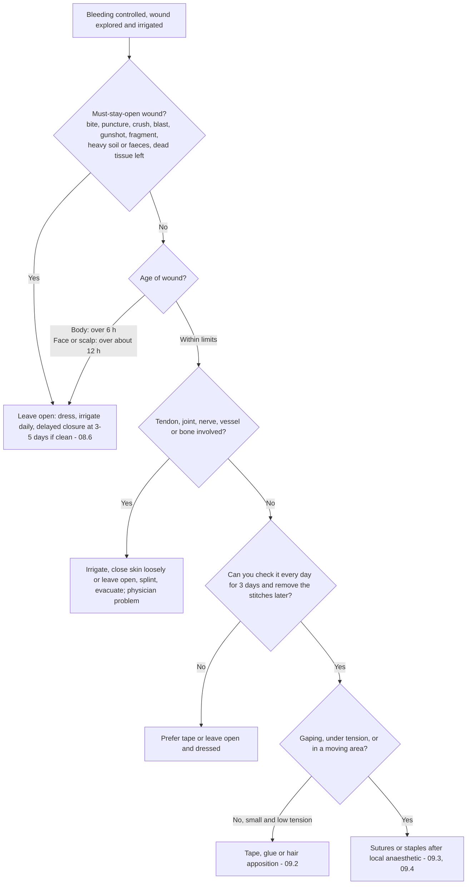

# 09.1 · Close or leave open: the decision

By the end of this lesson you will be able to look at a wound in the field and decide, with reasons, whether it should be closed now, kept open and closed in 3-5 days, or left to heal from the bottom up; explore it properly first; and prepare the skin for closure with whatever antiseptic you have, including when there is no medical alcohol in the house.

> [!CAUTION]
> Performing these procedures on people without the required state certification is illegal.
> This lesson is for educational purposes only. Practise only on models and animal tissue.

## Why it matters

Closing a wound feels like finishing the job. In a hospital it often is, because infection is caught early and the wound can be reopened in minutes. In a long hold it is the opposite: a closed wound traps bacteria, dirt and dead tissue under the skin, and the first sign is often fever and spreading redness on day 2 or 3, when you may have no antibiotics left and no surgeon to reach.

Leaving a wound open is almost never fatal. Closing the wrong one can be. The Wilderness Medical Society (WMS) is clear that most clean wounds can be closed safely, but that grossly contaminated wounds should be packed open (grade 1B). The Vietnam-era punji stake wounds are the classic lesson: those treated with **delayed primary closure** had an infection rate of about 2%, compared with near-universal infection in those closed straight away (cited in WMS 2014).

So the decision comes first, and the techniques in lessons 09.2-09.4 are only for wounds that pass it.

## What to do

### 1. Control bleeding and look after the casualty first

Closure is never part of bleeding control (except a scalp that keeps oozing, below). Tourniquet, packing and pressure come first (Module 2). Pain relief, warmth and the rest of the casualty come before a laceration. A laceration can wait hours; most closure decisions are made after the casualty is stable.

### 2. Explore the wound

You cannot decide without seeing the whole wound.

1. Wash your hands, put on gloves (clean non-sterile gloves are fine: WMS found no difference in infection between sterile and clean gloves for lacerations, grade 1A).
2. Good light (a head torch) and, if needed, reading glasses as magnification.
3. **Anaesthetise if you have to explore deeply** (lesson 09.3). A casualty in pain moves, and you will miss things.
4. **Bloodless field:** press for 5-10 minutes, raise the limb, or for a finger use a rubber band at the base for a few minutes only.
5. **Irrigate** with at least 1 litre of potable water (WMS 1C), 50-100 ml per cm of wound, at 5-8 psi (a 35 ml syringe through a 19G cannula, or a pierced bottle): the method is in [08.6](../module-08/lesson-06.md). Clip hair if it is in the way; **never shave** (shaving raises infection, WMS 1C).
6. Open the edges gently with gloved fingers or forceps and look at the **base** of the wound. Look for:
   - **Foreign bodies:** glass, gravel, wood, cloth. Remove what you can see (lesson 09.6). Do not extend the wound to hunt for things you cannot see (WMS).
   - **Dead tissue:** grey, shredded fat or muscle that does not bleed (the four Cs in 08.6).
   - **Deep structures:** white shiny tendon, a joint capsule, bone, a pulsing vessel.
7. **Test function beyond the wound**, before anaesthetic if possible:
   - **Tendons:** move each joint beyond the wound against resistance. For a finger, hold the middle joint straight and ask them to bend the tip (deep flexor), then hold the other fingers straight and ask them to bend the injured one (superficial flexor). Weakness or pain on resisted movement can mean a partial cut.
   - **Nerves:** light touch and two-point feel on both sides of each finger tip or beyond the wound.
   - **Circulation:** colour, warmth and capillary refill beyond the wound.
8. Write what you found on the casualty card: length, depth, location, contamination, structures, function, time of injury.

### 3. Decide

**Wounds that stay open** (WMS 2014, MSF ch. 10, JTS wound CPG):

| Wound | Why |
|---|---|
| **Bites** (dog, cat, human) | High infection rate; MSF says do not suture bites immediately. WMS: rabies-risk wounds closed no earlier than 4 days. Face is the exception a physician may close |
| **Gunshot, blast, fragment, mine wounds** | Dead tissue and dirt driven deep; all war wounds are contaminated. Delayed primary closure is the standard |
| **Puncture wounds** (nails, thorns, knives with small entry) | You cannot clean the track |
| **Crush and stellate (burst) wounds** | WMS: wounds made by blunt crushing are "dirty" regardless of time |
| **Heavy contamination** (soil, farm dirt, faeces, sewage) or wounds in the groin or armpit | WMS treats these as dirty: high-pressure irrigation, delayed closure |
| **Dead tissue you cannot remove** | WMS 1C: wounds with significant dead tissue stay open |
| **Old wounds** | See the age table below |
| **Any wound already infected** | Open it, drain it (09.5) |

**How old is too old?** Sources differ, because the evidence is weak:

| Source | Body | Face and scalp |
|---|---|---|
| WMS 2014 (grade 1C) | Up to 6 h for most clean wounds | Up to 10 h |
| MSF Clinical Guidelines ch. 10 | Up to 6 h, clean, no dead or bruised tissue | Up to 24 h (also upper limb and hand) |
| Forsch, Am Fam Physician 2017 | Clean, non-infected wounds up to 18 h | Head up to 24 h |

**Course rule (reasoning, not a guideline):** in a long hold with no surgeon, close the body only within 6 hours and the face and scalp within about 12 hours, unless the wound is very clean and you can inspect it every day; past those times, dress it and plan delayed closure. The face and scalp have such a good blood supply that they rarely become infected, and an open face wound scars badly, which is why every source allows longer there.

**If evacuation is coming within hours,** don't close anything. Irrigate, dress and hand over: a clean wound under a dressing can still be closed at the hospital, and they can explore it properly.

**Scalp that keeps bleeding:** the scalp bleeds heavily and its bleeding vessels are held open by the tough layer under the skin. Firm pressure for 10 minutes usually works. If it does not, closing the scalp with sutures or staples does help stop the bleeding; hair apposition does not (WMS).

### 4. Delayed primary closure and secondary intention

- **Delayed primary closure:** keep the wound open with daily dressings; **MSF: suture after 72 hours if there are no signs of infection;** JTS: 3-7 days; WMS rabies-risk wounds: 4 days. The wound must be clean, red, without pus, dead tissue or spreading redness, and the casualty without fever (08.6).
- **Secondary intention:** the wound fills from the bottom and closes over weeks. It is slower and scars more, but it is the safest choice for any wound you are unsure about.

### 5. Tetanus and antibiotics

- Ask about tetanus vaccination and write it on the card; the rules are in [08.6](../module-08/lesson-06.md).
- Simple non-bite lacerations that are cleaned and closed do **not** need antibiotics (Forsch 2017). Bites, open fractures, war wounds and wounds in people with diabetes or poor immunity are another matter (04.6, 08.5).

### Watch

The Real Response channel shows cleaning, irrigating and dressing a deep laceration step by step, the preparation every closure decision starts from:

https://www.youtube.com/watch?v=Mj2aGSo314o

The Wound Guy, a wound care clinician, explains therapeutic cleansing and irrigation before any closure:

https://www.youtube.com/watch?v=0hX3htsRMgs

Closing the Gap, an emergency laceration channel, shows how a through-and-through lip laceration is assessed and closed in layers, a wound that needs a physician and good anaesthesia:

https://www.youtube.com/watch?v=ib5I6zZKMyE

## Improvise it

### A clean field without a hospital

WMS (grade 1A): **a clean field is enough; sterility is not necessary.** What that means at home:

- **Surface:** a table wiped with soap and water, covered with a freshly ironed cotton sheet or pillowcase (ironing hot and dry kills most surface bacteria), or opened clean plastic wrap.
- **Hands:** wash with soap and running water for 30 seconds, dry on a clean towel, then gloves. No gloves: freshly washed hands and alcohol hand gel (60% or stronger) on dry hands, and touch the wound only with instruments.
- **Instruments:** scrub with soap and water, then boil for 20 minutes, or use a pressure cooker (lesson 09.4). Lay them on the clean cloth.
- **Light:** a head torch or a phone torch held by a helper; daylight by a window is better than a dim room.

### Antisepsis with no medical alcohol

The **skin around** the wound is cleaned with antiseptic; the **inside** of the wound is irrigated with water only. WMS (1A): no additives in the irrigation fluid, because antiseptics damage the tissue that heals the wound. The exception is a dirty or infected wound, where 0.025% Dakin's solution is used (08.6).

| What you have | How to use it on the skin around the wound | What fails / the risk |
|---|---|---|
| **Soap and potable or boiled-then-cooled water** | Wash outward from the wound edge in circles, rinse well. MSF's first step is washing with ordinary soap | Best first step on dirty skin. Not a disinfectant by itself, but it removes most bacteria with the dirt. Keep soap out of the wound |
| **Povidone-iodine 10%** (Polydine, Betadine) | MSF disinfects the wound and surrounding skin with 10% povidone-iodine. Paint outward, let dry about 2 minutes | Rare iodine allergy. Stains |
| **Chlorhexidine** (skin preparations, some mouthwashes are 0.12-0.2%, too weak for skin) | Skin preparation solutions only | Never in eyes or ears |
| **Rubbing alcohol 70%** or **alcohol hand gel 60-80%** | Wipe the intact skin, let it dry completely before you start | Do not put in the wound: stings and kills tissue. Flammable |
| **Spirits** | Only 60% alcohol or stronger disinfects (some neutral grain spirits are 95%) | Vodka, arak and whisky at 40% are **not** antiseptic: use them only to wipe instruments after boiling, if at all |
| **Diluted household bleach** | **0.025% Dakin's** (25 ml divided by the bleach % per litre: 08.6) may be used on and around a dirty wound | Never undiluted, never the 0.5% surface strength on skin. The CDC advises against chlorine for routine skin hygiene because it damages the skin. Plain unscented bleach only |
| **Salt water** (1 level teaspoon of salt in 500 ml boiled water, about 0.9%) | An irrigation fluid, gentler than tap water on raw tissue | Not an antiseptic. Any clean drinkable water works as well (08.6) |
| **Honey** | Not for skin preparation | A dressing for open, infected wounds (08.6), never under a closure |

**How to tell it is failing:** at 24-48 hours, redness spreading more than 1-2 cm from the edges, increasing pain, warmth, swelling, pus or fever. Open the wound (remove stitches), drain and treat as infected (08.5, 09.5).

## When it goes wrong

| Problem | Cause | Recovery |
|---|---|---|
| Closed wound red, hot, swollen, painful on day 2-3 | Closed too late, too dirty, dead tissue or a foreign body left inside | Remove some or all stitches, let pus out, irrigate, leave open, antibiotics (08.5) |
| Finger cannot bend the tip after a "simple" cut | Missed flexor tendon cut | Do not close tightly; splint in a position of function; evacuate (a tendon repair has a window of days) |
| Numb fingertip after closure | Nerve cut you did not test before anaesthetic | Record it, splint, evacuate; nerves are repaired by surgeons |
| Gravel tattoo or hard lump under a healed scar | Dirt not irrigated out | Prevention only: irrigate and scrub abrasions within hours |
| Bite closed for cosmetic reasons, now infected | Bites are high-risk | Open, drain, antibiotic (amoxicillin-clavulanate is the usual choice, 04.6); dog and cat bites in Israel are a rabies question for a physician |

## Scope and law

Assessing a wound, irrigating it, testing function and dressing it are within EMT and reasonable lay first aid. The decision to close and the closure itself (beyond adhesive strips), local anaesthetic injection and antibiotics are physician powers in Israel; nurses and paramedics close wounds only within their own protocols. The Duty to Rescue Law gives no immunity: close a wound yourself only as the last resort described in [01.5 · The law and your scope in Israel](../module-01/lesson-05.md), when no qualified person can be reached and leaving it open would cause real harm. When in doubt, leave it open and dressed: that is always defensible.

## Practice

**Drill 1: decision cards (20 minutes).** A partner writes ten wound cards from this list (shuffle them): (1) 3 cm knife cut to the forearm, kitchen, 2 h ago; (2) dog bite to the calf, 1 h; (3) 4 cm scalp cut from a cupboard door, 9 h; (4) fragment wound to the thigh after a rocket strike, 30 min; (5) 2 cm cut on the palm from a broken glass, finger tip will not bend; (6) 5 cm shin cut while working in a cowshed, 3 h; (7) 1.5 cm cut on the chin of a 6-year-old, 4 h; (8) 4 cm forearm cut, 14 h, clean; (9) nail through the sole of a sandal; (10) 3 cm forehead cut, evacuation by ambulance expected in 40 minutes.

For each, say: close now (and how), leave open with delayed closure, or secondary intention, and one reason.

**Drill 2: exploration on chicken (25 minutes).** A whole chicken leg (thigh and drumstick) with skin, from a kosher butcher, a sharp knife, gloves, a 20-35 ml syringe, a bowl of tap water, a head torch.

1. Cut a 4 cm wound across the drumstick, down to the white tendons near the ankle end.
2. Irrigate with 500 ml, open the edges and identify skin, fat, muscle, tendon and bone.
3. Push a few grains of sand and a small splinter into the wound; irrigate and find them with light and forceps.
4. Move the foot of the leg and watch which tendon moves.

How you know it worked: your card answers match these: (1) close; (2) leave open; (3) close (scalp, within about 12 h); (4) leave open; (5) do not close tight, splint, evacuate; (6) leave open or delayed closure (farm contamination); (7) close with glue or tape; (8) leave open, delayed closure; (9) leave open; (10) irrigate, dress, hand over. In the chicken, you found all the sand and the splinter, and you could name each layer and show the tendon moving.

## Sources

- Quinn JV, Wedmore I, Johnson J, et al. *Wilderness Medical Society Practice Guidelines for Basic Wound Management in the Austere Environment: 2014 Update.* Wilderness Environ Med 2014;25(4 Suppl):S118-S133: clean field (1A), potable water irrigation (1A), no additives (1A), at least 1 L (1C), clipping not shaving (1C), primary vs delayed closure (1B), closure within 6 h, 10 h face and scalp (1C), devitalised tissue left open (1C), wound matrix (dirty wounds, groin and axilla, stellate wounds, bites), rabies-risk wounds closed at 4 days, punji stake data, evacuation criteria.
- MSF *Clinical Guidelines*, chapter 10, Treatment of a simple wound (accessed 2026-11-14): 6 h and 24 h limits, no immediate suturing of bites and war wounds, delayed suturing at 72 h, soap or povidone-iodine washing, 10% povidone-iodine.
- Forsch RT, Little SH, Williams C. Laceration Repair: A Practical Approach. *Am Fam Physician* 2017;95(10):628-636: 18 h and 24 h limits, tap water irrigation, 50-100 ml per cm at 5-8 psi, no prophylactic antibiotics for simple wounds.
- Joint Trauma System. *Acute Traumatic Wound Management in the Prolonged Field Care Setting* CPG (ID 62), 2017: delayed primary closure at 3-7 days.
- CDC. *Rationale and Considerations for Chlorine Use in Infection Control for Non-U.S. General Healthcare Settings*: chlorine not for routine hand or skin hygiene.
