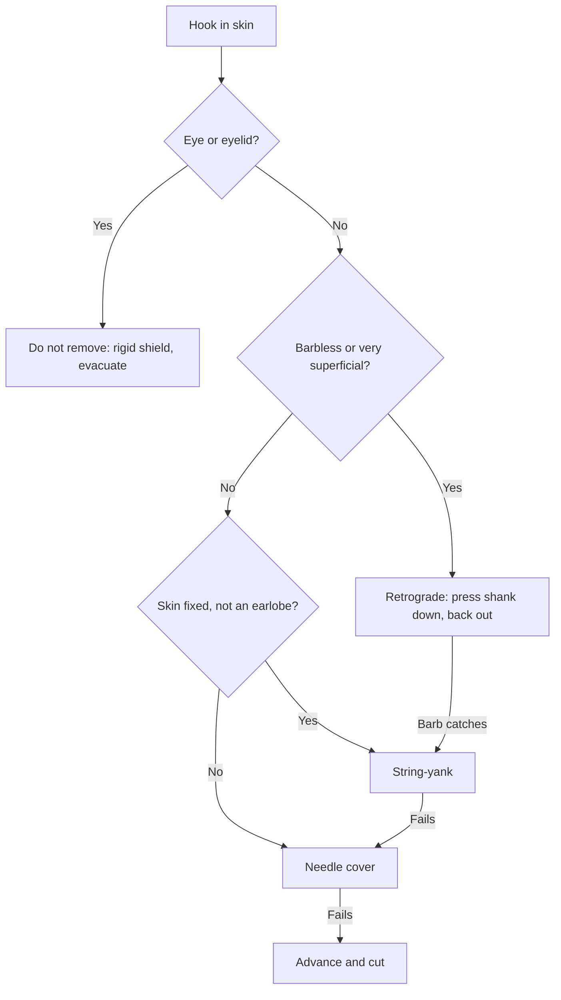

# 09.6 · Foreign bodies: splinters, fish hooks, glass and rings

By the end of this lesson you will be able to decide which foreign bodies must come out and which are safer left in, remove splinters and visible glass, take out an embedded fish hook with the right technique for the hook, get a ring off a swelling finger before it cuts off the circulation, and then run the Module 9 scenario on chicken or beef tongue, using everything from lessons 09.1-09.6.

> [!CAUTION]
> Performing these procedures on people without the required state certification is illegal.
> This lesson is for educational purposes only. Practise only on models and animal tissue.

## Why it matters

Splinters, glass, hooks and rings are the most common "minor surgery" in any community, and in a long hold each one can become a real problem. A wood splinter left in becomes an abscess (09.5) in days. A fish hook near the eye can cost the eye if pulled wrongly. A ring on a finger that swells after a crush injury, burn or bite acts as a tourniquet and can cost the finger. And a foreign body hunted for too long, with too much digging, does more harm than leaving it in. The skills here are simple, but the decisions matter: what to take out, how, and when to stop.

## What to do

### 1. Decide: out, leave or surgeon

**Never remove an impaled object** (a knife, a rod, a large piece of glass deep in the body) in the field: stabilise it and evacuate (EMT recap). This lesson is about small foreign bodies in the skin.

| Remove (WMS, AAFP 2007) | Can be left (AAFP 2007, WMS) | Leave for a surgeon (WMS, AAFP 2001) |
|---|---|---|
| **Wood, thorns and plant material** (very reactive: inflammation and infection) | **Glass** that is inert and hard to find or remove | Anything **in or near the eye or eyelid** |
| **Clothing fragments** and contaminated material | **Metal** (pellets, fragments) deep or near tendons, nerves, vessels, unless it causes symptoms or infection | Large foreign bodies **next to or into vital structures or body cavities** |
| Anything in the **foot**, or pressing on a nerve or vessel, or stopping function | Small inert fragments you cannot see after gentle exploration | Objects in a joint, the hand's deep spaces, or that you lost track of |
| **Pencil lead / graphite** (tattoos the skin) | | |
| **Anything causing pain** (AAFP) | | |

**Rules of the search (AAFP 2007, WMS):**

1. **Direct vision, not blind probing.** Good light, magnification, a bloodless field (pressure, elevation), and anaesthesia (09.3: a digital block for fingers and toes).
2. You may **extend the entry wound** a little to see, but WMS: don't extend a wound to look for foreign bodies you cannot see on gentle exploration.
3. **Set a time limit** before you start (course rule: about 15-20 minutes). If you have not found it, stop, irrigate, dress, record and evacuate. X-ray misses glass fragments under 2 mm and does not show most wood; ultrasound finds wood in 50-90% (AAFP 2007); you have neither.
4. **Feel for glass with a metal instrument, never with your finger tip** (it cuts gloves and fingers).
5. Irrigate afterwards, leave puncture-type wounds open, check tetanus (08.6). Prophylactic antibiotics are generally not needed for simple non-bite foreign bodies (AAFP 2001 and 2007); an infected puncture wound needs re-exploration for a retained piece.

### 2. Splinters

**Splinter lying along the skin (most):**

1. Wash the skin; numb with a little lidocaine or a digital block if it is deep or the casualty cannot keep still.
2. With good light, grasp the **exposed end** with fine tweezers and pull **along the splinter's own direction**, slowly. Wood breaks if pulled at an angle.
3. If no end sticks out, use a **sterile needle tip or the tip of a No. 11 blade** to open the thin skin **along the length of the splinter** over it, lift it out of its groove whole.
4. Check the track for remaining fragments; irrigate.

**Splinter or thorn going straight down:** AAFP 2007 describes cutting a small ellipse of skin around the entry point, undermining the edges and pressing to push the object out. This is a clinician's procedure; in the field, if you cannot grasp it, soak, dress and evacuate or wait for it to "point" (it often works its way to the surface or forms a small abscess that is then drained with the splinter in the pus, 09.5).

**Under a nail:** grasp with fine tweezers if the end is visible. If not, after a digital block, a clinician trims a small V-shaped notch in the nail over the splinter's end to reach it (course reasoning; this is common practice but not from the sources above).

### 3. Glass

- Glass is **inert**: AAFP 2007 says it **can be left in place if it is difficult to find or remove**.
- Look under good light with the wound held open; remove what you can see with forceps; feel the base with forceps or a probe.
- A casualty who feels "something sharp in there" when pressing a superficial, well-explored wound usually has a scratched track, not glass; AAFP says such wounds do not need an X-ray.
- **Red flags:** numbness, weakness or a tendon that does not work beyond the wound (glass cuts tendons and nerves silently: test as in 09.1).

### 4. Fish hooks

**First:** if the hook is in or near the eye or eyelid, **do not remove it**. Cover the eye with a rigid cup (a paper cup or the bottom of a plastic bottle) without touching the hook, cover the other eye, evacuate (AAFP 2001). For a **treble hook**, tape over or cut off the free points first so they do not catch you or the casualty. **Wear eye protection** and keep bystanders out of the line of pull.

Try the gentle methods first (retrograde and string-yank cause the least tissue trauma); most need local anaesthetic or a digital block, except string-yank on a superficial hook.

**Retrograde (AAFP 2001):** clean, numb. Press down on the shank so the hook rotates deeper and the barb disengages, then back it out along the path it came in. If the barb catches, stop and change method. Simplest, lowest success; best for barbless or very superficial hooks.

**String-yank (AAFP 2001):**

1. Loop a strong string (fishing line, umbilical tape, silk or floss) around the **middle of the bend** of the hook. Wrap the ends around a stick or your hand for grip.
2. Rest the body part on a flat surface. Press the **eye of the hook / shank down** against the skin, keeping the shank parallel to the skin.
3. Give a **firm, quick jerk** on the string **along the line of the shank**. The hook flies out backwards, often painlessly.
4. Not for loose tissue such as an earlobe.

**Needle cover (AAFP 2001):** after local anaesthetic, slide an **18G or larger needle** along the entry wound, parallel to the shank, bevel facing the inside of the hook's curve, until its opening covers the barb. Advance the hook slightly, then pull and twist so the point sits inside the needle; withdraw hook and needle together. Best for large single-barbed hooks whose point is superficial.

**Advance and cut (AAFP 2001):** after local anaesthetic, push the point (with the whole barb) out through the skin with pliers or a needle holder, **cut the point off below the barb** with wire cutters, then back the rest out through the entry. For multi-barbed hooks, cut the **eye** off instead and pull the hook through forward. Almost always succeeds; causes a second wound.

**After:** look for bait or debris, irrigate, leave open, ointment and a dressing; tetanus if more than 5 years since the last dose (AAFP 2001); antibiotics only for the immunosuppressed, diabetics, poor circulation or deep wounds into tendon, cartilage or bone.

### 5. Rings

**Prevention:** remove all rings at once from any injured, burned, bitten or envenomated hand or arm, before it swells. Tape the rings to the casualty card or give them to a relative.

**Urgency:** a ring on a swollen, pale or blue, cold or numb finger is a tourniquet. Get it off now.

**Sequence (Merck):** lubricate, then cold and elevation, then the string method or a cutter.

1. **Lubricate and elevate:** soap, water-soluble lubricant, oil; raise the hand above the heart for a few minutes; twist the ring gently off.
2. **Compress the swelling:** wrap a thin elastic cord or a Penrose drain (or a strip of glove) firmly from the fingertip towards the palm, leave a few minutes, unwrap, and try again. Merck: these are for reducing swelling only; they are too flexible to pull the ring off.
3. **Cold:** the hand in ice water for several minutes, then soap and try again.
4. **String method (Merck)** (a digital block makes it painless and may let the finger shrink a little):
   1. Pass about **60 cm (2 feet)** of string, umbilical tape, thick silk or dental floss **under the ring** from the fingertip side towards the palm, using the tip of a haemostat or a needle to push it through.
   2. Wrap the **long (fingertip) end** tightly around the finger, starting right next to the ring and moving towards the tip, each loop **touching the last** so no swollen tissue bulges between them, over the middle knuckle (PIP joint), which is the hardest part.
   3. Take the **short (palm) end** that is under the ring and **unwind** it towards the fingertip, in the same direction as you wrapped. The ring slides over the compressed loops. Repeat if needed.
5. **Cut it:** a **ring cutter** (a guard goes under the ring, a toothed wheel cuts through). Cut, then spread the two ends with two pairs of pliers. Electric cutters heat the ring: pause and cool with water to avoid burns (WikEM). **Tungsten carbide and ceramic rings cannot be cut** by ring cutters; they are **cracked** with locking pliers (vice grips) squeezed across the ring until it shatters; protect the eyes.

### Watch

The NHS shows how to remove a simple splinter at home:

https://www.youtube.com/watch?v=c8yitB1JTfA

A physician (Dr Thomas McClellan) shows the surgical removal of a wood splinter from a finger, including the anaesthesia and exploration a deeper splinter needs:

https://www.youtube.com/watch?v=xaWcDw7DwuU

A family physician (Colonial Family Practice) demonstrates fish hook removal:

https://www.youtube.com/watch?v=-2Re91_P7KE

Emergency physician Larry Mellick demonstrates the needle barb release technique on three patients:

https://www.youtube.com/watch?v=am9J5qEnuog

The Laceration Course shows fish hook removal:

https://www.youtube.com/watch?v=0wCHFSfCYYA

Don't Forget the Bubbles shows how to get a stuck ring off a swollen finger:

https://www.youtube.com/watch?v=_F0ghN1E9dQ

Larry Mellick demonstrates the string ring-removal method:

https://www.youtube.com/watch?v=DrDROoJAF4I

## Improvise it

| Need | Household version | What works | What fails / the risk |
|---|---|---|---|
| **Fine needle to open skin over a splinter** | A sewing needle or a new hypodermic needle; flame the tip red-hot and let it cool (09.4) | Opens the thin skin layer cleanly | A dirty or rusty needle infects the track. Never dig blindly |
| **Fine forceps** | Slanted eyebrow tweezers, boiled | Good grip on a splinter end | Blunt or misaligned tips crush wood so it breaks: check the tips meet |
| **Light and magnification** | Head torch, phone torch, reading glasses or a phone camera zoomed in | Most "lost" splinters are found with better light | Shadow from your own hand: light from the side |
| **Tiny fibres, cactus spines, glass dust** | Press a strip of strong tape on the skin and peel it off; repeat | Lifts many fine spines at once (course reasoning: widely used home method) | Does not remove anything embedded deeper than the surface |
| **String for string-yank** | Fishing line, strong cord, a shoelace, doubled dental floss | All work if strong enough not to snap | Thin thread snaps; the hook can fly: eye protection, bystanders clear |
| **Needle for needle cover** | An 18G or larger hypodermic needle or the needle from an IV cannula | Same as the clinical method | A needle too small does not cover the barb |
| **Wire cutters for advance and cut** | Side cutters or the cutter in multi-tool pliers; boil or wipe with alcohol | Cut most hooks | Hardened or thick hooks resist; the cut piece flies: cover it with a cloth and protect eyes |
| **Ring lubricant** | Dish soap, cooking oil, butter, hand cream | Often enough with elevation and cold | Do not keep twisting a ring over a swelling finger for long: you make it swell more |
| **Compression wrap** | A strip cut from a glove, a rubber band cut open, an elastic hair tie cut open, a strip of cling film | Pushes swelling back before a removal attempt | Too tight for too long cuts off circulation: minutes only |
| **String-method string** | Dental floss (waxed slides more easily under a ring), thin cord, strong thread | Works for many rings | Fails on very swollen or injured fingers; stop if the finger becomes blue or the skin tears |
| **Ring cutting** | A small hacksaw or jeweller's saw, or a rotary tool with a cutting disc, with a metal spatula, a butter knife blade or a strip of tin slid under the ring as a guard; cool with water every few seconds | Cuts gold, silver and steel | Heat burns; the guard must stay between ring and skin; do not try on tungsten carbide or ceramic (use locking pliers to crack) |

**How to tell it is failing:** a splinter that keeps breaking into pieces, a hook whose barb catches on each pull, a ring that will not pass the middle knuckle after two string attempts, or a finger that is getting darker. Stop, protect, and change method or evacuate; for a ring on a darkening finger, cutting it is the next step, not more pulling.

## When it goes wrong

| Problem | Cause | Recovery |
|---|---|---|
| Splinter breaks, fragment left deep | Pulled at an angle or crushed by tweezers | Stop digging; dress, warm soaks; it often surfaces or forms a small abscess that you drain with the fragment (09.5); record it |
| Hook tears skin on string-yank | Shank not pressed flat, pull not along the shank | Stop; numb and use needle cover or advance and cut |
| Second wound from advance and cut infected | Debris pushed through | Irrigate both wounds, leave open, antibiotics if spreading |
| Glass cut tendon or nerve missed | Function not tested | Splint and evacuate (09.1) |
| Finger blue after ring attempts | Swelling worsened by repeated twisting, wrap left too long | Remove wraps, elevate, cut the ring now |
| Burn from a saw or rotary tool | No guard, no cooling | Cool burn under running water (05.4), finish with a better guard |
| Exploration took 40 minutes and found nothing | No time limit, blind probing | Irrigate, dress, record, evacuate |

## Scope and law

Removing a simple superficial splinter, a ring by lubrication or string, or a superficial fish hook by the string method is reasonable lay first aid. Cutting skin to reach a foreign body, the advance-and-cut technique, needle-cover and any injection of anaesthetic are physician (and protocol-based nurse or paramedic) procedures in Israel, and anything near the eye is for an ophthalmologist. Go beyond lay first aid only as the last resort described in [01.5 · The law and your scope in Israel](../module-01/lesson-05.md).

## Practice

> [!WARNING]
> Animal tissue and models only. Eye protection for every hook and ring-cutting exercise. Count every needle, blade and drain out and back in, and keep a sharps bottle on the table.

### Drill 1: foreign bodies (30 minutes)

A chicken thigh with skin, a few toothpicks broken into 1-2 cm pieces, a fish hook with a barb (single) and a treble hook, fishing line, a 18G needle, wire cutters, eyebrow tweezers, a sewing needle, a head torch, eye protection. For rings: a partner with a normal finger and a loose ring, dental floss.

1. Push three toothpick splinters under the chicken skin at a shallow angle, one with an end showing and two buried. Remove all three whole, the buried ones by opening the skin along their length with the flamed needle tip.
2. Set the barbed hook through the skin as if embedded. Remove it by string-yank (press the shank down, jerk along it), then again by needle cover, then by advance and cut.
3. Tape the free points of the treble hook before you handle it.
4. On your partner's (healthy) finger, practise the string method over the middle knuckle with floss until the ring slides off smoothly. Your partner says stop if anything hurts.

### Drill 2: the Module 9 scenario (120 minutes)

**Situation:** a moshav cut off by fighting, day 3. The road is closed; a physician answers the phone every few hours and has told you to "do what is safe and call me with each decision". The clinic's suture kit has one pack of 4-0 nylon, 20 ml of 1% lidocaine plain, a small vial of tissue adhesive, gauze, gloves and one haemostat. After the 4-0 pack is used you have household materials only.

Build each casualty on tissue first: chicken legs or breasts with skin, or a beef tongue (kosher butcher; no pork). Use water with food colouring for "lidocaine". Work through them in the order you would choose, writing a card for each.

| Casualty | Findings | What to build on the tissue |
|---|---|---|
| **A. Avi, 45, 80 kg** | 5 cm gaping cut on the forearm from a window, 3 hours ago, clean after irrigation, all fingers work | A 5 cm cut through skin into fat |
| **B. Noa, 8, 26 kg** | 3 cm straight scalp cut from a fall, long hair, bleeding stopped after pressure, no step in the skull | The hair model from 09.2 |
| **C. Maya, 30, 60 kg** | Fragment wound on the calf from day 1, left open with daily dressings; today it has a clean red base, no pus, no smell, no spreading redness, no fever | A 4 cm open wound you made yesterday, kept covered in the fridge |
| **D. Yosef, 62, 90 kg, diabetic** | 4 cm fluctuant, red, painful lump on the outer thigh where a splinter went in 5 days ago, redness 3 cm around it, temperature 38.2 °C | The glove-finger abscess model from 09.5, with a toothpick fragment inside the "pus" |
| **E. Itai, 16** | A barbed fish hook in the pad of his thumb, and his crushed ring finger is swelling under a silver ring | Hook through the chicken skin; string method on a partner's healthy finger |

**For each casualty, decide and do:**

1. **A:** close or not (09.1)? Calculate his lidocaine maximum (09.3) and how much of your 20 ml you can spare. Infiltrate through the wound edges, close with the 4-0 nylon: simple interrupted, starting in the middle, with a vertical mattress at each end. Write the removal day.
2. **B:** choose the closure that needs no needle and no anaesthetic (09.2). Do it on the hair model.
3. **C:** is this wound ready for delayed primary closure (09.1, 08.6)? If yes, your nylon is gone: bend and boil a sewing needle, choose your household thread, and close with widely spaced simple stitches (09.4). Write when you will inspect it and what will make you remove the stitches.
4. **D:** drain it (09.5) with a razor blade clamped in the haemostat: field block within his maximum (remember what A used from the same vial), one incision along the long axis, break up the pockets, find and remove the splinter fragment, irrigate, place a glove-strip drain or a glove-cuff loop. Decide on antibiotics and what you will tell the physician.
5. **E:** which comes first, hook or ring? Remove the ring by the string method (on your partner) and say what you would do if it failed; remove the hook by string-yank on the chicken.
6. Phone the "physician" (a partner) with a 1-minute report for each casualty (07.7 format).

**How you know it worked:**

- **Order:** E's ring first (a finger at risk), then D (infection with fever in a diabetic), then A (3 hours old, still within the 6-hour limit), then C and B.
- **A:** 80 kg x 4.5 mg/kg is 360 mg, capped at 300 mg (30 ml); you have only 20 ml, and D also needs some, so use about 5 ml on A. Closure: edges everted, bites as deep as wide, knots off the line, mattress stitches at the ends. Removal: day 7-10 (arm).
- **B:** hair apposition with single twists every 1 cm and a drop of glue on each twist; nothing to remove.
- **C:** yes, a clean red base on day 3 meets MSF's 72-hour delayed closure criteria; thin nylon fishing line as first choice, or polyester thread; stitches widely spaced; daily inspection, stitches out early if redness, pus or fever.
- **D:** lidocaine left after A is about 15 ml (150 mg), well under his maximum of 300 mg (90 kg x 4.5 is 405 mg, capped at 300 mg); an incision along the long axis, the cavity swept clear, the fragment found, a drain counted and secured; antibiotics are indicated (cellulitis, fever, diabetes: MSF) and the physician is asked for TMP-SMX or clindamycin.
- **E:** the ring slides off over the middle knuckle with the floss wrapped loop against loop; if it had failed: cut it (after a digital block), and if it were tungsten, crack it with locking pliers. The hook comes out by string-yank with the shank pressed flat.
- Every card has the time, the drug and dose given, the material used, the next inspection time and the removal or drain-out day.

## Sources

- Halaas GW. Management of Foreign Bodies in the Skin. *Am Fam Physician* 2007;76(5):683-690: direct visualisation, time limits, wood removed, glass inert and may be left, X-ray misses glass under 2 mm, ultrasound for wood 50-90%, elliptical excision for perpendicular objects, metal, graphite, antibiotics and tetanus.
- Gammons MG, Jackson E. Fishhook Removal. *Am Fam Physician* 2001;63(11):2231-2237: retrograde, string-yank, needle cover and advance-and-cut techniques, eye injuries, treble hooks, eye protection, aftercare, tetanus, antibiotics.
- Gupta P. *How To Remove a Ring Using the String Method*. Merck Manual Professional Version (full review July 2025): equipment, digital block, compression wrap, string method steps, warnings.
- Quinn JV, et al. *WMS Practice Guidelines for Basic Wound Management in the Austere Environment: 2014 Update*: which foreign bodies to remove, which to leave, large objects near vital structures and the eye left in place, no wound extension to hunt for unseen bodies.
- WikEM, Ring removal: ring cutter guard, cooling electric cutters; tungsten carbide and ceramic rings cracked with locking pliers rather than cut (also jewellers' and EMS guidance; a 2013 *Am J Emerg Med* study compared locking pliers with the string technique for tungsten carbide).
- MSF *Clinical Guidelines*, chapter 10 (delayed suturing at 72 hours; abscess drainage) for the module scenario.
