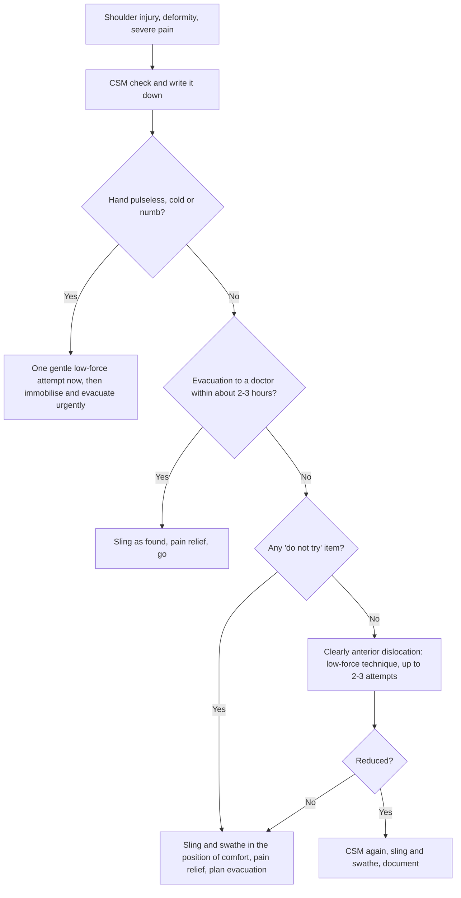

# 10.1 · Shoulder dislocation: assessment and reduction

By the end of this lesson you will be able to recognise an anterior shoulder dislocation by hand, decide whether putting it back in the field is reasonable, guide it back with gentle techniques that need no sedation, check the nerves and circulation before and after every attempt, and immobilise the arm for the days until a doctor and an X-ray can be reached.

> [!CAUTION]
> Performing these procedures on people without the required state certification is illegal.
> This lesson is for educational purposes only. Practise only on models and animal tissue.

## Why it matters

The shoulder is the joint that dislocates most often, and the great majority of shoulder dislocations (commonly quoted as over 90%) are **anterior**: the ball of the upper arm (humeral head) slips forward and down out of the shallow socket. While it is out, the muscles around it go into spasm, the pain is severe, the arm cannot be used, and the nerves and vessels in the armpit are stretched over the displaced head. The longer it stays out, the harder it is to put back, because spasm and swelling build.

In a hospital the shoulder goes back within an hour or two. In a cut-off community, a safe room or a long evacuation it may stay out for a day or more. Field reduction is one of the few things in wilderness medicine that is routinely taught to non-physicians:

- **NOLS** describes reducing dislocations as a practice "unique to wilderness medicine", supported by the Wilderness Medical Society practice guidelines, with early reduction giving "dramatic pain relief" and reducing risk to the limb, and is taught with the rule to **stop at resistance or increasing pain**.
- A ski-patrol programme in which **EMTs** diagnosed and reduced anterior dislocations **without any drugs** reviewed 546 shoulder injuries over 10 seasons: EMTs identified anterior dislocations with **98% sensitivity**, reduction succeeded in **86%** of attempts (88% in confirmed anterior dislocations), and **no harm from the reductions** was found (Pringle et al., *Wilderness & Environmental Medicine* 2023).
- In a survey of wilderness sports users, non-medical companions succeeded in **72%** of on-scene attempts, with a median of **5 minutes** from injury to reduction versus **135 minutes** for those reduced in a medical facility (Ditty et al., 2010; self-reported, weak evidence).
- In 2024 an Israeli group (Tel Aviv) reported that patients taught **self-reduction** by a video sent to their phones in the emergency department remembered and used it: 18 of 23 who dislocated again tried it, and 12 succeeded (Rabin et al., *WEM* 2024).

**Is there a WMS guideline?** We searched for a Wilderness Medical Society clinical practice guideline on dislocations or orthopaedic injuries and **found none**. The WMS publishes clinical practice guidelines on altitude, cold, heat, pain, spinal cord protection and other topics, but not on dislocations. Support for field reduction comes from the older WMS *Practice Guidelines for Wilderness Emergency Care* (book), NOLS, the studies above and emergency medicine references.

## What to do

### 1. Is it a dislocation, and which kind?

You have no X-ray. You have the story, your eyes and your hands. Compare with the other shoulder every time.

| | Anterior dislocation (most) | Posterior dislocation (rare) | Fracture of the upper arm or "just bruised" |
|---|---|---|---|
| **Typical story** | Arm forced up and back (blocked throw, fall with arm outstretched, ski pole, a wrench while hanging); or a known recurrent dislocator | Seizure, electric shock, fall onto the front of the arm | Direct blow or fall onto the side of the shoulder, especially in older people |
| **How they hold the arm** | Slightly away from the body, turned outward, supported by the other hand | Tight against the body, turned inward | Against the body; any position hurts |
| **Shape** | **Squared-off shoulder**: the round deltoid contour is lost, the bony point of the shoulder (acromion) sticks out, a hollow below it | Front of the shoulder flat; back may bulge | Round contour preserved; swelling and bruising, often after hours |
| **Feel** | A hard lump (the humeral head) in front, below the collarbone | Bump behind | Grating (crepitus) or point tenderness on the bone |
| **Movement** | Cannot bring the hand to touch the opposite shoulder | **Cannot turn the arm outward at all** | Painful but some movement possible |

**Luxatio erecta** (inferior dislocation, uncommon) is unmistakable: the arm is stuck straight up over the head.

### 2. The neurovascular check: before and after every attempt

Do this before you touch the arm, after every attempt, and after the sling is on. Write each one down with the time.

- **Circulation:** radial pulse, warmth and colour of the hand, capillary refill under 2 seconds.
- **Axillary nerve** (the one most often injured): light touch on the **outer side of the upper arm** over the deltoid (the "regimental badge" patch). Compare with the other side. Do not ask them to lift the arm while it is out.
- **Radial nerve:** feel on the back of the hand between thumb and index finger; can they bend the wrist and fingers back?
- **Median nerve:** feel on the palm side of the index finger; can they make an "OK" sign (tip of thumb to tip of index)?
- **Ulnar nerve:** feel on the little finger; can they spread their fingers apart?

A numb badge patch before reduction is common and usually recovers over weeks to months. A **new** deficit after your attempt, or a cold, pale, pulseless hand at any time, changes the plan: stop manipulating, immobilise, and evacuate urgently.

### 3. Reduce in the field, or not?

**Do not try a field reduction (course rules drawn from the MSD Manual contraindications and wilderness teaching):**

- **Child or adolescent** whose growth plates are still open: an apparent shoulder dislocation in a child is often a **growth plate fracture** (MSD). Exception: a pulseless or numb hand with no way out.
- **High-energy injury or a direct blow** to the shoulder (fall from height, vehicle, blast), or grating, or the shape does not match an anterior dislocation: suspect a fracture of the upper humerus. Fractures of the humeral neck and badly displaced fractures of the greater tuberosity are contraindications to closed reduction (MSD).
- **Posterior** or **inferior** dislocation: these are reduced in hospital with traction under sedation (MSD).
- **Dislocated more than 7-10 days**: risk of tearing the axillary artery (MSD).
- **Open dislocation** (bone or joint visible through a wound): irrigate, dress, give antibiotics as for an open fracture (05.6), splint, evacuate.
- **Casualty who cannot cooperate** (very drunk, head injury, multiple serious injuries): their other injuries come first.

**Lean towards trying** when the casualty is a **known recurrent dislocator** ("it's happened before, it always goes back"), the mechanism was indirect, the dislocation is minutes to hours old, and help is many hours away. Older people (over about 40) more often have an associated fracture or rotator cuff tear; gentle techniques are still reasonable, forceful ones are not.

### 4. Principles for every technique

1. **Explain** what you will do and that relaxation is the key: you are not going to pull hard; the shoulder goes back when the muscles let go.
2. Give **pain relief** if you have it (section 6), but do not delay a gentle first attempt for it. The ski-patrol programme used no drugs.
3. **Slow beats strong.** Each technique may take **5-10 minutes**. Pause when spasm or pain rises; continue when it settles.
4. **Stop at firm resistance or rising pain.** Never jerk, lever or use your foot in the armpit. The old **Kocher** (levering) and **Hippocratic** (heel in the armpit) methods carry a high risk of fracture and nerve injury and **should not be performed** (MSD).
5. **Signs of success:** a "clunk" (sometimes subtle or absent), the round contour returns, pain drops sharply, the arm lengthens slightly, and they can put the palm of the injured arm on the opposite shoulder.
6. **Two or three attempts** in total, with different techniques if needed; then stop, immobilise and evacuate.

### 5. The techniques

Learn two or three well rather than all of them. A good field sequence (course suggestion): **Cunningham or external rotation first** (seated or lying, no assistant), then **FARES**, then **Stimson with scapular manipulation** if the casualty can lie face down. Teach a known recurrent dislocator **Davos self-reduction**.

#### External rotation (Hennepin) — lying or sitting, one person

1. Casualty lying on their back (or sitting). Upper arm against the side, **elbow bent to 90 degrees**, thumb pointing up.
2. Hold the elbow against their side with one hand; cradle the wrist with the other.
3. Using only the weight of your fingers, **slowly turn the forearm outward**, like opening a door, towards the floor. Stop when it hurts or spasm starts, wait, then continue.
4. Reduction usually happens between **70 and 110 degrees** of outward rotation, often quietly (MSD). Allow 5-10 minutes.
5. If not reduced: keep it turned out and slowly raise the arm overhead (the **Milch** variation), pushing the humeral head up gently with your thumb in the armpit.
6. Bring the arm back to the side, and the hand across the belly.

#### Cunningham — seated, one person, no traction

The idea: the head is held out by spasm of the biceps, deltoid and trapezius; relax them and it slides back.

1. Casualty sits upright on a chair or the ground with their back straight, **shoulders pulled back** ("chest out, shoulder blades together"). You kneel beside them on the injured side.
2. Their arm hangs at the side with the **elbow bent**; rest their wrist on your shoulder or forearm, so they do not have to hold the weight.
3. Put your hand in their elbow crease (no pulling) and **massage** the biceps in the middle of the upper arm, then the deltoid and trapezius, slowly and firmly.
4. Coach them to keep shrugging their shoulder blades **back and together** and to breathe slowly.
5. Reduction can take several minutes. It works best in a calm, relaxed person; it often fails in a muscular person in pain, which is why it is a good first technique and a poor last one.

#### FARES (FAst, REliable, Safe) — lying, one person

1. Casualty on their back, arm **straight at the side**, palm facing in (thumb up). They hold something with the other hand.
2. Hold their wrist in both hands. Apply **gentle steady traction** along the arm. No countertraction.
3. Add small **up-and-down oscillations** of about 5 cm, about **2 per second**, and keep them going throughout.
4. While oscillating, slowly **move the arm out to the side** (abduction). At **90 degrees**, add gentle outward rotation (palm turns up) and keep moving up.
5. Reduction usually comes at about **120 degrees** (MSD).
6. Bring the arm down to the side with the elbow bent and the forearm across the belly.

#### Stimson with scapular manipulation — face down, ideally two people

1. Casualty **face down** on a table, bed or high platform, with the injured arm **hanging straight down** over the edge. Secure them so they cannot roll off.
2. Hang a weight of **about 2.5-7 kg** (5-15 lb) from the wrist. MSD lists 5-10 lb; start with a 2-3 kg water bottle or bag tied with a padded strap around the wrist (**never hold the weight in the hand**: gripping keeps the muscles tight). Add weight gradually.
3. Wait: **up to 30 minutes** of traction as the spasm fades (MSD).
4. Meanwhile, **scapular manipulation**: find the shoulder blade. With the fingers of one hand steady its top edge; with both thumbs push the **lower tip of the shoulder blade towards the spine**, gently and steadily. Reduction usually comes within minutes and may be almost silent (MSD).
5. **Do not** use face-down positioning in a drunk, multiply injured or pregnant casualty, and never after sedative drugs (breathing is harder to watch face down).

Scapular manipulation also works seated: an assistant facing the casualty holds the injured arm straight forward with gentle traction while their other hand rests on the casualty's collarbone; you manipulate the shoulder blade from behind. In a Nepalese comparison, scapular manipulation needed sedation less often than external rotation (13% vs 39%) and succeeded more often at the first attempt (Adhikari et al., *J Spec Oper Med* 2018).

#### Spaso — lying, one person

1. Casualty on their back.
2. Hold the wrist and **lift the straight arm slowly towards the ceiling** (90 degrees of forward flexion), applying gentle **upward traction**.
3. While holding the traction, **turn the arm slightly outward** (thumb out).
4. Wait for the clunk; reduction may take a few minutes. A 2025 randomised trial found similar first-attempt success with Spaso (80%) and FARES (72%), and that Spaso often worked when FARES had failed (Lee et al., *Sci Rep* 2025).

#### Self-reduction (Davos / Boss-Holzach-Matter) — the casualty does it

For a **known recurrent dislocator**, or a casualty alone or with a helper who cannot touch them. A 2024 meta-analysis found supervised self-reduction techniques succeeded more often and hurt less than physician-performed techniques (Hoveidaei et al.); the Tel Aviv study shows patients can learn it from a video.

1. Sit on the ground or a flat surface. **Bend the knee** on the injured side and pull it up towards the chest, foot flat.
2. Wrap both hands around the front of the bent knee, **fingers interlocked or wrists tied together** with a scarf, belt or elastic bandage just below the kneecap.
3. **Relax the shoulders**, let the elbows straighten, and slowly **lean back** with a **straight spine**, head tilted back, while letting the shoulders shrug forward. The leg is the countertraction; leaning back is the traction. You control how much it pulls.
4. Hold, breathe, relax. A helper can sit gently on the casualty's foot so it does not slide.
5. Keeping the spine straight and the shoulders relaxed is the key (MSD). Do **not** use sedative drugs with this technique: the casualty must stay in control.

### 6. Pain control for reduction

The reduction itself is the best painkiller: pain usually drops dramatically once the joint is back. Gentle techniques are designed to be done **without sedation**. Never sedate someone deeply for a reduction without someone who can manage an airway (lesson 04.8).

| Option | Route | Adult | Child | Notes |
|---|---|---|---|---|
| **Calm, time, coaching** | — | Always | Always | Slow breathing, one calm voice, warm room; most failures are rushed attempts |
| **Acetaminophen** | PO | 1000 mg (max 4 g/day) | 15 mg/kg (max 75 mg/kg/day) | OTC; give early, it helps afterwards more than during |
| **Ibuprofen** | PO | 400 mg every 6-8 h | 10 mg/kg (max 400 mg/dose) | OTC NSAID; not with meloxicam or another NSAID |
| **Dipyrone (Optalgin)** | PO | 500-1000 mg | 8-16 mg/kg, from 3 months | OTC in Israel; cautions in 04.5 |
| **Ketamine** (analgesic dose) | IN | 50 mg (0.5 ml of 100 mg/ml) | 1 mg/kg, max 50 mg | Prescription, controlled; doses as in 04.5; aim for comfort, not dissociation; no benzodiazepines with it |
| **Ketamine** (analgesic dose) | IM | 100 mg | 0.2-0.5 mg/kg | As above; wait 5-10 minutes, then start the technique gently |
| **Intra-articular lidocaine 1%** | Into the joint | 10-20 ml (100-200 mg), wait up to 15-20 min (MSD) | 4.5 mg/kg maximum (0.45 ml/kg of 1%); physician decision | Physician skill: needle 2 cm below the outer edge of the acromion, aimed inward and slightly down. A 2022 meta-analysis found it as successful as IV sedation with fewer adverse events. Plain lidocaine maximum 4.5 mg/kg, not over 300 mg |

**Methoxyflurane** (Penthrox, the "green whistle") is a self-administered inhaled analgesic used by ambulance services in Australia and Europe; label dose 3 ml, a second 3 ml if needed, maximum 6 ml per day, adults only, avoid in kidney disease. Its availability in Israel was not verified for this course. You may meet it in an organised team's kit.

**What fails at home:** alcohol (adds vomiting and sedation and the casualty stops cooperating), someone's sleeping pills or benzodiazepines (sedation, breathing risk, and they do not relax the spasm reliably), and "waiting until the painkillers work" for hours while the spasm hardens.

### 7. After the reduction

1. **CSM again**, including the badge patch. Write it down.
2. Confirm: round contour, palm to opposite shoulder.
3. **Sling and swathe** (section Improvise it): arm against the body, forearm across the belly, the elbow at 90 degrees. The joint can slip out again, especially in the first hours.
4. Pain relief: acetaminophen with an NSAID; cold packs 20 minutes at a time.
5. Keep the sling on for comfort for **one to three weeks** (typical practice; there is no single agreed duration), and take the arm out several times a day to move the elbow, wrist and fingers.
6. **Evacuate when you can** for an X-ray: a fracture may have been present or caused, and the casualty needs orthopaedic follow-up. A first dislocation in a young person often recurs; in an older person a rotator cuff tear is common.
7. **Red flags:** pain that rises again within 48 hours (bleeding into the joint, or it has come out again), new numbness or weakness, a cold hand.
8. **Document**: time of injury, CSM before, technique, number of attempts, time reduced, CSM after, drugs and times.

If you **could not** reduce it: sling and swathe in the position the casualty finds most comfortable (often with a pillow between arm and body), pain relief, CSM every hour for the first few hours then on the 05.6 schedule, and evacuate. A non-reduced shoulder is painful but rarely threatens the limb unless the hand loses circulation.

### Watch

Larry Mellick, an emergency physician, shows ten different reduction techniques on real patients (good for seeing how gentle and slow they are):

https://www.youtube.com/watch?v=HtOnreM7heg

Ryan Walsh, an emergency physician, compares twelve techniques on a model:

https://www.youtube.com/watch?v=dUbaZ_y-kUw

Medmastery demonstrates the Cunningham technique with explanation of patient selection:

https://www.youtube.com/watch?v=yiA3x02CMQA

Larry Mellick shows the FARES method on a patient:

https://www.youtube.com/watch?v=grdhARe0H4Y

EM:RAP (emergency medicine education) shows the Stimson technique combined with scapular manipulation:

https://www.youtube.com/watch?v=VqcdOHudAWs

USC Athletic Training Programs shows the external rotation manoeuvre and the Spaso technique as separate short clips:

https://www.youtube.com/watch?v=zdsLC5f5GvI

https://www.youtube.com/watch?v=zCDV8L8CGa4

Larry Mellick shows the Davos self-reduction method, and Professional Seminars shows how to teach an athlete to self-reduce:

https://www.youtube.com/watch?v=u2MsnjVNoPM

https://www.youtube.com/watch?v=_bX25_c9mtI

Some older videos still show the Kocher manoeuvre or a heel in the armpit. Do not copy them.

## Improvise it

### Sling and swathe from clothing

| Material | How | What works / what fails |
|---|---|---|
| **Triangular bandage** (from a pillowcase or a square of sheet cut diagonally, about 1 m a side) | Classic arm sling, knot at the side of the neck, not on the spine | Works well; pad under the knot. The knot over the neck bone hurts after hours |
| **T-shirt or sweater** | Pin or tie the lower hem up over the forearm; or tie the sleeves around the neck with the body of the shirt cradling the forearm | Quick; stretchy shirts let the arm sag, so add a swathe |
| **The casualty's own shirt** | Fold up the front hem over the forearm and safety-pin it to the chest | Works in the first minutes; may be the only option alone |
| **Jacket zip** | Close the jacket over the arm with the hand inside, at chest level | Surprisingly good; take it off to check the hand |
| **Belt, bag strap, buff** | Loop around the neck and the wrist ("collar and cuff") | Lets the elbow hang and pulls on the shoulder: fine for comfort, poor for a just-reduced shoulder |
| **Swathe** | A second strip of sheet, scarf, elastic bandage, belt or duct tape over clothing, around the chest and the upper arm, keeping the arm against the body | Stops the arm swinging out; tight swathes restrict breathing: you should fit a flat hand under it |

**Padding:** a folded towel or socks in the armpit and between the arm and body, especially in hot weather (skin breakdown), and over any knot.

**How to tell it is failing:** the arm has slid out of the sling, the hand is swollen or blue (sling too tight at the wrist, or the hand hanging below the elbow), the neck is raw from the knot, or the casualty cannot breathe deeply. Re-tie with the hand slightly higher than the elbow.

### Traction weights for Stimson

A water bottle (1 L = 1 kg), a bag of rice or sugar, or a pot with a known amount of water, hung from a **padded strap** (towel, belt, sock) around the wrist; never in the hand. A bed, a kitchen table or a car bonnet can be the platform; the casualty must be secure and someone must stay with them.

### Household pain relief

Acetaminophen with ibuprofen (or dipyrone if NSAIDs are unsafe), a cold pack of frozen vegetables wrapped in a cloth for 20 minutes, and a warm, quiet place for the attempt. See lesson 04.5 for the full plan.

## When it goes wrong

| Problem | Likely cause | What to do |
|---|---|---|
| Spasm, the casualty fights every movement | Rushed, painful, frightened | Stop, breathe with them, pain relief, try Cunningham or Davos, which they control |
| Two or three gentle attempts failed | Spasm, a fracture fragment, a large muscular person, an old dislocation | Stop. Sling and swathe in comfort, pain relief, evacuate. Do not escalate force |
| Grating felt during the attempt | Fracture | Stop at once; splint as found; CSM; evacuate |
| New numbness or weakness after the attempt | Nerve stretched or trapped | Stop manipulating; immobilise; record; evacuate (often recovers, but needs a doctor) |
| Hand becomes cold, pale or pulseless | Artery kinked or injured | Bring the arm back to the position where the pulse was present; if it was pulseless from the start and reduction failed, evacuate as an emergency |
| It was actually posterior | Seizure or electric shock history, arm locked turned in | Do not use anterior techniques; sling in position; evacuate |
| It comes out again in the sling | Unstable shoulder, sling too loose | Reduce again with the same gentle technique; tighter swathe; less movement |

## Scope and law

Reducing a dislocated joint is not part of the Israeli EMT course; in Israel it is done by physicians. Wilderness courses teach it to non-physicians, and the ski-patrol data show EMTs can do it safely with structured training, but that does not change Israeli scope. Coaching a casualty through their own self-reduction is closer to reasonable lay aid than doing it to them. Prescription drugs (ketamine, intra-articular lidocaine, methoxyflurane) are physician and paramedic powers. The legal basis and the last-resort test (the limb or severe suffering is at stake, no one more qualified can reach or direct you, and you have trained) are in [01.5 · The law and your scope in Israel](../module-01/lesson-05.md).

## Practice

> [!WARNING]
> Never try to dislocate or reduce a healthy shoulder. On a partner, practise **positions and hand placement only**, with no traction, no weights and no force. Stop if your partner feels any pain. Do not practise on anyone who has ever dislocated a shoulder or had shoulder surgery.

**What you need:** a partner, a chair, a bed or table, a pillowcase or old sheet, a T-shirt, a belt, safety pins, a 1 L water bottle and a towel, a watch, a casualty card. 50 minutes.

1. **Recognition (10 minutes).** Your partner adopts the posture of an anterior dislocation, then a posterior one, then a "bruised" shoulder, in random order. Name which, and say what you would feel and which movement would be impossible.
2. **CSM drill (5 minutes).** On both arms: radial pulse, capillary refill, badge patch, the three hand nerves. Write it on the card in under 90 seconds.
3. **Technique walk-through (20 minutes).** On the healthy shoulder, with no force: external rotation (move slowly through the arc while talking your partner through it), Cunningham (posture, massage points, coaching), FARES (the hand grip and the oscillation rhythm of 2 per second, timed with a watch, without lifting the arm far), Stimson (set up the bed and the padded wrist strap with the bottle resting on the floor, so no weight pulls; find the lower tip of the shoulder blade), Spaso (hand positions only), Davos (your partner sits, ties the wrists around the knee and practises the posture without leaning back).
4. **Sling and swathe (10 minutes).** Make a sling from a pillowcase, then from a T-shirt, then add a swathe with a belt. Check CSM after each.
5. **Decision (5 minutes).** Answer aloud for each: a 22-year-old basketball player with his third dislocation, 6 hours from help; a 14-year-old who fell off a bike; a 70-year-old who fell onto the side of her shoulder; a man after a seizure whose arm is locked turned in.

How you know it worked: you identified all three postures correctly; your CSM check was complete and recorded with times; you can describe each technique's position, direction and stopping rule without notes; the sling holds the forearm slightly above the elbow with a flat hand fitting under the swathe; and you chose to try only for the basketball player (the 14-year-old, the 70-year-old after a direct fall and the man with a probable posterior dislocation get a sling and evacuation).

## Sources

- Pringle BD, Hurley GA, McGrath TA, et al. Austere diagnosis and reduction of anterior shoulder dislocations: 10-year review of a ski patrol-based program with EMTs. *Wilderness Environ Med* 2023;34(3).
- Rabin A, Chechik O, Maman E, et al. Adherence of patients to methods of self-reduction of shoulder dislocation taught via smartphones: a medium-term follow-up survey. *Wilderness Environ Med* 2024;35(3):266-270.
- Hoveidaei AH, et al. Efficacy of supervised self-reduction vs physician-assisted techniques for anterior shoulder dislocations: systematic review and meta-analysis. *BMC Musculoskelet Disord* 2024.
- Ditty J, Chisholm D, Davis SM, Estelle-Schmidt M. Safety and efficacy of attempts to reduce shoulder dislocations by non-medical personnel in the wilderness setting. *Wilderness Environ Med* 2010;21(4):357-361.
- Bokor-Billmann T, et al. Reduction of acute shoulder dislocations in a remote environment: a prospective multicenter observational study. *Wilderness Environ Med* 2015.
- Adhikari S, Koirala P, Kafle D. Comparison of scapular manipulation with external rotation method of reduction of acute anterior shoulder dislocation. *J Spec Oper Med* 2018.
- Lee KH, Chang SH, Hung LW. FARES and Spaso method for anterior shoulder dislocation: a prospective randomized control study. *Sci Rep* 2025.
- Widmer LW, et al. Fast treatment of anterior shoulder dislocations with two sedation-free methods: the Davos self-reduction method and Arlt method. *Shoulder Elbow* 2024 (82% success, no new sensory deficit).
- Sayegh FE, et al. Reduction of acute anterior dislocation with the FARES method. *JBJS Essent Surg Tech* 2012.
- Sithamparapillai A, et al. Intra-articular lidocaine versus intravenous sedation for closed reduction of acute anterior shoulder dislocation. *CJEM* 2022.
- MSD Manual Professional (Streitz MJ, reviewed August 2025): Overview of Shoulder Dislocation Reduction Techniques; external rotation (Hennepin), FARES, Stimson, scapular manipulation and Davos technique pages.
- NOLS Wilderness Medicine Institute. *Wilderness Medicine Practices and Protocols* (Schimelpfenig, revised October 2015).
- Fink PB, et al. Wilderness Medical Society clinical practice guidelines for the treatment of acute pain in austere environments: 2024 update. *Wilderness Environ Med* 2024.
- Penthrox (methoxyflurane) product information (dose limits).
