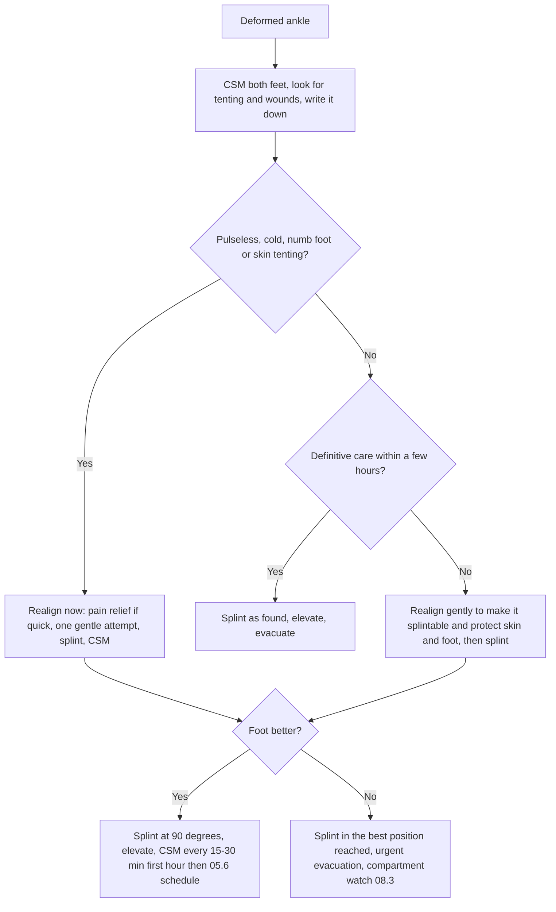

# 10.3 · Ankle and fracture-dislocations: realignment when circulation is at risk

By the end of this lesson you will be able to recognise when a badly deformed ankle threatens the foot or the skin, bring it back into line gently and splint it, and recognise the elbow and hip dislocations that you should splint and evacuate rather than try to reduce.

> [!CAUTION]
> Performing these procedures on people without the required state certification is illegal.
> This lesson is for educational purposes only. Practise only on models and animal tissue.

## Why it matters

A dislocated or badly displaced ankle is common after a fall on stairs, rubble or a hillside, and it is one of the few joint injuries where waiting can cost the foot. The displaced bones press on the artery and nerves running behind the inner ankle bone, and they stretch the thin skin over the ankle bones. Skin that is **tented** (stretched white over a bone end) can die within hours and turn a closed fracture into an open, infected one.

The *Wilderness & Environmental Medicine* review of field ankle fracture management states that **prompt reduction is indicated when evacuation to definitive care would be prolonged or neurovascular compromise to the foot is suspected**, and that reduction restores circulation, realigns the joint, reduces pain and reduces swelling (Dean 2009). The MSD Manual says to reduce **immediately** if there is a neurovascular deficit or skin tenting. NOLS notes that traction-in-line to straighten a limb with compromised circulation, sensation or movement is in the EMT national standard curriculum.

The elbow and hip are different: their reduction needs deep sedation, strong force or both, the look-alike fractures are common, and a failed or forceful attempt can do serious harm. For them, the field skills are recognition, splinting, pain relief and urgent evacuation.

## What to do

### 1. Recognise the threatened ankle

| Finding | What it means |
|---|---|
| Foot grossly displaced, usually **backwards and to one side**, heel looks long or the foot points the wrong way | Ankle fracture-dislocation. Most are posterior or posteromedial with fractures of the ankle bones (MSD) |
| **Skin tenting**: skin stretched white and shiny over a bone end, usually the inner ankle bone | Skin will die without realignment: urgent |
| Foot **cold, pale or blue**, toes slow to refill, no pulse at the top of the foot or behind the inner ankle bone | Circulation at risk: urgent |
| Numb sole or numb top of the foot | Nerve stretched: urgent |
| Bone or a wound over the joint | Open fracture-dislocation (section 5) |
| Deformity with a warm pink foot, normal feeling, no tenting, and evacuation within a few hours | Splint as found and evacuate |

Record the CSM of both feet with the time. Use the Ottawa rules in lesson 10.4 only for the **non-deformed** ankle; a deformed ankle is a fracture or dislocation until proved otherwise.

### 2. Decide

### 3. Realign the ankle, step by step

This follows the MSD Manual technique, adapted for the field (two people are better than one).

1. **Explain**, give pain relief if it can work quickly (section 4), and position the casualty **on their back** with a pillow or rolled jacket **behind the knee** so the knee is **bent**: this slackens the calf muscle, which is the main force holding the foot displaced.
2. **CSM** of both feet, recorded.
3. **Assistant** holds the calf firmly with both hands as countertraction (or, alone, let the casualty's body weight and a bent knee provide it).
4. You hold the **heel** in one hand (cupping it from behind) and the **top of the foot** with the other.
5. **Pull the heel gently and steadily along the line of the leg** (distraction). Keep pulling. For the common **posterior** dislocation, point the toes slightly down first, then, while still pulling, **bring the foot forward and up** to 90 degrees (pull the heel forward, push the front of the shin back). For a foot displaced to the side, keep the pull and guide it back towards the middle, then up to 90 degrees (MSD).
6. **Stop at firm resistance or if pain rises sharply.** One or two gentle attempts. Do not try to make it perfect: the goal is a straight foot under the leg, untented skin and a pink, warm foot.
7. A clunk, the heel contour back to normal and a sharp drop in pain mean success.
8. **Keep holding traction** while the assistant applies the splint (section Improvise it): foot at **90 degrees**, a back slab from calf to toes plus a U-shaped stirrup around the sides of the ankle (MSD).
9. **CSM again.** A pulse that returns, pinker skin, untented skin: success. Write it all down.
10. **Elevate** the leg above heart level, cold packs over the splint, and watch for compartment syndrome (08.3). Fracture-dislocations with two or more broken bones are unstable and can slip during transport (MSD): recheck the foot after every move.

### 4. Pain control for realignment

| Option | Who | Dose | Notes |
|---|---|---|---|
| **Talking, a pillow under the knee, a firm grip** | Anyone | — | Spasm relaxes in a calm, warm casualty |
| **Acetaminophen + NSAID or dipyrone** | Anyone (OTC) | As in 04.5 and 10.1 | Takes 30-60 minutes; give early, do not wait for it if the foot is white |
| **Ketamine** | Paramedic or physician | IN 50 mg (child 1 mg/kg, max 50), IM 100 mg (child 0.2-0.5 mg/kg), IV/IO 25 mg slowly (child 0.1-0.2 mg/kg) | Analgesic doses from 04.5; wait 5-10 minutes for IN/IM |
| **Haematoma block** | Physician | Lidocaine 1% about 5-10 ml injected into the fracture haematoma (aspirate blood first); plain lidocaine maximum 4.5 mg/kg (not over 300 mg) | The WEM review describes it as safe, easy and effective, needing few supplies, and as effective as conscious sedation for ankle reduction (Dean 2009) |
| **Intra-articular lidocaine** | Physician | 5-10 ml of 1% into the ankle joint, wait up to 15-20 minutes (MSD) | Front of the ankle, inside the tibialis anterior tendon |

If the foot is white and pulseless, do not wait 30 minutes for tablets: the foot is the priority.

### 5. Open fracture-dislocation

1. Control bleeding (tourniquet if needed).
2. **Irrigate** gross dirt off the exposed bone and joint with plenty of clean water.
3. **Realign** only if the foot is pulseless or the limb cannot be splinted; bone ends that slip back under the skin during realignment must be **written on the card and told to the surgeon** (05.6). Never deliberately push bone back in.
4. Moist clean dressing, splint, **antibiotics** as soon as possible (cefadroxil 1 g PO daily or ceftriaxone 2 g IV/IO/IM daily; children in 04.6), tetanus noted (05.6).
5. Evacuate as a priority.

### 6. Elbow dislocation: recognise, splint, do not try

- **Recognition:** fall on an outstretched hand; elbow held **half bent**, forearm looks **shortened**, the point of the elbow (olecranon) sticks out **behind**; the normal triangle formed by the two side bumps and the point of the elbow is lost. Most are posterior.
- **Danger:** brachial artery and median or ulnar nerve injury. **A distal pulse does not exclude an artery injury** because of collateral circulation (MSD). In a **child**, a fracture just above the elbow (supracondylar) looks the same and is far more common than dislocation, with the same artery at risk.
- **Why not in the field:** reduction usually needs procedural sedation (MSD), fractures are common with it, and nerves can be trapped in the joint during reduction.
- **What to do:** CSM; **splint as found**, padded, with a sling and swathe; elevate; pain relief; evacuate urgently.
- **Exception (course rule):** if the hand is **pulseless, cold and numb** and evacuation is many hours away, **one gentle pull along the line of the forearm** while an assistant holds the upper arm, to see if circulation returns, then splint in the position reached. That is realignment for circulation (05.6), not a formal reduction.

### 7. Hip dislocation: recognise, splint, do not try

- **Recognition:**
  - **Posterior** (about 9 in 10 hip dislocations): high-energy injury such as the knee hitting a car dashboard; leg **shortened, bent at the hip, turned inward and pulled across** the other leg.
  - **Anterior:** leg turned **outward** and out to the side.
  - **Artificial hip** (hip replacement): a low-energy dislocation in an older person (bending, getting out of a low chair) with the posterior posture. In a grid-down community this is a realistic call.
- **Danger:** the sciatic nerve lies behind the hip (foot drop, numb foot); the blood supply to the head of the femur is torn, and the risk of **avascular necrosis** (death of the femoral head) rises with delay, **particularly beyond 6 hours** (MSD). There are often fractures of the hip socket, the femur or the pelvis as well.
- **Why not in the field:** reduction **requires procedural sedation, which may be insufficient** (MSD), plus strong traction by at least two people. A failed or forceful attempt can fracture the femoral neck.
- **What to do:**
  1. CSM of the foot, including **pulling the foot up** (sciatic and peroneal nerve).
  2. Treat for shock and look for pelvic and femoral injuries; a **pelvic binder** if a pelvic fracture is possible (02.6).
  3. **Splint as found**: support the bent, turned leg with pillows, rolled blankets and folded towels so nothing hangs; tie the legs together only if it matches the position. Do not straighten it.
  4. Pain relief (ketamine by a provider if available; OTC otherwise).
  5. **Evacuate as a priority**: this is the dislocation where hours count for the joint.

### Watch

Larry Mellick, an emergency physician, reduces an ankle dislocation in the emergency department; Trauma Pro shows the same manoeuvre step by step; MEDspiration explains the anatomy and the reduction:

https://www.youtube.com/watch?v=ANA2b-g3qaw

https://www.youtube.com/watch?v=8hodXLUHwLw

https://www.youtube.com/watch?v=18fzSvVyRg8

EM:RAP shows a haematoma block of the ankle (physician skill, for awareness):

https://www.youtube.com/watch?v=r6z_uqB3_-w

SAM Medical, the manufacturer, demonstrates the ankle stirrup splint:

https://www.youtube.com/watch?v=QZiByS7o1RM

Dr James Gill explains the two types of elbow dislocation; the Arizona Trauma Association shows a posterior hip reduction in hospital, which shows why it is not a field procedure:

https://www.youtube.com/watch?v=cu0JNT99acc

https://www.youtube.com/watch?v=DUvGNhYxVrM

## Improvise it

### Ankle splints without a SAM splint

| Material | How | What works / what fails |
|---|---|---|
| **Pillow** | Wrap a firm pillow around the lower leg and foot, tie with three or four strips; tape or tie the corners up so the foot stays at 90 degrees | Fast, comfortable, padded; poor for walking and for very unstable fracture-dislocations: add a board under it |
| **Cardboard box** | Cut a long rectangle, fold into a U (stirrup) up both sides of the leg and under the heel, plus a strip along the back from calf to toes; pad and tape | Rigid when dry; softens when wet: wrap in a plastic bag |
| **Rolled magazines or newspapers** | Several thick layers moulded around the ankle as a stirrup, padded with a towel, taped | Rigid enough for hours; same weakness to water |
| **Foam sleeping pad, yoga mat, camping mat** | Fold into a U around the ankle and foot, or roll around the leg; tie | Light and padded; the best walking-out option for an ankle (10.4) |
| **Boot left on** | A stiff hiking boot with laces loosened can act as a splint over a closed injury | Hides the skin and swelling: take it off if the foot changes colour, numbness appears or you suspect tenting; once off, it will not go back on |
| **Padding** | Towels, socks, sanitary pads over the ankle bones and heel | Hard folds and knots over bone cause pressure sores within hours |

Mould the splint on the uninjured leg first, then transfer it. Leave the toes visible for checks.

### Quigley's traction from clothing

The WEM field review describes **Quigley's traction**: the injured leg is suspended by the foot in a tube of fabric so that the weight of the leg gradually relaxes the deforming muscles and some displaced ankle fractures fall back into line; it can be improvised from clothing (Dean 2009). In practice: the casualty lies on their back; a trouser leg, a long sock or a tube of sheet goes around the front of the foot and is tied to a high point (a door top, a branch, a bunk), so the leg hangs with the heel off the bed. This is a physician-guided technique for a fracture that will not stay in line, used with a haematoma block; for this course it is awareness only. Check the toes every 15 minutes; stop if pain rises or the foot changes colour.

### Pain relief at home

Acetaminophen plus ibuprofen (or dipyrone), cold packs, elevation on pillows, and a firm splint. See 04.5.

## When it goes wrong

| Problem | Likely cause | What to do |
|---|---|---|
| Foot still pulseless after realignment | Artery injured, or not fully realigned | Splint in the best position, elevate slightly, emergency evacuation; recheck every 15 minutes |
| Foot was pink before and is pale after | Over-manipulation or the splint is too tight | Loosen the splint; return the foot towards the position where it was pink; evacuate |
| Ankle slips out again in the splint | Unstable fracture-dislocation (two or more broken bones) | Realign again gently; more rigid splint (board plus stirrup); carry, do not walk |
| Tented skin still white after realignment | Bone end still pressing | Small further adjustment if gentle; pad around (not over) the spot; evacuate; mark it on the card |
| Pain out of proportion, tight swollen calf hours later | Compartment syndrome | Loosen the splint, keep the leg at heart level, 08.3, urgent evacuation |
| Elbow or hip forced and now worse | Attempted reduction without sedation, fracture | Stop; splint as found; record; evacuate |
| Bones slipped back inside an open wound | Realignment of an open fracture | Document, antibiotics, tell the surgeon |

## Scope and law

Splinting, CSM checks and gentle in-line traction to straighten a limb with compromised circulation are EMT-level skills (NOLS notes traction-in-line is in the EMT curriculum). Formal reduction of an ankle, elbow or hip dislocation, haematoma blocks, intra-articular lidocaine, ketamine and antibiotics are physician or paramedic powers in Israel. Realigning a pulseless or tented ankle is a last-resort act to save the foot or skin when no one more qualified can reach or direct you; the legal basis and the test are in [01.5 · The law and your scope in Israel](../module-01/lesson-05.md).

## Practice

> [!WARNING]
> On a partner, practise **positions, grips and splints only**: no traction, no twisting, no force on a healthy ankle, elbow or hip.

**What you need:** a partner, a pillow, a cardboard box and tape, magazines, a foam mat, towels, socks, triangular bandages or strips of sheet, a marker, a casualty card, a watch. 40 minutes.

1. **Pulses (5 minutes).** Find both foot pulses on your partner; mark them with the marker. Then find the radial and brachial pulses. Time yourself.
2. **Grip and position walk-through (10 minutes).** Partner on their back, pillow under the knee. Assistant places both hands on the calf. You cup the heel and hold the top of the foot and **describe** each step aloud: "pull along the leg, toes slightly down, now bring the foot forward and up to 90", without moving the foot.
3. **Splint (15 minutes).** Build a cardboard stirrup plus back slab, then a pillow splint, then a foam-mat splint. Foot at 90 degrees, heel and ankle bones padded, toes visible. CSM before and after each.
4. **Posture recognition (5 minutes).** Partner adopts: posterior hip (shortened, bent, turned in, across), anterior hip, posterior elbow. You name each and say what you would do.
5. **Decision (5 minutes).** For each, decide realign now, splint as found, or splint and evacuate urgently: (a) an ankle pointing sideways with white skin over the inner ankle bone, 8 hours from help; (b) a deformed ankle with a warm pink foot, an ambulance 40 minutes away; (c) an elderly woman with a hip replacement whose leg is short and turned in after she bent to pick up a cup; (d) a child's swollen elbow after a fall from a climbing frame, hand pink.

How you know it worked: pulses marked within 30 seconds each; your splints hold the foot at 90 degrees with padding over the bones and the toes visible; postures named correctly; and the decisions were (a) realign now, (b) splint as found, (c) splint as found with pillows and urgent evacuation, (d) splint as found and urgent evacuation (probable supracondylar fracture).

## Sources

- Dean DB. Field management of displaced ankle fractures: techniques for successful reduction. *Wilderness Environ Med* 2009;20(1):57-60.
- MSD Manual Professional (Streitz MJ, reviewed August 2025): How To Reduce an Ankle Dislocation; How To Reduce a Posterior Elbow Dislocation; How To Reduce a Posterior Hip Dislocation.
- NOLS Wilderness Medicine Institute. *Wilderness Medicine Practices and Protocols* (revised October 2015): traction-in-line and dislocations.
- Committee on TCCC. *TCCC Guidelines*, 01 May 2026: antibiotics for open wounds (cefadroxil, ceftriaxone).
- Joint Trauma System. Orthopaedic and Prolonged Casualty Care CPGs: splinting principles, CSM schedule (see 05.6).
