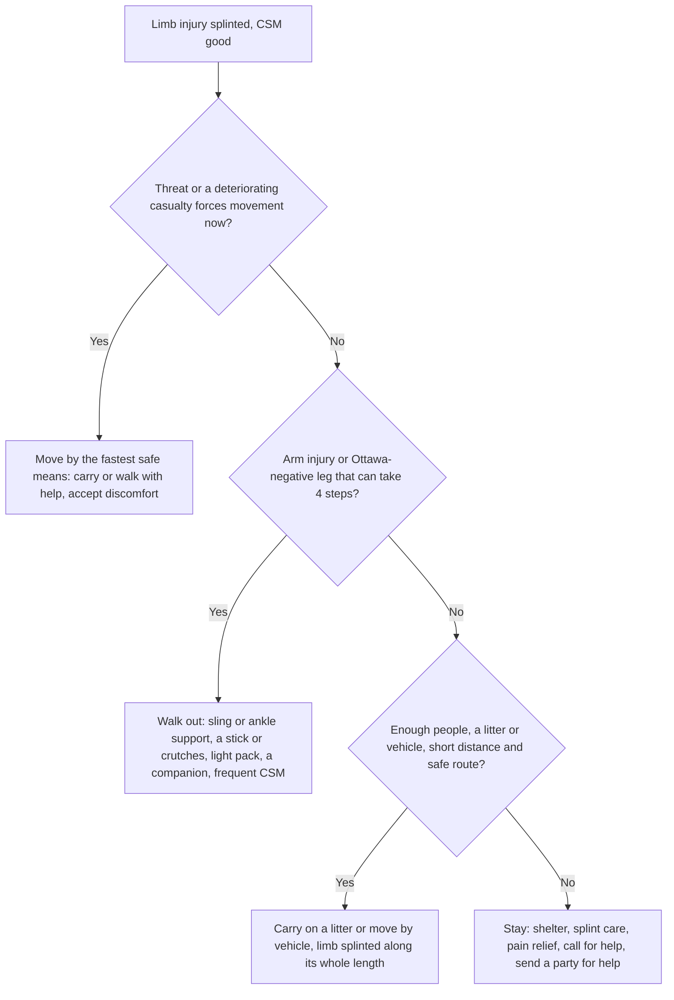

# 10.4 · Long-term splint care and walking out

By the end of this lesson you will be able to look after an immobilised limb for days or weeks without creating new injuries, use the Ottawa rules to decide which ankles and knees are probably broken, and decide whether a casualty walks, is carried or waits, then run a full orthopaedic scenario from injury to the decision to move.

> [!CAUTION]
> Performing these procedures on people without the required state certification is illegal.
> This lesson is for educational purposes only. Practise only on models and animal tissue.

## Why it matters

In a hospital, a reduced shoulder or a splinted ankle goes home with an X-ray, a proper cast and a clinic appointment. In a cut-off place, the splint you build is the treatment for days or weeks. Badly kept splints cause pressure sores, nerve palsies, stiff joints and missed compartment syndrome; a casualty who should have been carried but was made to walk can turn a closed fracture into a displaced or open one.

The other big decision is movement. Carrying one adult a long distance takes many people, hours and exposes them all to the threat; walking a casualty out on a stable sprain frees everyone. NOLS points out that mistaking a simple transport problem for an urgent evacuation can put rescuers at unnecessary risk. Without X-ray, the **Ottawa rules** are the best validated bedside tools for telling probable sprains from probable fractures.

## What to do

### 1. How long to immobilise (field guide)

| Injury | Position | Typical duration | Source |
|---|---|---|---|
| Reduced shoulder | Sling and swathe, arm across belly | 1-3 weeks for comfort; move the elbow, wrist and fingers daily | Common practice; no single agreed duration |
| Unreduced shoulder | Sling and swathe in comfort, pillow between arm and body | Until reduced by a doctor | 10.1 |
| Reduced kneecap | Knee straight | 3 weeks | MSD |
| Dorsal finger (PIP) | About 15 degrees bent, or buddy tape plus a block against bending back | 3 weeks | MSD |
| Volar finger (PIP) | Straight | 1-2 weeks, then doctor | MSD |
| Ankle fracture-dislocation (realigned) | Foot at 90 degrees, back slab plus stirrup, no weight bearing | Until definitive care; weeks | Dean 2009; MSD |
| Suspected fracture (any) | Joint above and below | Until X-ray; healing usually takes about 6 weeks or more | Common teaching |

### 2. Daily splint care

From the JTS Prolonged Casualty Care nursing guideline and lesson 05.6, adapted for days to weeks:

1. **CSM on a schedule**: pulses and refill beyond the splint **at least every 6 hours if conscious** (and whenever they complain of the splint), **every 2 hours if unconscious**; every 15-30 minutes in the first hour after any reduction or realignment and after every move. Write it on the flowsheet (07.2).
2. **Ask about the splint, not only the injury.** "Does anything rub, burn, or feel tight?" Pain from the splint is a warning, not a complaint.
3. **Skin**: once a day remove or open the splint section by section (keep the limb supported), look at the heel, ankle bones, kneecap, the bone below the outer knee, elbow, wrist and armpit. Redness that does not fade when pressed is an early pressure injury: re-pad, relieve pressure. Wash and dry the skin, then replace dry padding (07.4).
4. **The outer knee**: pressure from a splint or tie just below the outer side of the knee can damage the **peroneal nerve**, causing a numb top of the foot and a dropped foot. Keep ties and hard edges off it.
5. **Swelling** continues for 2-5 days after a significant injury: **loosen and re-tie** as needed; elevate the limb above the heart while lying, unless in shock.
6. **Compartment syndrome** (08.3): pain out of proportion, pain on moving the fingers or toes passively, a tense limb. Loosen, then remove the splint, keep the limb at heart level and seek a physician.
7. **Move every joint that is not immobilised**, several times a day: fingers, wrist, elbow for an arm; toes, the other ankle and knee for a leg. Older people stiffen fastest, especially the shoulder.
8. **Clots in the legs.** A leg in a splint, a casualty lying for days, dehydration and injury all raise the risk of a deep vein thrombosis. Prevention: drink enough, pump the toes and the free ankle every hour while awake, deep breathing, sit up and get mobile with crutches as soon as allowed. Warning signs: one-sided calf swelling, warmth and pain; sudden breathlessness or chest pain means a possible pulmonary embolism, an emergency for evacuation. Blood thinners are a physician decision.
9. **Pain**: acetaminophen regularly plus an NSAID (or dipyrone) for the first days (04.5); cold packs 20 minutes at a time in the first 48 hours.
10. **Document** each check and change on the splint itself (date and time of last skin check) and on the card.

### 3. The Ottawa rules: fracture or sprain without X-ray

The Ottawa rules were built to decide who needs an X-ray. They are very good at **ruling a fracture out** (high sensitivity) and poor at ruling one in (many positives are sprains). In the field, use them this way: **rule negative = probably a sprain, may walk with support; rule positive = treat as a fracture**.

**Ottawa ankle rule.** In a casualty with pain around the ankle bones, treat as a possible fracture if **any** of:

- Bone tenderness along the **back edge or tip of the outer ankle bone** (lateral malleolus), in the last 6 cm.
- Bone tenderness along the **back edge or tip of the inner ankle bone** (medial malleolus), in the last 6 cm.
- **Unable to take 4 steps** (two on each foot, limping allowed) both straight after the injury and when you examine.

**Ottawa foot rule.** In a casualty with pain in the middle of the foot, treat as a possible fracture if **any** of:

- Bone tenderness at the **base of the fifth long bone** of the foot (the bump halfway along the outer edge).
- Bone tenderness at the **navicular** (the bump on the inner side of the foot in front of the ankle).
- **Unable to take 4 steps** both immediately and when examined.

**Ottawa knee rule.** After a knee injury, treat as a possible fracture if **any** of:

- Age **55 or older**.
- Tenderness at the **head of the fibula** (the bony knob just below the outer knee).
- Tenderness **only over the kneecap** (no other bone tenderness of the knee).
- **Cannot bend the knee to 90 degrees.**
- **Unable to take 4 steps** both immediately and when examined.

**How good they are:** a 2026 meta-analysis of the ankle rule found pooled sensitivity **92%** and specificity **35%**; a 2023 meta-analysis of the knee rule found sensitivity **98%** and specificity **43%**. In children, a meta-analysis of 12 studies found the ankle rule **98.5%** sensitive.

**Do not rely on them when** the casualty is drunk or drugged, has a head injury or reduced consciousness, has other painful injuries that distract them, has numb legs (spinal injury, diabetes with neuropathy), the injury is more than about 10 days old, there is obvious deformity, or (knee rule) in children, for whom it was less studied. Then treat as a fracture.

**How to press:** with one or two fingertips, firmly, on the bone, not the soft tissue in front of it, comparing with the other side. Ask "is that sore?" at each point, without leading.

### 4. Walk out, be carried, or stay?

Course rules for the decision:

- **Arm injuries** (shoulder, elbow, wrist, fingers): usually walk. The sling must be secure, the casualty should carry nothing in that hand, and someone walks beside them on rough ground.
- **Kneecap reduced and knee splinted straight**: short walk with a stick or crutches.
- **Ottawa-negative ankle or knee** that can take 4 steps: walk with an ankle wrap or splint and a stick, shorter stages, frequent rests, recheck CSM at each rest.
- **Ottawa-positive leg, a realigned fracture-dislocation, any knee or hip dislocation, a femur or pelvis injury**: **do not walk** on it. Crutches only for short distances by a fit casualty with a well-splinted lower leg and no other injuries; otherwise carry or stay.
- **Carrying** an adult on a litter over long distances or rough ground needs many people working in shifts, is slow and exhausting, and exposes the whole group to the threat (06.2). If help can come to you within a reasonable time and the place is safe, staying put is often better.
- **Threat beats comfort**: if staying means exposure to fire, collapse or attack, move the casualty by whatever means, after the quickest splint that holds.
- **Re-decide** after each stage: a casualty walking on a sprain who develops increasing pain, swelling or numbness stops walking.

### 5. Walking with crutches or a stick

- **Fitting a crutch**: the top should sit about **5 cm (three finger widths) below the armpit**; the handgrip at the level of the wrist crease with the arms hanging, so the elbow bends slightly when gripping. Weight goes through the **hands**, not the armpits: leaning on the armpit compresses the radial nerve and causes "crutch palsy" (a weak wrist).
- **Non-weight-bearing gait**: crutches forward together, hop the good leg through to them, injured leg held up. On stairs: **up with the good leg first, down with the crutches and injured leg first** ("up with the good, down with the bad").
- **One stick**: held in the hand **opposite** the injured leg, moving forward together with the injured leg.
- **Two sticks or trekking poles** are often easier than improvised crutches on rough ground.

### Watch

EM Ottawa: Dr Ian Stiell, who developed the rules, explains the Ottawa knee rule:

https://www.youtube.com/watch?v=sPMmIptAs-w

American Family Physician explains the Ottawa ankle and foot rules; Physiotutors shows where to press:

https://www.youtube.com/watch?v=4yDR2MNEu9U

https://www.youtube.com/watch?v=KDkkhGZF1TI

The Ottawa Hospital shows non-weight-bearing walking with crutches; Halton Healthcare shows stairs:

https://www.youtube.com/watch?v=HgwepDw3svY

https://www.youtube.com/watch?v=Yvv-RXs0EQs

## Improvise it

### Crutches and walking aids

| Material | How | What works / what fails |
|---|---|---|
| **Y-shaped branch** | A sturdy branch forked at about armpit height minus 5 cm; pad the fork with a rolled jacket or socks and tape; cut a short side branch or tie a cross-stick as a handgrip | Works, but green wood bends and splits: test it with your own weight first. Too long is worse than too short |
| **Broom or mop** | Turn it upside down: the padded head becomes the armpit piece; tie a handgrip (a rolled towel or a short stick) at wrist height | Good indoors and on paths; the head slips sideways on rough ground |
| **Two trekking poles or ski poles** | Use as two sticks; shorten to wrist height | Light and adjustable; not enough for full non-weight-bearing on long distances |
| **Chair** | Push a chair ahead and lean on its back, or sit and slide indoors | Fine inside a house or shelter |
| **Human crutch** | A companion on the injured side with the casualty's arm over their shoulders | Fast for short distances; tiring for both |
| **Padding and grip** | Socks, foam, towel, tape | Without padding at the hands, palms blister within an hour |

**How to tell it is failing:** the crutch bends or creaks, the padding has slipped and they are bearing weight in the armpit (tingling in the hand), the hands blister, or they are putting weight on the injured leg to balance. Stop, fix, or switch to carrying.

### Splint care without supplies

- **Re-padding:** clean socks, folded T-shirts, sanitary pads and disposable nappies all make good padding; change wet padding the same day.
- **Washing under a splint:** support the limb, open one section at a time, wipe with clean water and soap, pat dry, re-pad.
- **Elevation:** a stack of folded blankets or a backpack under the whole leg, not only the heel (a heel on a hard edge gets a sore in hours).
- **Cold packs:** frozen vegetables or a bag of cold water in a cloth, 20 minutes on, 20 off, during the first 48 hours.
- **An ankle support for walking:** the foam-mat stirrup from 10.3 inside a loosened boot or wrapped with tape; a figure-of-eight wrap with an elastic bandage or a strip of sheet for an Ottawa-negative sprain.

## When it goes wrong

| Problem | Likely cause | What to do |
|---|---|---|
| Heel sore after two days in a splint | No padding, heel on a hard surface | Pad, float the heel off the surface, check twice daily |
| Foot drop, numb top of the foot | Peroneal nerve pressed at the outer knee | Move ties and edges away, pad; record; evacuate for review |
| One-sided calf swelling and pain after days lying still | Deep vein thrombosis | Rest the leg, physician contact, evacuate; sudden breathlessness is an emergency |
| Stiff, painful shoulder after weeks in a sling | Immobilised too long, especially over 40 | Gentle pendulum swings and daily movement once the first week has passed (course practice) |
| Casualty who "only had a sprain" can no longer walk | It was a fracture, or it has displaced | Stop walking, splint as a fracture, carry or stay |
| Group exhausted carrying a casualty who could have walked | Decision not revisited | Re-assess with the Ottawa rules at each rest |
| Hands tingling on crutches | Weight on the armpits | Lower the crutch, more padding at the hands, teach weight through the hands |

## Scope and law

Splint care, CSM checks, elevation, padding, the Ottawa rules, crutch fitting and decisions about moving a casualty are first-aid and EMT-level skills. Prescription analgesics and blood thinners are physician powers. The legal basis and the last-resort test for anything beyond your scope are in [01.5 · The law and your scope in Israel](../module-01/lesson-05.md).

## Practice

> [!WARNING]
> All technique practice is on a willing partner, **positions and grips only**: no traction, no rotation against resistance, no weights, no pushing a kneecap or pulling a finger or toe. Stop at any discomfort. Do not use a partner who has had a dislocation or joint surgery.

### Module scenario: the hill path after the earthquake (90 minutes)

**What you need:** two or three partners (or one partner playing each casualty in turn), a watch, casualty cards and a flowsheet (07.2), a pillowcase, a T-shirt, belts and strips of sheet, a cardboard box, magazines, a foam mat, a pillow, towels and socks, tape, ice-lolly sticks, a broom and a mop, two trekking poles (or broom handles), a marker.

**Situation.** A strong earthquake has cut the road to your village. You are with a group of 10 adults on a hillside path, 6 km from the village clinic, which still has a physician but no X-ray. Phones work intermittently. It is 14:00; it gets dark at 17:30. Four people are hurt:

- **A**, a 26-year-old man who has dislocated his left shoulder "for the fourth time" while catching a falling friend. Squared-off shoulder, arm held away from his body, hand warm and pink, outer arm feeling normal.
- **B**, a 58-year-old woman who fell on the rocks. Her right ankle points backwards and outwards, the skin over the inner ankle bone is white and stretched, the foot is cool and the pulse at the top of the foot is weak compared with the other side.
- **C**, a 16-year-old girl whose kneecap is on the outside of her bent left knee after she twisted.
- **D**, a 35-year-old man with a stubbed, sideways little toe and a twisted right ankle. He walked 10 m after the injury with a limp and has tenderness at the front of the ankle but none on the bones.

**Step 1 (10 minutes): triage and CSM.** Decide the order. Do and record CSM for all four on the cards, with times.

**Step 2 (20 minutes): B first.** Position B (pillow under the knee), place the assistant's hands on the calf and your hands on the heel and foot, and **describe** the realignment aloud without moving the partner's foot. State what pain relief you would give (what is in a typical group's first-aid kit; what a phone call to the physician might allow). Build the cardboard stirrup and back slab at 90 degrees. Write post-realignment CSM for two outcomes: pulse returns; pulse still weak.

**Step 3 (15 minutes): A and C.** For A, choose a technique, set up the position on your partner (no force) and talk through every step and your stopping rule; then make a sling and swathe. For C, cradle the leg, bend the hip, describe straightening the knee and the inward push, then build a straight-knee splint from the foam mat.

**Step 4 (10 minutes): D.** Apply the Ottawa ankle and foot rules to your partner playing D: point to every place you press and say what each finding means. Buddy-tape the little toe to the fourth toe with padding.

**Step 5 (15 minutes): the movement decision.** It is now 14:50. Decide for each casualty: walks, walks with crutches or sticks, carried, or stays with a companion. Build one improvised crutch from the broom or mop and fit it to a partner. Write your plan for the group: who carries whom, who goes ahead to the clinic, what is sent back, what happens at dark.

**Step 6 (10 minutes): hour 6 and day 2.** At 20:00, B says her splint "burns" over the outer ankle and her toes feel numb. At day 2, A's sling has slipped and C's knee splint has ridden down. Write what you check and what you do for each, and the next CSM times on the flowsheet.

**Step 7 (10 minutes): debrief.** Compare your decisions with the answers below.

Reference decisions

- **Order:** B first (threatened foot and skin), then A and C (quick, pain relief by reduction), then D.
- **B:** realign now (tenting plus weak pulse, long evacuation): pillow under the knee, gentle traction on the heel, toes slightly down, then forward and up to 90 degrees; stop at resistance; stirrup plus back slab; CSM at once and every 15-30 minutes. If the pulse is still weak, splint in the best position and make her evacuation the priority. She does **not** walk: she is carried (or the group stays with her and sends for help). OTC analgesia is what most groups have; the phone call to the physician is for advice and possibly ketamine if a provider can reach you.
- **A:** a recurrent anterior dislocator with normal CSM: Cunningham or external rotation first, then FARES; or coach Davos self-reduction. CSM after, sling and swathe, he walks and helps with nothing heavy.
- **C:** straighten the knee to reduce; straight-knee splint; she walks slowly with a stick or crutch and a companion. A 16-year-old with a kneecap dislocation (not a knee dislocation, low energy) is fine to reduce; the growth-plate caution is for the shoulder and elbow.
- **D:** Ottawa ankle and foot rules negative (walked 4 steps, no bone tenderness): probable sprain; figure-of-eight support, buddy-taped toe, stiff shoe, he walks.
- **Movement:** carrying B 6 km on a hillside path with 3.5 hours of light left and 9 helpers, two of them injured, is marginal. A reasonable plan: send two fit people with D (walking) and A ahead to the clinic for help and supplies; the rest stay with B and C in shelter, keep B warm, splint care and CSM, and carry B only if a vehicle route or a litter team can meet you.
- **Hour 6:** loosen and re-pad B's splint, look at the outer ankle bone for a pressure point, check for compartment syndrome (pain on moving the toes, tense calf), elevate to heart level, recheck CSM in 15 minutes. **Day 2:** re-secure A's sling and swathe, check the outer arm sensation; re-tie C's splint with ties above and below the knee, not on the kneecap, check the outer knee for pressure on the peroneal nerve.

How you know it worked: every casualty has a CSM record before and after each manoeuvre with times; you described each technique with its stopping rule without notes and never applied force to your partner; your splints hold their position with padding over the bones; your Ottawa examination pressed the correct bony points; your crutch top sits about 5 cm below the armpit with the handgrip at the wrist crease; and your movement plan matches the reference decisions or you can justify each difference.

## Sources

- Stiell IG, et al. Original Ottawa ankle, foot and knee rule derivation and validation studies (1992-1996); Stiell I. Ottawa ankle rules. *Can Fam Physician* 1996.
- Sharifi Razavi D, Seiri M, Farrokhi M. Revisiting the diagnostic accuracy of Ottawa Ankle Rules for ankle fractures: systematic review and meta-analysis. *Arch Acad Emerg Med* 2026 (sensitivity 0.92, specificity 0.35).
- Dowling S, et al. Accuracy of Ottawa Ankle Rules to exclude fractures of the ankle and midfoot in children: a meta-analysis. *Acad Emerg Med* 2009 (pooled sensitivity 98.5%).
- Kazemi SM, et al. Diagnostic accuracy of Ottawa Knee Rule: systematic review and meta-analysis. *Arch Acad Emerg Med* 2023 (sensitivity 0.98, specificity 0.43).
- Joint Trauma System. *Nursing Interventions in Prolonged Casualty Care* CPG (ID 70), 08 July 2025: CSM schedule in splints, skin care.
- MSD Manual Professional (reviewed 2025): immobilisation positions and durations for patellar and finger dislocations; ankle dislocation aftercare.
- Dean DB. Field management of displaced ankle fractures. *Wilderness Environ Med* 2009 (non-weight bearing after reduction).
- NOLS Wilderness Medicine Institute. *Wilderness Medicine Practices and Protocols* (revised October 2015): evacuation decisions.
