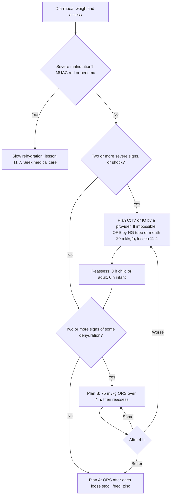

# 11.3 · How much to give: WHO plans A, B and C, and zinc

By the end of this lesson you will be able to look at a person with diarrhoea, put them into one of three WHO dehydration classes in under two minutes, work out exactly how much ORS they need and how fast, turn that into teaspoons and cups a tired parent can follow, give zinc to children, and recognise the person who needs a drip that you cannot give. These are the plans used by WHO, UNICEF and MSF in every cholera treatment centre.

> [!CAUTION]
> Performing these procedures on people without the required state certification is illegal.
> This lesson is for educational purposes only. Practise only on models and animal tissue.

## Why it matters

Your EMT course taught you to recognise dehydration and to call for transport. When no one is coming, recognising it is not enough: you must decide **how much** fluid, **how fast**, and **when to stop**. Too little, too slowly, and a child slides into shock overnight. Too much in a malnourished or very small child, and the lungs fill with fluid. The WHO plans solve this with simple numbers based on weight, and they work with nothing but ORS, a cup, a spoon and a watch.

## What to do

### 1. Weigh, or estimate weight

Plans are calculated per kilogram. Weigh the child (a bathroom scale: weigh yourself holding the child, subtract your own weight). If you cannot weigh, estimate weight by age (lesson 04.7) and use the age column of the tables below. Write the weight and time down.

### 2. Assess dehydration (WHO)

Look at the signs below. **Two or more signs in a column** put the person in that class. Use the most severe class that fits.

| Sign | No dehydration (Plan A) | Some dehydration (Plan B) | Severe dehydration (Plan C) |
|---|---|---|---|
| General condition | Well, alert | Restless, irritable | Lethargic or unconscious |
| Eyes | Normal | Sunken | Sunken |
| Thirst (offer a drink) | Drinks normally | Thirsty, drinks eagerly | Drinks poorly or cannot drink |
| Skin pinch (abdomen, 1 second) | Goes back immediately | Goes back slowly | Goes back very slowly (more than 2 seconds) |
| Approximate fluid deficit | Less than 5% of body weight | 5-9% | 10% or more |

Also look for:

- **Shock:** weak or absent radial pulse, cold hands, slow capillary refill, altered consciousness. This is severe dehydration.
- **Danger signs** that mean the person needs medical care as well as ORS: blood in the stool (dysentery, needs an antibiotic, Module 12), diarrhoea for 14 days or more, high fever, a young infant (under 2 months), severe malnutrition (lesson 11.7), repeated vomiting so nothing stays down, convulsions, very fast breathing.

> [!IMPORTANT]
> In a child with **severe acute malnutrition** (lesson 11.7) these signs are unreliable (sunken eyes and slow skin pinch can be present without dehydration), and the WHO plans below are **not** used: they rehydrate too fast and can cause heart failure. Use the malnutrition rules in lesson 11.7.

### 3. Plan A: no dehydration, treat at home

The four rules of Plan A:

1. **Give extra fluid**: ORS after every loose stool, plus as much as the person wants of safe home fluids.
2. **Give zinc** to children (section 6).
3. **Continue feeding**: breastfeeding on demand, normal food in small frequent meals. Do not starve a child with diarrhoea.
4. **Know when to come back** (or call): not drinking, getting worse, blood in stool, fever, sunken eyes, or no better after 2 days.

ORS after each loose stool (WHO, as given by MSF):

| Age | ORS after each loose stool | ORS per day, about |
|---|---|---|
| Under 2 years | **50-100 ml** (10-20 teaspoons) | 500 ml |
| 2-10 years | **100-200 ml** (half to one 200 ml glass) | 1000 ml |
| Over 10 years and adults | **at least 200-250 ml** (at least one glass) | 2000 ml |

How to give it:

- **Under 2 years:** one **teaspoon (5 ml) every 1-2 minutes**. Do not use a baby bottle.
- **Older children:** frequent sips from a cup.
- **If the child vomits:** wait **10 minutes**, then continue more slowly (a spoonful every 2-3 minutes). Most vomiting stops once rehydration starts.

### 4. Plan B: some dehydration, ORS over 4 hours

**Give 75 ml/kg of ORS over 4 hours**, in the place where you can watch the person.

| Weight | ORS over 4 hours | ORS per hour |
|---|---|---|
| Under 6 kg | 200-400 ml | 50-100 ml |
| 6 to under 10 kg | 400-700 ml | 100-175 ml |
| 10 to under 12 kg | 700-900 ml | 175-225 ml |
| 12 to under 19 kg | 900-1400 ml | 225-350 ml |
| 19 to under 30 kg | 1400-2200 ml | 350-550 ml |
| 50 kg and over (adults) | about 4000 ml | about 1000 ml |

(MSF Appendix 14 and cholera Appendix 5. Calculate 75 ml/kg for any weight in between.)

1. **Calculate:** weight × 75 is the 4-hour total. Divide by 4 for the hourly amount. Divide the hourly amount by 12 for "every 5 minutes".
2. **Show the carer** the amount: mark the hourly level on a bottle with tape, or give them a cup and tell them how many cups per hour.
3. **If the person wants more, give more.** If they will not drink the full amount but are improving, that is fine.
4. **Add Plan A amounts** for each further loose stool during the 4 hours.
5. **Continue breastfeeding** throughout. Other food can wait until the 4 hours are over.
6. **Watch for overload:** **puffy eyelids** mean too much. Stop ORS, give plain water or breast milk, and restart Plan A when the puffiness is gone.
7. **Reassess at 4 hours** with the same table:
   - No dehydration: Plan A at home, with ORS for 2 days.
   - Still some dehydration: repeat Plan B, and start food and drink as well.
   - Worse, or severe signs: Plan C.

**Worked example.** A 9 kg, 11-month-old boy, irritable, sunken eyes, drinks eagerly. Some dehydration. 9 × 75 is **675 ml over 4 hours**, about **170 ml per hour**, which is about **14 ml every 5 minutes**, or a teaspoon about every 2 minutes.

### 5. Plan C: severe dehydration

Severe dehydration and shock need **intravenous or intraosseous Ringer's lactate**, 100 ml/kg (WHO; MSF):

| Age | First give 30 ml/kg in | Then give 70 ml/kg in |
|---|---|---|
| Infants under 12 months | 1 hour | 5 hours |
| 12 months and older, and adults | 30 minutes | 2.5 hours (MSF cholera protocol: 3 hours) |

- Repeat the first 30 ml/kg once if the radial pulse is still weak or absent.
- Start **ORS by mouth (about 5 ml/kg/h)** as soon as the person can drink, usually after 3-4 hours in infants and 1-2 hours in older children (WHO), alongside the drip.
- **Reassess** after 6 hours (infant) or 3 hours (child, adult), and choose Plan A, B or C again.
- Example: a 60 kg adult gets **2 litres in 30 minutes, then about 4 litres over the next 3 hours** (MSF cholera guide).
- MSF's cholera protocol for **children under 5** uses a smaller first bolus: 20 ml/kg over 15 minutes, up to 3 times, then 70 ml/kg over 3 hours.

IV and IO fluid prescriptions are paramedic and physician care (lesson 04.2 for IO access). Your job is to **start ORS immediately** if the person can drink at all, **get someone who can start a drip**, and if no one can: give ORS by **nasogastric tube or by mouth at 20 ml/kg per hour for 6 hours** (total 120 ml/kg; WHO), as taught in lesson 11.4. A nasogastric tube cannot give fluid fast enough to reverse true shock (MSF), so keep trying to reach help.

### 6. Zinc for children

Zinc shortens diarrhoea, reduces stool volume and lowers the chance of diarrhoea in the next 2-3 months. Give it to **every child with diarrhoea**, whatever the degree of dehydration, from the first day the child can swallow.

| Age | Zinc (elemental) daily | Duration | Source |
|---|---|---|---|
| Under 6 months | 10 mg | 10-14 days | WHO 2005 |
| 6 months to 5 years | 20 mg | 10-14 days | WHO 2005; GTFCC (10 days) |
| Up to 10 years | 5 mg is now suggested | up to 14 days | WHO 2024 (conditional, low-certainty evidence) |

The 2024 WHO guideline suggests a lower dose (5 mg) because large trials found 5, 10 and 20 mg worked equally well and the low dose caused less vomiting. Because 5 mg tablets are not yet sold, **WHO and UNICEF still advise using 20 mg a day for 14 days** in practice (UNICEF, 2026).

How to give it:

- Dispersible zinc tablets (20 mg) are dissolved in a teaspoon of breast milk, ORS or clean water.
- In Israel, children's dispersible zinc is not easy to find; adult **zinc supplements** are sold in pharmacies and health shops. Read the **elemental zinc** per tablet on the label (not the weight of the zinc salt). Crush the tablet, dissolve it in a teaspoon of liquid, and give a portion close to the dose. Anything **between 5 and 20 mg** a day is within the doses tested by WHO (course reasoning from the 2024 evidence), so you do not need to split a tablet precisely.
- If the child vomits within 30 minutes, give the dose again.
- Children already receiving ready-to-use therapeutic food for malnutrition do not need extra zinc (GTFCC).
- If the child is also taking ciprofloxacin, give the antibiotic 2 hours before or 4-6 hours after the zinc (GTFCC).
- Adults do not need zinc for diarrhoea.

### 7. Feeding and what not to give

- **Breastfeed throughout**, including during Plan B and C.
- Older children and adults: start eating again within 3-4 hours of starting rehydration, small frequent meals, ordinary food with a little salt.
- **Do not give** antidiarrhoeal drugs (such as loperamide) or routine anti-vomiting drugs to children (WHO). For an adult with severe vomiting, the field antiemetic in lesson 04.8 can help them keep ORS down.
- Antibiotics are **not** needed for most watery diarrhoea. They are needed for **blood in the stool** (Module 12) and for **cholera with some or severe dehydration** (lesson 11.5).

### Watch

med1pager walks through the WHO classification and Plans A, B and C in children with the volumes:

https://www.youtube.com/watch?v=1a3CkK8QcVc

A paediatric clinician (Dr Shambhavi Clinicals) demonstrates the bedside signs of dehydration (eyes, thirst, skin pinch) and the WHO classification on real children:

https://www.youtube.com/watch?v=UAx_y5UkqQU

The Children's Hospital of Philadelphia shows parents how to give oral rehydration to children in small, frequent amounts:

https://www.youtube.com/watch?v=vO1VdVcvB_A

## Improvise it

### Measuring a plan with household things

| Need | Improvised tool | Accuracy | Tip |
|---|---|---|---|
| 5 ml doses for an infant | Calibrated teaspoon (lesson 11.2) or a 5 ml syringe without needle | Good with syringe | Squirt slowly into the cheek, not the throat |
| Hourly volume | Bottle with tape marks at each hour's level | Good | Mark "8:00, 9:00, 10:00..." on the tape |
| Weight | Bathroom scale, hold the child; or luggage hook scale with a cloth sling | About 0.5 kg | Weigh at the start and every morning |
| Timing | Phone timer, or one teaspoon per song verse | Fair | Give the carer a written plan |
| Stool count | Tally on tape on the wall; or count nappies | Good | Each loose stool earns its Plan A amount |
| Urine | Weigh nappies: 1 g is about 1 ml (lesson 07.3) | Good | First urine within the plan is a good sign |

### When there is no ORS at all

Give the home recipe (lesson 11.2) or salted rice water in exactly the same Plan A and B volumes. Plain water can be given as well, but should not be the only fluid for a child with large losses.

### When the carer is exhausted

Plan B for a 10 kg child means about 190 ml per hour, a teaspoon roughly every 90 seconds, for 4 hours. That is hard work. **Rotate helpers every hour**, give each a written card (name, weight, ml per hour, ml per stool, time of next reassessment) and a marked bottle, and check every hour that the level has gone down.

## When it goes wrong

| Problem | Likely cause | What to do |
|---|---|---|
| Child keeps vomiting | Too fast, too much at once | Wait 10 minutes, then 5 ml every 2-3 minutes. If vomiting continues and signs worsen: nasogastric ORS (lesson 11.4) |
| Puffy eyelids during Plan B | Too much fluid | Stop ORS; give water or breast milk; restart Plan A later |
| Breathing faster, crackles, swelling, liver edge lower | Fluid overload, especially in malnutrition or heart disease | Stop fluids, sit upright, get medical help; MSF uses furosemide 0.5 mg/kg IV (prescription) |
| No urine by the end of Plan B | Still dehydrated, or kidneys injured | Reassess; repeat Plan B or move to Plan C |
| Stool volume huge, adult worsening despite drinking | Cholera with losses faster than drinking (lesson 11.5) | Count stools per hour; this person needs IV fluid and an antibiotic |
| Weakness, cramps, floppy muscles after a day of diarrhoea | Low potassium | ORS contains potassium; add potassium-rich food. Home salt-sugar solution has none |
| Child getting better but diarrhoea continues for days | Normal: rehydration does not stop diarrhoea | Continue Plan A and zinc; diarrhoea over 14 days needs medical care |

## Scope and law

Assessing dehydration and giving ORS by Plans A and B is lay care and within EMT practice. Zinc supplements are sold over the counter, but deciding to treat a child is still a responsibility: write down what you gave. IV or IO fluids (Plan C), antiemetics, furosemide and antibiotics are paramedic or physician powers in Israel. The Duty to Rescue Law (1998) gives no immunity; act beyond your scope only as a last resort, as explained in [01.5 · The law and your scope in Israel](../module-01/lesson-05.md).

## Practice

**Drill: six rehydration plans on paper (45 minutes).** You need: paper, a calculator, the tables above, and a timer.

For each case: classify, choose the plan, calculate total volume and hourly volume, turn it into spoons or cups, and write the carer's card. Time yourself: aim for under 3 minutes per case.

1. Girl, 3 years, 14 kg, alert, drinks normally, 6 watery stools today.
2. Boy, 8 months, 8 kg, irritable, sunken eyes, drinks eagerly, skin pinch slow.
3. Woman, 70 kg, watery stools every hour since this morning, very thirsty, sunken eyes, skin pinch slow, pulse 110, alert.
4. Baby, 5 months, 6 kg, very sleepy, will not drink, skin pinch very slow, cold hands.
5. Boy, 6 years, 20 kg, after 4 hours of Plan B, now alert, drinks normally, eyelids slightly puffy.
6. Girl, 2 years, 11 kg, some dehydration, blood and mucus in the stool, fever 39.

Reference answers

1. No dehydration: Plan A, 100-200 ml after each stool (about 1000 ml a day), feed, zinc 20 mg daily for 10-14 days.
2. Some dehydration: Plan B, 8 × 75 is 600 ml over 4 h, 150 ml per hour, about 12-13 ml every 5 minutes (a teaspoon every 2 minutes); plus 50-100 ml per stool; zinc 20 mg; reassess at 4 h.
3. Some dehydration: Plan B, 70 × 75 is 5250 ml over 4 h, about 1300 ml per hour (MSF's table gives about 1000 ml per hour for 50 kg and over, 1500 ml per hour for 75 kg and over); plus 200-250 ml per stool. Hourly stools suggest cholera: she needs an antibiotic (lesson 11.5) and close watching for Plan C.
4. Severe dehydration with shock: Plan C, 6 kg × 30 is 180 ml IV/IO over 1 hour then 6 × 70 is 420 ml over 5 hours. Call for a provider now. If no IV/IO is possible: nasogastric ORS at 20 ml/kg/h, 120 ml per hour for 6 hours (lesson 11.4). Reassess at 6 h.
5. Rehydrated but puffy eyelids: stop ORS, give plain water and food, then Plan A when the puffiness goes.
6. Some dehydration: Plan B, 11 × 75 is 825 ml over 4 h (about 205 ml per hour), plus zinc. Blood in the stool means dysentery: she needs an antibiotic (Module 12) and medical care.

How you know it worked: you classified all six correctly, every volume is within 10% of the reference, every carer's card states ml per hour and ml per stool, and you completed the six cases in under 20 minutes.

## Sources

- WHO. *The treatment of diarrhoea*, 4th revision, 2005: assessment table, Plans A, B and C, zinc 10 mg under 6 months and 20 mg from 6 months for 10-14 days, no antidiarrhoeals in children.
- MSF. *Clinical Guidelines*, Appendix 14: WHO rehydration plan (2025 edition): Plan A and B tables by weight, Plan C, overload criteria, puffy eyelids, ORS 5 ml/kg/h with IV.
- MSF. *Management of a cholera epidemic*: 5.3 severe dehydration (adult and under-5 boluses, no NG tube for shock), 5.5 maintenance table, Appendix 5 volumes.
- WHO. *Guideline on management of pneumonia and diarrhoea in children up to 10 years of age*, 2024: zinc recommended for acute watery and persistent diarrhoea; 5 mg daily suggested (conditional).
- UNICEF Supply Division. Market update: ORS and zinc, 6 July 2026: continue 20 mg daily for 14 days until 5 mg products exist.
- GTFCC. Interim technical note on antibiotics for cholera, revised October 2022: zinc 20 mg for 10 days at 6 months to 5 years; zinc and ciprofloxacin spacing; no zinc needed with therapeutic food.
- WHO secondary training materials (IMCI) for nasogastric ORS 20 ml/kg/h for 6 hours when IV is not available.
