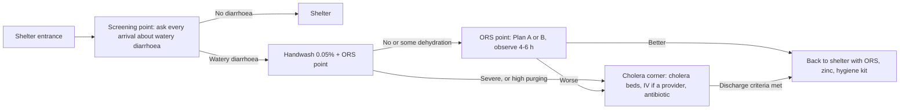

# 11.5 · Cholera and outbreak control in a shelter

By the end of this lesson you will be able to recognise cholera, treat it with the plans from lesson 11.3 plus the right single-dose antibiotic, and stop it spreading through a crowded shelter: a screening point at the door, a cholera corner with its own toilets and buckets, chlorine solutions made from household bleach, a simple patient list, and safe handling of the dead. Cholera is the model for every outbreak of watery diarrhoea; the same controls work for most of them.

> [!CAUTION]
> Performing these procedures on people without the required state certification is illegal.
> This lesson is for educational purposes only. Practise only on models and animal tissue.

## Why it matters

Cholera is a bowel infection with *Vibrio cholerae*, spread by water and food contaminated with faeces. Symptoms start **12 hours to 5 days** after infection. Most infected people have no symptoms or mild diarrhoea, but they **still shed the bacteria in their stool for 1-10 days**, and a minority develop massive watery diarrhoea that can kill **within hours** (WHO, 2026). In 2025, 47 countries reported over 450,000 cases and about 7,900 deaths, the most reported deaths since 1999.

Israel has no cholera today, but cholera follows broken water and sewage systems, crowding and displacement, which is exactly what a long war, an earthquake or a mass evacuation produces. With proper treatment, **fewer than 1% of patients die**. In a shelter where no one knows what to do, many more do, and the infection spreads to the people looking after them.

## What to do

### 1. Recognise it

Typical cholera: **sudden, painless, profuse watery diarrhoea**, pale and cloudy like water in which rice has been washed ("rice-water stools"), often with **vomiting**, and dehydration that becomes severe within hours. An adult can lose litres in a day. Fever is unusual. Muscle cramps are common (low potassium).

**GTFCC case definitions of suspected cholera:**

- **Where no outbreak has been declared:** anyone **aged 2 years or older** with acute watery diarrhoea **and severe dehydration**, or who dies of acute watery diarrhoea.
- **Where an outbreak has been declared:** **any person** with, or dying of, acute watery diarrhoea.

Only a laboratory confirms cholera (stool culture or a rapid test kit). You will rarely have one. **Course rule for a shelter:** two or more people with acute watery diarrhoea and severe dehydration, or one death from acute watery diarrhoea, within a few days: **act as if it is cholera** and report it.

### 2. Treat every patient

1. **Rehydrate by the plans in lesson 11.3.** Most cholera patients recover with **ORS alone**. Start ORS at the door, before anything else.
2. **Severe dehydration:** IV Ringer's lactate 100 ml/kg (adults and children 5 and older: 30 ml/kg in 30 minutes, then 70 ml/kg over 3 hours; children under 5 in MSF's protocol: 20 ml/kg in 15 minutes, up to 3 times, then 70 ml/kg over 3 hours). Give ORS as soon as they can drink.
3. **Replace ongoing losses:** count stools, do not measure them, and give ORS after each one (under 2 years 50-100 ml, 2-10 years 100-200 ml, over 10 years at least 200-250 ml). In the first 4-6 hours an adult may lose 10-15 ml/kg per hour (MSF).
4. **Give an antibiotic to the right patients** (below), within the first 4 hours if possible.
5. **Zinc** for children 6 months to 5 years: 20 mg a day for 10 days (GTFCC; lesson 11.3).
6. **Feed** from 3-4 hours after starting rehydration. Breastfeed throughout.
7. **Watch** for hypoglycaemia in children (drowsy, sweaty, fits: give sugar by mouth or as ORS), low potassium (cramps, weakness), and fluid overload (lesson 11.3).
8. **Discharge** from your cholera corner when the person has had **3 or fewer liquid stools and no vomiting in the last 4-6 hours** (after severe dehydration) and can drink enough ORS (MSF).

### 3. Antibiotics: who and what

Antibiotics shorten diarrhoea by about 1.5 days, cut stool volume by up to half and shorten shedding to 1-2 days. They do **not** replace fluids (GTFCC 2022).

**Who gets one** (GTFCC):

- Patients with **severe dehydration**; and, **whatever the degree of dehydration**:
- **High purging**: at least **one stool per hour** on average over the first 4 hours of rehydration;
- **Failure** of the first 4 hours of rehydration;
- **Pregnancy**, **severe acute malnutrition**, HIV or other serious illness, **age over 60**.

Most patients with no or mild dehydration do **not** need an antibiotic, and **mass antibiotic prophylaxis** of the shelter is **not recommended** by WHO or any other organisation: it does not stop outbreaks and it breeds resistance.

| Drug | Adults, including pregnant women | Children under 12 years | Notes |
|---|---|---|---|
| **Doxycycline** (first choice if the local strain is sensitive) | **300 mg by mouth, single dose** | **2-4 mg/kg by mouth, single dose** | GTFCC: suitable for pregnant women and children as a single dose |
| **Azithromycin** (alternative) | **1 g by mouth, single dose** | **20 mg/kg (max 1 g), single dose** | Very little resistance; safe in pregnancy and children |
| **Ciprofloxacin** (alternative) | **1 g by mouth, single dose** | **20 mg/kg (max 1 g), single dose** | Resistance is growing in Asia and Africa. Separate from zinc |

All three are prescription drugs (lesson 04.6 covers obtaining and storing field antibiotics). If health authorities give you the local sensitivity results, follow them.

### 4. Set up a cholera corner in a shelter

The aim is to **keep stool, vomit and dirty hands away from the shelter's water and food**, while treating patients close to their families.

**Layout (GTFCC and MSF principles, adapted to a shelter):**

1. **One entrance and exit** to the cholera corner, with a **handwashing point** (0.05% chlorine or soap and water) at it. Rope or tape marks the boundary.
2. **ORS point** near the entrance: a table, a covered container of ORS made fresh every day, cups, a marked bottle, a carers' card per patient.
3. **Cholera beds** for severe cases (see Improvise it), each with a covered **stool bucket** underneath and a **vomit bucket** beside it.
4. **Patient toilets** used only by patients: a separate latrine or bucket toilets (lesson 11.6), at least 1 per 20 patients.
5. **One carer per patient**, who washes hands each time they leave and does not go back and forth to the shelter kitchen.
6. **Water:** about **60 litres per patient per day** in a cholera treatment centre (Sphere), all of it chlorinated.
7. **Waste:** stool and vomit buckets are emptied into the patient latrine, **not** into the shelter's drains or open ground. Rinse the bucket with 2% chlorine.

### 5. Chlorine solutions from household bleach

Read the **sodium hypochlorite %** on the label (Israeli and imported bleaches commonly 3-6%). Use plain, unscented bleach. Then:

**ml of bleach per litre of finished solution: 1000 × the strength you want ÷ the bleach strength.**

| Solution | Used for (MSF, Sphere) | From 3.5% bleach, per litre | From 5% bleach, per litre |
|---|---|---|---|
| **0.05%** | Handwashing, laundry (soak 15 minutes after washing) | 14 ml bleach + water to 1 L | 10 ml bleach + water to 1 L |
| **0.2%** | Floors, beds, surfaces, utensils, dishes, aprons, boots (after cleaning) | 57 ml bleach + water to 1 L | 40 ml bleach + water to 1 L |
| **2%** | Stool and vomit buckets, preparing the dead | 570 ml bleach + 430 ml water | 400 ml bleach + 600 ml water |

- Make the solutions **fresh every day** (bleach-based 0.2% just before use). Label each container clearly and keep them apart from drinking water.
- **Contact time 15 minutes.** Clean off dirt first; chlorine does not work through dirt.
- **Never mix bleach** with acids (descalers, vinegar) or ammonia cleaners: toxic gas.
- Do not spray people, footbaths, or homes: GTFCC finds no evidence of benefit for footbaths and many guidelines advise against household spraying. Use the chlorine for hands, buckets and surfaces instead.

### 6. Stop it spreading

| Route | Control |
|---|---|
| **Water** | All drinking water boiled or chlorinated (lesson 11.6). During an outbreak aim for at least **0.5 mg/L free chlorine** at the point of use (Sphere's figure for health settings). Separate dipping cups; taps or pouring, never hands in the container |
| **Hands** | Soap and water or 0.05% chlorine after the toilet, after cleaning a patient, before preparing food, before eating and before feeding a child |
| **Food** | Cook thoroughly and eat hot; peel fruit yourself; no raw salads or seafood; separate cooks who have not cared for patients |
| **Toilets** | Every person uses a toilet or bucket toilet; no open defecation; patient toilets separate |
| **Contacts** | Families of patients get soap, a water container with a tap, chlorine for their water, and the warning signs to watch for. Single-dose antibiotics for household contacts (selective chemoprophylaxis) are debated and are a decision for health authorities |
| **The dead** | Bodies are infectious. Wash with 2% chlorine, plug openings with cotton soaked in it, wrap in a sheet or bag, bury quickly. No washing of the body by family, no shared meals at funerals |
| **Vaccine** | Oral cholera vaccines (Euvichol-Plus, Euvichol-S, Dukoral) protect for years with two doses; since 2022 single doses are used because of global shortage. Supply is controlled by health authorities |

### 7. Count and report

Keep a **line list** on paper: name, age, sex, where they sleep in the shelter, date of first symptom, dehydration class, plan given, antibiotic, outcome (discharged, died), and date. Each day add up: new cases, total cases, deaths. The case-fatality rate (deaths divided by cases) should be **below 1%**; above that, something in treatment is failing.

Report suspected cholera to the **district health office (Ministry of Health)** and to Home Front Command or Magen David Adom as soon as communications allow. Health authorities can bring rapid tests, IV fluids, antibiotics and, if available, vaccine.

### Watch

Global Health Media Project's "The Story of Cholera" shows how cholera spreads and how a community stops it:

https://www.youtube.com/watch?v=jG1VNSCsP5Q

MSF South Asia explains what cholera does to the body and why rehydration works:

https://www.youtube.com/watch?v=voCci_sHhso

MSF shows how a cholera treatment centre is set up, with its zones, cholera beds and chlorine points:

https://www.youtube.com/watch?v=ZsxSGzrVNuQ

PAHO (the WHO regional office for the Americas) shows mixing chlorine disinfectant solution:

https://www.youtube.com/watch?v=AaKh6JRAOfs

The MSF and PAHO videos may show chlorine footbaths or older strengths (for example 0.2% for hands). Current MSF guidance uses 0.05% for hands and finds no benefit in footbaths.

## Improvise it

| Need | Improvisation | What works | What fails / the risk | How to tell it is failing |
|---|---|---|---|---|
| **Cholera bed** | A canvas camp bed or a stretcher with a **hole about 20 cm across** cut under the buttocks, edges taped, a bucket underneath with a cup of 2% chlorine; or a table covered with plastic sheeting with a hole and a bucket | Patient can lie still while purging; stool counted in the bucket | Bucket overflows, patient slides off the hole, cold | Wet bedding: empty the bucket more often, reposition |
| **Measuring losses** | Mark litres on the bucket with tape | Gives a sense of volume | MSF counts stools rather than measuring | Count stools; use volumes only as a rough check |
| **Hand-washing point** | A tippy tap or a jerrycan with a tap (lesson 11.6), soap or 0.05% chlorine | Works | Empty containers, missing soap | Assign one person per shift to refill |
| **Separate zone** | Tape on the floor, a tarpaulin wall, a separate room or tent | Reduces traffic | People cross it to visit | Put the boundary where it can be watched |
| **ORS supply** | Home recipe or rice ORS (lesson 11.2) in 20 L containers | Works | Spoils or gets contaminated | Make fresh daily, cover, use a tap or a clean ladle |
| **Body bags** | Two heavy plastic sheets and tape | Contains fluids | Leaks | Wrap with absorbent cloth soaked in 2% chlorine inside |
| **No bleach strength on label** | Assume 3% and use the 3.5% column rounded up | Errs on the stronger side for disinfection | Wrong strength | Strong chlorine smell is expected; if none, make it stronger |

## When it goes wrong

| Problem | Cause | Recovery |
|---|---|---|
| Patients keep dying in the cholera corner | Too slow rehydration, missed IV needs, no night care | Check the CFR; reassess every patient every hour at night; get a provider for IV |
| New cases among carers and cooks | Hands, shared food | Enforce handwashing at the exit, separate cooks, stop shared meals |
| Shelter refuses patients, families hide cases | Fear and stigma | Explain: with ORS almost everyone survives; treat close to family; avoid spraying and visible "contamination" rituals |
| Cases spread to a new part of the shelter | Water or toilets shared | Check the water chlorine; close or chlorinate the toilets used; find the common source on the line list |
| Skin irritation, coughing near the chlorine point | Solutions too strong or mixed with acid | Remake to the table; ventilate; never mix with other cleaners |
| Antibiotic does not seem to help | Resistant strain, or fluids are inadequate | Fluids first; report so health authorities can test sensitivity |

## Scope and law

Screening, giving ORS, hygiene measures, chlorine solutions and organising a shelter are lay and community actions. IV fluids and antibiotics are paramedic and physician powers in Israel, and suspected cholera must be reported to health authorities. The Duty to Rescue Law (1998) gives no immunity; act beyond your scope only as the last resort described in [01.5 · The law and your scope in Israel](../module-01/lesson-05.md).

## Practice

> [!WARNING]
> Wear gloves and eye protection when handling bleach. Work in a ventilated place, never mix bleach with other cleaners, and label every container.

**Drill 1: make the three chlorine solutions (20 minutes).** You need: your household bleach, a 10 ml syringe or measuring spoons, a measuring jug, three 1 L bottles, a marker, gloves.

1. Read the % on your bleach label. Calculate the bleach per litre for 0.05%, 0.2% and 2% with the formula.
2. Make 1 L of each. Label: strength, date, use. Smell each: 0.05% faint, 2% strong.
3. Pour all three away down the toilet afterwards (not with other cleaners).

**Drill 2: shelter outbreak tabletop (40 minutes).** A school gym holds 180 displaced people, with 4 toilets and one water tank. On day 1 a 70-year-old man and a 4-year-old girl have profuse watery diarrhoea; the man is drowsy with a weak pulse. On day 2 three more cases appear, all sleeping near the east toilets.

1. Draw the gym layout with the screening point, ORS point, cholera corner, patient toilets and handwashing points.
2. Write the plan for the man and the girl (lesson 11.3 plus antibiotics with doses; estimate the girl at 16 kg).
3. Start a line list with the five cases.
4. List three changes for the water tank and toilets today (lesson 11.6).
5. Write the 3-line report you would send to the district health office.

How you know it worked: your chlorine amounts are correct for your bleach to within 10%; your plan gives the man IV-plan triggers, doxycycline 300 mg (or an alternative) and ORS, and the girl ORS by plan, zinc and an antibiotic only if she meets the criteria; the layout separates patient toilets from the shared ones; and your line list points to the east toilets as a possible common source.

## Sources

- WHO. Cholera fact sheet, 29 September 2026 (incubation, shedding, CFR target, vaccines, 2025 figures, no mass prophylaxis).
- GTFCC. Interim technical note: use of antibiotics for the treatment and control of cholera, revised October 2022 (indications, doxycycline, azithromycin and ciprofloxacin doses, case definitions, zinc, chemoprophylaxis).
- GTFCC. Technical note on WASH and IPC in cholera treatment structures (no evidence for footbaths); GTFCC WASH working group 2021 (household spraying not recommended in many guidelines).
- MSF. *Management of a cholera epidemic*: 5.1 principles (antibiotics within 4 hours, feeding, discharge), 5.3 severe dehydration, Appendix 15 chlorine solutions (0.05%, 0.2%, 2%; formula; 15-minute contact; daily renewal).
- Sphere Association. *The Sphere Handbook*, 2018: WASH standard 6 (60 L per patient per day in cholera treatment centres, 0.5 mg/L FRC, chlorine uses, 1 toilet per 20 inpatients).
