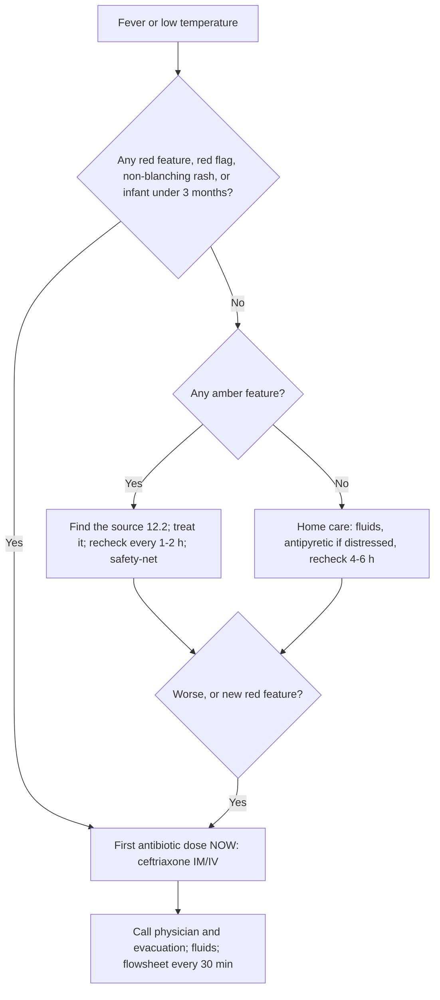

# 12.1 · Fever and infection: who is dangerous

By the end of this lesson you will be able to look at a feverish adult, child or baby and decide, within a few minutes and without a laboratory, whether they can be watched at home, need treatment today, or are in danger and need an antibiotic and evacuation now. You will recognise meningitis and sepsis early, treat every fever in a young baby as an emergency, and cool and hydrate a patient safely with what is in the house.

> [!CAUTION]
> Performing these procedures on people without the required state certification is illegal.
> This lesson is for educational purposes only. Practise only on models and animal tissue.

## Why it matters

When the system is down, most of the medicine you will do is not trauma. It is fever: a child with a cough, a grandmother who is "not herself", a baby who will not feed. Almost all of these are viral and get better on their own. A few are bacterial meningitis, sepsis, pneumonia or a kidney infection, and those kill in hours to a day if nobody acts.

Your job is not to diagnose every fever. It is to **find the few dangerous ones early** and act on them, and to **not waste scarce antibiotics** on the many that do not need them. The tools in this lesson are the same traffic-light and red-flag systems that emergency departments use, stripped down to what you can see, count and feel. Sepsis in a wounded casualty was covered in [08.5 · Wound infection and sepsis without labs](../module-08/lesson-05.md); this lesson applies the same thinking to people who were well yesterday.

## What to do

### 1. Measure properly

1. **Temperature.** Fever is **38 °C or more**. Use a digital thermometer: in the armpit for children under 5 (NICE), under the tongue for older children and adults. An infrared ear or forehead reading is acceptable for screening only. A temperature **below 36 °C** in a sick-looking patient is as worrying as a high one.
2. **Breathing rate** for a full 60 seconds, with the chest bare, before you disturb the patient.
3. **Heart rate** for 30 seconds.
4. **Capillary refill**: press a fingertip (or the breastbone in a baby) for 5 seconds; colour should return in **under 3 seconds**.
5. **Mental state and behaviour**: in adults, new confusion; in children, how they respond to you and to their parent.
6. **Urine**: when did they last pass urine? In babies, how many wet nappies today?
7. **Skin**: undress fully and look everywhere for a rash, mottling or a source of infection.
8. **SpO2** if you have an oximeter.

Write everything down with the time (flowsheet, lesson 07.2). One set of observations is a snapshot; the trend decides.

### 2. Sort children with the traffic light

The table below combines the high-risk and intermediate-risk features of the RCH Melbourne febrile-child guideline (October 2026) and NICE NG143. **Any one red feature means danger.**

| | Red: high risk | Amber: intermediate risk |
|---|---|---|
| **Colour** | Mottled, ashen, grey or blue skin, lips or tongue | Pallor reported by the parent |
| **Behaviour** | No response to social cues; looks ill to you; does not wake, or does not stay awake; weak, high-pitched or continuous cry | Not responding normally; wakes only with prolonged stimulation; less active; parent says "this is different" |
| **Breathing** | Grunting; breathing rate over 60 a minute; marked chest indrawing; pauses in breathing; SpO2 under 90% | Fast breathing for age (table below); nasal flaring; SpO2 under 92%; crackles |
| **Circulation and fluids** | Cool hands and feet with low blood pressure or persistent unexplained fast heart rate | Capillary refill 3 seconds or more; dry mouth; poor feeding; reduced urine; fast heart rate for age |
| **Other** | **Age under 3 months with 38 °C or more**; non-blanching rash; bulging fontanelle; stiff neck; seizure that does not stop; new weakness of one side | Age 3-6 months with 39 °C or more; fever for 5 days or more; rigors; a swollen limb or joint, or not bearing weight |

Fast breathing and fast heart rate in children (MSF pneumonia thresholds; UK Sepsis Trust under-5 red flags):

| Age | Fast breathing (amber) at or above | Red-flag breathing at or above | Red-flag heart rate at or above |
|---|---|---|---|
| Under 2 months | 60 | 60 | 160 |
| 2-11 months | 50 | 60 | 160 |
| 1-2 years | 40 | 50 | 150 |
| 3-4 years | 40 | 40 | 140 |
| 5 years and over | 30 (older children), adults 22 | Adults 25 | Adults 130 |

> [!IMPORTANT]
> **Fever under 3 months is red, always.** Babies under 3 months (and especially under 1 month) do not show the classic signs of meningitis or sepsis, and RCH treats every febrile baby under 21 days with full investigation and IV antibiotics whatever they look like. In a cut-off setting you cannot investigate, so you treat (section 5).

Risk factors that move a child up a level: unvaccinated, immunosuppressed (chemotherapy, long-term steroids), a central line, recent surgery or burns, severe malnutrition, and a parent who is very worried or who has come back to you within 48 hours.

### 3. Sort adults with red flags

Use the UK Sepsis Trust adult red flags from 08.5. **Any one** means red-flag sepsis: new confusion; breathing 25 or more; new oxygen need; systolic BP 90 or less (or more than 40 below their normal); heart rate over 130; no urine for 18 hours; non-blanching rash, mottled, ashen or blue skin.

Amber flags in adults (act today, recheck every 1-2 hours): relatives worried about behaviour; breathing 21-24; heart rate 91-130; systolic 91-100; no urine for 12-18 hours; rigors; temperature under 36 °C; immunosuppression; recent surgery or trauma; signs of a wound or line infection.

People who hide sepsis: the elderly (may only be confused or fall), pregnant and recently delivered women, people on steroids or chemotherapy, people with diabetes, people after splenectomy, and anyone who has taken paracetamol or ibuprofen in the last few hours (the fever is masked; the heart rate and breathing are not).

### 4. Recognise meningitis and meningococcal disease

**Children over 1 year and adults** (MSF): fever, severe headache, dislike of light, neck stiffness, vomiting, confusion, drowsiness, seizures. A **petechial or purpuric rash** (pinpoint red-purple spots or larger bruise-like patches that do not fade on pressure) usually means meningococcus.

**Babies under 1 year** (MSF): the classic signs are usually absent. Look for irritability (especially a baby who cries more when picked up), fever or low temperature, poor feeding or vomiting, seizures, pauses in breathing, drowsiness, and a **bulging fontanelle** when the baby is not crying.

**Meningococcal sepsis** may come before any meningitis signs: leg pain, cold hands and feet, pale or mottled skin, then the rash. The rash may start as a few blanching spots and turn purpuric within hours. Check the whole body, including the soles, palms, conjunctivae and the roof of the mouth, every hour.

**The glass test.** Press the side of a clear drinking glass firmly against the spots. Spots that stay visible through the glass are **non-blanching**. A non-blanching rash with fever is meningococcal disease until proven otherwise. A rash that fades **does not** rule it out; early rashes often blanch, and on dark skin look at pale areas.

Do **not** check for neck stiffness and Kernig's sign and feel reassured if they are absent: many patients with meningitis, and nearly all babies, do not have them.

### 5. Act on danger: antibiotic now, then evacuate

**The first dose matters more than which drug.** For suspected meningitis or meningococcal disease, NICE NG240 tells non-hospital clinicians to give a parenteral antibiotic at once if it does not delay transfer. In this course the field drug is **ceftriaxone** (lesson 04.6), which covers meningococcus, pneumococcus and Haemophilus.

| Situation | Drug and route | Adult | Child | Repeat | Max | Notes |
|---|---|---|---|---|---|---|
| Suspected meningitis or meningococcal sepsis | **Ceftriaxone** IV (slow, 3-5 min) or IM | **2 g every 12 h** (or 4 g once daily) (MSF) | Over 1 month (MSF over 3 months; 1-3 months add ampicillin, physician): **100 mg/kg** on day 1, then 100 mg/kg once daily or 50 mg/kg every 12 h | Continue until a physician takes over | 4 g a day | IM: split doses over 1 g into two sites. Never with calcium-containing fluids |
| Suspected sepsis, no meningitis signs | **Ceftriaxone** IV/IO/IM | **2 g** once daily | **50-75 mg/kg** once daily | Every 24 h | 2 g a day | As in 08.5 |
| If only penicillin is available (UK pre-hospital option, NICE NG240) | **Benzylpenicillin** IM or IV | 1.2 g | Under 1 year 300 mg; 1-9 years 600 mg; 10 years and over 1.2 g | Physician | | Meningococcal disease only; ceftriaxone is better if both are available |

**Young infants who cannot be referred (WHO 2015 PSBI guideline).** WHO recognises that in many places a sick baby under 2 months cannot reach hospital, and gives simplified regimens for health workers:

| Infant 0-59 days | WHO regimen when referral is not possible |
|---|---|
| **Fast breathing only** (60 or more), age 7-59 days, otherwise well | Oral **amoxicillin 50 mg/kg twice daily for 7 days** |
| **Clinical severe infection** (not feeding well, low or high temperature, movement only when stimulated, severe chest indrawing), no critical sign | **Gentamicin IM 5-7.5 mg/kg once daily** for 2 days **plus** oral **amoxicillin 50 mg/kg twice daily** for 7 days (or gentamicin for all 7 days) |
| **Critical illness** (convulsions, unable to feed at all, no movement even when stimulated) | No simplified regimen: these babies need hospital. Give the first antibiotic dose and keep trying to evacuate |

> [!WARNING]
> **Requires physician confirmation.** Gentamicin dosing, ceftriaxone in babies under 1 month (it is avoided in jaundiced newborns and with any calcium-containing fluid), and the decision to treat a baby without hospital are physician decisions. Phone a physician before the second dose whenever you can; never let that call delay the first dose in a baby with red features.

**Then:**

1. **Call** a physician and evacuation (telemedicine report, 07.7): age, weight, temperature, heart rate, breathing rate, capillary refill, mental state, rash photo, urine, what you gave and when.
2. **Fluids.** If shocked (cold mottled skin, capillary refill over 3 seconds, fast heart rate, drowsy): IV or IO fluid as in 08.5 (child **10-20 ml/kg** boluses, reassessing after each; adult 500 ml boluses, maximum 2-3 L at first). Not shocked: oral fluids in small frequent sips. Do not flood a child with suspected meningitis who is not shocked.
3. **Seizures**: see [12.3 · Chronic patients without their medication](lesson-03.md) for benzodiazepine doses.
4. **Low blood sugar**: a drowsy, feverish child who has not eaten may be hypoglycaemic; check if you can, and give sugar (12.3).
5. **Contacts of meningococcal disease** (household, kissing contacts) need prophylaxis from a physician: commonly a single dose of ciprofloxacin or ceftriaxone. Report it.

### 6. Fever control: comfort, not cure

Fever itself is rarely dangerous; it is a sign. Treat it to make the patient comfortable and able to drink, not to reach a number.

| Drug | Route | Adult | Child | Repeat | Max | Notes |
|---|---|---|---|---|---|---|
| **Acetaminophen** (paracetamol) | PO or rectal | 1000 mg | **15 mg/kg** | Every 4-6 h (adult every 6 h) | Adult 4 g a day (3 g if under 50 kg, drinker, malnourished); child 75 mg/kg a day, not over 4 g | 04.5. Count hidden paracetamol in cold remedies |
| **Ibuprofen** | PO | 400 mg | **10 mg/kg**, from 6 months (course rule, 04.5) | Every 6-8 h | Adult 1.2 g a day OTC; child 40 mg/kg a day, max 400 mg a dose | Avoid if dehydrated, vomiting, in shock, kidney disease, chickenpox |

- **Use one drug at a time.** NICE advises against giving both together just to reduce temperature; switch to the other only if distress returns before the next dose is due.
- **Antipyretics do not prevent febrile seizures** (NICE), so don't wake a sleeping child to give one.
- **A child who perks up after paracetamol is reassuring; a child who stays floppy and grey with a normal temperature is not.** The response to antipyretics does not separate bacterial from viral illness.
- **No aspirin under 16** (Reye's syndrome).

### 7. Safety-net every patient you leave at home

Tell the family exactly what should make them call you at once: the red features above, a rash that does not fade under a glass, a child who is harder to wake, breathing that becomes fast or noisy, no urine for 12 hours (8 hours in a baby), fever beyond 5 days, or "something is wrong". Recheck every patient with amber features within 2 hours, and every febrile child at least every 4-6 hours, including at night.

### Watch

The UK Sepsis Trust and Patient Safety Learning explain the warning signs in children under 5 (by the Trust's chief medical officer):

https://www.youtube.com/watch?v=ggbUjMPmXQE

The same series for school-aged children:

https://www.youtube.com/watch?v=sJIz93rvsSU

The UK Sepsis Trust's red flags and cardinal symptoms in adults:

https://www.youtube.com/watch?v=UkQVfE4jR3s

A short demonstration of the glass test on a non-blanching rash (Geraint Preest):

https://www.youtube.com/watch?v=hcQGlv0dUOY

Good Morning Britain's segment on newer advice about the tumbler test explains why a rash that fades does not rule out meningitis:

https://www.youtube.com/watch?v=_WgG2XynTTk

## Improvise it

| Need | Household version | What works | What fails / the risk | How to tell it is failing |
|---|---|---|---|---|
| **Thermometer** | Any digital thermometer; if none, the back of your hand on the trunk (not the forehead) plus counting pulse and breathing | Breathing rate, heart rate and capillary refill matter more than the number | Touch misses moderate fever and low temperature; mercury thermometers break (do not use around children) | Patient feels "normal" but heart rate and breathing keep rising |
| **Glass test** | Any clear glass tumbler or a clear plastic ruler | Shows non-blanching spots | On dark skin spots are hard to see; check palms, soles, inside the eyelids and mouth | A rash that spreads or darkens between checks, even if it blanched before |
| **Cooling a very hot or distressed patient** | Undress to a single layer, fan, sponge with **lukewarm** water | Comfort and fluid intake improve | **Cold water, ice or alcohol rubs** cause shivering (which raises temperature), and alcohol is absorbed through children's skin | Shivering, mottling, blue lips: stop sponging and cover lightly |
| **Fluids** | Water, diluted juice, soup, breast milk or formula as usual; ORS ([lesson 11.3](../module-11/lesson-03.md)) if vomiting or diarrhoea | Small amounts every few minutes (5 ml every 1-2 minutes in a small child, by spoon or syringe) | Large gulps cause vomiting; plain water alone for a child with diarrhoea | Dry mouth, no tears, fewer wet nappies, sunken fontanelle |
| **Measuring a liquid dose** | 5 ml oral syringe from a pharmacy pack, or a 5 ml medical syringe without needle | Accurate | Kitchen teaspoons vary from about 3 to 7 ml | Doses run out sooner than expected |
| **Paracetamol for a baby who vomits** | Crush the tablet into a little jam or yoghurt; or a suppository | Usually stays down | Splitting adult tablets for small babies is inaccurate: use 04.7's crush-and-dissolve method | Distress returns early |
| **Monitoring at night** | Alarm every 2-4 hours; sleep in the same room; a torch with a red filter so you can see skin colour without waking the household | Catches overnight deterioration | Exhausted carers sleep through alarms: take turns | Missed checks on the flowsheet |

**Antibiotics from the cabinet for a red-flag patient.** If you have no ceftriaxone, any oral antibiotic is better than none while you arrange evacuation for suspected pneumonia or a kidney infection, but **no oral antibiotic is adequate for meningitis**: it must be injected. If all you have is oral amoxicillin or amoxicillin-clavulanate, give a full dose (12.2) and keep trying for ceftriaxone, penicillin injection and a physician.

## When it goes wrong

| Mistake | Consequence | Recovery |
|---|---|---|
| "It's just a virus" in a baby under 3 months | Missed meningitis or urinary sepsis | Fever under 3 months is red: antibiotic and evacuation |
| Waiting for the rash to become purpuric | Meningococcal sepsis kills in hours | Fever with leg pain, cold hands, mottling: treat as sepsis now |
| Reassured by a normal temperature after paracetamol | Missed sepsis | Judge by behaviour, breathing, heart rate, capillary refill and urine |
| Counting breathing for 15 seconds | Fast breathing missed | Full minute, chest bare, before you disturb the child |
| Antibiotics for every fever | Side effects, resistance, empty stock when the dangerous case comes | Antibiotics for red features or an identified bacterial source (12.2) |
| Oral antibiotic for suspected meningitis | Not enough drug reaches the brain | Ceftriaxone injection; evacuate |
| Ceftriaxone given in the same line as Ringer's lactate | Calcium-ceftriaxone precipitate | Separate line or flush well; in newborns never together (04.6) |
| No safety-net advice | Family waits too long | Tell them exactly what to watch for and when to call |

## Scope and law

Measuring vital signs, recognising danger signs, cooling, giving fluids by mouth and over-the-counter antipyretics, and calling for help are within EMT and lay first aid. Antibiotics are prescription drugs, and injections are paramedic or physician powers in Israel; give them only under physician direction (by phone if necessary) or as the last resort described in [01.5 · The law and your scope in Israel](../module-01/lesson-05.md): a red-flag patient, no one more qualified reachable, and a delay that would cost their life. Write down what you gave and when.

## Practice

**Drill 1: observations on a household (20 minutes).** You need a digital thermometer, a watch with a second hand, a clear glass and the flowsheet from 07.2.

1. Measure temperature, breathing rate (full minute), heart rate and capillary refill on every member of your household, including a child if you have one (asleep is ideal).
2. Write them down and compare with the tables above. Repeat after the child has run around for 5 minutes and note how much activity changes the numbers.
3. Press the glass against a freckle or a bruise and against a pressure mark from a sock: learn what blanching and non-blanching look like.

**Drill 2: five paper patients (25 minutes).** For each, decide red, amber or green, the first action and the first dose (with the calculation) where needed. Answers in the box.

1. A 6-week-old, 4.5 kg, 38.3 °C, feeding a little less, otherwise looks well.
2. A 3-year-old, 14 kg, 39.4 °C, breathing 44, coughing, running around between coughs, drinking.
3. A 17-year-old, 60 kg, 39 °C, headache, vomiting, aching legs, cold hands, three dark spots on the ankle that do not fade under a glass.
4. A 78-year-old woman, 37.6 °C, new confusion since morning, breathing 26, burning urine yesterday.
5. A 9-month-old, 8 kg, 38.6 °C for 2 days, a runny nose, alert and smiling, wet nappies normal.

Reference answers

1. **Red** (under 3 months with 38 °C or more). First antibiotic dose and physician now; WHO when referral is impossible: gentamicin IM 5-7.5 mg/kg (22.5-34 mg) plus amoxicillin 50 mg/kg (225 mg) twice daily, physician-directed. Ceftriaxone is an alternative over 1 month if no jaundice: 50 mg/kg (225 mg) for sepsis.
2. **Amber** (fast breathing for age, 40 or more at 1-4 years). Likely chest infection: examine and treat as pneumonia (12.2: amoxicillin 30 mg/kg (420 mg) three times daily for 5 days). Recheck in 2 hours.
3. **Red**: meningococcal disease. Ceftriaxone 2 g IV or IM now (adult dose at 60 kg; MSF meningitis dose 2 g every 12 h), fluids for shock, evacuation, prophylaxis for the household through a physician.
4. **Red** (new confusion, breathing 25 or more): urinary sepsis. Ceftriaxone 2 g now (08.5), fluids, evacuation.
5. **Green**: probable viral cold. Fluids, paracetamol 15 mg/kg (120 mg) if distressed, safety-net, recheck every 4-6 hours. Fever for 5 days or more would make it amber.

How you know it worked: you can measure a full set of observations on a sleeping child in under 3 minutes, your five decisions match the box (especially 1, 3 and 4), and every dose calculation is correct to the milligram.

## Sources

- Royal Children's Hospital Melbourne. *Febrile child* clinical practice guideline (updated October 2026): traffic-light features and age-based risk.
- NICE NG143. *Fever in under 5s: assessment and initial management*: traffic-light system, fever under 3 months, antipyretic advice.
- MSF. *Clinical Guidelines: bacterial meningitis*: clinical features by age, ceftriaxone doses.
- NICE NG240. *Meningitis (bacterial) and meningococcal disease* (2024): pre-hospital parenteral antibiotics.
- WHO. *Managing possible serious bacterial infection in young infants when referral is not feasible* (2015).
- MSF. *Clinical Guidelines: pneumonia in children under 5*: fast-breathing thresholds.
- UK Sepsis Trust. Community screening and action tools, adults (2025) and under-5s (2024).
