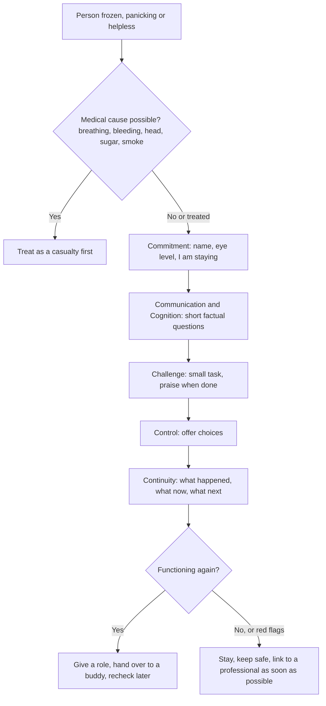

# 13.1 · Psychological first aid: the SIX Cs and Look-Listen-Link

By the end of this lesson you will be able to recognise acute stress reactions at a scene, bring a frozen or panicking person back to functioning within minutes using the Israeli SIX Cs model, support people over the following hours and days with the WHO Look-Listen-Link actions, and look after children, including those separated from their parents.

> [!CAUTION]
> Performing these procedures on people without the required state certification is illegal.
> This lesson is for educational purposes only. Practise only on models and animal tissue.

## Why it matters

At every mass-casualty scene there are more people who are frightened, frozen or panicking than there are injured. A person who stands frozen in the open during a rocket alarm, a mother who cannot stop screaming, a teenager hyperventilating in a safe room: each of them is in danger, slows everyone down, and can spread panic to a whole shelter. Your EMT course covered the injured. This lesson covers everyone else.

Two models matter in Israel:

- The **SIX Cs model**, developed by Moshe Farchi (Tel-Hai), was reported in 2017 to have been adopted by the Israeli Ministry of Health as the national model for psychological first aid. It is built for the **first minutes**: its aim is to move a person from helplessness and passivity to active, effective functioning. It is "cognitive-functional": it works by switching the thinking brain back on, not by talking about feelings.
- The **WHO Psychological First Aid (PFA)** guide for field workers (2011) is the international standard for the **hours and days** afterwards: Prepare, then **Look, Listen, Link**.

Most people recover from acute stress reactions by themselves with practical support, safety, information and people around them. Psychological first aid is not therapy and not a diagnosis. It is humane, practical help that does no harm. The evidence for both models is modest (small studies, simulations and case reports for the SIX Cs; expert consensus for WHO PFA), so treat them as structured common sense, not as a cure.

## What to do

### 1. Recognise the acute stress reaction, and rule out what imitates it

Acute stress reactions usually appear within minutes and fade over hours to days. Common forms:

| Reaction | What you see |
|---|---|
| **Freezing / helplessness** | Stands or sits motionless, does not respond, stares, does not take cover when told |
| **Panic / hyperarousal** | Fast breathing, tingling hands and lips, chest tightness, "I'm dying", trembling, running without purpose |
| **Agitation / anger** | Shouting, blaming, pushing, refusing help |
| **Dissociation / confusion** | "This isn't real", cannot remember what just happened, repeats the same question, flat and distant |
| **Regression** (especially children) | Clinging, crying like a much younger child, bedwetting, refusing to separate |
| **Body reactions** | Shaking, nausea, vomiting, diarrhoea, palpitations, exhaustion |

> [!WARNING]
> "Panic" is the last diagnosis, not the first. Before you treat a reaction as psychological, check for the medical causes that look exactly the same: **hypoxia** and chest injury (03.3), **shock** and hidden bleeding (04.1), **head injury** (05.2), **blast lung** (05.1), **low blood sugar**, **carbon monoxide or smoke** (06.5), **nerve agent** (06.3), intoxication or withdrawal (12.3). A casualty with a fast breathing rate after an explosion has blast lung until proven otherwise. Do a quick primary survey and a pulse oximetry reading if you have one.

**Red flags that need more than PFA:** a threat to harm self or others, confusion that does not improve, no response at all, psychosis (hearing or seeing things that are not there), or a person who cannot care for themselves or their children. Keep them safe, do not leave them alone, and link them to a physician or mental-health professional as soon as one can be reached.

### 2. The SIX Cs: the first minutes

The model's six components, as named by Farchi's centre (ICFR) and in the 2026 papers by Farchi and colleagues, are **Commitment, Communication, Cognition, Challenge, Control and Continuity**. Some earlier publications and the ASPR TRACIE listing combine the first two into "cognitive communication" and list five; the 2026 paper by Levy and Farchi states that Cognitive and Communication are analytically distinct components. You do not need to use them in a fixed order; most of them happen together in a few sentences.

**Commitment: "You are not alone."**

1. Go to the person, get to their eye level, say your name and that you are there to help.
2. Say you are staying: "I'm Dana. I'm with you. I'm not leaving you."
3. If you must leave, say when you will be back and hand over to someone by name. Then come back.

Loneliness feeds helplessness. A committed person beside them is often the single most effective intervention.

**Communication: short, clear, one thing at a time.**

1. Use the person's name. Speak calmly, a little slower than usual.
2. Short sentences. One question at a time. Yes/no questions when they are struggling ("Answer me with one word: yes or no").
3. Tell them what is happening and what you are doing. Do not argue with what they feel.

**Cognition: switch the thinking brain on.**

Ask factual questions that make them think, not questions about feelings:

- "What's your name? How old are you?"
- "How many people were with you in the car?"
- "Where is your phone? How much battery is left?"
- "What time did the siren go off?"

Thinking about facts, numbers and order activates the parts of the brain that the stress response shuts down. "How do you feel?" at this stage usually deepens the flood.

**Challenge: give a small task they can succeed at.**

1. Give a simple, real, achievable task: "Hold this torch for me." "Count how many people are in this room." "Press on this bandage." "Put your phone on silent."
2. When they do it, say so specifically: "Great, that's exactly right."
3. Build up to bigger tasks: fetching water, helping a child, guiding others to the shelter.

A person who is doing something is no longer helpless. This is the core of the model: the aim is activation.

**Control: give back choices.**

1. Offer small, real choices: "Do you want to sit here or by the wall?" "Shall I call your sister, or do you want to?"
2. Explain what will happen next so nothing comes as a surprise.
3. Let them decide what they can.

**Continuity: put the event in order.**

1. Help them build the sequence: what happened, what is happening now, what will happen next.
2. "The siren was ten minutes ago. Now we are in the shelter and the door is closed. When the all-clear comes, we will go up together and find your husband."
3. Fill gaps with facts you know. Do not invent facts you do not know.

A fragmented memory of chaos is part of what keeps the event "still happening" in a person's mind. A clear sequence with a "next" in it restores a sense of time and future.

**What not to say:** "Calm down." "I know exactly how you feel." "You're lucky, it could have been worse." "Everything will be fine" (when you do not know). Do not push them to tell the story in detail, and do not make promises you cannot keep.

### 3. WHO PFA: Prepare, Look, Listen, Link

Use this once the immediate danger has passed: in the shelter, at the casualty point, over the following days.

**Prepare (before you approach).** Learn what happened, what services exist (who is in charge, where water, food, a physician, the welfare office are), and the safety situation.

**Look.**

1. **Safety**: is it safe for you and for them to be here?
2. **People with obvious urgent basic needs**: injured, needing water, food, shelter, medication, clothing, a toilet, help with a disability.
3. **People with serious distress reactions**: the frozen, the very agitated, those who cannot care for themselves or their children.
4. **People who need special attention**: children (especially alone), pregnant women, the elderly, people with disabilities or chronic illness, people at risk of discrimination or violence.

**Listen.**

1. Approach respectfully, introduce yourself, ask if you can help.
2. Ask about **needs and concerns**: "What do you need right now? What worries you most?"
3. **Listen** without pressure. Do not press anyone to talk about what happened; let them say as much or as little as they want.
4. Help them feel calm (breathing, grounding, section 4).

**Link.**

1. Help them meet **basic needs** and reach **services** (water, food, a phone charger, medication, a physician).
2. Help them **cope with problems** themselves: break big problems into steps, identify who can help.
3. Give **accurate information**: what is known, what is not known, where and when updates will come.
4. **Connect** them with family, friends and their community.

PFA, as the WHO guide frames it, is not professional counselling, and it is not "psychological debriefing" (making people recount the event in detail). WHO's 2013 stress guidelines recommend that **benzodiazepines should not be offered** to reduce acute traumatic stress symptoms or sleep problems in the first month after a traumatic event.

### 4. Panic and hyperventilation

1. **Rule out medical causes** (section 1). In anyone with chest injury, asthma, diabetes, heart disease, or after blast, smoke or chemicals, treat the medical cause first.
2. Move them, if possible, to a quieter spot away from the crowd. Sit them down.
3. Tell them what is happening: "This is a panic reaction. It's frightening but it is not dangerous, and it will pass in a few minutes."
4. **Breathe with them** (course rule: count out loud, in through the nose for 4, out slowly through the mouth for 6). Do it yourself, visibly. Slow breathing out is what matters.
5. **Grounding** (5-4-3-2-1): ask them to name 5 things they see, 4 they can touch, 3 they hear, 2 they smell, 1 they taste. This is the Cognition component in action.
6. Give a task as soon as breathing slows (Challenge).

**Do not use a paper bag.** Re-breathing into a bag is no longer taught in first aid: it lowers oxygen, which is dangerous if the real cause is asthma, a lung injury, a heart problem or poisoning.

### 5. Children

Children react according to age: babies and toddlers cling, cry and stop sleeping; young children regress (bedwetting, baby talk), believe it was their fault, and replay the event in play; older children and teenagers may become withdrawn, angry, or take on adult roles. Most of these reactions are normal and fade with safety and routine.

1. **Keep children with their caregivers.** The best psychological first aid for a child is a calm parent. Support the parent so they can support the child.
2. **Unaccompanied children** (course rule built on the WHO guide's priority for them):
   - One named adult is responsible for each unaccompanied child or group of children, all the time.
   - Record each child's name, age, description, where and when found, and who brought them. Write the child's name and the CCP's name on a tape wristband (Improvise it).
   - **Never hand a child to an adult you cannot verify.** Release to family only after you check identity with the child's reaction, documents, or the authorities, and record who took the child.
   - Do not move the child further away unless safety requires it, so family can find them.
3. **Talk at their level**: kneel, use simple honest words. "Something very scary happened. You are safe here now. I am staying with you." Do not lie about deaths or injuries, but do not give gruesome details. If you do not know where their parents are, say so, and say what is being done to find them.
4. **Protect them from sights and sounds**: keep them away from the injured, the dead and the news.
5. **Give them a job and a routine**: drawing, handing out water, a game. Play is how children process events.
6. **Teenagers**: treat them as near-adults, give real responsibility, and watch for risk-taking.

The SIX Cs work with children too: the 2026 case report by Farchi and Shlezinger describes a social worker using all the components by phone to guide two children hiding during an attack (short instructions, a small task, a choice, "I am with you", and what will happen next).

### 6. A group in a shelter

1. **Information is the first intervention**: tell the group what you know at fixed times ("every 30 minutes I'll update you"), even when nothing has changed.
2. Identify the calm people and give them roles (Challenge for them too): water, children's corner, watching the door, listening to the radio.
3. Separate the most distressed person from the crowd gently, with one helper, so panic does not spread.
4. Create routines: meals, quiet time, lights out.

### Watch

The IFRC Reference Centre for Psychosocial Support (PS Centre) introduces the WHO action principles Look, Listen and Link:

https://www.youtube.com/watch?v=c0YzDVIt9yg

PFA e-Orientation walks through the same action principles in a short training unit:

https://www.youtube.com/watch?v=AwG-ONQjUQo

The British Red Cross shows first aid for a panic attack and hyperventilation:

https://www.youtube.com/watch?v=1UWa124NfCc

NATAL Israel (the Israel Trauma and Resiliency Center) explains the Six Cs model and grounding questions for calming people in shock during sirens, terror and war. The video is in Ukrainian; watch it for the demonstration and use the auto-translated captions:

https://www.youtube.com/watch?v=U4eRp8AzuTE

## Improvise it

Psychological first aid needs no equipment, but the setting matters. These are course suggestions built from the principles above.

| Need | Household version | What works | What fails / the risk | How to tell it is failing |
|---|---|---|---|---|
| **A quiet corner** | Blanket or sheet hung on a string or clothes rack; a car with the doors closed; a stairwell landing | Cuts noise and the sight of others panicking | A closed space that the person cannot leave increases panic; never hide a distressed person out of sight of helpers | The person tries to leave, or you cannot see them |
| **Earplugs and eye shade** | Foam earplugs; rolled tissue or cotton wool in the outer ear only; a folded T-shirt over the eyes | Lets people rest in a noisy shelter | Tissue pushed deep can stick in the canal (12.6); they must still hear alarms | Someone misses an instruction or alarm |
| **Children's corner** | Paper, crayons, a ball, cards, a phone with downloaded cartoons (save battery) | Play and routine calm children and free parents | Gruesome news on screens nearby; children unsupervised | Children re-enact the attack aggressively for hours, or wander |
| **Child ID wristband** | Duct tape or masking tape around the wrist or ankle: child's name, age, CCP name; or write in permanent marker on the child's arm as a backup | Prevents lost children and wrong handovers | Tape falls off when wet; writing on skin smudges; never write the child's home address where strangers can read it | Bands missing at the next check |
| **Reunification board** | Paper on a wall or door: "Looking for" and "We have here" columns, with names, ages, descriptions | Families find each other without crowding the treatment area | Wrong or duplicated names; personal details visible to everyone | Same person listed twice, or families crowd the casualty area |
| **Information board** | Paper and marker: time, what is known, next update time | Rumours drop when updates are regular | Out-of-date information is worse than none | The time on the board is more than an hour old |
| **Comfort** | Water, a sweet drink, a blanket, a phone charger shared from a power bank | Basic needs first is part of PFA | Sweet drinks for diabetics; giving food to someone who may need surgery | Vomiting, or a casualty with abdominal injury eating |

## When it goes wrong

| Problem | Why it happens | Recovery |
|---|---|---|
| "Panic" turned out to be blast lung, shock or head injury | Anchoring on the first impression | Re-examine anyone who does not settle within minutes; breathing rate, pulse, SpO2, pupils, blood sugar |
| The person gets worse when you ask what happened | Pushing for the story floods them | Switch to facts and tasks (Cognition, Challenge); let them talk only if they want to |
| Aggression | Fear, loss of control, alcohol | Keep a safe distance and an exit; one calm speaker; offer choices; never corner them; call for help early |
| Someone says they want to die | Acute despair | Ask directly whether they are thinking of killing themselves (asking does not plant the idea); do not leave them alone; remove means (medication, weapons) with help; link to a professional and ERAN 1201 (13.2) |
| A child is handed to the wrong adult | No verification in the chaos | One responsible adult per child, a written log, identity check before release |
| You promised "everyone is fine" and it was not true | Wanting to comfort | Correct it honestly as soon as possible; trust is the most important thing you have |
| You are overwhelmed yourself | You are human | Hand over, step out for 5 minutes, use the techniques in 13.2 |

## Scope and law

Psychological first aid is lay help that anyone may give and is part of the reasonable help the Duty to Rescue Law expects; it requires no licence. Diagnosing mental disorders and prescribing psychiatric drugs (including benzodiazepines) are physician powers. Respect privacy: what people tell you is not for the community's gossip or social media. The legal basis for lay aid and its limits are in [01.5 · The law and your scope in Israel](../module-01/lesson-05.md).

## Practice

**Role-play drill (45 minutes).** You need a partner (ideally two), a timer, this lesson, and the checklist below.

Your partner plays each person for 3-4 minutes; you respond. Then swap roles.

1. **Frozen in the open.** A woman stands still in the street during a rocket alarm, staring, not answering. You have 60 seconds to get her into the shelter.
2. **Hyperventilating teenager.** A 15-year-old in the safe room is breathing fast, says his hands are numb and he is dying. (Your partner decides privately whether he has asthma; you must ask.)
3. **Lost child.** A 6-year-old is alone at your casualty point, crying for her mother.
4. **Two days later.** An older man in the community shelter has not eaten, sits alone and says, "There's no point any more."

Checklist for the observer (tick each one you hear or see):

- [ ] Checked for a medical cause first (scenario 2 and 4)
- [ ] Commitment: name, eye level, "I'm staying"
- [ ] Communication: short sentences, one question at a time
- [ ] Cognition: factual questions, not "how do you feel"
- [ ] Challenge: a small task, and praise when done
- [ ] Control: at least one real choice
- [ ] Continuity: what happened, what now, what next
- [ ] Look-Listen-Link: asked about needs and linked to a service or person (scenario 3 and 4)
- [ ] Child: one responsible adult, written record, no release without verification (scenario 3)
- [ ] Asked directly about thoughts of suicide and did not leave him alone (scenario 4)
- [ ] Did not say "calm down", did not promise what you cannot know

How you know it worked: in scenario 1 your partner, playing honestly, starts moving within 60 seconds of your first sentence; in scenario 2 you asked about asthma and did not reach for a bag; the observer ticks at least 9 of the 11 items across the four scenarios; and you can name the six components from memory.

## Sources

- Farchi M, Levy T, Ben-Gershon B, Hirsch-Gornemann MIB, Gidron Y. The SIX Cs model for immediate cognitive psychological first aid: from helplessness to active efficient coping. *Int J Emerg Ment Health Hum Resil* 2018;20:1-12.
- Levy E, Farchi M. Proactive psychological first aid in mass-casualty recovery: a theory-driven case analysis of the SIX Cs model. *Front Psychol* 2026 (Cognitive and Communication as distinct components).
- Farchi MU, Shlezinger T. Case report: The SIX Cs model integrating empathy: a structured cognitive framework for psychological first aid during acute threat. *Front Psychol* 2026;17. doi 10.3389/fpsyg.2026.1700642.
- International Center for Functional Resilience. The Six Cs Model (the six principles: Communication, Commitment, Cognition, Continuity, Control, Challenge).
- Israel21c (2017). Israel's radical new approach to psychological first aid (Ministry of Health adoption as the national model).
- Effects of a psychological first aid based on the SIX Cs model on acute stress responses in a simulated emergency (University of Haifa; PubMed 39052417); Active versus comforting aid: the SIX Cs model, a retrospective study (*Prehosp Disaster Med* 2023).
- World Health Organization, War Trauma Foundation and World Vision International. *Psychological first aid: Guide for field workers*. WHO, 2011.
- World Health Organization. *Guidelines for the management of conditions specifically related to stress*, 2013 (no benzodiazepines in the first month).
