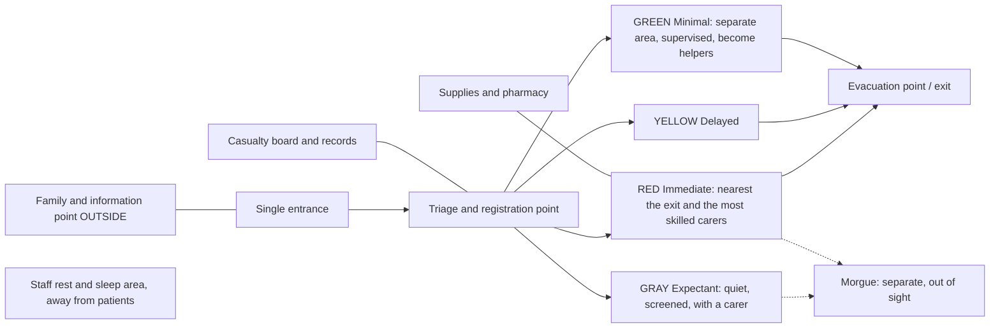
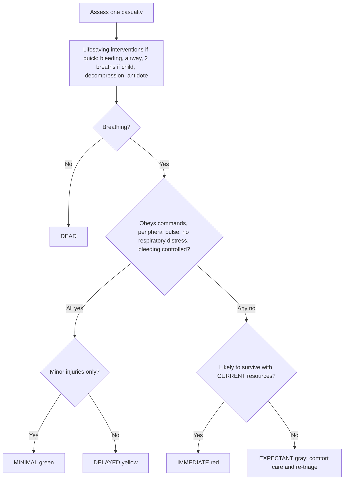

# 13.3 · Running a casualty collection point for days

By the end of this lesson you will be able to set up and run a casualty collection point (CCP) that has to hold casualties for days: choose and lay out the site, re-triage as patients and resources change, care for the expectant with dignity, ration supplies, put untrained helpers to work safely, keep records that survive shift changes, and write a shift plan.

> [!CAUTION]
> Performing these procedures on people without the required state certification is illegal.
> This lesson is for educational purposes only. Practise only on models and animal tissue.

## Why it matters

Your EMT course taught START triage and the first hour of a mass-casualty incident, when ambulances arrive and the scene empties. This lesson is about what happens when they do not arrive.

On 7 October improvised treatment stations were set up in a synagogue, a kibbutz safe room, a private house, a dental clinic and at roadside junctions; MDA stations treated and stabilised 306 casualties so that non-armoured ambulances could make fast runs to hospital (Jaffe et al., 2024). Those stations ran for hours to about a day. In a cut-off community, a collapsed neighbourhood or a besieged town, a CCP may have to run for days. Then the problems change:

- Patients **change**: the walking wounded with blast injury develop blast lung, the crush casualty's kidneys fail, wounds get infected. A triage tag from hour 1 is wrong by hour 12.
- **Resources change**: supplies run down, a telemedicine link opens, a helicopter is promised for tomorrow. Who is "expectant" depends on what you have.
- **People wear out**: you need shifts, helpers and records, or the operation collapses on day 2.

## What to do

### 1. Choose the site

Pick it in advance for your community if you can (TCCC's triage supplement advises pre-identifying CCP locations and procedures). Check, in this order:

1. **Safe from the threat** (06.1): protected from fire, fragments and collapse; out of the line of attack; with a protected space for rocket alarms. In Israel a large protected space (shelter, underground car park, reinforced school wing) is ideal.
2. **Access**: a route for stretchers in, and a separate route out to the evacuation point (vehicle access, helicopter landing area).
3. **Space**: about 2 m × 1 m per lying patient plus a 1 m walkway on one side (course rule), with room to expand.
4. **Water, toilets, light, power**, ventilation, and heating or cooling.
5. **A separate room or structure for the dead** that patients and families do not pass through (13.4).

### 2. Lay it out



Rules for the layout (course rules built from standard CCP practice):

- **One-way flow**: one way in through triage, one way out to evacuation. Nobody enters the treatment area without passing the registration point.
- **Red** is closest to the exit and to the supply point, and gets your most skilled carers.
- **Green** is separate, so the walking wounded do not crowd the treatment area, but someone checks them on schedule; many become helpers.
- **Expectant** is a real place: quiet, screened from the others, with light, blankets and a named carer. It is not the corridor.
- **The morgue** is separate from everything else (13.4).
- **Families and information** stay outside the treatment area, at a point with a board and a liaison person (13.1).
- **Staff rest** is out of earshot of patients (13.2).
- **Hygiene**: hand-washing station at the entrance and at each area; sharps bottles; separate rubbish for bloody waste; toilets and latrines as in 11.6.

### 3. Triage: SALT, and why the expectant category matters

You know START and JumpSTART from your EMT course. **SALT** (Sort, Assess, Lifesaving interventions, Treatment/transport) was proposed in 2008 by a CDC-sponsored panel as a US national standard and meets the Model Uniform Core Criteria (MUCC). It is worth knowing because it names the **expectant** category explicitly and builds the question of resources into the algorithm.

**Sort (global):** call out "Everyone who can walk, go to (place)". Assess first those who are **still or have an obvious life threat**, then those who **wave or move purposefully**, then the walkers.

**Assess individuals:**

1. **Lifesaving interventions**, only if they are quick and within your skill and equipment: control major haemorrhage, open the airway (consider **2 rescue breaths in a child**), chest decompression, autoinjector antidotes.
2. **Not breathing** after the airway is opened (and rescue breaths in a child): **Dead**.
3. Ask four questions:
   - Obeys commands or makes purposeful movements?
   - Has a peripheral pulse?
   - Not in respiratory distress?
   - Major haemorrhage controlled?
4. **All four yes**: minor injuries only means **Minimal (green)**; otherwise **Delayed (yellow)**.
5. **Any one no**: likely to survive given the **current resources** means **Immediate (red)**; not likely to survive given current resources means **Expectant (gray)**.



SALT's two judgement questions ("minor injuries only?" and "likely to survive?") make it less reproducible between raters than START in some studies; that is the price of taking resources into account. Write your reasoning down.

### 4. Re-triage over time

Triage is dynamic: the MUCC criteria require triage to reflect the patient's condition and the resources available at the time, and TCCC's triage supplement says to reassess and communicate categories during all phases of care. Course rules for a CCP that runs for days:

| Category | Routine reassessment | What you check |
|---|---|---|
| **Red** | Every 15 minutes until stable, then hourly | Full vital-sign set on the flowsheet (07.2), tourniquet and dressings, pain, urine |
| **Yellow** | Every hour | Vitals, wounds, pain, fluids in and out |
| **Green** | Every 4 hours, and whenever they report a change | Breathing rate and effort (blast lung, 05.1), dark urine (crush, 08.1), wound infection (08.5), mental state |
| **Expectant** | At least every 1-2 hours | Comfort, pain, breathing, and **whether they still belong in this category** |
| **Everyone** | At every shift change, and every time resources change | A full re-triage round, recorded on the board |

**Re-triage at once when:**

- a patient's trend crosses a threshold (shock index rising, SpO2 falling, new confusion, urine stopping);
- resources change: supplies arrive or run out, a telemedicine physician becomes available, an evacuation slot is confirmed;
- evacuation comes: re-sort by **evacuation priority**, not by the treatment category. TCCC's supplement uses **urgent** (needs surgery or advanced care now), **priority** (needs it, but can wait somewhat; includes threats to a limb or eyesight) and **routine** (minimal injury, or expectant).

Up-triage and down-triage are both normal. A green blast casualty who becomes breathless is now red. An expectant casualty who is still alive at 24 hours, when an evacuation slot appears, may be the right person to send.

### 5. Expectant care: ethics and comfort

The expectant category exists because, when resources are overwhelmed, spending them on one casualty who will almost certainly die can cost several who would live. The US Institute of Medicine's framework for **crisis standards of care** (2012) describes this shift from the usual standard (everything for each patient) to doing the greatest good for the greatest number when resources are overwhelmed. TCCC's triage supplement treats expectant casualty care as a legitimate category that emphasises **comfort and re-triage over time**, and describes its most extreme mass-casualty class as one where resources are insufficient for treatment or evacuation, so survival and palliative care dominate.

**Course rules for deciding:**

1. Expectant is a statement about **resources**, not about the person's worth. Typical examples: very large burns with no way to resuscitate or evacuate (05.4), unsurvivable head injury with no airway support, traumatic arrest in mass casualties.
2. Decided by the **most experienced person available, with a second person** agreeing, and with a physician by phone when one can be reached (07.7).
3. **Written** on the card, the board and the decision log, with the time and the reason (13.2).
4. **Reviewed** at every re-triage round and every change in resources.
5. Never decided on age, nationality, religion, disability or who the person is.

**Comfort care, step by step:**

1. Move them to the expectant area: quiet, screened, warm.
2. **Pain relief is treatment, not giving up.** Use the analgesia you have, by the routes in lessons 04.5 and 07.6. The JTS prolonged-care analgesia guideline says that when a casualty is dying, opioids and sedatives are indicated for comfort even if they worsen vital signs, after a telemedicine consult where possible.
3. Position for comfort and breathing, usually sitting up or on the side; pad pressure points (07.4).
4. Mouth care: moisten lips and mouth; small sips of water if they can swallow safely.
5. **Company**: one helper sits with them, holds a hand, talks. If family is present and wants to be there, let them. Offer a religious figure if the person or family wants one.
6. Keep them clean and covered; keep their belongings with them.
7. Tell the truth gently if they ask. Never tell them they will be fine if you do not believe it.

**Comfort drug options (doses from lessons 04.5 and 07.6, prescription drugs: physician direction whenever it can be reached):**

| Drug | Route | Adult dose | Child dose | Repeat | Max | Notes |
|---|---|---|---|---|---|---|
| Acetaminophen | PO | 1000 mg | 15 mg/kg | Every 6 h | Adult 4 g/day; child 60 mg/kg/day (MSF) | Background pain |
| Morphine | PO (immediate release) | 10 mg | 0.15 mg/kg (over 6 months) | Every 4 h | Titrate to comfort | Halve in the elderly and in kidney or liver failure |
| Morphine | IV | 2.5 mg steps every 5 min to effect (usual 5 mg) | 0.05 mg/kg every 10 min, to 0.1 mg/kg (over 6 months) | Every 1-6 h | Titrate to comfort | Also eases breathlessness |
| Morphine | SC/IM | 0.1-0.2 mg/kg | 0.1-0.2 mg/kg (over 6 months) | Every 4 h | Titrate | SC is gentler for repeated doses than IM |
| Ketamine | IN | 50 mg (100 mg/ml) | 1 mg/kg, max 50 mg | Every 30 min as needed | | When no opioid is available |
| Ketamine | IM | 100 mg (TCCC) | 0.2-0.5 mg/kg | Every 30 min as needed | | Can cause agitation and drooling |
| Ondansetron | PO/IV/IM | 4 mg | 0.15 mg/kg, max 4 mg per dose | Every 8 h | Adult 8 mg in 8 h | Nausea from opioids |

### 6. Rationing resources

1. **Inventory at the start**: count everything (tourniquets, haemostatic gauze, dressings, fluids, ORS, analgesics, antibiotics, oxygen, gloves, batteries, water, food). Put the counts on a board.
2. **Burn rate**: at each shift change, count again; work out how much was used per 12 hours and how many hours each item will last.
3. **Trigger rules agreed in advance** (course rules; adapt to your stock):
   - At **50%** of any critical item: only the leader releases it; switch to substitutes where possible (oral fluids and ORS instead of IV fluid for those who can drink, 11.2; oral analgesia instead of injections; irrigation with boiled water, 08.6).
   - At **25%**: keep a reserve for new arrivals with immediately survivable injuries (a tourniquet and gauze for the next bleeding casualty); review every patient's use.
   - **Oxygen**: only for those who need it by the criteria in 03.7, at the lowest flow that holds the target.
4. **Reprocess what can be reprocessed** (instruments boiled 20 minutes or chlorine-soaked, 03.4); never reuse needles, catheters or decompression needles.
5. **One person controls the pharmacy**, with a written log of every controlled drug given (who, what, dose, time, by whom).
6. **Do not hoard for someone who is not there**, and do not starve the present to save for a future that may never come; the reserve is a fixed, small amount.

### 7. Untrained helpers

Every CCP that lasts more than a few hours runs on volunteers. Give each one **a role, a briefing card and a supervisor**. Green casualties who are able often want to help; let them.

| Role | Does | Does not |
|---|---|---|
| **Patient sitter** | Stays with 2-4 patients, talks to them, gives water as allowed, calls a carer at once for any change on the card | Give drugs, remove dressings or tourniquets |
| **Scribe** | Writes vitals and events on cards and the board, keeps the master log | Decide treatment |
| **Runner** | Carries messages, supplies, water | Leave without telling the leader |
| **Stretcher team** (4 people) | Moves patients on the leader's instruction (06.2) | Move anyone without a carer saying so |
| **Supply keeper** | Counts, issues and logs supplies | Release critical items at trigger levels without the leader |
| **Hygiene** | Hand-washing water, rubbish, sharps bottles, toilets, cleaning | Handle sharps with bare hands |
| **Family liaison** | Information point, missing persons list, reunification board (13.1) | Announce deaths or identifications (13.4) |
| **Child minder** | Children's corner, unaccompanied children register (13.1) | Release a child without verification |
| **Security / door** | One entrance, keeps crowds and cameras out | Use force unless there is danger |
| **Morgue team** (2 people) | Respectful care of the dead (13.4) | Work alone or without rotation |

**Helper briefing card** (one per role, on an index card; template):

```text
ROLE: Patient sitter                SUPERVISOR: ________ (red vest)
YOU LOOK AFTER: beds ___ to ___     SHIFT: ___:___ to ___:___
DO: stay with your patients; talk to them; sips of water only if
    the card says "may drink"; write the time when they pass urine.
CALL A CARER AT ONCE IF: breathing changes or is noisy; confused or
    hard to wake; new bleeding; skin pale/grey/sweaty; severe pain;
    they ask for help; anything worries you.
NEVER: give drugs; loosen a tourniquet or bandage; move a patient.
IF THE ALARM SOUNDS: ________________________________
HAND OVER to the next sitter: names, what changed, what is due.
```

### 8. Records

1. **Casualty card on every patient** (01.7), with a unique number that never changes and is never reused.
2. **Flowsheet** for every red and yellow patient (07.2).
3. **Master log** (one book): number, name (or description), sex, approximate age, arrival time, where from, triage category with each change and time, location in the CCP, key treatments, outcome (evacuated where and when, died, discharged), and who it was handed to.
4. **Casualty board on the wall** (Improvise it): one row per patient with number, name, category (colour), location, key problem, last check time, next check due, evacuation priority. It is the CCP's shared brain.
5. **Missing persons and families list** at the information point, kept apart from the medical board.
6. **Decision log** kept by the leader (13.2).
7. **Deaths**: a separate deaths register linked to the body's unique code (13.4).

Protect privacy: the board is inside the treatment area, not facing the families' point or the street.

### 9. Shifts and handover

Course rules (built on 13.2):

- **Two 12-hour shifts** (for example 07:00-19:00 and 19:00-07:00), or three 8-hour shifts if you have enough people. Nobody works two shifts in a row.
- **30 minutes of overlap** for handover; the outgoing leader hands over at the board, bed by bed, in a fixed order: number, name, category, problem, what was done, trend, what is due, worries.
- **Stagger** the leader's shift change from the team's (for example leaders change at 08:00 and 20:00, carers at 07:00 and 19:00), so there is always someone who knows the last hour.
- **Every shift has**: a CCP leader, a triage/re-triage carer, carers for red and yellow, a sitter for expectant, sitters, a scribe, a supply keeper, a door/security person, and a hygiene person. Names go on the board.
- **Breaks** of 15-30 minutes every 4 hours, and food every 4-6 hours.
- **Full re-triage round** at every shift change.

The full shift-plan template is in the module practical (13.4).

### Watch

SkinnyMedic explains SALT triage step by step:

https://www.youtube.com/watch?v=SKE7kbbsoaE

St. Joseph County EMS gives a SALT triage overview from a county EMS service:

https://www.youtube.com/watch?v=XXBmO13_io0

EMS1 shows how to use SALT to triage mass-casualty patients:

https://www.youtube.com/watch?v=nqwEdXoYO3w

TACMED Academy demonstrates setting up a casualty collection point in the warm zone:

https://www.youtube.com/watch?v=AHJS-K8YJTs

The Prolonged Field Care Collective podcast discusses expectant patients and palliative care in austere settings (audio):

https://www.youtube.com/watch?v=a1b_AaMHrJs

## Improvise it

| Need | Household version | What works | What fails / the risk | How to tell it is failing |
|---|---|---|---|---|
| **Triage tags** | Coloured electrical or duct tape (red, yellow, green; gray or white tape with a big "E" for expectant; black for dead), or strips of coloured cloth. Wrap around the wrist or ankle, not clothing. Write the patient number and the time on the tape. If you have no colours, write a big letter: **I** (immediate), **D** (delayed), **M** (minimal), **E** (expectant) | Visible from across the room; changes are easy (new tape over old, with the time) | Tape on clothing is lost when clothes are cut off; colours fade in poor light; old and new tape confused | Two colours on one patient, or a patient with no tag at the next round |
| **Casualty board** | Paper sheets taped to a wall; a whiteboard; a window or glass door with a whiteboard marker; masking-tape grid on a door, written with a marker | Everyone sees the whole picture; survives shift change | Rain, smudging, a wall the families can read; erased by mistake | The board time stamps are hours old, or it does not match the beds |
| **Bed numbers** | Masking tape on the floor or wall at each space with a big number | Stops "the man by the window" confusion | Moving a patient without moving the record | A number on the board with nobody in that space |
| **Stretchers off the floor** | Doors or boards on chairs, crates or tables; mattresses on pallets | Easier care, less back strain, keeps patients out of spilled fluids | Unstable supports; falls | Wobbling, or patients rolling |
| **Partitions** | Sheets or blankets on string, clothes racks, bookshelves | Privacy for toileting, expectant area, exams | Blocks the view of patients from the carers | You cannot see a red patient from the carers' position |
| **Light** | Headlamps, LED camping lights, car batteries with 12 V lamps, phone torches on a power bank | Night care | Candles and gas lamps in an enclosed room (fire, carbon monoxide, 06.5) | Smell of fumes, headaches in staff |
| **Signals** | Whistle (alarm), bell or a pot and spoon (carer needed), coloured cloth on a stick at the entrance (CCP open) | Works when phones fail | Too many signals nobody remembers | People ask "what was that?" |
| **Clock** | One wall clock or a phone fixed to the wall, the reference for all times | Consistent times on all records | Every helper using their own phone time | Times out of order in the log |
| **Briefing cards** | Index cards, paper in a plastic sleeve or zip bag | Clear roles for untrained helpers | Too much text; not given to new helpers | A helper does something on the "never" list |
| **IV pole** | Coat hanger on a curtain rail, broom handle taped to a chair, a hook in the wall | Gravity for drips (07.5) | Falls and pulls the line | Bag lower than it should be; flow stops |

## When it goes wrong

| Problem | What happens | Recovery |
|---|---|---|
| **Over-triage**: everyone is red | Carers spread thin; the truly critical get less | Re-triage with SALT criteria; red means "any one of the four questions is no" |
| **Forgotten greens** | Blast lung, crush kidney failure or infection develops unseen | Scheduled checks on the board; sitters with briefing cards |
| **Expectant never re-triaged** | Someone who could now be saved dies; moral injury for the team | Re-triage at every shift and every change in resources; write it on the board |
| **Expectant area becomes a corridor** | Patients die alone and in pain | Named sitter; analgesia scheduled; check every 1-2 hours |
| **Supplies vanish** | Everyone takes "just in case" | One supply keeper, log, trigger rules |
| **Records lost or duplicated** | Two patients with the same name; numbers reused | Unique numbers never reused; master log; descriptions as well as names |
| **Families flood in** | Crowding, privacy breaches, rumours | Information point outside, liaison person, regular updates, door control |
| **Leader burnout** | Decisions stall on day 2 | Shift plan with a named deputy who can order rest (13.2) |
| **Authorities arrive** | Confusion about who is in charge | Hand over at the board using the master log; you now work under them |

## Scope and law

Triage and organising a casualty point are part of mass-casualty first aid and do not require a licence, but treatment decisions within it stay within each person's scope: prescription drugs, IV and IO fluids and invasive procedures remain paramedic and physician powers. Placing someone in the expectant category and withholding treatment because of scarce resources are grave decisions with legal and ethical exposure: make them only when resources are truly overwhelmed, with two people and a physician by phone when one can be reached, and write down the reason. When MDA, the Home Front Command, the police or the IDF take over, hand over and follow their command. The legal basis is in [01.5 · The law and your scope in Israel](../module-01/lesson-05.md).

## Practice

**Part A: site and layout (30 minutes).** Choose a real building in your community that could be a CCP (community hall, synagogue, school, underground car park). Walk it or use a floor plan. Draw:

1. Entrance and triage point; exit and evacuation point; protected space for alarms.
2. Red, yellow, green and expectant areas with numbered spaces (about 2 m × 1 m each plus walkway).
3. Supply point, casualty board, staff rest area, hand washing, toilets, family point outside, and a separate morgue.

**Part B: re-triage drill (45 minutes).** You need 10 index cards and a partner who reads updates from a list they write in advance. Write 10 casualties from a rocket strike on a crowded street (mixture of bleeding, burns, blast, fractures, a child, an elderly diabetic, one 80% burn, one walking blast victim). Triage each with SALT, put them on a paper board, then your partner reads timed updates:

- Hour 2: the walking blast victim is short of breath (SpO2 89%).
- Hour 4: half of your haemostatic gauze and all IV fluid are gone.
- Hour 6: a physician is available by phone.
- Hour 12: shift change.
- Hour 20: the 80% burn casualty is still alive; a helicopter can take two patients in 1 hour.

At each update, re-triage on the board, write the time, and say aloud what you do and why.

How you know it worked: your layout has one-way flow and a separate morgue and expectant area, with nothing passing through red to reach them; every update produced at least one category change on the board with a time; the walking blast victim became red at hour 2; you invoked your 50% trigger rule at hour 4; and at hour 20 you chose the two evacuees by evacuation priority and can explain why.

## Sources

- Lerner EB, Schwartz RB, Coule PL, et al. Mass casualty triage: an evaluation of the data and development of a proposed national guideline. *Disaster Med Public Health Prep* 2008;2(Suppl 1):S25-S34 (SALT).
- Model Uniform Core Criteria for Mass Casualty Triage (MUCC) and addendum, US NHTSA Office of EMS (triage is dynamic and reflects available resources).
- Committee on Tactical Combat Casualty Care. *Supplement A (Triage in TCCC) to the TCCC Guidelines*: urgent, priority and routine categories; expectant casualty care; MASCAL classes; pre-identified CCPs.
- Jaffe E, Dadon Z, Alpert EA. Prehospital care under fire: strategies for evacuating victims from the mega terrorist attack in Israel on October 7, 2023. *Prehosp Disaster Med* 2024;39(3).
- Institute of Medicine. *Crisis Standards of Care: A Systems Framework for Catastrophic Disaster Response*. National Academies Press, 2012.
- Joint Trauma System. *Analgesia and Sedation Management during Prolonged Field Care* (CPG ID 61), 2017: end-of-life (expectant) care; doses as in lessons 04.5 and 07.6.
- WikEM. Mass casualty incident triage (SALT, START, JumpSTART summary), checked 2026-11-14.
